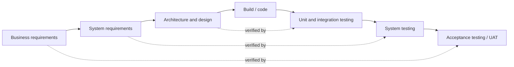
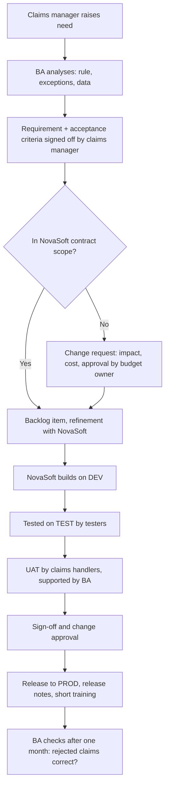

## Why this matters
Business analytik pracuje uvnitř dodávkového procesu: někdo rozhodne, co se postaví, někdo to postaví, někdo to otestuje, někdo to nasadí do produkce. Když neznáš fáze, role a pravidla smlouvy s dodavatelem, nebudeš vědět, kdy je potřeba tvůj vstup, ani proč najednou „malá změna“ stojí peníze. Cílový inzerát chce spolupráci s dodavateli, testování dodávek a reporting stavu; to všechno předpokládá, že rozumíš tomu, jak dodávka funguje.

## Quick version
**SDLC** (software development life cycle, životní cyklus vývoje softwaru) je obecná posloupnost, kterou prochází každá IT změna: nápad a analýza → požadavky → návrh → vývoj → testování → nasazení → provoz a údržba. Každá metoda tyto činnosti zachovává; liší se v tom, jak jsou seřazené a jak často se opakují.

**Waterfall** (vodopád) prochází fáze jednu po druhé. Požadavky se na začátku dohodnou a schválí (sign-off), pak přijde návrh, pak vývoj, pak testování. Hodí se pro pevný rozsah, smlouvy s pevnou cenou a silnou regulaci, ale změny pozdě v projektu jsou drahé. **V-model** je varianta vodopádu, která ke každé úrovni specifikace přiřazuje úroveň testování: business požadavky k akceptačnímu testování, systémové požadavky k systémovému testování, návrh k integračnímu testování, kód k unit testování.

**Agile** (agilní přístup) dodává v krátkých cyklech a průběžně se přizpůsobuje tomu, co se tým dozví. **Scrum** (definovaný ve Scrum Guide 2020) je nejběžnější agilní framework:
- **Scrum Team**: jeden Product Owner, jeden Scrum Master a Developers (všichni, kdo staví increment, včetně testerů a často i BA).
- **Events** (události): Sprint (pevná délka, nejvýš jeden měsíc), Sprint Planning, Daily Scrum (15 minut), Sprint Review, Sprint Retrospective.
- **Artifacts** (artefakty): Product Backlog (s Product Goal), Sprint Backlog (se Sprint Goal), Increment (splňuje Definition of Done).

**Kanban** nemá sprinty. Práce teče sloupci na tabuli (například To do → Analysis → Development → Test → Done) s limity, kolik práce smí být v každém sloupci najednou.

**Hybridní realita:** banky a pojišťovny málokdy jedou čistý Scrum. Obvykle se rozpočet a smlouva plánují vodopádově (roční rozpočet, smlouva s pevnou cenou nebo rámcová smlouva s dodavatelem), zatímco tým staví ve sprintech. Nasazení do produkce může pořád probíhat jen několikrát ročně, s formálním UAT a schvalováním změn.

**Práce s dodavateli.** Mnoho pojišťoven kupuje systémy a vývoj od externích firem. Klíčové pojmy:
- **RFI / RFP / RFQ**: žádosti o informace, o nabídku řešení nebo o cenovou nabídku, posílané potenciálním dodavatelům.
- Smlouva s **fixed price** (pevnou cenou): dohodnutý rozsah za dohodnuté peníze. Každá změna rozsahu potřebuje **change request (CR)** (změnový požadavek).
- **Time and materials (T&M)**: platíš za odpracované hodiny. Pružné, ale riziko růstu nákladů nese klient.
- **SLA** (service level agreement, dohoda o úrovni služeb): měřitelné sliby ohledně služby, například doba reakce na incident.
- **Acceptance / sign-off** (převzetí / formální schválení): formální potvrzení, že dodávka splňuje požadavky. Po sign-offu se defekty obvykle řeší v rámci záruky nebo podpory, ne jako součást původní dodávky.

**Prostředí (environments):** DEV (vývojáři staví), TEST (testeři testují), UAT (business uživatelé přebírají), PROD (skuteční uživatelé, skutečná data). Kód se posouvá zleva doprava; každý krok má své kontroly.

**BA v každé fázi:** analýza a požadavky (hlavní práce), návrh (revize, odpovědi na otázky), vývoj (vyjasňování), testování (dodává akceptační kritéria, podporuje testery a UAT), nasazení (release notes, školení), provoz (vyhodnocení, sběr nových potřeb).

## Deep dive

### SDLC: co obsahuje každá dodávka [P1]
Ať je metoda jakákoli, někdo musí zhruba v tomto pořadí odpovědět na tyto otázky:

1. **Initiation** (zahájení) — Existuje potřeba, kterou stojí za to řešit? Kdo ji sponzoruje? (Business case, popis problému.)
2. **Analysis and requirements** (analýza a požadavky) — Co přesně musí řešení dělat? (Požadavky, modely procesů, user stories.)
3. **Design** (návrh) — Jak to řešení udělá? (Architektura, datový model, obrazovky, rozhraní.)
4. **Build** (vývoj) — Vývojáři píšou kód nebo konfigurují platformu.
5. **Test** (testování) — Funguje to podle specifikace? Funguje to pro uživatele? (Unit, integrační, systémové, akceptační testování.)
6. **Deployment (release)** (nasazení) — Přesun změny do produkce.
7. **Operation and maintenance** (provoz a údržba) — Běh systému, oprava incidentů, drobná zlepšení.

Užitečný mentální model: metody (waterfall, Scrum, Kanban) jsou různé *rozvrhy* pro stejné činnosti. Ve vodopádu proběhne krok 2 jednou za celý projekt. Ve Scrumu proběhnou kroky 2–5 každý sprint pro malý kousek.

### Waterfall a V-model [P1]
**Waterfall** funguje dobře, když jsou požadavky stabilní a dobře pochopené, když regulátor nebo smlouva vyžaduje kompletní dokumentaci předem, nebo když práce zahrnuje hardware či fyzickou instalaci.

Jeho slabá místa:
- Uživatelé vidí řešení pozdě, často až v UAT. Nedorozumění se objeví měsíce po tom, co byl požadavek napsán.
- Změna pozdě v projektu je drahá, protože návrh a vývoj už proběhly.
- Testování se zkracuje, když předchozí fáze přetáhnou.

**V-model** dělá testování viditelným. Každá úroveň specifikace na levé straně má odpovídající úroveň testování na pravé straně.

Pro BA je poselství jednoduché: požadavky, které napíšeš, se stávají základem akceptačního testování. Když požadavek nejde otestovat, UAT ho nemůže potvrdit.

### Agile a Scrum (Scrum Guide 2020) [P1]
**Agile** je soubor hodnot a principů (Agile Manifesto, 2001), které upřednostňují fungující software, spolupráci a reakci na změnu před těžkými plány a dokumenty. Neznamená to „žádná dokumentace“ ani „žádný plán“.

**Scrum** je odlehčený framework. Scrum Guide 2020 je krátký a volně dostupný na [scrumguides.org](https://scrumguides.org/scrum-guide.html); přečti si ho jednou celý. Klíčové prvky:

**Scrum Team.** Malý, typicky 10 nebo méně lidí, cross-functional (všechny potřebné dovednosti uvnitř týmu) a self-managing (sám si řídí práci). Tři accountabilities (odpovědnosti):

| Accountability | Za co odpovídá |
|---|---|
| Product Owner | Maximalizace hodnoty produktu; správa Product Backlogu (definice a komunikace Product Goal, tvorba a řazení položek backlogu, jejich transparentnost). Jeden člověk, ne výbor. |
| Scrum Master | Efektivita Scrum Teamu; pomáhá všem pochopit teorii a praxi Scrumu; odstraňování překážek (impediments). |
| Developers | Vytvoření použitelného Incrementu v každém Sprintu; Sprint Backlog; kvalita díky Definition of Done. „Developers“ znamená všechny, kdo na práci dělají, ne jen programátory. |

Poznámka: Scrum Guide nezná roli „business analyst“. V praxi je BA buď jedním z Developers (dělá analytickou práci), podporuje Product Ownera, nebo jako Product Owner působí.

**Events.** Všechny události probíhají uvnitř Sprintu.

| Událost | Účel | Timebox (pro měsíční Sprint) |
|---|---|---|
| Sprint | Kontejner pro veškerou práci; pevná délka nejvýš jeden měsíc | — |
| Sprint Planning | Rozhodnout, proč je Sprint hodnotný (Sprint Goal), co se dá udělat a jak | Max. 8 hodin, u kratších Sprintů méně |
| Daily Scrum | Developers kontrolují postup k Sprint Goal a upravují plán | 15 minut |
| Sprint Review | Prohlédnout výsledek se stakeholdery a rozhodnout o dalších úpravách | Max. 4 hodiny |
| Sprint Retrospective | Naplánovat, jak zlepšit kvalitu a efektivitu | Max. 3 hodiny |

**Backlog refinement** (zpřesňování backlogu) není ve Scrum Guide formální událost. Je to průběžná činnost rozkládání a vyjasňování položek backlogu. Pro BA je to často nejdůležitější schůzka týdne.

**Artefakty a commitments (závazky).** Každý artefakt má závazek, díky kterému je pokrok měřitelný:

| Artefakt | Commitment |
|---|---|
| Product Backlog — seřazený seznam všeho, co je potřeba ke zlepšení produktu | Product Goal |
| Sprint Backlog — Sprint Goal, vybrané položky a plán, jak je dodat | Sprint Goal |
| Increment — použitelný krok k Product Goal | Definition of Done |

**Definition of Done** (definice hotového) je sdílený popis kvality, kterou increment musí splnit, například „kód prošel revizí, testy prošly, nasazeno na TEST, release notes aktualizované“. Co ji nesplňuje, není hotové a nesmí se na Sprint Review prezentovat jako hotové.

### Kanban [P2]
Kanban pochází z výroby. V IT znamená:
- **Vizualizovat práci** na tabuli se sloupcem pro každou fázi.
- **Omezit rozpracovanou práci (WIP, work in progress)**: například nejvýš tři položky v „Analysis“. Když je sloupec plný, něco dokončíš, než začneš něco nového.
- **Řídit tok**: měřit, jak dlouho položky trvají od začátku do konce (cycle time, doba průběhu), a odstraňovat úzká hrdla.

Kanban se hodí na práci, která přichází průběžně a nepředvídatelně: požadavky na podporu, drobné změny, BA tým vyřizující požadavky mnoha oddělení. IT podpora ClaimDesku v ExportShield by mohla jet v Kanbanu, zatímco větší projekt automatizace škod běží ve Scrumu.

### Hybridní realita v bankách a pojišťovnách [P1]
Čisté učebnicové metody jsou v regulovaných organizacích vzácné. Typické vzorce:

- **Water-Scrum-Fall.** Zahájení a schválení rozpočtu jsou vodopádové (business case, řídicí výbor). Vývoj probíhá ve sprintech. Nasazení do produkce je opět podobné vodopádu: formální UAT, change advisory board, release okno.
- **Smlouvy s pevnou cenou a agilní týmy.** Dodavatel pracuje ve sprintech, ale smlouva fixuje rozsah a cenu. Každá nová položka backlogu může být change request.
- **Release trains.** Několik týmů nasazuje společně, například jednou za měsíc nebo za čtvrtletí, protože systémy na sobě závisí.
- **Regulatorní brány (gates).** Bezpečnostní revize, posouzení ochrany dat, schválení operačního rizika. Přidávají kroky, o kterých agilní knihy nemluví.

Jako BA se ptej brzy: Jaké brány existují? Kdo co podepisuje? Kdy jsou release okna? Story, která je ve sprintu „hotová“, může na produkci čekat ještě dva měsíce.

### Práce s externími dodavateli [P1]
V ExportShield vyvíjí PolicyHub externí dodavatel NovaSoft s.r.o. To je běžné: mnoho pojišťoven vlastní business proces a data, ale ne kód.

**Výběr dodavatele (zhruba).**
- **RFI (request for information)** — „Řekněte nám o svém produktu a schopnostech.“ Slouží k sestavení užšího výběru.
- **RFP (request for proposal)** — „Tady jsou naše požadavky; navrhněte řešení, přístup, tým a cenu.“ BA často píše nebo doplňuje část s požadavky.
- **RFQ (request for quotation)** — „Tady je přesně, co chceme; dejte nám cenu.“ Používá se, když je řešení už jasné.

Odpovědi se porovnávají podle dohodnutých kritérií (funkční shoda, cena, reference, bezpečnost, podpora). Formální proces vede nákup a právní oddělení; BA přináší požadavky a pomáhá s hodnocením.

**Typy smluv.**

| | Fixed price | Time and materials (T&M) |
|---|---|---|
| Co se dohodne | Rozsah, cena, termín | Sazba za den/hodinu, tým, někdy strop |
| Kdo nese riziko růstu nákladů | Hlavně dodavatel | Hlavně klient |
| Pružnost při změně rozsahu | Nízká; změny potřebují CR | Vysoká |
| Co musí BA dělat dobře | Přesné, úplné požadavky předem | Jasné priority a backlog; hlídat tempo čerpání (burn rate) |
| Typické použití | Dobře definované dodávky, regulatorní změny | Průběžný vývoj, agilní týmy |

Mnoho skutečných smluv je smíšených: rámcová smlouva s denními sazbami a objednávky s pevnou cenou na konkrétní dodávky.

**Proč na change requestech záleží.** **Change request (CR)** je formální žádost o změnu dohodnutého rozsahu, harmonogramu nebo ceny. U smlouvy s pevnou cenou je změnou cokoli, co není v dohodnuté specifikaci. Bez procesu CR:
- dodavatel může postavit něco navíc zadarmo a pak šetřit jinde, nebo
- dodavatel může odmítnout a business obviní IT, nebo
- náklady tiše rostou a nikdo je neschválil.

Dobrý CR uvádí: co se mění, proč, dopad na rozsah, cenu, harmonogram a riziko, a kdo schvaluje. BA často píše business část a kontroluje odhad dopadu od dodavatele.

**SLA (service level agreement).** Definuje měřitelné úrovně služby po spuštění, například: na incidenty priority 1 reakce do 1 hodiny a vyřešení do 8 hodin; dostupnost systému 99,5 % v pracovní době. BA může potřebovat specifikovat SLA jako nefunkční požadavky a kontrolovat, zda reporty od dodavatele odpovídají.

**Převzetí a sign-off.** Smlouva obvykle definuje, co převzetí znamená: jaké testy, jaké úrovně defektů jsou přípustné (například žádné otevřené kritické nebo vysoké defekty) a kdo podepisuje. Po podpisu je dodávka převzatá a často se tím spouští platba. Podepsat příliš brzy znamená zaplatit za defekty; odmítnout podpis bez jasných důvodů poškozuje vztah. Jasná akceptační kritéria napsaná předem zabrání obojímu.

### Prostředí: DEV, TEST, UAT, PROD [P1]
**Environment** (prostředí) je samostatná instalace systému s vlastní databází a konfigurací. Změny jimi procházejí v daném pořadí.

| Prostředí | Kdo ho používá | Data | Účel |
|---|---|---|---|
| DEV (development) | Vývojáři | Smyšlená nebo minimální | Vývoj a první kontroly |
| TEST (někdy SIT, system integration test) | Testeři | Testovací data | Funkční a integrační testování |
| UAT (user acceptance test) | Business uživatelé s podporou BA | Realistická, často anonymizovaná kopie | Potvrdit, že řešení funguje pro business |
| PROD (production) | Skuteční uživatelé | Skutečná data | Každodenní práce |

Některé organizace přidávají PRE-PROD (kopii produkce pro závěrečné kontroly) nebo slučují TEST a UAT. V bankách a pojišťovnách musí být produkční data v nižších prostředích anonymizovaná nebo maskovaná kvůli pravidlům ochrany dat. Nikdy nekopíruj skutečná data klientů do testovacího prostředí ani do veřejného nástroje, abys „ušetřila čas“.

### Základy release a nasazení [P2]
- **Build** (sestavení) — zabalená verze softwaru připravená k instalaci.
- **Deployment** (nasazení) — instalace buildu do prostředí.
- **Release** (vydání) — zpřístupnění sady změn uživatelům v produkci. Release může zahrnovat několik nasazení.
- **Release notes** — seznam toho, co se změnilo, pro uživatele a podporu.
- **Change approval** (schválení změny) — v mnoha regulovaných organizacích schvaluje každou produkční změnu change advisory board (CAB) nebo podobný orgán; kontroluje riziko, plán návratu a načasování.
- **Rollback** (návrat) — plán, jak se vrátit k předchozí verzi, když release selže.
- **Hotfix** — urgentní oprava nasazená mimo běžný harmonogram releasů.

BA obvykle připravuje nebo reviduje release notes, potvrzuje, že business kritické scénáře byly v UAT přijaty, a plánuje školení nebo komunikaci pro uživatele.

### Role BA v každé fázi [P1]
| Fáze | Činnosti BA | Typické výstupy |
|---|---|---|
| Zahájení | Vyjasnit problém, identifikovat stakeholdery, hrubý business case | Popis problému, mapa stakeholderů |
| Analýza a požadavky | Elicitace, AS-IS / TO-BE, požadavky, prioritizace | Požadavky, modely procesů, položky backlogu |
| Návrh | Revize návrhů proti požadavkům, odpovědi na otázky, datové mapování | Zrevidovaný návrh, specifikace rozhraní |
| Vývoj | Vyjasňovat detaily, zpřesňovat stories, řešit CR | Aktualizované stories, change requesty |
| Testování | Vysvětlovat akceptační kritéria, revidovat testovací případy, třídit defekty, podporovat UAT | Traceability, plán UAT, rozhodnutí o defektech |
| Nasazení | Release notes, školení, podklady pro go/no-go | Release notes, školicí materiály |
| Provoz | Vyhodnotit přínosy, sbírat nové potřeby, analyzovat incidenty s dopadem na business | Vyhodnocovací zpráva, nové položky backlogu |

### Příklad: jedna změna v ExportShield od začátku do konce [P2]
Oddělení škod chce, aby ClaimDesk zamítal škody nahlášené později, než je smluvní lhůta od splatnosti faktury (předpokládejme, že lhůtu definuje pojistná smlouva). Takto změna putuje:

Každá šipka je **handoff** (předání): práce přechází od jednoho člověka nebo týmu k dalšímu. Při předáních se ztrácejí informace. Dobrý BA dělá každé předání explicitním: co se předává, v jakém dokumentu, kdo potvrdí převzetí.

## Key terms
- **SDLC (software development life cycle)** (životní cyklus vývoje softwaru) — posloupnost činností od nápadu po provoz softwarové změny.
- **Waterfall** (vodopád) — přístup k dodávce, kde fáze následují jedna po druhé jednou a každá skončí, než začne další.
- **V-model** — varianta vodopádu, která ke každé úrovni specifikace přiřazuje odpovídající úroveň testování.
- **Agile** (agilní přístup) — přístup, který dodává v krátkých iteracích a přizpůsobuje se zpětné vazbě a změnám.
- **Scrum** — agilní framework s definovanými odpovědnostmi, událostmi a artefakty, popsaný ve Scrum Guide 2020.
- **Product Owner** — odpovědnost ve Scrumu za maximalizaci hodnoty produktu a správu Product Backlogu.
- **Sprint** — období pevné délky nejvýš jeden měsíc, během kterého vzniká použitelný increment.
- **Definition of Done** (definice hotového) — sdílený standard kvality, který increment musí splnit, aby se počítal jako hotový.
- **Kanban** — metoda založená na toku, která vizualizuje práci na tabuli a omezuje rozpracovanou práci.
- **RFP (request for proposal)** (žádost o nabídku řešení) — dokument, který žádá dodavatele, aby k uvedeným požadavkům navrhli řešení a cenu.
- **Fixed price** (pevná cena) — smlouva, kde se rozsah a cena dohodnou předem; změny vyžadují change requesty.
- **Time and materials (T&M)** — smlouva, kde klient platí za skutečně odpracovaný čas.
- **Change request (CR)** (změnový požadavek) — formální žádost o změnu dohodnutého rozsahu, ceny nebo harmonogramu s posouzením dopadu a schválením.
- **SLA (service level agreement)** (dohoda o úrovni služeb) — měřitelné závazky ohledně služby, například doby reakce a dostupnost.
- **Environment** (prostředí) — samostatná instalace systému (DEV, TEST, UAT, PROD) pro určitý účel.
- **Release** (vydání) — zpřístupnění sady změn uživatelům v produkci.
- **Sign-off** (formální schválení) — formální potvrzení, že výstup splňuje dohodnutá kritéria.
- **Handoff** (předání) — místo, kde práce přechází od jednoho člověka nebo týmu k dalšímu.

## Hands-on
:::exercise id="m02-e1" title="Nakresli životní cyklus dodávky jedné změny v ExportShield" min="45" tool="draw.io"
**Cíl:** vidět každé předání v realistické dodávce s externím dodavatelem.

1. Vezmi změnu „ClaimDesk musí automaticky zamítat škody nahlášené po lhůtě ze smlouvy“ (z příkladu v Deep dive).
2. V [draw.io](https://app.diagrams.net/) vytvoř diagram s vodorovnými pruhy (lanes): Claims department, BA, NovaSoft (vendor), Testers, IT operations.
3. Rozmísti do pruhů kroky od nápadu po produkci. Zahrň: sign-off požadavku, rozhodnutí o CR, vývoj, test na TEST, UAT, sign-off, schválení změny, release, vyhodnocení.
4. Každé předání mezi pruhy označ malým popiskem, co se předává (například „podepsaný požadavek“, „build 1.4.2“, „UAT report“).
5. Zakroužkuj dvě předání, kde se podle tebe informace ztratí nejspíš, a jednou větou napiš proč.

**Hotovo, když:** diagram se vejde na jednu stránku, každý pruh má aspoň jeden krok a každá šipka mezi pruhy má popisek.
:::

:::exercise id="m02-e2" title="Napiš change request pro dodavatele" min="40" tool="Word or Confluence"
**Cíl:** procvičit nejběžnější dokument, který BA píše směrem k dodavateli.

Situace: podle smlouvy s pevnou cenou staví NovaSoft v PolicyHubu formulář žádosti o úvěrový limit. V polovině práce underwriting požádá o přidání povinného pole „roční obrat odběratele“ s validací (kladné číslo, měna vybraná ze seznamu).

1. Napiš jednostránkový CR s těmito nadpisy: ID a název CR; Kdo žádá a datum; Popis změny; Důvod / business hodnota; Dotčené požadavky nebo stories; Dopad (vyplní dodavatel: pracnost, cena, harmonogram, riziko); Zvažované varianty (včetně „nedělat nic“); Rozhodnutí a schvalovatel.
2. Vyplň vše kromě odhadu dopadu od dodavatele. Popis udělej tak přesný, aby ho NovaSoft uměl odhadnout bez schůzky.
3. Přidej dvě akceptační kritéria pro nové pole.
4. Zeptej se sama sebe: je to opravdu změna, nebo to vyplývalo už z původní specifikace? Napiš jednu větu, jak bys to ověřila.

**Hotovo, když:** CR se vejde na jednu stránku a vývojář by podle něj uměl odhadovat, aniž by se tě ptal, co jsi myslela.
:::

:::exercise id="m02-e3" title="Naplánuj Scrum sprint v Jiře nebo Trellu" min="60" tool="Jira / Trello"
**Cíl:** zažít artefakty a události Scrumu v nástroji, ne jen v teorii.

1. Vytvoř si zdarma tabuli v [Jiře](https://www.atlassian.com/software/free) (šablona Scrum) nebo v [Trellu](https://trello.com/) (sloupce: Product Backlog, Sprint Backlog, In progress, Test, Done).
2. Napiš Product Goal: „Exporters can submit credit limit requests online without email.“ (Exportéři mohou podávat žádosti o úvěrový limit online bez e-mailu.)
3. Přidej 8 položek backlogu (například: formulář žádosti, vyhledání odběratele podle IČO, nahrání účetních výkazů, fronta underwritera, e-mail s rozhodnutím, stavová stránka pro exportéra, auditní log, reporting). Seřaď je podle hodnoty.
4. Napiš Sprint Goal pro dvoutýdenní Sprint a přesuň 3–4 položky do Sprint Backlogu.
5. Pro každou událost (Sprint Planning, Daily Scrum, Sprint Review, Sprint Retrospective) napiš odstavec s plánem: kdo se účastní, co BA přináší, co z ní vzejde.
6. Napiš Definition of Done s 5–6 body.

**Hotovo, když:** tabule ukazuje seřazený backlog a sprint s cílem a máš sepsané plány událostí a Definition of Done.
:::

## Self-check
:::q
Proč změna pozdě ve vodopádovém projektu obvykle stojí víc než stejná změna na začátku?
---
Protože v tu chvíli už byl požadavek navržen, postaven a možná i otestován. Pozdní změna znamená předělat práci v několika fázích a znovu testovat. Na začátku je to jen změna dokumentu. U smluv s pevnou cenou navíc potřebuje formální change request a novou cenu.
:::

:::q
Tvůj Scrum tým má v organizačním schématu „BA“. Ke které odpovědnosti ve Scrumu ten člověk nejspíš patří a proč Scrum Guide BA nezmiňuje?
---
Obvykle je BA jedním z Developers, protože „Developers“ znamená všechny, kdo pracují na incrementu, ne jen programátory. Někdy BA Product Ownera podporuje nebo jím přímo je. Scrum Guide záměrně definuje jen tři odpovědnosti a konkrétní názvy pozic nechává na organizaci.
:::

:::q
Jaký je rozdíl mezi Sprint Goal a Sprint Backlogem?
---
Sprint Goal je jediný cíl Sprintu, důvod, proč je hodnotný. Sprint Backlog je artefakt, který obsahuje Sprint Goal, vybrané položky Product Backlogu a plán, jak je dodat. Vybrané položky se během Sprintu mohou upravit, pokud zůstane Sprint Goal zachován.
:::

:::q
U smlouvy s pevnou cenou požádá underwriting NovaSoft přímo o „ještě jeden malý report“. Co by se mělo stát a jaké je riziko, když se to nestane?
---
Požadavek by měl projít procesem change requestu: popsat ho, nechat NovaSoft odhadnout dopad a získat schválení od vlastníka rozpočtu. Když proces obejde, náklady a rozsah rostou bez schválení, dodavatel může šetřit jinde a později nikdo neumí říct, co bylo smluvně dohodnuto.
:::

:::q
Proč by UAT nemělo používat kopii skutečných produkčních dat bez maskování?
---
Produkce obsahuje osobní a důvěrná data klientů. Nižší prostředí mají obvykle slabší řízení přístupu a víc lidí s přístupem. Pravidla ochrany dat a interní politiky v bankách a pojišťovnách vyžadují anonymizaci nebo maskování. Realistická, ale neidentifikující testovací data dávají stejnou hodnotu pro testování bez rizika.
:::

:::q
Story je ve Sprintu 5 „hotová“, ale do produkce se dostane až o tři měsíce později. Jak je to možné a co to znamená pro BA?
---
V hybridních prostředích probíhají nasazení do produkce v pevných oknech po integračním testování, UAT a schválení změny. „Hotová“ ve sprintu znamená, že splnila Definition of Done, ne že ji uživatelé mají. BA musí story sledovat až do releasu, informovat stakeholdery o skutečné dostupnosti a po releasu ji znovu zkontrolovat.
:::

:::q
Jaký je rozdíl mezi SLA a akceptačními kritérii?
---
Akceptační kritéria určují, kdy je konkrétní dodaná funkce přijata jako splňující požadavky; obvykle se ověřují jednou při testování. SLA určuje trvalé úrovně služby během provozu, například doby reakce na incidenty a dostupnost, měřené průběžně v čase.
:::

## Interview corner
:::interview
Jaký je rozdíl mezi vodopádem a agilním přístupem a kterému dáváte přednost?
*EN: What is the difference between waterfall and agile, and which do you prefer?*
---
- Waterfall: postupné fáze, rozsah pevně daný předem, pozdní změny drahé; hodí se pro stabilní požadavky a smlouvy s pevnou cenou.
- Agile: krátké iterace, častá zpětná vazba, rozsah se přizpůsobuje; hodí se pro nejistotu a měnící se potřeby.
- Většina bank a pojišťoven používá hybrid; dej příklad, jak to vypadá.
- Preference: záleží na kontextu; vysvětli, co bys jako BA v každém z nich přizpůsobila.

Typická chyba: tvrdit, že agile je vždy lepší, nebo že agile znamená žádnou dokumentaci.
:::

:::interview
Popište události Scrumu a čím do každé přispívá BA.
*EN: Describe the Scrum events and what a BA contributes to each.*
---
- Sprint Planning: přináší zpřesněné, připravené položky backlogu, vyjasňuje akceptační kritéria.
- Daily Scrum: rychle odpovídá na blokující otázky, zapisuje si nová vyjasnění.
- Sprint Review: pomáhá stakeholderům posoudit increment vůči potřebě, zpětnou vazbu převádí do backlogu.
- Sprint Retrospective: otevírá problémy jako nejasné požadavky nebo pozdní vstupy od businessu.
- Zmiň backlog refinement jako průběžnou práci, ve které má BA ústřední roli, a že to není formální událost.

Typická chyba: správně vyjmenovat události, ale neříct nic o přínosu BA.
:::

:::interview
Jak byste spolupracovala s externím dodavatelem na projektu s pevnou cenou?
*EN: How would you work with an external vendor on a fixed-price project?*
---
- Zpřesnit požadavky a akceptační kritéria ještě před smlouvou nebo objednávkou.
- Dohodnout komunikační kanály a jedno kontaktní místo pro otázky k požadavkům.
- Vést jasný proces change requestů; nikdy nedohadovat rozsah navíc neformálně.
- Kontrolovat návrhy a výsledky testů dodavatele proti požadavkům; podporovat UAT a sign-off.
- Držet vztah profesionální: pevně v rozsahu, vstřícně při řešení problémů.

Typická chyba: brát dodavatele jako nepřítele, nebo naopak na schůzkách se vším souhlasit a nic nezaznamenat.
:::

:::interview
Co se děje mezi „vývojář dokončil“ a „uživatelé to mají v produkci“?
*EN: What happens between "developer finished" and "users have it in production"?*
---
- Nasazení na TEST, systémové a integrační testování, oprava defektů.
- Nasazení na UAT, akceptační testování businessem, sign-off.
- Schválení změny (například change advisory board), plánování releasu, plán návratu (rollback).
- Release na PROD, release notes, komunikace a školení uživatelů, monitorování po releasu.

Typická chyba: zapomenout na UAT a schválení změny, které jsou v regulovaných organizacích klíčové.
:::
