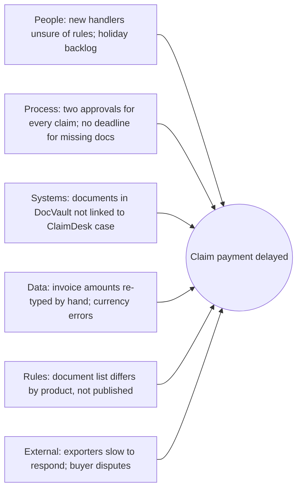

## Why this matters
Většina změnových požadavků nezačíná jasným problémem, ale stížností nebo hotovým návrhem řešení. Business analytik, který umí najít skutečnou příčinu, změřit současný proces a čísly ukázat, jestli se automatizace vyplatí, ušetří organizaci stavění špatné věci. Cílový inzerát čeká, že budeš automatizovat procesy v low-code platformách a zavádět AI do procesů. Tento modul tě naučí vybrat, *co* stojí za automatizaci, dřív než rozhodneš *jak*.

## Quick version
**Problém, symptom, řešení.** *Symptom* je to, čeho si lidé všimnou („škody trvají moc dlouho“). *Problém* je skrytý stav, který ho způsobuje („každá třetí škoda čeká na chybějící dokumenty, protože formulář pro nahlášení se na ně neptá“). *Řešení* je jeden ze způsobů, jak to napravit („udělat dokumenty ve formuláři povinné“). Požadavky obvykle přicházejí jako symptomy nebo řešení. Tvým prvním úkolem je dostat se k problému.

**Problem statement** (popis problému). Zapiš ho v pevné struktuře: *The problem of* [co] *affects* [koho], *the impact of which is* [měřitelný dopad]. *A successful solution would* [výsledek, ne technologie].

**Techniky hledání root cause (kořenové příčiny):**
- **5 Whys** (5× proč) — opakovaně se ptej „proč?“ (zhruba pětkrát), dokud nedojdeš k příčině, se kterou jde něco udělat.
- **Fishbone (Ishikawa) diagram** (diagram rybí kosti) — sesbírej možné příčiny do kategorií (lidé, proces, systémy, data, pravidla, vnější vlivy), aby ses nezafixovala na jednu.
- **Pareto analysis** (Paretova analýza) — spočítej, jak často se každá příčina vyskytuje; obvykle několik málo příčin vysvětluje většinu případů (vzorec „80/20“).

**Jak proces uvidět:**
- **SIPOC** — přehled na jedné stránce: Suppliers (dodavatelé), Inputs (vstupy), Process (5–7 kroků), Outputs (výstupy), Customers (zákazníci).
- **Lean 8 wastes (DOWNTIME)** (8 druhů plýtvání) — Defects, Overproduction, Waiting, Non-utilized talent, Transportation, Inventory, Motion, Extra-processing. Kontrolní seznam pro hledání plýtvání.

**Měření procesu.** Bez čísel nedokážeš zlepšení prokázat. Základní míry: **volume** (objem, případů za měsíc), **cycle time** (pracovní čas na jednom případu), **lead time** (průběžná doba od požadavku k výsledku včetně čekání), **error rate** (chybovost, podíl případů s přepracováním), **FTE effort** (kolik lidí na plný úvazek práce spotřebuje).

**Co automatizovat.** Dobří kandidáti jsou založení na pravidlech, mají vysoký objem, jsou stabilní (pravidla se nemění každý měsíc), mají digitální a strukturované vstupy a při ruční práci v nich vznikají chyby. *Neautomatizuj* rozbitý proces (nejdřív ho oprav), vzácný úkol, úkol, který pokaždé vyžaduje úsudek, ani proces, který se brzy změní.

**Jednoduchý business case.** Porovnej jednorázové náklady (vývoj, testování, školení) a průběžné náklady (licence, podpora) s přínosy (ušetřené hodiny × cena hodiny, méně chyb, rychlejší odezva). **Payback period** (doba návratnosti) = jednorázový náklad ÷ čistý roční přínos. Příklad s fiktivními čísly: vývoj za 900 000 Kč, který ročně ušetří čistých 534 000 Kč, se vrátí asi za 20 měsíců.

**Další rychlé nástroje:** **SWOT** (silné stránky, slabé stránky, příležitosti, hrozby) pro strategický pohled; **gap analysis** (analýza mezer: současný stav vs. požadovaný stav a co mezi nimi chybí).

**Prioritizace nápadů.** Rozmísti nápady do **impact/effort matrix** (matice dopad/pracnost): vysoký dopad a nízká pracnost jako první („quick wins“), vysoký dopad a vysoká pracnost jako plánované projekty, nízký dopad a nízká pracnost, když zbude čas, nízký dopad a vysoká pracnost vůbec.

## Deep dive

### Problém vs. symptom vs. řešení [P1]
Vezmi tři výroky, které můžeš v ExportShield Insurance slyšet:

1. „Škody trvají věčnost.“ — symptom.
2. „Potřebujeme OCR nástroj na dokumenty ke škodám.“ — řešení.
3. „Škody čekají v průměru 6 pracovních dnů na chybějící dokumenty, protože formulář pro nahlášení exportérům neříká, které dokumenty jsou povinné.“ — problém, s příčinou a mírou.

Jen třetí výrok ti řekne, co změnit. První je příliš vágní, aby se s ním dalo něco dělat. Druhý může být správný, ale nikdo neukázal, že úzkým hrdlem je čtení dokumentů. Pokud skutečné zpoždění vzniká čekáním na chybějící dokumenty, OCR mírně zrychlí rychlý krok a pomalý nechá beze změny.

Praktické pravidlo: když slyšíš řešení, zeptej se „Jaký problém by to vyřešilo?“ Když slyšíš symptom, zeptej se „Kde přesně, jak často a odkdy?“

### Problem statement [P1]
Krátká šablona, která funguje na workshopech i v dokumentech:

> **The problem of** claims waiting for missing supporting documents
> **affects** exporters, claims handlers and the claims manager,
> **the impact of which is** an average lead time of 15 working days per claim, of which about 6 are spent waiting for missing documents, and frequent client complaints;
> **a successful solution would** ensure that complete documents are submitted with the first notification in most cases and reduce average lead time to under 8 working days.

Česky: *Problém* čekání škod na chybějící podklady *se týká* exportérů, likvidátorů a vedoucího likvidace; *jeho dopadem je* průměrná průběžná doba 15 pracovních dnů na škodu, z toho asi 6 dnů čekání na chybějící dokumenty, a časté stížnosti klientů; *úspěšné řešení by* zajistilo, že ve většině případů přijdou kompletní dokumenty už s prvním nahlášením, a snížilo průměrnou průběžnou dobu pod 8 pracovních dnů.

(Všechna čísla jsou zde fiktivní.)

Tipy:
- V popisu problému žádná technologie. „Úspěšné řešení by zavedlo RPA“ je převlečené řešení.
- Do dopadu dej číslo, i když je to odhad. Napiš k němu „odhad“.
- Popis problému odsouhlas se sponzorem. Stane se měřítkem pro všechno, co následuje.

### 5 Whys [P1]
Zeptej se, proč se něco děje, pak se zeptej proč u odpovědi, a pokračuj. Pět je vodítko, ne pravidlo. Zastav se, když dojdeš k příčině, kterou někdo může změnit.

Příklad: škody se v ExportShield vyplácejí pozdě.

1. *Proč se škody vyplácejí pozdě?* Protože schvalování trvá dlouho.
2. *Proč schvalování trvá dlouho?* Protože likvidátoři nemohou spočítat plnění, dokud nejsou všechny dokumenty.
3. *Proč dokumenty chybějí?* Protože exportéři s prvním nahlášením posílají jen fakturu.
4. *Proč posílají jen fakturu?* Protože formulář pro nahlášení ani průvodce pojistnou smlouvou povinné dokumenty neuvádějí.
5. *Proč je neuvádějí?* Protože seznam se liší podle produktu a nikdo neodpovídá za jeho aktualizaci.

Kořenová příčina, se kterou jde pracovat: v místě nahlášení neexistuje kontrolní seznam dokumentů podle produktu, který by měl vlastníka. Možné opravy: dynamický kontrolní seznam ve formuláři pro nahlášení, automatická upomínka na chybějící dokumenty, vlastník seznamu.

Úskalí:
- **Jen jeden řetězec.** Skutečné problémy mají několik příčin. Používej vedle toho fishbone.
- **Obviňování lidí.** „Protože likvidátor X je pomalý“ analýzu zastaví. Ptej se, proč to proces dovoluje.
- **Hádání.** Každou odpověď ověř daty nebo u lidí, kteří práci dělají.

### Fishbone (Ishikawa) diagram [P1]
Fishbone dává účinek (problém) do „hlavy“ a možné příčiny seskupuje na „kosti“. Pro servisní a kancelářské procesy jsou praktické tyto kategorie:

- **People** (lidé) — dovednosti, vytížení, fluktuace, školení.
- **Process** (proces) — kroky, předání, schvalování, chybějící pravidla.
- **Systems** (systémy) — ClaimDesk, PolicyHub, DocVault, e-mail, Excel.
- **Data and documents** (data a dokumenty) — chybějící, ve špatném formátu, duplicitní.
- **Policies and rules** (zásady a pravidla) — interní pravidla, smluvní podmínky, regulace.
- **External** (vnější vlivy) — exportéři, odběratelé, banky, zahraniční soudy.

Jak ho vést: na 60minutovém setkání s likvidátory a vedoucím likvidace napiš problém do hlavy, po kategoriích vymýšlejte příčiny na lepicí papírky a pak hlasujte o 3–5 nejpravděpodobnějších. Ty se stanou hypotézami, které ověříš daty.

### Paretova analýza [P2]
Jakmile máš kandidátní příčiny, spočítej je. Vytáhni 100 zpožděných škod a u každé zaznamenej hlavní důvod zpoždění.

| Důvod zpoždění (fiktivní data) | Počet | Kumulativně % |
|---|---|---|
| Chybějící dokumenty | 46 | 46 % |
| Čekání na druhé schválení | 21 | 67 % |
| Oprava měny nebo částky | 14 | 81 % |
| Spor s odběratelem | 9 | 90 % |
| Výpadek systému | 5 | 95 % |
| Ostatní | 5 | 100 % |

První dva důvody vysvětlují zhruba dvě třetiny zpoždění. Soustřeď se nejdřív na ně. Pareto neznamená, že vzácné příčiny nevadí (spor s odběratelem může být právně důležitý), jen že tam se neztrácí nejvíc času.

### SIPOC [P2]
SIPOC vměstná celý proces na jednu stránku, než půjdeš do detailu. Hodí se na začátku projektu k dohodě o hranicích (scope, rozsah).

| Suppliers | Inputs | Process | Outputs | Customers |
|---|---|---|---|---|
| Exportér (pojištěný) | Oznámení o nezaplacení, faktura, doklad o dodání, korespondence s odběratelem | 1. Přijmout oznámení | Rozhodnutí (vyplatit / zamítnout / částečně) | Exportér |
| Odběratel (nepřímo) | Platební historie | 2. Ověřit pojistné krytí a limit | Výplata plnění | Finance |
| PolicyHub | Data smlouvy a úvěrového limitu | 3. Shromáždit a zkontrolovat dokumenty | Spis pro vymáhání | Tým vymáhání |
| DocVault | Uložené dokumenty | 4. Spočítat plnění | Report pro vedení | Zajistitelé, vedení |
| | | 5. Schválit | | |
| | | 6. Vyplatit a zahájit vymáhání | | |

Čti ho i zprava doleva: kdo je zákazník, co potřebuje, jaké vstupy jsou k tomu nutné.

### Lean a 8 druhů plýtvání (DOWNTIME) [P2]
**Lean** myšlení, které pochází z výroby, dělí činnosti na ty, které přidávají hodnotu pro zákazníka, a ty, které ne. **Value stream** (hodnotový tok) znamená všechny kroky včetně čekání od požadavku po dodaný výsledek. V kancelářských procesech tvoří většinu průběžné doby obvykle čekání, ne práce.

Osm druhů plýtvání, zapamatovatelných jako DOWNTIME, s kancelářskými příklady z ExportShield:

| Plýtvání | Význam | Příklad z ExportShield |
|---|---|---|
| **D**efects | Chyby a přepracování | Do ClaimDesku zadaná špatná měna, škoda se přepočítává |
| **O**verproduction | Produkovat víc nebo dřív, než je potřeba | Měsíční report se 40 záložkami, který nikdo nečte |
| **W**aiting | Prostoje mezi kroky | Škoda čeká 6 dnů na dokumenty; žádost čeká na schvalovatele na dovolené |
| **N**on-utilized talent | Nevyužité schopnosti lidí | Zkušení underwriteři kopírují data z e-mailů |
| **T**ransportation | Zbytečné přesouvání věcí | Dokumenty přeposílané e-mailem mezi čtyřmi schránkami |
| **I**nventory | Hromadění rozpracované práce | 120 nezpracovaných žádostí o úvěrový limit ve sdílené schránce |
| **M**otion | Zbytečné pohyby nebo kliky | Přepínání mezi PolicyHubem, DocVaultem a Excelem 15× na jeden případ |
| **E**xtra-processing | Dělat víc, než je potřeba | Dvě schválení u malých škod, kde podle interních pravidel stačí jedno |

Projdi proces s tímto seznamem a obvykle najdeš několik druhů plýtvání. Automatizace některé odstraní (motion, chyby z přepisování). Jiné potřebují změnu procesu nebo pravidla (extra-processing, čekání na schválení).

### Měření procesu [P1]
Potřebuješ **baseline** (výchozí stav): změřený stav před změnou. Bez něj později zlepšení neprokážeš.

| Míra | Definice | Jak ji získat |
|---|---|---|
| Volume (objem) | Počet případů za období | Systémové reporty, počty ve schránce, SQL dotaz |
| Cycle time (touch time, čistý pracovní čas) | Pracovní čas skutečně strávený na jednom případu | Změřit vzorek případů; požádat likvidátory o záznam po dobu jednoho týdne |
| Lead time (průběžná doba) | Uplynulý čas od požadavku k výsledku včetně čekání | Časová razítka: datum přijetí vs. datum rozhodnutí |
| Waiting time (doba čekání) | Lead time minus cycle time | Výpočtem |
| Error / rework rate (chybovost) | Podíl případů, které potřebují opravu | Kontrola vzorku, log defektů, vrácené případy |
| FTE effort | Objem × cycle time ÷ produktivní hodiny jednoho zaměstnance na plný úvazek za rok | Výpočtem |
| Cost per case (náklad na případ) | Náklad FTE ÷ objem plus další náklady | Výpočtem s financemi |

Pozor na terminologii: některé zdroje a Lean literatura používají „cycle time“ jinak (například jako čas mezi dvěma hotovými kusy). Ve svých dokumentech jednou definuj, co tím myslíš, a drž se toho.

Praktické tipy:
- Vzorek 30–50 případů často dá pro první business case dost dobrý obraz.
- Než požádáš lidi, aby se sami měřili, vyžádej si časová razítka ze systému. Lidé podceňují přerušení.
- Měř i rozptyl. Průměr 12 minut může skrývat případy po 3 a po 60 minutách, které potřebují různá řešení.

### Jak rozhodnout, co automatizovat [P1]
**Automation** (automatizace) tu znamená nechat software dělat kroky, které lidé dělají ručně. Možnosti sahají od pravidel uvnitř existujícího systému přes **low-code** nástroje (platformy, kde workflow stavíš hlavně konfigurací, například Power Automate, Make nebo n8n) po **RPA** (robotic process automation: software, který ovládá uživatelské rozhraní tak, jak by to dělal člověk), až po integrace přes API a AI.

Kritéria dobrého kandidáta:

| Kritérium | Dobré znamení | Varovné znamení |
|---|---|---|
| Založené na pravidlech | Jasná pravidla když–pak, málo výjimek | „Záleží na tom“, pokaždé expertní úsudek |
| Objem | Stovky nebo tisíce případů ročně | Pár případů měsíčně |
| Stabilita | Pravidla a obrazovky se mění zřídka | Proces nebo systém se do roka změní |
| Digitální, strukturované vstupy | Data ve formulářích, systémech, strukturovaných souborech | Papír, ručně psané poznámky, e-maily s volným textem |
| Dopad chyb | Ruční chyby jsou časté nebo drahé | Chyby vzácné a levné |
| Citlivost na čas | Klientům záleží na rychlosti | Na výsledek nikdo nečeká |

Kdy **neautomatizovat**:
- **Proces je rozbitý.** Automatizací špatného procesu získáš rychlý špatný proces. Nejdřív odstraň plýtvání.
- **Objem je příliš nízký**, aby se vrátil vývoj a údržba.
- **Jádrem je úsudek.** Upisování velkého, neobvyklého úvěrového limitu má zůstat na člověku; automatizace mu může připravit data.
- **Blíží se větší změna.** Pokud se PolicyHub příští rok nahradí, robot postavený nad jeho obrazovkami zanikne s ním.
- **Chybí vlastník.** Automatizace potřebují někoho, kdo je udržuje, když se mění pravidla. Osiřelá automatizace se stává rizikem.
- **Není schválená.** V regulované firmě musí automatizace používat nástroje a přístupy schválené IT. Postavit si soukromý skript s vlastními přihlašovacími údaji není přijatelné, ani když funguje.

### Jednoduchý business case s propočteným příkladem [P1]
**Business case** zdůvodňuje investici porovnáním nákladů, přínosů a rizik. Úplný business case může být dlouhý; první verze se vejde na jednu stránku.

**Scénář (všechna čísla fiktivní, jen pro procvičení):** žádosti o úvěrový limit přicházejí do ExportShield e-mailem. Asistentka každou žádost přepisuje do PolicyHubu. Návrh: online formulář, který posílá strukturovaná data do PolicyHubu přes API.

**Krok 1: výchozí stav.**
- Objem: 6 000 žádostí ročně.
- Ruční příjem: 12 minut na žádost → 6 000 × 12 = 72 000 minut = 1 200 hodin ročně.
- Chybovost: 4 % žádostí má chybu v přepisu, která se najde později → 240 žádostí × 30 minut přepracování = 120 hodin.
- Celková pracnost dnes: 1 320 hodin ročně.
- Plně zatížená cena hodiny práce (mzda, sociální a zdravotní pojištění, režie): 600 Kč (fiktivně).
- Náklad dnes: 1 320 × 600 = 792 000 Kč ročně.

**Krok 2: budoucí stav.**
- Příjem zkrácen na 2 minuty na žádost (kontrola a potvrzení) → 200 hodin.
- Chybovost klesne na 1 % → 60 žádostí × 30 minut = 30 hodin.
- Celková pracnost: 230 hodin → 230 × 600 = 138 000 Kč ročně.
- Hrubá roční úspora: 792 000 − 138 000 = 654 000 Kč.

**Krok 3: náklady.**
- Jednorázové: vývoj a testování u dodavatele 750 000 Kč, interní čas BA a testování 120 000 Kč, školení 30 000 Kč → 900 000 Kč.
- Průběžné: hosting, podpora a údržba 120 000 Kč ročně.

**Krok 4: výsledky.**
- Čistý roční přínos: 654 000 − 120 000 = 534 000 Kč.
- **Doba návratnosti:** 900 000 ÷ 534 000 ≈ 1,7 roku ≈ 20 měsíců.
- **Čistý přínos za 3 roky:** 3 × 534 000 − 900 000 = 702 000 Kč.
- **Uvolněná kapacita:** 1 320 − 230 = 1 090 hodin ≈ 0,7 FTE (při zhruba 1 600 produktivních hodinách na FTE za rok).

**Krok 5: buď poctivá v tom, co to znamená.**
- Uvolněné hodiny nejsou peníze, pokud je organizace nevyužije (zvládne větší objem bez nabírání lidí, nebo přesune lidi na práci s vyšší hodnotou). Řekni, co z toho.
- Přidej přínosy, které se těžko oceňují: exportéři dostanou rychlejší odpověď; méně chyb v limitech snižuje riziko; data jsou strukturovaná pro reporting.
- Vyjmenuj rizika: odhad dodavatele může narůst; exportéři mohou dál posílat e-maily; změny API v PolicyHubu.
- Ukaž kontrolu citlivosti (sensitivity check): když bude jednorázový náklad o 30 % vyšší (1 170 000 Kč), návratnost bude asi 2,2 roku. Je to pořád přijatelné?

Rozhodovatelé málokdy věří jednomu číslu. Věří výpočtu, který umí sledovat a zpochybnit.

### SWOT a gap analysis [P3]
**SWOT** uvádí Strengths a Weaknesses (silné a slabé stránky, interní) a Opportunities a Threats (příležitosti a hrozby, externí). Pomáhá, když je otázka strategická, například „Má ExportShield nabídnout malým exportérům samoobslužný portál?“. Pro opravu jednoho procesu je méně užitečný.

**Gap analysis** (analýza mezer) porovnává současný stav s požadovaným a vypisuje, co chybí: schopnosti, data, dovednosti, systémy, pravidla. Příklad: požadovaný stav „rozhodnutí o úvěrovém limitu do 2 pracovních dnů u malých žádostí“; mezery: chybí strukturovaný příjem, chybí automatické vyhledání v obchodním rejstříku, chybí pravidlo pro automatické schválení pod limitní částkou, chybí dohodnuté rozhodovací pravomoci. Každá mezera se může stát požadavkem nebo projektem.

### Prioritizace nápadů na zlepšení [P1]
Po workshopu budeš mít víc nápadů než rozpočtu. **Impact/effort matrix** je rychle roztřídí.

| | Nízká pracnost | Vysoká pracnost |
|---|---|---|
| **Vysoký dopad** | Quick wins — udělat hned | Velké projekty — naplánovat a zafinancovat |
| **Nízký dopad** | Výplň — udělat, když se to hodí | Vyhnout se — nezačínat |

Jak ji používat dobře:
- Než začneš bodovat, definuj dopad: ušetřené hodiny, odvrácené chyby, průběžná doba pro klienta, snížené riziko.
- Pracnost hodnoť s IT nebo dodavatelem, ne sama.
- Matici používej k zahájení diskuse, ne k jejímu ukončení. Položka s nízkým dopadem může být povinná kvůli regulaci; takové označ zvlášť.

Pro backlogy jsou běžné i jiné techniky prioritizace, například MoSCoW (Must, Should, Could, Won't). Probírají je moduly o požadavcích.

## Key terms
- **Symptom** — pozorovatelný projev problému, například dlouhé doby zpracování.
- **Root cause** (kořenová příčina) — skrytá příčina, po jejímž odstranění se problém už neopakuje.
- **Problem statement** (popis problému) — strukturovaný popis problému, koho se týká, jaký má dopad a jak vypadá úspěch.
- **5 Whys** (5× proč) — technika opakovaného ptaní „proč“, jak se od symptomu dostat ke kořenové příčině, se kterou jde pracovat.
- **Fishbone (Ishikawa) diagram** (diagram rybí kosti) — diagram, který seskupuje možné příčiny problému do kategorií.
- **Pareto analysis** (Paretova analýza) — seřazení příčin podle četnosti, aby se našlo těch několik, které vysvětlují většinu případů.
- **SIPOC** — přehled procesu na vysoké úrovni: Suppliers, Inputs, Process, Outputs, Customers.
- **Lean** (štíhlý přístup) — přístup ke zlepšování zaměřený na odstranění činností, které nepřidávají hodnotu pro zákazníka.
- **DOWNTIME** — pomůcka pro osm druhů plýtvání v Lean: Defects, Overproduction, Waiting, Non-utilized talent, Transportation, Inventory, Motion, Extra-processing.
- **Baseline** (výchozí stav) — změřený výkon procesu před změnou, kterým se prokazuje zlepšení.
- **Cycle time** (čistý pracovní čas) — v tomto kurzu pracovní čas skutečně strávený na jednom případu.
- **Lead time** (průběžná doba) — uplynulý čas od požadavku k výsledku včetně čekání.
- **FTE (full-time equivalent)** (přepočtený plný úvazek) — pracovní zátěž jednoho zaměstnance na plný úvazek, používaná k vyjádření pracnosti.
- **RPA (robotic process automation)** (robotická automatizace procesů) — software, který vykonává úkoly založené na pravidlech ovládáním uživatelského rozhraní aplikací.
- **Low-code** — platformy, ve kterých aplikace nebo workflow stavíš hlavně konfigurací, ne programováním.
- **Business case** — zdůvodnění investice, které porovnává náklady, přínosy a rizika.
- **Payback period** (doba návratnosti) — doba, za kterou kumulované čisté přínosy dorovnají počáteční investici.
- **Gap analysis** (analýza mezer) — porovnání současného a požadovaného stavu, které ukáže, co chybí.
- **Impact/effort matrix** (matice dopad/pracnost) — mřížka 2×2 pro prioritizaci nápadů podle očekávaného přínosu a potřebné pracnosti.

## Hands-on
:::exercise id="m03-e1" title="5 Whys a fishbone pro zpoždění škod" min="50" tool="Miro"
**Cíl:** procvičit cestu od symptomu k ověřitelným kořenovým příčinám.

Symptom (fiktivní): „Výplata škod v ExportShield trvá v průměru 15 pracovních dnů; exportéři si stěžují.“

1. V [Miro](https://miro.com/) (tabule zdarma) napiš symptom vpravo.
2. Nakresli šest kostí: People, Process, Systems, Data and documents, Policies and rules, External.
3. Ke každé kosti přidej aspoň tři možné příčiny. Inspiraci najdeš v tabulkách SIPOC a DOWNTIME v tomto modulu.
4. Vyber příčinu, kterou považuješ za nejdůležitější, a rozjeď z ní řetězec 5 Whys. Každou odpověď napiš na samostatný papírek.
5. U své finální kořenové příčiny napiš, jak bys ji *ověřila* (jaká data, z jakého systému, nebo koho by ses zeptala).
6. Napiš popis problému podle šablony.

**Hotovo, když:** fishbone má 18 a více příčin, jeden řetězec 5 Whys končí příčinou, se kterou jde pracovat, a máš způsob ověření a popis problému.
:::

:::exercise id="m03-e2" title="Změř a sestav business case pro automatizaci příjmu žádostí o úvěrový limit" min="60" tool="Excel or Google Sheets"
**Cíl:** vytvořit business case, který manažer umí sledovat a zpochybnit.

Použij vlastní fiktivní čísla, jiná než v propočteném příkladu.

1. Vytvoř list se vstupními buňkami: roční objem, minuty na žádost dnes, chybovost dnes, minuty přepracování na chybu, cena hodiny, minuty na žádost po automatizaci, chybovost potom, jednorázový náklad, roční průběžný náklad, produktivní hodiny na FTE.
2. Vzorci (ne ručně vepsanými výsledky) spočítej: hodiny dnes, hodiny potom, roční úsporu, čistý roční přínos, dobu návratnosti v měsících, čistý přínos za 3 roky, uvolněná FTE.
3. Přidej řádek citlivosti: jednorázový náklad +30 % a objem −20 %. Jak se změní návratnost a přínos za 3 roky?
4. Pod čísla napiš pět vět: doporučení, hlavní předpoklad, největší riziko, přínos, který se nedal ocenit, co bys po spuštění měřila.
5. List jasně označ „fiktivní data pro procvičení“.

**Hotovo, když:** změna kterékoli vstupní buňky aktualizuje všechny výsledky a pět vět se vejde na stejnou stránku.
:::

:::exercise id="m03-e3" title="Seřaď osm nápadů na zlepšení" min="30" tool="Miro"
**Cíl:** procvičit transparentní prioritizaci.

Nápady z workshopu v ExportShield:
1. Online formulář pro žádosti o úvěrový limit s API do PolicyHubu.
2. Automatické vyhledání firmy ve veřejném obchodním rejstříku podle IČO, když žádost dorazí.
3. Zrušit druhé schválení u škod pod interní limitní částkou.
4. E-mailová upomínka exportérům, když dokumenty ke škodě chybějí déle než 5 dnů.
5. Nahradit PolicyHub novým klíčovým systémem.
6. AI shrnutí korespondence s odběratelem přiložené ke škodám (jen s fiktivními nebo schválenými daty).
7. Týdenní excelové reporty otevřených žádostí sloučené do jednoho dashboardu.
8. Přejmenovat složky v DocVaultu podle jednotného vzoru.

Kroky:
1. Napiš jednořádkovou definici „dopadu“ a „pracnosti“ pro toto cvičení.
2. Ohodnoť každý nápad 1–5 za dopad a 1–5 za pracnost. Ke každému hodnocení napiš jednu větu zdůvodnění.
3. Rozmísti nápady do mřížky 2×2 dopad/pracnost v [Miro](https://miro.com/).
4. Označ každý nápad, který by potřeboval schválení IT, change request u dodavatele nebo změnu interních pravidel.
5. Vyber svou trojku a ve třech větách zdůvodni pořadí.

**Hotovo, když:** každý nápad je umístěný se zdůvodněním, závislosti jsou označené a trojka je zdůvodněná.
:::

## Self-check
:::q
Zařaď každý výrok jako symptom, problém nebo řešení: (a) „Potřebujeme chatbota pro exportéry.“ (b) „Exportéři nám často volají.“ (c) „Exportéři nevidí stav své žádosti o úvěrový limit, tak volají, aby se zeptali.“
---
(a) je řešení, (b) je symptom, (c) je problém s příčinou: chybějící přehled o stavu. Jen (c) ukazuje, co by se mělo změnit; stavová stránka nebo automatické e-maily o stavu to mohou vyřešit levněji než chatbot.
:::

:::q
Proč by popis problému neměl zmiňovat konkrétní technologii?
---
Protože by určil řešení dřív, než je problém pochopený, a vyloučil by alternativy. Popis problému je měřítko pro porovnání variant; když už v něm stojí „RPA“, každá jiná varianta vypadá z definice špatně. Technologie patří do variant a doporučení.
:::

:::q
Sezení 5 Whys skončí větou „protože to likvidátor zapomněl“. Co se pokazilo a jak pokračovat?
---
Zastavilo se u člověka místo u příčiny v procesu. Pokračuj otázkou, proč proces zapomenutí dovolil: chybí kontrolní seznam, upomínka, validace v systému, nebo je vytížení příliš vysoké? Cílem je příčina, kterou jde opravit v procesu nebo systému, ne obviňování.
:::

:::q
Lead time žádosti o úvěrový limit je 5 pracovních dnů, ale skutečná práce na ní trvá 40 minut. Co ti to říká a pomohlo by hodně rychlejší zadávání dat?
---
Skoro celá průběžná doba je čekání: ve frontách, na schválení nebo na chybějící informace. Zrychlení zadávání dat by zkrátilo 40 minut, ale 5 dnů by skoro nezměnilo. Podívej se nejdřív na kroky čekání: proč žádosti leží ve frontě, pravidla schvalování, chybějící dokumenty.
:::

:::q
Uveď dva důvody, proč proces neautomatizovat, i když je opakující se.
---
Možné důvody: proces sám je neefektivní a měl by se nejdřív zjednodušit; objem je příliš nízký, aby se vrátil vývoj a údržba; systém pod ním bude brzy nahrazen; pravidla se často mění; nikdo by automatizaci nevlastnil a neudržoval; nebo nástroj není schválený IT. Stačí libovolné dva s krátkým vysvětlením.
:::

:::q
V business case automatizace uvolní 0,7 FTE. Proč to automaticky neznamená úsporu nákladů?
---
Uvolněný čas šetří peníze jen tehdy, když ho organizace využije: vyhne se novému náboru, pokryje růst nebo přesune lidi na práci s vyšší hodnotou. Pokud lidé zůstanou ve stejné roli s menším množstvím práce, náklad zůstane stejný. Dobrý business case výslovně říká, jak se uvolněná kapacita využije.
:::

:::q
Nápad má nízký dopad a nízkou pracnost, ale vyžaduje ho regulátor. Kam patří v matici dopad/pracnost?
---
Musí se udělat bez ohledu na pozici v matici. Povinné položky označ zvlášť, protože matice měří business hodnotu, ne povinnost. V praxi se regulatorní položky často plánují jako první nebo souběžně.
:::

## Interview corner
:::interview
Jak byste našla kořenovou příčinu pomalého procesu?
*EN: How would you find the root cause of a slow process?*
---
- Vyjasnit symptom čísly: které případy, jak pomalé, odkdy.
- Zmapovat proces (SIPOC, pak AS-IS) a změřit lead time vs. pracovní čas.
- Fishbone použít k širokému sběru příčin, 5 Whys k jejich prohloubení u těch pravděpodobných.
- Ověřit daty (Pareto důvodů zpoždění) a u lidí, kteří práci dělají.
- Napsat popis problému a odsouhlasit ho se sponzorem dřív, než navrhneš řešení.

Typická chyba: skočit rovnou k nástroji nebo automatizaci, aniž bys ukázala, kde se ztrácí čas.
:::

:::interview
Jak rozhodujete, jestli je proces dobrý kandidát na automatizaci?
*EN: How do you decide whether a process is a good candidate for automation?*
---
- Kritéria: založené na pravidlech, objem, stabilita, digitální strukturované vstupy, dopad chyb.
- Nejdřív odstranit plýtvání; neautomatizovat rozbitý proces.
- Hrubý business case: ušetřené hodiny × cena vs. náklady na vývoj a provoz; návratnost.
- Zvážit vlastnictví, údržbu a schválení nástroje ze strany IT.
- Dát krátký příklad, třeba příjem žádostí o úvěrový limit.

Typická chyba: říct „všechno, co se opakuje, se má automatizovat“ bez zmínky o nákladech, stabilitě nebo řízení (governance).
:::

:::interview
Proveďte mě jednoduchým business casem, který byste uměla připravit.
*EN: Walk me through a simple business case you could prepare.*
---
- Výchozí stav: objem, čas na případ, chybovost, cena hodiny.
- Budoucí stav: očekávaný čas a chybovost po změně.
- Náklady: jednorázové a průběžné.
- Výsledky: čistý roční přínos, doba návratnosti, víceletý pohled, uvolněná kapacita.
- Nefinanční přínosy, rizika a kontrola citlivosti; jasné doporučení.

Typická chyba: ukázat jen přínos a zapomenout na průběžné náklady nebo předpoklady za čísly.
:::

:::interview
Máte z workshopu dvacet nápadů na zlepšení a rozpočet na tři. Co uděláte?
*EN: You have twenty improvement ideas from a workshop and budget for three. What do you do?*
---
- Se sponzorem dohodnout kritéria dopadu a pracnosti.
- Získat odhady pracnosti od IT nebo dodavatele.
- Ohodnotit nápady a rozmístit je do matice dopad/pracnost; označit povinné a závislé položky.
- Předložit doporučení se zdůvodněním; rozhodnutí nechat na sponzorovi.
- Zbytek držet ve viditelném backlogu, ne zahodit.

Typická chyba: prioritizovat podle toho, kdo nejvíc křičel, nebo podle osobní preference bez viditelných kritérií.
:::
