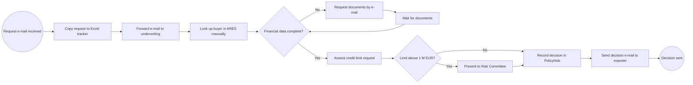
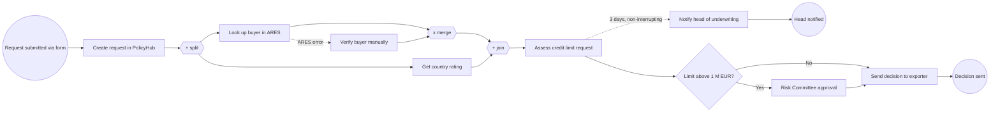

## Why this matters
Většina práce BA začíná procesem: někdo podá žádost, někdo ji zkontroluje, někdo ji schválí a někde uprostřed lidé přepisují data z e-mailu do tabulky. BPMN je standardní způsob, jak takový proces nakreslit, aby business, IT i dodavatelé četli stejný obrázek. Inzerát chce UML nebo BPMN přímo a na pohovoru můžeš čekat, že tě požádají načrtnout proces na tabuli. Jasný AS-IS a TO-BE model je také nejlepší výchozí bod pro jakýkoli návrh automatizace.

## Quick version
**BPMN 2.0** (Business Process Model and Notation) je standard, který vydává OMG (Object Management Group), organizace spravující modelovací standardy jako BPMN a UML. Definuje malou sadu tvarů s přesným významem, takže diagram nakreslený jedním analytikem přečte každý, kdo notaci zná.

**Čtyři základní stavební prvky:**
- **Events** (události, kolečka) – něco, co se stane. Kolečko s tenkým okrajem je *start event* (počáteční událost), s dvojitým okrajem *intermediate event* (průběžná událost), s tlustým okrajem *end event* (koncová událost). Ikona uvnitř říká, o jaký druh jde: obálka = zpráva, hodiny = časovač, blesk = chyba.
- **Activities** (aktivity, obdélníky se zaoblenými rohy) – práce, kterou někdo nebo něco dělá. *Task* (úloha) je jedna jednotka práce („Check buyer in registry“). *Sub-process* (podproces, s malým znaménkem plus) skrývá uvnitř podrobnější proces.
- **Gateways** (brány, kosočtverce) – místa, kde se tok větví nebo spojuje. Prázdný kosočtverec nebo kosočtverec s X je *exclusive* (exkluzivní, právě jedna cesta), znaménko plus je *parallel* (paralelní, všechny cesty), kolečko je *inclusive* (inkluzivní, jedna nebo více cest).
- **Flows** (toky) – plná šipka (*sequence flow*, sekvenční tok) ukazuje pořadí kroků uvnitř jedné organizace. Čárkovaná šipka s malým prázdným kolečkem na začátku a prázdným hrotem (*message flow*, tok zpráv) ukazuje komunikaci mezi samostatnými účastníky.

**Pools a lanes.** *Pool* (bazén) je jeden účastník, obvykle jedna organizace (ExportShield, exportér). *Lanes* (dráhy) uvnitř poolu dělí práci podle role nebo oddělení (Sales, Underwriting). Sekvenční toky zůstávají uvnitř poolu. Mezi pooly používáš jen toky zpráv.

**AS-IS a TO-BE.** Nejdřív modeluješ, jak proces funguje dnes (AS-IS), včetně nehezkých částí: e-maily, Excel, čekání. Pak označíš pain pointy a nakreslíš zlepšený proces (TO-BE). Rozdíl mezi nimi je rozsah tvého projektu.

**Pravidla stylu, díky kterým je model čitelný:**
- Úlohy pojmenuj sloveso + podstatné jméno: „Approve credit limit“, ne „Approval“ ani „Underwriter“.
- Kde to jde, jedna počáteční událost na úroveň procesu; každá cesta končí koncovou událostí.
- Exkluzivní brány popiš otázkou („Limit above 1 M EUR?“) a odchozí toky odpověďmi („Yes“, „No“).
- Tok zleva doprava. Drž zhruba 7 ± 2 prvků na úroveň; detaily dej do podprocesů.
- Každé paralelní rozvětvení potřebuje odpovídající paralelní spojení, jinak se proces chová jinak, než si myslíš.

**Úrovně detailu.** Stejný proces jde nakreslit na třech úrovních: *descriptive* (popisná, přehledová pro manažery), *analytic* (analytická, všechny cesty a výjimky pro BA a testery) a *executable* (spustitelná, technické detaily, aby ji mohl spustit process engine jako Camunda). Jako BA pracuješ většinou na analytické úrovni.

**BPMN vs. vývojový diagram vs. UML.** Vývojový diagram (flowchart) nemá standardní sémantiku ani pojem účastníků. UML diagram aktivit je BPMN podobný, ale pochází ze softwarového návrhu; BPMN je častější volba, když diagram musí číst business stakeholdeři.

**Nástroje.** BPMN kresli v [bpmn.io demo](https://demo.bpmn.io/) (zdarma, bez registrace), [Camunda Modeler](https://camunda.com/download/modeler/) nebo [draw.io](https://app.diagrams.net/). Mermaid umí BPMN jen přiblížit vývojovým diagramem.

**Odpověď na pohovor jednou větou:** „BPMN je standard OMG pro procesní diagramy. Pools a lanes používám, abych ukázala, kdo co dělá, brány pro rozhodnutí, události pro spouštěče a vypršení lhůt, a modeluji nejdřív AS-IS, pak TO-BE bez pain pointů.“

## Deep dive

### Proč vůbec standardní notace [P1]
Představ si, že proces úvěrových limitů v ExportShield popíšou tři lidé. Sales nakreslí v PowerPointu obdélníky a šipky, Underwriting napíše ve Wordu číslovaný seznam a dodavatel NovaSoft pošle sekvenční diagram. Každý obrázek je pro svého autora správně a žádné dva nejde porovnat. Standardní notace to řeší. Každý tvar v BPMN má jeden definovaný význam, takže otázka „znamená tahle šipka *potom* nebo *pošle e-mail*?“ vůbec nevznikne.

BPMN 2.0 vydala OMG v roce 2011; aktuální verze je 2.0.2 (2013), přijatá také jako ISO/IEC 19510. [Specifikace](https://www.omg.org/spec/BPMN/2.0.2/) je dlouhá a technická. Číst ji nemusíš. Potřebuješ dobře znát asi 20 symbolů a vědět, kde jsou ostatní, když je někdo použije.

BPMN je pro BA užitečná ve čtyřech situacích:
1. **Pochopení** procesu, který zatím neznáš (kresli ho během rozhovorů a přehraj ho zpátky).
2. **Hledání problémů**: doby čekání, předávky, duplicitní kontroly, ruční přepisování.
3. **Dohoda o rozsahu**: TO-BE model přesně ukazuje, které kroky se mění.
4. **Předání do IT**: dodavatel nebo vývojář z něj odvodí obrazovky, integrace a testovací případy.

### Tři úrovně modelování [P2]
Stejná notace se používá s různým množstvím detailu. Praktici často popisují tři úrovně (názvy se liší podle autora):

| Úroveň | Publikum | Co ukazuje | Typické symboly |
|---|---|---|---|
| Descriptive (popisná) | Manažeři, sponzoři | Hlavní kroky, happy path, role | Počáteční/koncové události, úlohy, exkluzivní brány, lanes |
| Analytic (analytická) | BA, vlastníci procesů, testeři, dodavatel | Všechny cesty, výjimky, vypršení lhůt, zprávy mezi stranami | Navíc průběžné a hraniční události, toky zpráv, podprocesy, datové objekty |
| Executable (spustitelná) | Vývojáři, process engine | Technické atributy: formuláře, volání služeb, proměnné, podmínky jako výrazy | Stejné tvary plus vlastnosti v XML, které na diagramu nejsou vidět |

Častá chyba začátečníků je míchat úrovně v jednom diagramu: přehled na vysoké úrovni, kde jedna větev najednou ukazuje „Click Save button“. Než začneš kreslit, rozhodni se pro úroveň.

### Pools, lanes a dva druhy toků [P1]
**Pool** představuje účastníka spolupráce (collaboration). Účastník je obvykle organizace nebo samostatný systém: ExportShield, exportér, externí registr ARES. **Lane** je část poolu, obvykle role nebo oddělení: Sales, Underwriting, Risk Committee. Lanes říkají, *kdo* úlohu dělá. Nevytvářejí samostatné procesy.

**Sequence flow** (sekvenční tok; plná čára, plný hrot) spojuje prvky uvnitř jednoho poolu. Znamená „až tohle skončí, začne tamto“. Může přecházet přes lanes, protože lanes jsou pořád stejná organizace.

**Message flow** (tok zpráv; čárkovaná čára, malé kolečko na začátku, prázdný hrot) spojuje dva různé pooly. Znamená „tento účastník posílá něco tamtomu účastníkovi“: e-mail, dopis, volání API, odeslání formuláře. Nikdy nespojuje prvky ve stejném poolu.

Pool můžeš nakreslit jako **black box** (černou skříňku: sbalený, bez obsahu, jen s názvem). Udělej to u účastníků, jejichž vnitřní proces neznáš nebo tě nezajímá, například u exportéra. Toky zpráv pak vedou na okraj sbaleného poolu.

Pravidlo k zapamatování: *sekvenční tok uvnitř, tok zpráv mezi.* Když se přistihneš, že kreslíš plnou šipku z ExportShield k exportérovi, zastav se. Exportér „nepokračuje“ v procesu ExportShield; dostane zprávu a reaguje ve vlastním procesu.

### Události [P1]
Událost je něco, co se *stane*, na rozdíl od něčeho, co se *dělá*. Události jsou kolečka. Okraj říká pozici v toku:

| Okraj | Typ | Význam |
|---|---|---|
| Tenká jednoduchá čára | Start event | Tady proces začíná |
| Dvojitá čára | Intermediate event | Během procesu se něco stane (čeká se na to, nebo se to posílá) |
| Tlustá jednoduchá čára | End event | Tady tato cesta končí |

Ikona uvnitř říká spouštěč (trigger). Soustřeď se na tyto:

| Ikona | Název | Typické použití v ExportShield |
|---|---|---|
| (prázdná) | None | Začátek nebo konec bez konkrétního spouštěče, běžné na přehledových diagramech |
| Obálka | Message | „Credit limit request received“ (start), „Decision sent to exporter“ (konec) |
| Hodiny | Timer | „Every Monday 8:00“ (start), „Wait 5 working days“ (průběžná) |
| Blesk | Error | „Registry not available“ ukončí podproces chybou |
| Trojúhelník | Signal | Vysílání všem, kdo poslouchají, například „Country rating downgraded“ |
| Šipka nahoru | Escalation | Předání problému vyšší roli; na rozdíl od chyby může práce pokračovat, například upozornění vedoucího underwritingu |
| List papíru s řádky | Conditional | Spustí se, když začne platit podmínka („Exposure above limit“) |
| Plné černé kolečko (jen konec) | Terminate | Okamžitě zastaví celý proces včetně všech paralelních větví, které ještě běží |

Plná (černá) ikona znamená **throwing** (vyhazující: proces něco posílá nebo spouští). Obrysová ikona znamená **catching** (zachytávající: proces na něco čeká). Například průběžná událost zprávy s bílou obálkou znamená „čekej na dokumenty od exportéra“; s černou obálkou znamená „pošli žádost o dokumenty“.

Rozdíl mezi message a signal: zpráva jde jednomu konkrétnímu příjemci; signál se vysílá a zachytit ho může kdokoli, koho zajímá. Rozdíl mezi error a escalation: chyba přeruší práci, protože nemůže pokračovat; eskalace informuje někoho výš a práce může pokračovat.

### Aktivity a typy úloh [P1]
**Activity** (aktivita) je práce vykonávaná v procesu. Nejmenší forma je **task** (úloha). BPMN definuje typy úloh, které se zobrazují malou ikonou v levém horním rohu. Nejvíc na nich záleží, když plánuješ automatizaci, protože říkají, kdo nebo co práci dělá:

| Typ úlohy | Ikona | Význam | Příklad |
|---|---|---|---|
| User task | Postava | Člověk ji dělá v systému s obrazovkou | Underwriter posuzuje žádost v PolicyHubu |
| Manual task | Ruka | Člověk ji dělá bez jakéhokoli systému | Podepsat papírovou smlouvu |
| Service task | Ozubená kola | Systém ji dělá automaticky, typicky přes API | Vyhledat odběratele v ARES |
| Script task | Svitek | Uvnitř process enginu běží skript | Spočítat celkovou angažovanost |
| Business rule task | Tabulka | Vyhodnotí se rozhodnutí, často DMN tabulkou | Určit schvalovací pravomoc |
| Send task | Černá obálka | Pošle zprávu jinému účastníkovi | Odeslat dopis s rozhodnutím |
| Receive task | Bílá obálka | Čeká na zprávu | Přijmout chybějící účetní výkazy |
| Abstract task | (žádná) | Typ neurčen | Typické pro popisné modely |

API (Application Programming Interface, aplikační programové rozhraní) je definovaný způsob, jak jeden systém žádá data nebo akce od jiného systému. Když v TO-BE modelu změníš user task na service task, říkáš „tento krok bude automatizovaný integrací“. Tahle jedna změna ikony je často jádrem celého automatizačního projektu.

**Sub-process** (podproces) seskupuje několik aktivit. Sbalený vypadá jako úloha s malým plusem dole; rozbalený ukazuje svůj vnitřní tok. Používej ho, aby každá úroveň diagramu zůstala malá a čitelná.

**Call activity** (volající aktivita, úloha s tlustým okrajem) volá samostatný, znovupoužitelný proces definovaný jinde. Příklad: „Perform KYC check“ se používá v onboardingu smluv i v žádostech o úvěrový limit, takže ho namodeluješ jednou a voláš z obou.

Aktivity mohou nést i **markery** (značky): kruhová šipka pro smyčku (opakuj, dokud neplatí podmínka), tři svislé čáry pro paralelní multi-instance (udělej pro každou položku současně), tři vodorovné čáry pro sekvenční multi-instance (jednu položku po druhé). Příklad: „Check each invoice“ jako sekvenční multi-instance v procesu škod.

### Brány [P1]
Brána řídí, jak se tok větví a spojuje. *Nedělá* žádnou práci a sama nerozhoduje. Rozhodnutí padne v úloze před ní; brána jen směruje podle výsledku. Proto má dobrý model úlohu jako „Assess buyer risk“ a za ní bránu „Risk acceptable?“.

| Brána | Symbol | Chování při větvení | Chování při spojení |
|---|---|---|---|
| Exclusive (XOR) | Prázdný kosočtverec nebo X | Právě jedna odchozí cesta podle podmínky | Každý příchozí token propustí dál, nečeká |
| Parallel (AND) | Plus | Všechny odchozí cesty začnou současně | Čeká, dokud nedorazí všechny příchozí cesty |
| Inclusive (OR) | Kolečko | Jedna nebo více cest, každá s vlastní podmínkou | Čeká na všechny cesty, které byly skutečně spuštěny |
| Event-based | Pětiúhelník ve dvojitém kolečku | Čeká; o cestě rozhodne první událost, která nastane | Pro spojování se nepoužívá |

**Token** je užitečný mentální model: představ si minci, která se posouvá po šipkách. Paralelní rozvětvení vytvoří několik mincí, paralelní spojení počká, až dorazí všechny, a sloučí je do jedné.

**Příklad event-based brány:** když ExportShield požádá exportéra o chybějící dokumenty, mohou nastat dvě věci: dokumenty dorazí (událost zprávy) nebo uplyne 10 pracovních dnů (událost časovače). Co nastane dřív, vyhrává, a druhá možnost se zahodí.

**Časté chyby u bran:**
1. **Nespárované paralelní spojení.** Paralelní branou rozvětvíš na „Check ARES“ a „Check country rating“ a pak je spojíš exkluzivní branou. Exkluzivní spojení propustí každý token, takže další úloha proběhne *dvakrát*. Oprava: paralelní rozvětvení uzavři paralelním spojením.
2. **Exkluzivní rozvětvení uzavřené paralelním spojením.** Proběhla jen jedna cesta, ale paralelní spojení čeká na všechny. Proces čeká navždy (deadlock, uváznutí). Oprava: exkluzivní rozvětvení uzavři exkluzivním spojením.
3. **Nepopsaná exkluzivní brána.** Nikdo nezná podmínku. Oprava: bránu popiš otázkou a každý odchozí tok odpovědí.
4. **Překrývající se nebo chybějící podmínky.** „Amount < 1 M“ a „Amount > 1 M“: co se stane přesně při 1 M? Oprava: udělej podmínky úplné a vzájemně se vylučující, nebo jeden tok označ jako *default flow* (výchozí tok, malé lomítko na šipce).
5. **Brána dělá práci.** Kosočtverec s popiskem „Underwriter decides“. Oprava: rozhodnutí dej do úlohy, brána jen směruje.

### Data, artefakty a anotace [P2]
**Data objects** (datové objekty, list s přehnutým rohem) ukazují informace, které úlohy používají nebo vytvářejí: „Credit limit request“, „Financial statements“, „Decision letter“. **Data stores** (datová úložiště, válec) ukazují, kde data trvale leží: PolicyHub, DocVault, sdílený Excel. S úlohami se propojují tečkovanými *data associations* (datovými asociacemi). Data neovlivňují pořadí kroků; jen dokumentují, co jde dovnitř a ven.

**Text annotations** (textové anotace, otevřená hranatá závorka s textem) přidávají komentáře: „Done by e-mail today“, „SLA 3 working days“. V AS-IS modelech jsou anotace dobré místo, kam zapsat pain pointy, aniž bys zahltila názvy úloh.

**Groups** (skupiny, přerušovaný obdélník se zaoblenými rohy) vizuálně seskupují prvky, například vše, co je v rozsahu fáze 1. Na tok nemají žádný vliv.

### Hraniční události a eskalace časovačem [P1]
**Boundary event** (hraniční událost) sedí na okraji aktivity. Zachytí něco, co se stane, *zatímco* aktivita běží. Dvě varianty:

- **Interrupting** (přerušující, plný dvojitý okraj): když událost nastane, aktivita se zruší a tok pokračuje z hraniční události.
- **Non-interrupting** (nepřerušující, čárkovaný dvojitý okraj): aktivita pokračuje a souběžně začne další cesta.

Typické použití je **timer escalation** (eskalace časovačem). Underwriter má rozhodnout do 3 pracovních dnů. Na „Assess credit limit request“ dáš nepřerušující hraniční časovač. Po 3 dnech začne souběžná cesta: „Notify head of underwriting“. Underwriter úlohu pořád dokončí. Pokud chceš, aby žádost místo toho přešla na jiného člověka, použij přerušující časovač, který vede do „Reassign request“.

Další běžné hraniční události: chybová událost na service tasku („ARES not reachable“ vede do „Look up buyer manually“), událost zprávy na dlouhé úloze („Exporter withdraws request“ zruší posuzování).

### Propočtený příklad: žádost o úvěrový limit v ExportShield [P1]
**AS-IS, popsané krok za krokem.** Dnes proces funguje takto:
1. Exportér pošle e-mail se žádostí: název odběratele, jeho registrační číslo (IČO), země, požadovaný limit v EUR.
2. Asistentka obchodu zkopíruje data do sdíleného excelového přehledu a e-mail přepošle do schránky underwritingu.
3. Underwriter si e-mail vezme, otevře web ARES a vyhledá odběratele podle IČO (u českých odběratelů) nebo v jiných registrech u zahraničních odběratelů, pak zkopíruje údaje o firmě do přehledu.
4. Underwriter zkontroluje finanční data a rating země. Pokud chybějí účetní výkazy, napíše exportérovi a čeká. Upomínky se posílají ručně a někdy se na ně zapomene.
5. Underwriter rozhodne: schválit, snížit, nebo zamítnout. Žádosti nad 1 M EUR jdou na Risk Committee, který zasedá jednou týdně.
6. Underwriter zapíše rozhodnutí do PolicyHubu a napíše exportérovi e-mail s rozhodnutím.

Pain pointy, které bys označila anotacemi: dvojí zadávání dat (e-mail → Excel → PolicyHub), ruční vyhledávání v registru, žádné sledování lhůt, žádosti ztracené ve sdílené schránce, žádná auditní stopa, kdo co a kdy rozhodl.

Tady je AS-IS přiblížený v Mermaidu. Mermaid nemá pools, lanes ani BPMN události, takže je to vývojový diagram, ne BPMN. V BPMN bys v [bpmn.io](https://demo.bpmn.io/) nakreslila dva pooly (Exporter jako sbalenou černou skříňku, ExportShield s lanes Sales, Underwriting, Risk Committee).

**TO-BE, popsané krok za krokem.**
1. Exportér podá žádost přes webový formulář (počáteční událost zprávy „Request submitted“). Formulář zkontroluje formát IČO a částku.
2. **Service task** „Create request in PolicyHub“ uloží data. Žádný Excel, žádné přepisování.
3. **Paralelní brána** rozvětví tok do dvou service tasků: „Look up buyer in ARES“ (přes [ARES API](https://ares.gov.cz/ekonomicke-subjekty-v-be/rest/ekonomicke-subjekty/{ico}), veřejné REST API, které k IČO vrátí údaje o firmě) a „Get country rating“. **Paralelní brána** je zase spojí.
4. **Chybová hraniční událost** na úloze ARES řeší situaci, kdy ARES není dostupný nebo odběratel nebyl nalezen: cesta jde do user tasku „Verify buyer manually“. **Exkluzivní brána** tuto cestu spojí s běžnou cestou z ARES *před* paralelním spojením, takže spojení dostane z větve odběratele pořád právě jeden token.
5. **User task** „Assess credit limit request“ pro underwritera s **nepřerušující hraniční událostí časovače** (3 pracovní dny), která spustí „Notify head of underwriting“.
6. **Exkluzivní brána** „Limit above 1 M EUR?“ pošle velké žádosti do call activity „Risk Committee approval“.
7. **Send task** „Send decision to exporter“, pak koncová událost „Decision sent“. Rozhodnutí a jeho časové razítko se kvůli auditu uloží v PolicyHubu.

Všimni si, že verze v Mermaidu neumí hraniční události vyjádřit správně (tečkované čáry jsou jen nápověda). Právě proto skutečný model kreslíš v BPMN nástroji: sémantika (přerušující, nebo ne; kterou cestou jde token) je součástí notace. Všimni si také, že TO-BE diagram není jen „AS-IS s méně obdélníky“: typy úloh se změnily z user na service, přibyl časovač a objevila se výjimková cesta, která na papíře předtím neexistovala. Každá z těchto změn se v modulu 06 stane požadavkem.

### Pravidla modelovacího stylu [P1]
Dobré BPMN je hlavně o disciplíně. Pravidla, kterými se řídí zkušení modeláři:

1. **Sloveso + předmět u úloh.** „Check financial statements“, „Send decision letter“. Ne „Check“, ne „Financial statements“, ne „Underwriter“.
2. **Události v minulém čase nebo jako stav.** „Request received“, „Decision sent“, „5 days elapsed“.
3. **Brány jako otázky, toky jako odpovědi.** „Documents complete?“ s „Yes“ / „No“.
4. **Jedna počáteční událost** na úroveň procesu, pokud nejde o opravdu různé spouštěče. Každá cesta končí koncovou událostí a koncové události se pojmenovávají podle výsledku: „Request approved“, „Request rejected“.
5. **Zleva doprava**, happy path v přímé linii, výjimky odbočují nahoru nebo dolů.
6. **7 ± 2 prvků na úroveň.** Víc než zhruba tucet úloh na jedné stránce znamená, že potřebuješ podprocesy.
7. **Stejný název, stejná věc.** Když „credit limit“ znamená v lane A jednu věc, musí znamenat totéž v lane B. Veď si slovník pojmů.
8. **Nemodeluj vnitřek systému v business diagramu.** „Save record to table CREDIT_LIMITS“ patří do technického návrhu, ne do analytického modelu procesu.
9. **Typy bran pro rozvětvení a spojení musí sedět** a kde to jde, vyhni se křížení čar.

### AS-IS vs. TO-BE v praxi [P1]
**AS-IS** je, jak proces funguje dnes, ne jak podle směrnice fungovat má. Poznáš ho z rozhovorů, z pozorování lidí při práci a z čtení tiketů nebo e-mailů (viz modul 05). Nakresli ho rychle, ukaž ho lidem, kteří práci dělají, a oprav ho. Typický komentář: „Vlastně když je odběratel v Německu, tenhle krok přeskakujeme.“

Pain pointy označ přímo v AS-IS: anotacemi, jinou barvou nebo číslovanými značkami, které odkazují na seznam. U každého pain pointu si poznamenej dopad, pokud ho umíš změřit („zhruba 40 žádostí měsíčně, u každé 15 minut přepisování“).

**TO-BE** je dohodnutý budoucí proces. Měl by řešit pain pointy, které jsou v rozsahu, a nemělo by se v něm objevit nic, o co nikdo nežádal. Než začneš kreslit, dohodni omezení: které systémy zůstávají, jaký rozpočet, co dodavatel umí dodat. TO-BE, které potřebuje nový klíčový systém, není užitečné, pokud je projekt tříměsíční zlepšení.

Pomáhá seznam mezer (gap list): pro každou změnu mezi AS-IS a TO-BE napiš jeden řádek („Manual ARES search → automated lookup via API“). Seznam mezer se stane páteří tvých požadavků.

### BPMN vs. vývojový diagram vs. UML diagram aktivit [P2]
| Hledisko | Vývojový diagram | UML diagram aktivit | BPMN 2.0 |
|---|---|---|---|
| Standard | Žádný jednotný standard (ISO 5807 existuje, ale málokdo ho dodržuje) | UML 2.5 (OMG) | BPMN 2.0.2 (OMG, ISO/IEC 19510) |
| Hlavní publikum | Kdokoli | Softwaroví návrháři | Business a IT společně |
| Účastníci / organizace | Ne | Partitions (swimlanes) | Pools a lanes, toky zpráv |
| Události, časovače, zprávy | Nedefinované | Některé (accept event, time event) | Bohaté typy událostí, hraniční události |
| Spustitelnost | Ne | Zřídka | Ano, s process enginem |

Vývojový diagram použij na rychlý náčrt nebo algoritmus. UML diagramy aktivit použij, když tým už software modeluje v UML (UML probírá modul 08). BPMN použij, když se business a IT musí shodnout na procesu, zvlášť když se plánuje automatizace.

### DMN rozhodovací tabulky [P3]
**DMN** (Decision Model and Notation) je doprovodný standard OMG pro rozhodování. Business rule task v BPMN může odkazovat na DMN rozhodovací tabulku, která obsahuje logiku. Pravidla tak nejsou v diagramu: místo pěti vnořených bran máš jednu úlohu a jednu tabulku.

Příklad: kdo smí schválit úvěrový limit.

| Requested limit (EUR) | Country risk | Approver |
|---|---|---|
| ≤ 250,000 | Low, Medium | Underwriter |
| ≤ 250,000 | High | Senior underwriter |
| 250,001 – 1,000,000 | any | Senior underwriter |
| > 1,000,000 | any | Risk Committee |

Tabulka má *hit policy* (pravidlo shody), například „Unique“ (smí sedět právě jeden řádek) nebo „First“ (vyhrává první řádek, který sedí). Když se pravidla změní, upravíš tabulku, ne proces. Camunda Modeler umí DMN tabulky upravovat.

### Od modelu k automatizaci [P2]
**Executable** (spustitelný) BPMN model se ukládá jako XML (textový formát se značkami, viz modul 11) a nahrává se do process enginu. Process engine je software, který model spouští: pro každou novou žádost vytvoří token, přiděluje user tasky lidem, u service tasků volá API a spouští časovače. **Camunda** je známý příklad; spustitelné modely můžeš kreslit v [Camunda Modeler](https://camunda.com/download/modeler/). Diagram, který jsi nakreslila, *je* program, rozšířený o technické vlastnosti.

**Low-code** platformy (nástroje, kde automatizaci stavíš hlavně konfigurací místo kódu) jako [Power Automate](https://make.powerautomate.com/), [Make](https://www.make.com/) nebo [n8n](https://n8n.io/) BPMN nespouštějí, ale jejich toky na něj dobře mapují: trigger je počáteční událost, akce je service task, podmínka je exkluzivní brána, schvalovací akce je user task, „paralelní větev“ je paralelní brána, zpoždění (delay) je časovač. TO-BE model v BPMN je proto dobrá specifikace pro low-code tok. Když v práci navrhuješ automatizaci, používej nástroje a postupy schválené tvým IT; to je mimochodem dobrý bod i na pohovor.

## Key terms
- **BPMN 2.0** — standardní notace OMG pro diagramy business procesů, také ISO/IEC 19510.
- **Pool** (bazén) — účastník spolupráce, obvykle organizace nebo samostatný systém.
- **Lane** (dráha) — část poolu, která ukazuje, která role nebo oddělení práci vykonává.
- **Sequence flow** (sekvenční tok) — plná šipka, která ukazuje pořadí kroků uvnitř jednoho poolu.
- **Message flow** (tok zpráv) — čárkovaná šipka, která ukazuje komunikaci mezi dvěma různými pooly.
- **Start / intermediate / end event** (počáteční / průběžná / koncová událost) — kolečko, které označuje, jak proces začíná, co se během něj stane, nebo jak cesta končí.
- **Timer event** (událost časovače) — událost spuštěná datem, časem nebo uplynulou dobou.
- **Boundary event** (hraniční událost) — událost připojená k aktivitě, která zachytí něco, co se stane, zatímco aktivita běží; buď přerušující, nebo nepřerušující.
- **Task** (úloha) — nejmenší jednotka práce; její typ (user, service, manual, script, business rule, send, receive) říká, kdo nebo co ji vykonává.
- **Sub-process** (podproces) — aktivita, která obsahuje vlastní podrobný proces, zobrazená sbaleně nebo rozbaleně.
- **Call activity** (volající aktivita) — aktivita, která vyvolá samostatný, znovupoužitelný proces.
- **Exclusive gateway** (exkluzivní brána) — pošle tok podle podmínek právě do jedné odchozí cesty.
- **Parallel gateway** (paralelní brána) — spustí všechny odchozí cesty najednou, nebo počká, až dorazí všechny příchozí cesty.
- **Inclusive gateway** (inkluzivní brána) — aktivuje jednu nebo více odchozích cest, jejichž podmínky platí.
- **Event-based gateway** (brána založená na událostech) — čeká na jednu z několika událostí; o cestě rozhodne ta, která nastane první.
- **Data object / data store** (datový objekt / datové úložiště) — informace, kterou úloha používá nebo vytváří, a místo, kde se data uchovávají.
- **AS-IS / TO-BE process** (současný / budoucí proces) — proces, jak funguje dnes, a dohodnutý budoucí proces.
- **DMN** — standard OMG pro modelování rozhodování, hlavně formou rozhodovacích tabulek.
- **Process engine** (procesní engine) — software, který spouští BPMN model, například Camunda.

## Hands-on
:::exercise id="m04-e1" title="Namodeluj AS-IS žádosti o úvěrový limit" min="60" tool="bpmn.io"
Cíl: převést popis AS-IS krok za krokem z propočteného příkladu na skutečný BPMN diagram.

1. Otevři [demo.bpmn.io](https://demo.bpmn.io/) a vytvoř nový diagram.
2. Vytvoř pool „ExportShield Insurance“ se třemi lanes: Sales, Underwriting, Risk Committee. Vytvoř druhý, sbalený pool „Exporter“.
3. Do lane Sales přidej počáteční událost zprávy „Request e-mail received“ a k ní tok zpráv z poolu Exporter.
4. Šest kroků AS-IS namodeluj jako úlohy pojmenované sloveso + podstatné jméno. Použij exkluzivní bránu „Financial data complete?“ se smyčkou zpět po „Request documents by e-mail“ a druhou bránu „Limit above 1 M EUR?“.
5. Přidej datové úložiště „Excel tracker“ a datové úložiště „PolicyHub“ s datovými asociacemi k úlohám, které je používají.
6. Přidej aspoň čtyři textové anotace, které označují pain pointy.
7. Ukonči koncovou událostí zprávy „Decision sent“ a tokem zpráv do poolu Exporter.
8. Stáhni diagram jako .bpmn a jako .svg (ikony v levém dolním rohu bpmn.io).

Hotovo, když: každá cesta končí koncovou událostí, každá brána a odchozí tok má popisek, žádný sekvenční tok nepřekračuje hranici poolu a někdo, kdo proces nezná, ho podle tvého diagramu dokáže převyprávět.
:::

:::exercise id="m04-e2" title="Namodeluj TO-BE s vyhledáním v ARES a eskalací časovačem" min="60" tool="bpmn.io"
Cíl: ukázat zlepšený proces s automatizací a hlídáním lhůt.

1. Zkopíruj svůj AS-IS diagram (znovu otevři soubor .bpmn) a ulož ho pod novým názvem.
2. Nahraď e-mailový start počáteční událostí zprávy „Request submitted via form“.
3. Ruční zadávání dat nahraď service taskem „Create request in PolicyHub“. Typ úlohy změníš přes ikonu klíče (wrench) v kontextovém menu úlohy.
4. Přidej paralelní rozvětvení se dvěma service tasky „Look up buyer in ARES“ a „Get country rating“, uzavřené paralelním spojením.
5. K „Look up buyer in ARES“ připoj chybovou hraniční událost, která vede do user tasku „Verify buyer manually“. Spoj ji s běžnou cestou z ARES exkluzivní branou umístěnou před paralelním spojením (paralelní spojení se třemi příchozími toky by čekalo na všechny tři a nikdy by nepokračovalo).
6. K „Assess credit limit request“ připoj nepřerušující hraniční událost časovače „3 working days elapsed“, která vede do „Notify head of underwriting“ a do vlastní koncové události.
7. Napiš seznam mezer (5–8 řádků), co se mezi AS-IS a TO-BE změnilo.

Hotovo, když: u každé změny umíš vysvětlit, který pain point řeší, a paralelní rozvětvení i spojení jsou stejného typu.
:::

:::exercise id="m04-e3" title="Najdi šest chyb ve špatném modelu" min="25" tool="paper"
Cíl: vycvičit si oko na nejčastější chyby v modelování.

Kolegyně popisuje svůj diagram škod: „Začíná dvěma počátečními událostmi, ‚Claim‘ a ‚Start‘. První úloha se jmenuje ‚Claims handler‘. Pak kosočtverec s popiskem ‚Check‘ má odchozí šipky bez popisků. Později rozvětvím plus bránou na ‚Check invoices‘ a ‚Check policy‘ a obě cesty spojím X bránou před ‚Calculate indemnity‘. Systém ClaimDesk je nakreslený jako lane a pro ‚Send payment notice‘ kreslím plnou šipku z našeho poolu do poolu Exporter. Cesta po ‚Reject claim‘ prostě skončí bez koncové události.“

1. Vyjmenuj aspoň šest chyb.
2. U každé napiš pravidlo, které porušuje, a opravu.
3. Načrtni opravenou verzi na papír nebo v bpmn.io.

Hotovo, když: našla jsi problém s počátečními událostmi, název úlohy, nepopsanou bránu, nespárované paralelní spojení, plný tok mezi pooly, chybějící koncovou událost a máš názor na systém namodelovaný jako lane (v některých stylech přijatelné, ale systém, který jedná sám, se často lépe modeluje jako samostatný pool nebo jako service tasky).
:::

:::exercise id="m04-e4" title="Namodeluj vlastní každodenní proces" min="40" tool="bpmn.io"
Cíl: procvičit si to na procesu, který dobře znáš, bez jakýchkoli důvěrných dat.

1. Vyber každodenní proces: objednávka a vrácení zboží z e-shopu, objednání k lékaři, měsíční placení domácích účtů.
2. Urči aspoň dva účastníky (například sebe a e-shop) a nakresli je jako pooly.
3. Zahrň aspoň jednu exkluzivní bránu, jednu událost časovače (například lhůtu pro vrácení) a jeden tok zpráv každým směrem.
4. Drž se nejvýš 12 prvků na pool. Pokud potřebuješ víc, vytvoř podproces.
5. Ukaž ho někomu a požádej ho, aby ti proces převyprávěl.

Hotovo, když: druhý člověk proces správně převypráví bez tvé pomoci. Nemodeluj pracovní procesy se skutečnými jmény klientů ani interními daty.
:::

## Self-check
:::q
Jaký je rozdíl mezi sekvenčním tokem a tokem zpráv a kdy musíš použít který?
---
Sekvenční tok ukazuje pořadí aktivit uvnitř jednoho poolu, tedy procesu jednoho účastníka. Tok zpráv ukazuje komunikaci mezi dvěma různými pooly. Sekvenční toky nikdy nepřekračují hranici poolu a toky zpráv nikdy nespojují prvky uvnitř stejného poolu.
:::

:::q
Proč paralelní rozvětvení uzavřené exkluzivním spojením způsobí problém?
---
Paralelní rozvětvení vytvoří jeden token pro každou odchozí cestu. Exkluzivní spojení nečeká; každý příchozí token propustí dál. Úloha za spojením tedy proběhne jednou za každou cestu, například dvakrát místo jednou. Paralelní rozvětvení musí uzavřít paralelní spojení, které počká na všechny tokeny a sloučí je.
:::

:::q
Chceš, aby vedoucí underwritingu dostal upozornění, když posouzení trvá déle než 3 dny, ale underwriter ho má i tak dokončit. Jaký prvek BPMN použiješ?
---
Nepřerušující hraniční událost časovače na úloze posouzení. Když časovač vyprší, začne souběžná cesta s upozorněním, zatímco úloha sama pokračuje. Přerušující časovač by úlohu zrušil, což tu nechceme.
:::

:::q
Co sděluje změna úlohy z „user task“ na „service task“ v TO-BE modelu?
---
Říká, že krok už nebude dělat člověk, ale automaticky systém, typicky voláním API. To bývá jádro požadavku na automatizaci a musí to podložit integrační požadavky: jaký systém, jaká data, co se stane při chybě.
:::

:::q
Proč by brána neměla mít popisek „Underwriter decides“?
---
Brána jen směruje tok; nedělá žádnou práci. Rozhodnutí je práce a patří do úlohy, například „Assess credit limit request“. Brána za ní se ptá na výsledek, například „Request approved?“, a odpovědi jsou na odchozích tocích.
:::

:::q
Kdy bys místo bran použila DMN rozhodovací tabulku?
---
Když směrování závisí na několika kombinovaných podmínkách, například na částce a riziku země, které by vyžadovaly mnoho vnořených bran. Business rule task s odkazem na DMN tabulku drží diagram jednoduchý a business může měnit pravidla v tabulce, aniž by se proces překresloval.
:::

:::q
Jaké je riziko, když AS-IS proces nakreslíš jen podle směrnice?
---
Směrnice popisuje, jak má proces fungovat, ne jak funguje doopravdy. Často v ní chybějí obezličky, excelové soubory, doby čekání a přeskakované kroky, a to jsou přesně pain pointy, které potřebuješ. AS-IS je nutné ověřit u lidí, kteří práci dělají.
:::

## Interview corner
:::interview
Co je BPMN a proč byste ji použila místo jednoduchého vývojového diagramu?
*EN: What is BPMN and why would you use it instead of a simple flowchart?*
---
- Standard OMG (BPMN 2.0), tvary s definovaným významem, čitelné pro business i IT.
- Má pojmy, které vývojový diagram nemá: pools/lanes pro účastníky, toky zpráv, události jako časovače a chyby, hraniční události.
- Může ji spouštět process engine; dobře mapuje na low-code toky.
- Vývojový diagram na rychlé náčrty, BPMN, když se lidé musí shodnout na procesu nebo se plánuje automatizace.

Typická chyba: vyjmenovávat symboly a neříct, jaký problém standard řeší.
:::

:::interview
Proveďte mě tím, jak byste namodelovala a zlepšila schvalovací proces, který zatím neznáte.
*EN: Walk me through how you would model and improve an approval process you do not know yet.*
---
- Rozhovory s vlastníkem procesu a s lidmi, kteří práci dělají, čtení existujících dokumentů, případně pozorování.
- Rychle nakreslit AS-IS, přehrát ho zpátky, opravit.
- Označit pain pointy s dopadem (čas, chyby, objem).
- Dohodnout omezení a rozsah, nakreslit TO-BE, napsat seznam mezer.
- Mezery převést na požadavky a TO-BE ověřit se stakeholdery a IT.

Typická chyba: skočit rovnou k TO-BE bez ověření AS-IS u lidí, kteří práci dělají.
:::

:::interview
Vysvětlete na příkladu rozdíl mezi exkluzivní, paralelní a inkluzivní bránou.
*EN: Explain the difference between exclusive, parallel and inclusive gateways with an example.*
---
- Exkluzivní: právě jedna cesta, například „Limit above 1 M EUR?“ ano nebo ne.
- Paralelní: všechny cesty najednou, například vyhledání v ARES a kontrola ratingu země současně; spojí je paralelní brána, která čeká na obě.
- Inkluzivní: jedna nebo více cest podle podmínek, například vyžádat kopii faktury, pokud chybí, a/nebo doklad o dodání, pokud chybí; inkluzivní spojení čeká jen na cesty, které byly spuštěny.
- Zmínit, že typy rozvětvení a spojení musí sedět.

Typická chyba: říct, že paralelní znamená „v libovolném pořadí“, a nevysvětlit, že spojení čeká na všechny cesty.
:::

:::interview
Jak v BPMN modelu řešíte lhůty a výjimky?
*EN: How do you handle deadlines and exceptions in a BPMN model?*
---
- Hraniční události časovače na aktivitách: přerušující (zrušit a přesměrovat) nebo nepřerušující (eskalovat, zatímco práce pokračuje).
- Chybové hraniční události na service tascích pro selhání systému, s ruční záložní cestou.
- Brána založená na událostech, když se čeká na jeden z několika výsledků (dokumenty dorazí, nebo uplyne lhůta).
- Nejdřív namodelovat happy path, pak přidat výjimky dohodnuté se stakeholdery.

Typická chyba: namodelovat jen happy path a výjimky nechat jako „bude se řešit ručně“.
:::

:::interview
Jak pomáhá BPMN model při práci s dodavatelem nebo automatizačním týmem?
*EN: How does a BPMN model help when working with a vendor or automation team?*
---
- Sdílený obraz rozsahu: které kroky se mění, které systémy jsou zapojené.
- Typy úloh ukazují, co je automatizované (service tasky) a co dělá člověk (user tasky).
- Každý service task a hraniční událost ukazuje na integraci a její ošetření chyb.
- Cesty modelem se stávají testovacími scénáři pro UAT.
- Lze ho spustit přímo v enginu nebo převést na low-code tok.

Typická chyba: brát diagram jako samostatný výstup místo toho, aby byl propojený s požadavky a testy.
:::
