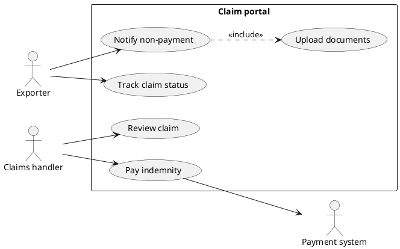
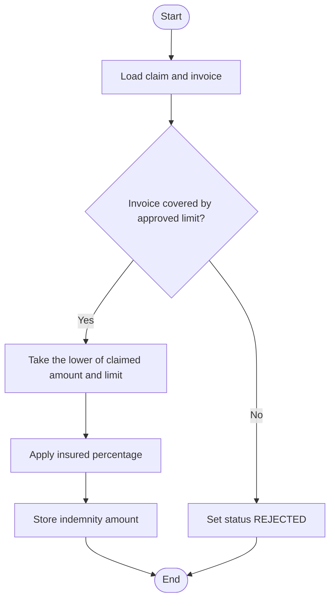
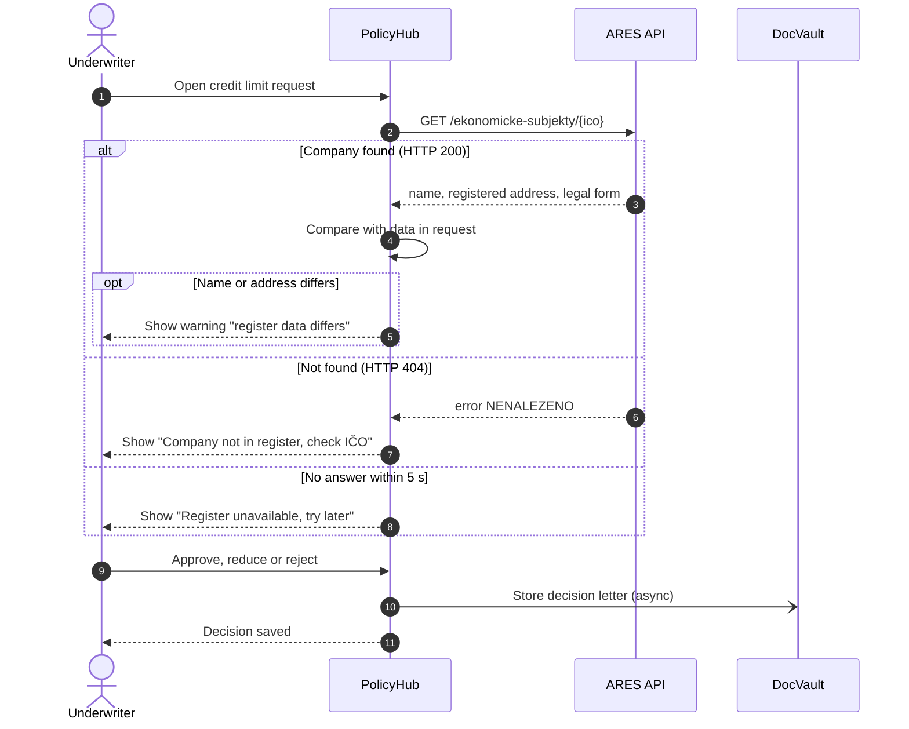
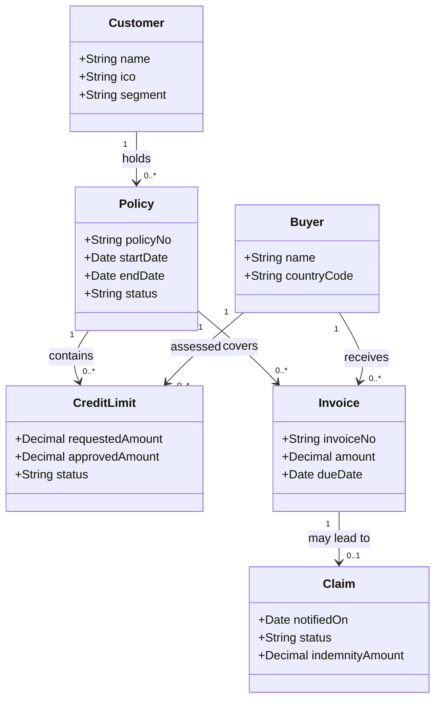
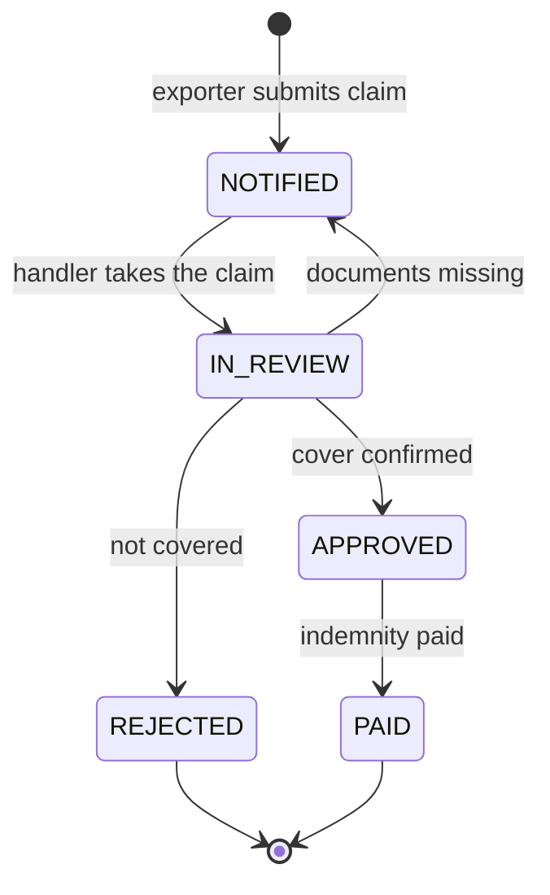

## Why this matters
Inzerát chce UML nebo BPMN. BPMN ukazuje, jak práce teče businessem. UML (Unified Modeling Language) lépe ukazuje, jak spolu komunikují systémy, jaká data systém drží a jakými stavy prochází záznam. Ve specifikaci pro dodavatele jeden sekvenční diagram volání API nebo jeden stavový diagram škody často nahradí dvě stránky textu a předejde nedorozuměním. Nepotřebuješ celé UML. Potřebuješ pět nebo šest typů diagramů a úsudek, kdy který použít.

## Quick version
**Co je UML.** UML je standardní vizuální jazyk pro popis softwarových systémů. Spravuje ho OMG (Object Management Group); aktuální verze je **UML 2.5** (2.5.1 je nejnovější revize). Definuje 14 typů diagramů ve dvou skupinách:

- **Structural diagrams** (strukturní diagramy) ukazují, co existuje: třídy, komponenty, servery. Jsou to snímky stavu.
- **Behavioral diagrams** (diagramy chování) ukazují, co se děje v čase: use cases, aktivity, zprávy, změny stavů.

**Pět diagramů, které analytik skutečně používá:**

1. **Use case diagram** (diagram případů užití) — kdo (aktéři) používá které funkce (use cases) systému. Je to obsah požadavků. Skutečný obsah je v **textovém use case**: vstupní podmínky, hlavní tok, alternativní toky, výstupní podmínky. Diagram bez textu říká velmi málo.
2. **Activity diagram** (diagram aktivit) — kroky procesu nebo algoritmu s rozhodnutími a paralelními větvemi. Vypadá jako vývojový diagram (flowchart). Pro business procesy s odděleními a událostmi je obvykle lepší volbou BPMN; diagramy aktivit se hodí na logiku uvnitř jedné systémové funkce.
3. **Sequence diagram** (sekvenční diagram) — který účastník posílá kterou zprávu komu, v časovém pořadí. Je to nejužitečnější UML diagram pro integrace. Příklad: underwriter odešle žádost o úvěrový limit, PolicyHub zavolá API registru firem ARES, ARES vrátí údaje o firmě nebo „nenalezeno“, PolicyHub zobrazí výsledek. Varianty ukazují fragmenty `alt` (buď–anebo), `opt` (volitelné) a `loop` (opakování).
4. **Class diagram (domain model)** (diagram tříd jako doménový model) — business objekty a jejich vztahy: jeden zákazník má mnoho pojistných smluv, jedna smlouva kryje mnoho faktur. Čísla na čarách (**multiplicity**, násobnost, např. `1` a `0..*`) říkají kolik. Analytici ho používají jako **domain model** (doménový model), ne jako programový kód.
5. **State machine diagram** (stavový diagram) — životní cyklus jednoho objektu: škoda přechází z Notified přes In review do Approved nebo Rejected a pak do Paid. Odpovídá na otázku „které změny stavu jsou povolené?“, a to je přesně to, co potřebují testeři.

Diagramy komponent a nasazení (které systémy a servery existují a jak jsou propojené) je užitečné umět číst, když je ukáže architekt, ale sama je kreslit budeš málokdy.

**BPMN, nebo UML?**

| Otázka, na kterou potřebuješ odpovědět | Použij |
|---|---|
| Kdo co dělá a v jakém pořadí napříč odděleními? | Procesní diagram BPMN |
| Které funkce systém nabízí kterým uživatelům? | UML use case diagram + textové use cases |
| Jak si dva systémy krok za krokem vyměňují data? | UML sekvenční diagram |
| Jaké business objekty existují a jak spolu souvisejí? | UML diagram tříd (nebo ER diagram) |
| Jaké stavy může záznam mít a co ho mezi nimi posouvá? | UML stavový diagram |

**Nástroje.** [draw.io](https://app.diagrams.net/) na kreslení myší. Textové nástroje vygenerují diagram z několika řádků kódu: [Mermaid Live](https://mermaid.live/) a [PlantUML](https://www.plantuml.com/plantuml/). Textové diagramy můžou žít v Confluence, v Gitu nebo v Markdown specifikaci a snadno se mění.

**Pravidla od oka:**

- Kresli diagram pro konkrétního čtenáře a konkrétní otázku. Pokud odpověď nikdo nepotřebuje, diagram vynech.
- Vejdi se na jednu stránku. Velké diagramy rozděl.
- Používej business názvy, které používají tvoji stakeholdeři („Claim“, ne „tbl_clm“).
- Diagram doplňuje textový požadavek; nenahrazuje akceptační kritéria.

**Věta na pohovor:** „Pro business proces používám BPMN a UML tam, kde jde o systém: use cases pro rozsah, sekvenční diagramy pro integrace, diagram tříd pro doménový model a stavový diagram pro životní cyklus stavů.“

## Deep dive

### UML na jedné stránce: co je a co není [P1]
UML vzniklo v 90. letech sloučením několika objektově orientovaných notací a stalo se standardem OMG. Specifikace UML 2.5.1 je dlouhá a psaná pro výrobce nástrojů; nikdo ji nečte od začátku do konce. Pro tebe je podstatné:

- UML je **notace**, ne metoda. Říká, jak kreslit, ne co analyzovat a v jakém pořadí.
- 14 typů diagramů se dělí na **strukturní** (class, object, component, composite structure, package, deployment, profile) a **behaviorální** (use case, activity, state machine a interakční diagramy: sequence, communication, timing, interaction overview).
- Stačí být „dost správně“. Týmy zřídka používají všechny symboly. Konzistentní, čitelný diagram s legendou je lepší než dokonale normovaný diagram, kterému nikdo nerozumí.

V praxi existují dvě úrovně přesnosti. **Sketch** (náčrt): diagram na tabuli nebo na schůzce, aby se lidé shodli. **Specification** (specifikace): diagram přiložený k požadavku, podle kterého dodavatel staví. Ve druhém případě na přesnosti záleží: typy šipek, multiplicity a názvy stavů musí odpovídat textu.

### Use case diagram a textové use cases [P1]
**Use case** (případ užití) je cíl, kterého aktér se systémem dosáhne, zapsaný jako sloveso + předmět: „Request credit limit“, „Notify non-payment“. **Actor** (aktér) je role mimo systém, která s ním interaguje: člověk (Exporter, Underwriter) nebo jiný systém (ARES, platební systém). **System boundary** (hranice systému) je obdélník s názvem systému; use cases jsou uvnitř, aktéři venku.

Nejvíc zmatku působí dva vztahy:

- **«include»**: základní use case zahrnutý use case *vždy* použije. „Submit claim“ vždy zahrnuje „Upload documents“. Používá se k vytažení kroku, který sdílí několik use cases.
- **«extend»**: rozšiřující use case *někdy* přidá chování v definovaném bodě, za určité podmínky. „Request payment by instalments“ rozšiřuje „Submit claim“ jen tehdy, když se exportér s odběratelem dohodl na splátkovém kalendáři.

Začátečníci obojí nadužívají. Když si nejsi jistá, vynech je a variantu popiš v textovém use case.

Use case diagram portálu ExportShield pro hlášení škod, zapsaný v PlantUML (vlož ho do [PlantUML](https://www.plantuml.com/plantuml/) a vykreslí se):

Diagram na první pohled ukazuje **rozsah**: co portál dělá a pro koho. Neříká, co „Notify non-payment“ znamená. To je úkol **textového use case**, ve kterém je většina analýzy:

| Pole | Příklad: Notify non-payment |
|---|---|
| Aktér | Exportér |
| Vstupní podmínka | Exportér je přihlášený; smlouva je aktivní; faktura je krytá schváleným úvěrovým limitem |
| Spouštěč | Odběratel nezaplatil v čekací lhůtě po splatnosti |
| Hlavní tok | 1. Exportér vybere smlouvu a fakturu. 2. Portál předvyplní údaje o faktuře z PolicyHubu. 3. Exportér zadá dlužnou částku a nahraje dokumenty. 4. Portál zkontroluje povinná pole. 5. Exportér odešle. 6. Portál vytvoří škodu ve stavu NOTIFIED a zobrazí číslo škody. |
| Alternativní tok 3a | Faktura není v PolicyHubu: exportér zadá údaje o faktuře ručně; škoda dostane příznak pro ruční kontrolu. |
| Výjimka 4a | Chybí povinný dokument: portál odeslání zablokuje a vypíše, co chybí. |
| Výstupní podmínka | Škoda existuje v ClaimDesku ve stavu NOTIFIED; exportér dostane potvrzovací e-mail. |
| Business pravidla | Nárokovaná částka nesmí převýšit částku faktury. |

Tato tabulka je testovatelná: z každého toku vznikne alespoň jeden testovací případ. Proto zkušení analytici říkají, že text je důležitější než obrázek.

### Diagram aktivit a jak se liší od BPMN [P2]
**Activity diagram** (diagram aktivit) ukazuje tok akcí: plný kruh jako začátek, obdélníky se zaoblenými rohy jako akce, kosočtverce jako rozhodnutí nebo sloučení, tlustá čára jako **fork/join** (rozdělení a spojení paralelních větví) a plný kruh uvnitř prstence jako konec celé aktivity (kruh s X ukončí jen jeden tok). **Partitions** (oddíly, swimlanes) můžou ukazovat, kdo akci provádí.

Vypadá podobně jako BPMN a jednoduché business procesy jde modelovat v obojím. Rozdíly, na kterých v praxi záleží:

| Aspekt | BPMN 2.0 | UML diagram aktivit |
|---|---|---|
| Určeno pro | Business procesy napříč rolemi a organizacemi | Chování systému nebo algoritmu |
| Události (časovače, zprávy, chyby) | Bohaté, standardizované typy událostí | Základní podpora |
| Spolupráce mezi organizacemi | Pools a message flows | Prakticky ne |
| Spustitelné ve workflow enginech | Ano (např. Camunda) | V běžné praxi ne |
| Typický čtenář | Business, vlastníci procesů | Vývojáři, architekti |

Pravidlo: BPMN použij pro business proces „jak se v ExportShield vyřizuje škoda“. Diagram aktivit použij pro logiku uvnitř jedné funkce, například „jak PolicyHub počítá pojistné plnění“ s jeho rozhodnutími. Mermaid nemá nativní diagram aktivit, ale flowchart se mu hodně přiblíží:

### Sekvenční diagram pro integrace [P1]
**Sequence diagram** (sekvenční diagram) ukazuje účastníky vedle sebe a zprávy mezi nimi shora dolů, v časovém pořadí. Pro analytika, který pracuje s dodavateli, je to nejpraktičtější UML diagram, protože integrace jsou místo, kde jsou nedorozumění nejdražší.

Prvky:

- **Lifeline** (čára života): účastník (člověk, systém, služba) s přerušovanou čarou dolů. Čas plyne dolů.
- **Synchronous message** (synchronní zpráva, plná čára, plná šipka): odesílatel čeká na odpověď. Typické volání REST API.
- **Asynchronous message** (asynchronní zpráva, otevřená šipka): odesílatel pokračuje bez čekání. Typické pro frontu zpráv nebo e-mailové upozornění.
- **Reply** (odpověď, přerušovaná čára): odpověď na synchronní volání.
- **Activation bar** (pruh aktivace): úzký obdélník na lifeline po dobu, kdy je účastník zaneprázdněný.
- **Combined fragments** (kombinované fragmenty): rámeček s operátorem v rohu.
  - `alt` — alternativy: proběhne jedna z několika větví, každá s podmínkou (jako if/else).
  - `opt` — volitelná část, která proběhne, jen když platí podmínka (if bez else).
  - `loop` — opakování, dokud platí podmínka, nebo pro každou položku.
  - `par` — paralelní části (pro analytiky méně časté).

**Řešený příklad: žádost o úvěrový limit s kontrolou v ARES.** Underwriter v ExportShield pracuje v PolicyHubu. Když přijde nová žádost pro českou firmu, PolicyHub vyhledá firmu podle IČO v ARES, veřejném registru ekonomických subjektů, který spojuje data z několika úředních registrů a nabízí bezplatné API (probírá se v modulu 11 o API). ARES pokrývá jen české subjekty; u zahraničních odběratelů platí stejný vzor s komerčním poskytovatelem dat.

Čti ho shora dolů. Krok 2 je synchronní: PolicyHub čeká. Fragment `alt` uvádí tři výsledky; třetí (timeout, vypršení časového limitu) je ten, na který většina specifikací zapomene. Fragment `opt` proběhne, jen když se data liší. Poslední volání do DocVault je asynchronní: underwriter na archiv dokumentů nečeká.

Co tento diagram dá dodavateli (NovaSoft), co text často nedá: pořadí volání, kdo na koho čeká, každou chybovou větev a místo, kam připojit pravidla (timeout 5 sekund, která pole porovnat). Každá větev je zároveň testovací případ.

Tipy:

- Jeden scénář na diagram, nebo jeden diagram s větvemi `alt`. Nesnaž se ukázat všechno.
- Zprávy popisuj nejdřív business významem, technický detail až potom: „Look up company (GET /ekonomicke-subjekty/{ico})“.
- Když zpracováváš seznamy, přidej `loop`, např. „for each invoice in the batch“.

### Diagram tříd jako doménový model [P2]
**Class diagram** (diagram tříd) ukazuje třídy (typy věcí), jejich **attributes** (atributy, datová pole) a **associations** (asociace, vztahy). Vývojáři ho používají k návrhu kódu. Analytici používají stejnou notaci pro **domain model** (doménový model): obrázek business pojmů a jejich vztahů, bez technických detailů jako metody nebo databázové typy.

**Multiplicity** (násobnost) na každém konci asociace říká, kolik objektů se vztahu účastní:

| Zápis | Význam |
|---|---|
| `1` | právě jeden |
| `0..1` | žádný nebo jeden (volitelné) |
| `*` nebo `0..*` | libovolný počet, včetně nuly |
| `1..*` | alespoň jeden |

Asociaci čti v obou směrech: „jeden Customer má nula nebo více Policies; každá Policy patří právě jednomu Customerovi.“

V diagramech tříd se objevují ještě dva vztahy: **generalization** (generalizace, šipka s prázdným trojúhelníkem, „je druhem“: CorporateCustomer je Customer) a **composition** (kompozice, plný kosočtverec, „je součástí a bez celku nemůže existovat“: InvoiceLine nemůže existovat bez své Invoice). V doménových modelech je používej střídmě.

Doménový model je nástroj pro rozhovor. Nakresli ho brzy na začátku projektu a pak se ptej stakeholderů: „Může jedna škoda krýt dvě faktury?“, „Může mít odběratel limity pod dvěma smlouvami?“ Z odpovědí se stanou business pravidla. Stejná struktura se později promění v ER diagram a tabulky (viz modul o datech).

### Stavový diagram: životní cyklus škody [P2]
**State machine diagram** (stavový diagram) ukazuje stavy, ve kterých může být jeden objekt, a **transitions** (přechody) mezi nimi. Přechod má spouštěč (trigger, událost), volitelnou **guard** (podmínku v hranatých závorkách) a volitelný efekt. Černá tečka je počáteční stav, plná tečka uvnitř prstence koncový stav. Popisek přechodu se zapisuje jako `trigger [guard] / effect`. V Mermaidu se obojí zapisuje jako `[*]`.

Proč na tom analytikovi záleží:

- Dělá explicitními **povolené a zakázané přechody**. Dá se zamítnutá škoda znovu otevřít? Může škoda přejít z NOTIFIED rovnou do PAID? Pokud v diagramu šipka není, odpověď je ne a vývojář to musí zablokovat.
- Testeři z něj přímo odvozují testovací případy: každá šipka je test platného přechodu, každá chybějící šipka negativní test. Je to technika ISTQB „state transition testing“ (testování přechodů stavů).
- Vynese na povrch otázky: co se stane, když odběratel zaplatí až po schválení škody? To může vyžadovat nový stav (např. RECOVERED) nebo business pravidlo.

Názvy stavů drž totožné s hodnotami v systému (`IN_REVIEW`, ne jednou „Under review“ a jinde „Checking“).

### Diagramy komponent a nasazení [P3]
**Component diagram** (diagram komponent) ukazuje stavební bloky řešení a jejich rozhraní: PolicyHub, ClaimDesk, DocVault, integrační vrstvu, ARES jako externí službu. **Deployment diagram** (diagram nasazení) ukazuje, kde software běží: servery, cloudové služby, sítě a která komponenta je nainstalovaná kde.

Jako analytička je budeš většinou číst v architektonických dokumentech. Užitečné otázky při čtení:

- Která komponenta vlastní která data (**system of record**, autoritativní zdroj dat)?
- Která rozhraní překračují hranici firemní sítě? Ta potřebují bezpečnostní posouzení.
- Kde bude žít moje nová funkce a kterých rozhraní se dotkne?

Pro vlastní dokumenty obvykle stačí jednoduchý „context diagram“ (kontextový diagram) z krabic a šipek: tvůj systém uprostřed, kolem něj uživatelé a sousední systémy.

### Volba mezi BPMN a UML [P1]
Navzájem se doplňují. Typická specifikace změny v ExportShield by mohla obsahovat:

1. TO-BE proces vyřizování úvěrových limitů v BPMN (business pohled).
2. Use case diagram pro nové funkce PolicyHubu, ke každé funkci textový use case.
3. Sekvenční diagram pro integraci s ARES.
4. Stavový diagram pro stavy úvěrového limitu.
5. Doménový model nebo ER diagram pro nová data.

Vybírej podle otázky. Proces napříč lidmi a časem: BPMN. Chování systému, data a rozhraní: UML. Nekresli stejnou věc dvakrát ve dvou notacích; zdvojnásobí to údržbu a obě verze se rozejdou.

### Nástroje: kreslení versus diagramy jako kód [P2]
**[draw.io](https://app.diagrams.net/)** (diagrams.net) je zdarma, běží v prohlížeči a má knihovny tvarů pro UML i BPMN. Hodí se pro diagramy s přesným rozložením a pro stakeholdery, kteří mají raději obrázky.

**Diagrams as code** (diagramy jako kód) znamená, že napíšeš krátký text a nástroj nakreslí obrázek:

- **[Mermaid](https://mermaid.live/)** podporuje mimo jiné flowcharty, sekvenční, třídní, stavové a ER diagramy. Nativně se vykresluje v mnoha wiki a v Markdownu na platformách jako GitHub a GitLab. Tento web Mermaid bloky také vykresluje.
- **[PlantUML](https://www.plantuml.com/plantuml/)** pokrývá víc z UML, včetně diagramů use case, aktivit, komponent a nasazení.

Výhody textových diagramů: správa verzí (vidíš, co se změnilo), rychlé úpravy, konzistentní rozložení, snadno se drží vedle specifikace. Nevýhoda: menší kontrola nad rozložením. AI asistenti umí z popisu navrhnout Mermaid nebo PlantUML, což je rychlá cesta k první verzi; výsledek vždy zkontroluj proti vlastnímu porozumění a používej jen fiktivní nebo schválená data.

### Revize diagramu, který dostaneš [P2]
Dodavatelé a architekti ti budou diagramy posílat také, často jako součást návrhu řešení, který máš schválit. Jejich revize je součást práce a dobrý způsob, jak zachytit mezery dřív, než se cokoli postaví. Krátký checklist:

1. **Účel**: na jakou otázku diagram odpovídá? Pokud to nepoznáš, zeptej se dřív, než začneš revidovat detaily.
2. **Názvy**: používají účastníci, třídy a stavy stejné názvy jako požadavky a business? „Credit line“ v diagramu a „credit limit“ v user story může být totéž, nebo dvě různé věci; zjisti to.
3. **Úplnost vůči požadavkům**: dokážeš u každého požadavku nebo akceptačního kritéria v rozsahu ukázat, kde ho diagram pokrývá? U sekvenčního diagramu: je tam každý chybový případ ze specifikace?
4. **Multiplicity a přechody**: dovoluje diagram tříd něco, co business zakazuje, nebo zakazuje něco, co business potřebuje? Dovoluje stavový diagram přechod, který by porušil business pravidlo?
5. **Předpoklady**: co diagram bere jako samozřejmost? Synchronní volání externího registru předpokládá, že registr je vždy dostupný. Je to přijatelné?
6. **Vlastnictví**: v diagramech komponent a sekvenčních diagramech, který systém data vlastní a který drží jen kopii?

Zjištění piš jako konkrétní revizní komentáře: „Step 4: what happens if ARES returns 404? The specification requires a warning to the underwriter.“ S komentářem, který odkazuje na požadavek, se pracuje mnohem snáz než s „please add error handling“. Veď seznam otevřených bodů a dohodni se s dodavatelem, které z nich blokují schválení.

### Časté chyby [P2]
- Míchání úrovní: jeden diagram s business kroky a databázovými voláními vedle sebe.
- Názvy use cases, které jsou obrazovky nebo tlačítka („Click Save“) místo cílů.
- Sekvenční diagramy jen se šťastnou cestou.
- Diagramy tříd plné technických polí (created_by, row_version), která stakeholdery nezajímají.
- Názvy stavů, které se liší mezi diagramem, user stories a systémem.
- Žádný název, datum, verze. Diagram bez kontextu se za půl roku špatně přečte.

## Key terms
- **UML (Unified Modeling Language)** — standardní notace OMG pro modelování softwarových systémů; aktuální verze UML 2.5.1.
- **Structural diagram** (strukturní diagram) — UML diagram, který ukazuje statické části systému, například třídy nebo komponenty.
- **Behavioral diagram** (diagram chování) — UML diagram, který ukazuje, jak se systém chová v čase, například diagram use case, aktivit, sekvenční nebo stavový.
- **Actor** (aktér) — role mimo systém (člověk nebo systém), která s ním interaguje.
- **Use case** (případ užití) — cíl, kterého aktér se systémem dosáhne, popsaný toky kroků.
- **System boundary** (hranice systému) — obdélník v use case diagramu, který odděluje to, co systém dělá, od jeho okolí.
- **«include»** — vztah, kdy use case vždy použije jiný use case.
- **«extend»** — vztah, kdy use case za určité podmínky volitelně přidá chování k jinému use case.
- **Lifeline** (čára života) — účastník v sekvenčním diagramu, nakreslený jako obdélník s přerušovanou čarou dolů.
- **Synchronous message** (synchronní zpráva) — volání, při kterém odesílatel čeká na odpověď.
- **Asynchronous message** (asynchronní zpráva) — zpráva, po které odesílatel pokračuje bez čekání na odpověď.
- **Combined fragment (alt / opt / loop)** (kombinovaný fragment) — rámeček v sekvenčním diagramu pro alternativy, volitelné části a opakování.
- **Domain model** (doménový model) — diagram tříd s business pojmy a jejich vztahy, bez technických detailů.
- **Multiplicity** (násobnost) — čísla na asociaci, která říkají, kolik objektů se vztahu účastní (např. 1, 0..1, 0..*).
- **State machine diagram** (stavový diagram) — diagram stavů jednoho objektu a povolených přechodů mezi nimi.
- **Guard** (stráž, podmínka přechodu) — podmínka na přechodu nebo toku, která musí platit, aby k němu došlo.
- **Diagrams as code** (diagramy jako kód) — psaní diagramů jako textu (Mermaid, PlantUML), který nástroj vykreslí do obrázku.

## Hands-on
:::exercise id="m08-e1" title="Use case diagram pro portál škod" min="45" tool="PlantUML or draw.io"
**Cíl:** vymezit rozsah nového portálu ExportShield pro škody a jeden use case popsat úplně.

1. Vypiš aktéry: Exporter, Claims handler, Claims manager (schvaluje škody nad limitem), Payment system, DocVault.
2. Vypiš 6–8 use cases ve tvaru sloveso + předmět (např. „Notify non-payment“, „Upload documents“, „Approve claim“, „Pay indemnity“, „Track claim status“).
3. Nakresli diagram v [draw.io](https://app.diagrams.net/) nebo vyjdi z příkladu v PlantUML v tomto modulu a rozšiř ho v [PlantUML](https://www.plantuml.com/plantuml/). Přidej jeden «include» a nejvýš jeden «extend». U každého krátce napiš, proč je potřeba.
4. Napiš textový use case pro „Approve claim“ s tabulkou z modulu: aktér, vstupní podmínka, spouštěč, hlavní tok, alespoň dva alternativní nebo výjimkové toky, výstupní podmínka, business pravidla.
5. Ze svých toků odvoď tři názvy testovacích případů.

**Hotovo, když:** diagram se vejde na jednu stránku, každý název use case je cíl a textový use case má alespoň dva toky mimo šťastnou cestu a tři názvy testovacích případů.
:::

:::exercise id="m08-e2" title="Sekvenční diagram vyhledání v ARES v Mermaid Live" min="40" tool="Mermaid Live"
**Cíl:** namodelovat integraci se všemi chybovými větvemi.

1. Otevři [Mermaid Live](https://mermaid.live/) a vlož sekvenční diagram z tohoto modulu. Ověř, že se vykreslí.
2. Změň scénář: exportér teď zadává IČO odběratele v **customer portal** (zákaznickém portálu), portál volá PolicyHub, PolicyHub volá ARES. Přidej portál jako nového účastníka.
3. Přidej větev `alt` pro HTTP 400 (neplatný formát ID). V modulu o API uvidíš, že ARES vrací 400, když ID nemá 8 číslic.
4. Přidej `loop` pro dávkový případ: jednou za noc PolicyHub znovu zkontroluje všechny aktivní odběratele s českým IČO.
5. Přidej řádek `Note over PH,ARES: Timeout 5 s, max 1 retry` (syntaxe Mermaid: `Note over A,B: text`).
6. Exportuj diagram jako SVG nebo PNG.

**Hotovo, když:** diagram se vykreslí bez chyb, má alespoň tři větve výsledků plus noční smyčku a někdo, kdo modul nečetl, umí vysvětlit, co se stane, když ARES nefunguje.
:::

:::exercise id="m08-e3" title="Stavový diagram životního cyklu škody" min="30" tool="Mermaid Live"
**Cíl:** udělat povolené změny stavu škody explicitní a testovatelné.

1. Vyjdi z příkladu `stateDiagram-v2` v tomto modulu.
2. Přidej tyto business situace a u každé rozhodni, jestli potřebuješ nový stav, nový přechod, nebo nic: exportér škodu stáhne; odběratel zaplatí po nahlášení; proti zamítnuté škodě se exportér odvolá; částečná výplata plnění ve dvou splátkách.
3. Ke každému přechodu napiš jeho spouštěč.
4. Napiš seznam tří přechodů, které musí být **nemožné** (negativní testy), např. „PAID to IN_REVIEW“.
5. Porovnej výsledek s tabulkami `claims` a `payments` v datové sadě ExportShield (`data/sql/exportshield.sql`). Sedí stavy? Co by databáze potřebovala pro tvoje nové stavy?

**Hotovo, když:** diagram se vykreslí, každý stav je dosažitelný ze startu, každý stav má buď odchozí přechod, nebo končí, a máš seznam tří zakázaných přechodů.
:::

:::exercise id="m08-e4" title="Doménový diagram tříd pro ExportShield" min="45" tool="Mermaid Live or draw.io"
**Cíl:** namodelovat business pojmy úvěrového pojištění a najít otevřené otázky.

1. Použij třídy Customer, Policy, Buyer, Country, CreditLimit, Invoice, Claim, Payment.
2. Každé třídě dej 2–4 business atributy (technická ID nejsou potřeba).
3. Nakresli asociace s multiplicitami na obou koncích. Každou přečti nahlas v obou směrech.
4. Napiš alespoň tři otázky, které bys položila stakeholderovi, protože multiplicita není jasná (např. „Can one claim cover several invoices of the same buyer?“).
5. Porovnej svůj model se strukturou tabulek v `data/sql/exportshield.sql`. Najdi jedno místo, kde databáze dovoluje něco, co tvůj model zakazuje.

**Hotovo, když:** diagram se vykreslí, každá asociace má multiplicity na obou koncích a máš tři otázky pro stakeholdera a jeden rozdíl mezi modelem a databází.
:::

## Self-check
:::q
Jaký je rozdíl mezi strukturními a behaviorálními UML diagramy? Uveď příklad od každého.
---
Strukturní diagramy ukazují, co v systému existuje v určitém okamžiku: třídy, komponenty, servery. Diagram tříd s Customer, Policy a Invoice je strukturní. Behaviorální diagramy ukazují, co se děje v čase: interakce, toky, změny stavů. Sekvenční diagram, ve kterém PolicyHub volá ARES, je behaviorální.
:::

:::q
Proč zkušení analytici říkají, že textový use case je důležitější než use case diagram?
---
Diagram ukazuje jen názvy cílů a kdo je používá, takže se hodí na rozsah. Text obsahuje vstupní podmínky, hlavní tok, alternativní a výjimkové toky, výstupní podmínky a business pravidla. To je to, co vývojáři staví a testeři testují. Dva lidé se můžou shodnout na stejném diagramu, a přitom myslet velmi odlišné chování.
:::

:::q
Kdy použiješ «include» a kdy «extend»?
---
«include» znamená, že základní use case zahrnuté chování provede vždy, například „Submit claim“ vždy zahrnuje „Upload documents“. «extend» znamená, že se další chování přidá jen za určité podmínky v definovaném bodě, například „Request instalment plan“ rozšiřuje „Submit claim“ jen tehdy, když byly dohodnuté splátky. Když si nejsi jistá, popiš variantu v textovém use case, místo abys vztah přidávala.
:::

:::q
Jaký je v sekvenčním diagramu rozdíl mezi synchronní a asynchronní zprávou a která z nich je typické volání REST?
---
U synchronní zprávy odesílatel čeká na odpověď, než pokračuje; má plnou šipku a obvykle přerušovanou čáru odpovědi. U asynchronní zprávy odesílatel pokračuje hned, jako u fronty zpráv nebo e-mailového upozornění; má otevřenou šipku. Typické volání REST, kdy klient čeká na HTTP odpověď, je synchronní.
:::

:::q
Co vyjadřují fragmenty `alt`, `opt` a `loop`? Ke každému uveď příklad z ExportShield.
---
`alt` ukazuje alternativní větve, z nichž proběhne právě jedna, jako if/else: ARES vrátí 200, 404, nebo vyprší časový limit. `opt` ukazuje volitelnou část, která proběhne, jen když platí její podmínka: varování zobraz, jen když se název v registru liší. `loop` část opakuje: pro každého aktivního českého odběratele každou noc znovu zkontroluj registr.
:::

:::q
Diagram tříd ukazuje `Customer "1" --> "0..*" Policy`. Přečti ho v obou směrech. Na jakou business otázku se může analytik ještě zeptat?
---
Jeden zákazník má nula nebo více smluv a každá smlouva patří právě jednomu zákazníkovi. Otevřené otázky: může smlouvu sdílet skupina firem (pak je „právě jeden“ špatně)? Existuje v systému zákazník bez smluv, například během onboardingu? Odpovědi se stanou business pravidly nebo změní model.
:::

:::q
Jak stavový diagram pomáhá testerům?
---
Každý přechod v diagramu je platná změna stavu, která potřebuje pozitivní test. Každá dvojice stavů bez přechodu je změna, kterou musí systém zablokovat, a dává negativní testy. Diagram také ukazuje spouštěče a podmínky (guards), takže testeři vědí, která událost nebo podmínka každou změnu způsobí. To je základ testování přechodů stavů.
:::

:::q
Potřebuješ zdokumentovat, jak se škoda pohybuje mezi exportérem, oddělením škod a financemi. Použiješ BPMN, nebo UML diagram aktivit, a proč?
---
BPMN, protože jde o business proces napříč několika rolemi s předáváním, čekáním a událostmi, jako jsou upomínky. BPMN má pro to pools, lanes a typy událostí a business čtenáři ho znají. UML diagram aktivit se lépe hodí na logiku uvnitř jedné systémové funkce, například výpočet pojistného plnění.
:::

## Interview corner
:::interview
Které UML diagramy jako business analytička používáš a kdy?
*EN: Which UML diagrams do you use as a business analyst, and when?*
---
- Use case diagram pro rozsah, vždy podložený textovými use cases.
- Sekvenční diagram pro integrace: pořadí volání, synchronní versus asynchronní, chybové větve.
- Diagram tříd jako doménový model pro shodu na business pojmech a multiplicitách.
- Stavový diagram pro životní cykly stavů; testeři z něj odvozují testovací případy.
- Diagram aktivit pro logiku uvnitř funkce; BPMN pro procesy napříč odděleními.
- Konkrétní příklad z tvého portfolia (např. vyhledání v ARES).

Typická chyba: zpaměti vyjmenovat všech 14 typů diagramů a neříct, kdy bys kterýkoli z nich použila.
:::

:::interview
Jak bys dodavateli popsala integraci mezi dvěma systémy?
*EN: How would you describe an integration between two systems to a vendor?*
---
- Začni business účelem a spouštěčem: jaká událost výměnu zahájí.
- Sekvenční diagram s účastníky, pořadím volání a každým výsledkem (úspěch, nenalezeno, neplatný vstup, timeout).
- Tabulka mapování dat: zdrojové pole, cílové pole, transformace, povinné nebo volitelné.
- Nefunkční pravidla: timeouty, opakování (retries), objemy, bezpečnost, logování.
- Akceptační kritéria a testovací scénáře pro každou větev.

Typická chyba: popsat jen šťastnou cestu a ošetření chyb nechat na fantazii vývojáře.
:::

:::interview
Jaký je rozdíl mezi BPMN a UML?
*EN: What is the difference between BPMN and UML?*
---
- Obojí jsou standardy OMG, ale pro různé otázky.
- BPMN 2.0: business procesy, kdo co dělá v jakém pořadí, události a předávání mezi rolemi a organizacemi; workflow enginy ho umí spouštět.
- UML 2.5: softwarové systémy, jejich struktura (třídy, komponenty) a chování (use cases, sekvence, stavy).
- V praxi se kombinují: BPMN pro business proces, UML pro systémové části.

Typická chyba: říct, že jedno je „lepší“, a nenavázat volbu na otázku, na kterou má diagram odpovědět.
:::

:::interview
Ukaž mi, jak bys namodelovala životní cyklus pojistné události.
*EN: Show me how you would model the lifecycle of an insurance claim.*
---
- Pojmenuj stavy tak, jak existují v systému (NOTIFIED, IN_REVIEW, APPROVED, REJECTED, PAID).
- Nakresli stavový diagram se spouštěči u každého přechodu a s podmínkami (guards), kde platí.
- Upozorni na otázky, které vyvstaly: znovuotevření zamítnutých škod, pozdní platba odběratele, částečné výplaty.
- Vysvětli, jak se zakázané přechody stanou negativními testy a validačními pravidly pro vývojáře.

Typická chyba: nakreslit vývojový diagram procesu vyřizování škody místo stavů jednoho objektu škody.
:::
