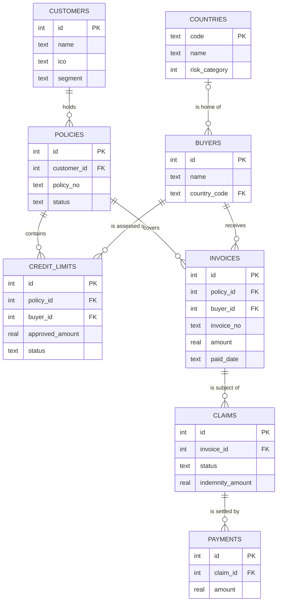

## Why this matters
Skoro každý požadavek se dotýká dat: nové pole ve formuláři, report, rozhraní, které posílá záznamy do jiného systému, migrace na novou platformu. Inzerát chce základní SQL a SQL dává smysl, až když rozumíš tabulkám, klíčům a vztahům. Analytička, která umí číst datový model, klade lepší otázky („co se stane se škodami, když sloučíme dva duplicitní zákazníky?“) a píše specifikace, podle kterých dodavatel dokáže stavět. Tento modul je teorie; modul o SQL ji procvičí na stejné datové sadě ExportShield.

## Quick version
**Database** (databáze) je uspořádané úložiště dat spravované softwarem (**DBMS**, database management system, systém řízení báze dat), který umožňuje mnoha uživatelům a aplikacím data bezpečně číst a měnit ve stejnou chvíli. Excel data uložit umí, ale neumí vynutit pravidla, hlídat, kdo co mění, ani spolehlivě zvládnout mnoho uživatelů a miliony řádků.

**Relational databases** (relační databáze: Oracle, Microsoft SQL Server, PostgreSQL, MySQL, SQLite) ukládají data do **tabulek**. Každá tabulka popisuje jeden druh věci:

- **Row** (řádek, záznam) je jeden výskyt: jeden zákazník, jedna faktura.
- **Column** (sloupec, atribut, pole) je jedna vlastnost: název, částka, datum splatnosti. Každý sloupec má **data type** (datový typ): text, celé číslo, desetinné číslo, datum, pravda/nepravda.
- **Primary key (PK)** (primární klíč) jednoznačně identifikuje každý řádek, např. `customers.id`.
- **Foreign key (FK)** (cizí klíč) je sloupec, který ukazuje na primární klíč jiné tabulky, např. `policies.customer_id` ukazuje na `customers.id`. Cizími klíči se tabulky propojují.

**Vztahy** mezi tabulkami:

- **1:1** — jeden řádek odpovídá nejvýš jednomu řádku na druhé straně (zákazník a jeho KYC záznam).
- **1:N** — jeden řádek odpovídá mnoha (jeden zákazník má mnoho smluv). Nejčastější případ. FK je na straně „mnoha“.
- **M:N** — mnoho k mnoha (smlouva kryje mnoho odběratelů; odběratel se objevuje pod mnoha smlouvami). Potřebuje mezi sebou **junction table** (spojovací tabulku). V datech ExportShield tuto roli hraje `credit_limits`: každý řádek propojuje jednu smlouvu s jedním odběratelem a přidává vlastní data (částky, stav).

**ER diagram** (entity-relationship diagram, diagram entit a vztahů) je obrázek tabulek a jejich vztahů. Běžný styl je **crow's foot** („vraní stopa“): „stopa“ se třemi prsty znamená „mnoho“, svislá čárka „jeden“, kroužek „nula / volitelné“.

**Normalization** (normalizace) znamená uspořádat tabulky tak, aby každý fakt byl uložený jednou. Když se země odběratele píše do každé faktury, dřív nebo později se dvě faktury rozejdou. Ulož ji jednou v `buyers` a odkazuj na ni klíčem.

**Data dictionary** (datový slovník): tabulka, která dokumentuje každé pole: název, význam, typ, povolené hodnoty, povinnost, zdroj, vlastníka. Je to jeden z nejužitečnějších výstupů, které BA může vytvořit.

**Data quality** (kvalita dat) se měří v několika dimenzích:

| Dimenze | Otázka | Příklad z ExportShield |
|---|---|---|
| Completeness (úplnost) | Je hodnota vyplněná? | Odběratel bez země |
| Validity (platnost) | Odpovídá formátu a pravidlům? | IČO se 7 číslicemi místo 8 |
| Consistency (konzistence) | Souhlasí související hodnoty? | Úvěrový limit rozhodnutý dřív, než byl požádán |
| Accuracy (přesnost) | Odpovídá realitě? | Plnění vyšší než nárokovaná částka |
| Uniqueness (jedinečnost) | Je každá věc zapsaná jednou? | Stejný exportér registrovaný dvakrát |
| Timeliness (včasnost) | Je aktuální, když je potřeba? | Zaplacené faktury zadané o týdny později |

**Master data** (kmenová data) jsou klíčová sdílená data, která používá mnoho procesů: zákazníci, odběratelé, země, produkty. Chyby v kmenových datech se šíří všude.

**Osobní údaje a GDPR**: analytici rozhodují, která pole systém sbírá a kdo je vidí. Sbírej jen to, co účel potřebuje (**data minimization**, minimalizace údajů), urči, jak dlouho se data uchovávají (**retention**, doba uložení), a omez přístup podle rolí.

**Věta na pohovor:** „Umím číst datový model: tabulky, primární a cizí klíče, vztahy 1:N a M:N. Pole dokumentuji v datovém slovníku, kvalitu dat kontroluji v SQL a myslím na GDPR, když požadavek přidává osobní údaje.“

## Deep dive

### Od tabulky v Excelu k databázi [P1]
Mnoho procesů v pojišťovně začíná v Excelu. Tabulka žádostí o úvěrové limity funguje, dokud: ji neupravují dva lidé najednou, někdo nenapíše „Germany“ a někdo jiný „DE“, omylem se nesmaže řádek, nebo se manažer nezeptá „kolik limitů jsme loni zamítli tureckým odběratelům?“

Databáze s DBMS tyto problémy řeší:

- **Struktura**: každý sloupec má typ; sloupec s datem přijme jen datum.
- **Pravidla (constraints, omezení)**: povinná pole (`NOT NULL`), jedinečné hodnoty, platné odkazy mezi tabulkami.
- **Souběh (concurrency)**: mnoho uživatelů a systémů čte a zapisuje ve stejnou chvíli, aniž by si data přepisovali.
- **Transakce**: skupina změn proběhne buď celá, nebo vůbec. Pokud výplata plnění znamená „vložit platbu“ a „nastavit škodu na PAID“, proběhne obojí, nebo nic.
- **Bezpečnost a audit**: kdo smí co číst nebo měnit a záznam o tom, kdo co udělal.
- **Dotazovací jazyk**: SQL (Structured Query Language), kterým se data ptáš.

Kromě relačních databází existují **NoSQL** databáze (dokumentové jako MongoDB, key-value úložiště, grafové databáze). Používají se pro specifické potřeby, například velmi pružnou strukturu nebo obrovské objemy. Klíčové systémy pojišťoven a bank běží většinou na relačních databázích, proto se soustředíme na ně.

### Tabulky, řádky, sloupce a datové typy [P1]
Datová sada ExportShield (`data/sql/exportshield.sql`) má osm tabulek:

| Tabulka | Jeden řádek je | Klíčové sloupce |
|---|---|---|
| `countries` | země s rizikovou kategorií 1–7 | `code` (PK) |
| `customers` | exportér, tj. pojistník | `id` (PK), `ico` |
| `buyers` | zahraniční odběratel exportéra | `id` (PK), `country_code` (FK) |
| `policies` | pojistná smlouva | `id` (PK), `customer_id` (FK) |
| `credit_limits` | žádost o limit pro jednoho odběratele v rámci jedné smlouvy | `policy_id` (FK), `buyer_id` (FK) |
| `invoices` | faktura od exportéra odběrateli | `policy_id` (FK), `buyer_id` (FK) |
| `claims` | hlášení nezaplacení jedné faktury | `invoice_id` (FK) |
| `payments` | výplata pojistného plnění exportérovi | `claim_id` (FK) |

Běžné **datové typy** a na co si dát pozor:

| Typ | Na co | Pozor |
|---|---|---|
| Integer (celé číslo) | počty, ID | ID s úvodními nulami nejsou čísla. IČO `00006947` uložené jako číslo se změní na `6947`. Ukládej ho jako text. |
| Decimal / numeric (desetinné číslo) | peníze | V produkčních systémech používej pro peníze typ s pevnou desetinnou čárkou, ne plovoucí čárku (floating point). Vedle částky vždy ukládej měnu. |
| Text (varchar) | názvy, kódy | Urči maximální délku a povolené znaky (diakritika!). |
| Date / timestamp (datum / časové razítko) | data, události | Dohodni časové pásmo a formát. Formát ISO `YYYY-MM-DD` se jako text řadí správně. |
| Boolean (logická hodnota) | příznaky ano/ne | Rozhodni, co znamená „neznámo“: NULL, nebo výchozí hodnota? |

**NULL** znamená „žádná hodnota / neznámo“. Není to nula ani prázdný řetězec. Nezaplacená faktura má `paid_date` NULL. NULL potřebuje v SQL zvláštní zacházení (`IS NULL`), jak ukáže modul o SQL.

Poznámka: SQLite, které používá SQL playground na webu, je k typům benevolentní a data ukládá jako text. Serverové databáze jako Oracle nebo SQL Server mají skutečné datové a desetinné typy a jsou přísnější.

### Primární klíče, cizí klíče a vztahy [P1]
**Primary key** (primární klíč) musí být jedinečný a nikdy prázdný. Dva druhy:

- **Surrogate key** (umělý klíč): technické číslo bez business významu (`customers.id = 7`). Stabilní, nikdy se nemění.
- **Natural key** (přirozený klíč): business identifikátor (`policy_no`, IČO). Má význam, ale může se změnit nebo být chybný. Mnoho systémů používá jako PK umělý klíč a přirozený klíč vynucuje jako **unique** (jedinečný).

**Foreign key** (cizí klíč) propojuje řádek s řádkem v jiné tabulce. `invoices.buyer_id = 19` znamená „tato faktura byla poslána odběrateli 19“. DBMS umí vynutit **referential integrity** (referenční integritu): nemůžeš vytvořit fakturu pro odběratele 99, pokud odběratel 99 neexistuje, a nemůžeš smazat odběratele, který má ještě faktury.

Typy vztahů s příklady z ExportShield:

- **1:N** — `customers` → `policies`. Jeden zákazník, mnoho smluv. FK `customer_id` je v `policies` (na straně „mnoha“).
- **1:1** — v datové sadě není; příkladem by byla tabulka `customers_kyc` s právě jedním KYC záznamem na zákazníka.
- **M:N** — smlouvy a odběratelé. Jedna smlouva kryje mnoho odběratelů, jeden odběratel se může objevit pod smlouvami několika exportérů. Relační databáze M:N přímo uložit neumí, proto se přidá **junction table** (spojovací tabulka, také associative nebo link table) se dvěma FK. `credit_limits` je taková spojovací tabulka a nese vlastní atributy: požadovanou a schválenou částku, stav, data.
- **Volitelné** vztahy — `buyers.country_code` může být NULL (odběratel 24 nemá zemi), takže odběratel má žádnou nebo jednu zemi.

### ER diagramy v notaci crow's foot [P1]
**Entity** (entita) je věc, o které ukládáš data (stane se z ní tabulka). Notace **crow's foot** označuje každý konec čáry vztahu:

| Symbol na konci čáry | Význam |
|---|---|
| `||` (dvě čárky) | právě jeden |
| `o|` (kroužek a čárka) | žádný nebo jeden |
| `|{` (čárka a vraní stopa) | jeden nebo více |
| `o{` (kroužek a vraní stopa) | žádný nebo více |

Datový model ExportShield v Mermaidu (`erDiagram`):

Čti ho jako věty: „Každý zákazník má nula nebo více smluv; každá smlouva patří právě jednomu zákazníkovi.“ Všimni si `INVOICES ||--o{ CLAIMS`: databáze technicky dovoluje více škod na jednu fakturu. Business nejspíš chce nejvýš jednu otevřenou škodu na fakturu. Právě tuhle mezeru mezi modelem a business pravidlem má analytička zachytit a převést na požadavek (unique constraint nebo validaci).

Úrovně datových modelů:

- **Conceptual** (konceptuální): jen business entity a vztahy. Pro stakeholdery.
- **Logical** (logický): všechny atributy, klíče a vztahy, nezávisle na konkrétním databázovém produktu.
- **Physical** (fyzický): skutečné tabulky, typy sloupců, indexy pro jeden DBMS. Vlastní ho vývojáři nebo DBA.

BA typicky vytváří konceptuální model a reviduje logický.

### Normalizace jednoduše [P2]
Normalizace je sada pravidel, jak se vyhnout ukládání stejného faktu na více místech. Duplicity škodí, protože se rozcházejí: změníš jednu kopii a druhá je špatně (**update anomaly**, anomálie při aktualizaci).

Představ si jedinou tabulku „credit limits“ v Excelu:

| request | exporter | exporter city | buyer | buyer country | country risk | amount |
|---|---|---|---|---|---|---|
| 1 | Moravia AgroTech | Olomouc | Dunaj Agro | Slovakia | 2 | 80,000 |
| 2 | Moravia AgroTech | Olmouc | Parana Agro | Brazil | 5 | 500,000 |
| 3 | Hana Food Export | Prostejov | Bosphorus Gida | Turkey | 5 | 500,000 |

Problémy: město exportéra je napsané dvakrát a už obsahuje překlep. Když se změní riziková kategorie Turecka, musíš najít každý turecký řádek. Když smažeš žádost 3, ztratíš informaci, že Hana Food Export sídlí v Prostějově.

Tři normální formy prakticky:

- **1NF (první normální forma)**: jedna hodnota v buňce, žádné opakující se skupiny. Ne „buyers: Dunaj Agro, Parana Agro“ v jedné buňce a ne sloupce `buyer1`, `buyer2`, `buyer3`.
- **2NF**: každý neklíčový sloupec závisí na *celém* klíči. Pokud je klíčem tabulky (smlouva, odběratel), název zákazníka závisí jen na smlouvě, takže patří do jiné tabulky.
- **3NF**: neklíčové sloupce závisí na klíči a na ničem jiném. Riziko země závisí na zemi, ne na odběrateli, takže patří do `countries`, ne do `buyers`.

Tabulky ExportShield jsou ve 3NF: každý fakt je uložený jednou a odkazuje se na něj klíčem. Krátká pomůcka: „the key, the whole key, and nothing but the key“ (klíč, celý klíč a nic než klíč).

**Denormalization** (denormalizace) je záměrný opak, používaný v reportingu a datových skladech: některá data se zduplikují, aby reporty běžely rychle bez mnoha joinů. To je v pořádku, když se kopie obnovuje z normalizovaného zdroje a nikdo ji přímo neupravuje.

### Datový slovník [P1]
**Data dictionary** (datový slovník) dokumentuje každé pole, aby business, vývojáři i testeři mysleli totéž. Šablona:

| Pole | Business název | Popis | Typ / formát | Povinné | Povolené hodnoty / pravidlo | Zdroj | Příklad |
|---|---|---|---|---|---|---|---|
| `claims.id` | Claim ID | Jedinečný identifikátor škody | integer | ano | generuje systém, jedinečné | ClaimDesk | 12 |
| `claims.invoice_id` | Invoice | Faktura, které se škoda týká | integer, FK na `invoices.id` | ano | faktura musí existovat a být nezaplacená | Portal | 34 |
| `claims.notified_on` | Notification date | Datum, kdy exportér nahlásil nezaplacení | datum YYYY-MM-DD | ano | po splatnosti faktury; ne v budoucnosti | Portal | 2026-02-15 |
| `claims.status` | Claim status | Aktuální stav životního cyklu | text | ano | NOTIFIED, IN_REVIEW, APPROVED, REJECTED, PAID | ClaimDesk | IN_REVIEW |

Podle potřeby přidej sloupce: vlastník (kdo o poli rozhoduje), citlivost (osobní údaje, důvěrné), doba uchování a obrazovka nebo rozhraní, kde se pole objevuje. Drž slovník vedle specifikace a aktualizuj ho s každým change requestem.

### Dimenze kvality dat [P1]
Špatná data stojí peníze: chybná rozhodnutí, nepovedené migrace, odmítnuté zprávy na rozhraní, nálezy regulátora. Analytička se s kvalitou dat potká na třech místech: když píše validační pravidla do požadavků, když testuje a když analyzuje problém. Šest běžných dimenzí, každá s kontrolou, kterou můžeš na datové sadě ExportShield spustit v SQL:

- **Completeness** (úplnost) — povinné hodnoty jsou vyplněné. Kontrola: odběratelé s `country_code IS NULL`.
- **Validity** (platnost) — hodnoty odpovídají formátu a pravidlům domény. Kontrola: zákazníci, u kterých `length(ico) <> 8`; faktury, kde `due_date < issue_date`; smlouvy, kde `end_date < start_date`.
- **Consistency** (konzistence) — související hodnoty souhlasí napříč poli a tabulkami. Kontrola: úvěrové limity, kde `decided_on < requested_on`; limity ve stavu REJECTED, ale s `approved_amount > 0`; škody ve stavu PAID bez řádku platby; škody na fakturách, které už mají `paid_date`.
- **Accuracy** (přesnost) — hodnoty odpovídají realitě. Z dat samotných se kontroluje nejhůř; obvykle potřebuješ důvěryhodný zdroj. Kontrola: plnění vyšší než nárokovaná částka (nemůže být správně), název firmy porovnaný s registrem ARES.
- **Uniqueness** (jedinečnost) — každá skutečná věc existuje jednou. Kontrola: duplicitní `invoice_no`; dva zákazníci se stejným `ico`.
- **Timeliness** (včasnost) — data jsou dostupná a aktuální, když jsou potřeba. Kontrola: kolik dní uplyne mezi platbou a jejím zadáním do systému (potřebuje časové razítko „entered on“, které tato sada nemá; to samo je zjištění).

Datová sada obsahuje záměrně vložené problémy prvních pěti druhů (včasnost ověřit nejde, jak je vysvětleno výše). Najdeš je v modulu o SQL. Když nějaký najdeš, dobrá analytička si položí tři otázky: kolika záznamů se týká, jaký má dopad na business a odkud špatná data pocházejí (root cause, kořenová příčina: chybějící validace, ruční zadávání, rozhraní)?

### Kmenová a referenční data [P2]
**Master data** (kmenová data) popisují klíčové business objekty sdílené napříč procesy a systémy: zákazníky, odběratele, smlouvy, produkty. **Reference data** (referenční data, číselníky) jsou malé, pomalu se měnící seznamy pro klasifikaci jiných dat: země, měny, stavy, rizikové kategorie. **Transactional data** (transakční data) zaznamenávají události: faktury, škody, platby.

Proč na tom záleží: pokud stejný odběratel existuje dvakrát s různým zápisem, jeho úvěrové limity a škody se rozdělí mezi dva záznamy. Reporty expozice pak riziko na tohoto odběratele podhodnocují. **Master data management (MDM)** je disciplína, která udržuje jednu důvěryhodnou verzi („golden record“) každého kmenového objektu s jasným vlastnictvím a pravidly pro zakládání a slučování záznamů. Otázky, které polož v každém projektu: který systém je pro tato data **system of record** (autoritativní zdroj), kdo je smí zakládat nebo měnit a jak se k aktualizacím dostanou ostatní systémy?

### Základy migrace dat [P3]
Když ExportShield nahrazuje starý systém, existující data se musí přesunout. Část práce BA:

1. **Rozsah**: které entity a kolik historie (všechny škody, nebo jen za posledních 10 let?).
2. **Mapování**: pro každé cílové pole zdrojové pole a transformace (číselníky, formáty, výchozí hodnoty pro chybějící údaje).
3. **Data profiling** (profilování dat): spusť na zdroji dotazy, které najdou prázdné hodnoty, duplicity a neplatné hodnoty před migrací, ne po ní.
4. **Rozhodnutí o čištění**: opravit ve zdroji, opravit během migrace, nebo převést tak, jak je, a označit.
5. **Reconciliation** (odsouhlasení): po každé testovací migraci porovnej počty a součty (např. počet aktivních smluv, součet částek otevřených škod) mezi zdrojem a cílem.
6. **Cut-over** (přepnutí): období zmrazení, finální běh, sign-off od vlastníků dat.

Většina problémů s migrací jsou problémy s kvalitou dat, které se odhalily příliš pozdě.

### Data v reportech a BI [P2]
Nástroje **business intelligence (BI)** (Power BI, Tableau, Qlik a další) dělají z dat dashboardy. Za nimi je často **data warehouse** (datový sklad): samostatná databáze, která sbírá data z provozních systémů přes úlohy **ETL** (extract, transform, load), obvykle přes noc, a ukládá je ve struktuře optimalizované pro reporting.

Co BA u reportu specifikuje:

- Na jakou otázku odpovídá a kdo ho používá.
- Každé **measure** (měřítko, číslo) s přesnou definicí: „loss ratio = indemnities paid and reserved for claims / earned premium, per quarter, in EUR at the month-end rate“ (škodní poměr = vyplacená a rezervovaná plnění / zasloužené pojistné, za čtvrtletí, v EUR kurzem ke konci měsíce). Vágní definice vedou ke dvěma reportům se dvěma různými čísly.
- **Dimensions** (dimenze), podle kterých se dá řezat: země, segment, underwriter, měsíc.
- Filtry, frekvenci obnovy, zdroj dat a zpoždění (včerejší data, nebo v reálném čase?).
- Přístup: kdo smí vidět které řádky.

### Osobní údaje a GDPR pro analytiky [P1]
**GDPR** (obecné nařízení EU o ochraně osobních údajů) se vztahuje na **osobní údaje**: jakékoli informace o identifikované nebo identifikovatelné fyzické osobě. V úvěrovém pojištění jsou většinou stranami firmy, ale osobní údaje jsou i tak všude: kontaktní osoby, podnikající fyzické osoby (jejichž IČO identifikuje člověka), podpisy na dokumentech, uživatelské účty, poznámky z hovorů.

Článek 5 GDPR uvádí sedm zásad: zákonnost, korektnost a transparentnost; účelové omezení; minimalizace údajů; přesnost; omezení uložení; integrita a důvěrnost; odpovědnost. Nejpříměji se do požadavků promítají tyto:

- **Purpose limitation** (účelové omezení): sbírej data pro stanovený účel a bez právního základu je nepoužívej k něčemu nesouvisejícímu.
- **Data minimization** (minimalizace údajů): sbírej jen pole, která účel potřebuje. Opravdu formulář škody potřebuje datum narození kontaktní osoby?
- **Storage limitation (retention)** (omezení uložení): urči, jak dlouho se data uchovávají a jak se potom smažou nebo anonymizují. Doby uchování často vyplývají z jiných zákonů (účetnictví, pojišťovnictví, boj proti praní peněz); stanoví je právní oddělení nebo compliance, BA dohlédne, aby je systém implementoval.
- **Accuracy** (přesnost): osobní údaje musí být správné a aktuální, takže systém potřebuje způsob, jak je opravit.
- **Integrity and confidentiality (security)** (integrita a důvěrnost, bezpečnost), v praxi:
  - *řízení přístupu*: kdo co vidí. Likvidátor škod potřebuje dokumenty ke škodě; uživatel z marketingu ne.
  - *technická opatření*: šifrování, logování přístupů, žádné produkční osobní údaje v testovacích prostředích bez anonymizace.

Jako analytička zákon nevykládáš; to dělá pověřenec pro ochranu osobních údajů (DPO) a právní oddělení. Tvým úkolem je všimnout si, když požadavek přidává nebo mění osobní údaje, upozornit na to a zapsat výsledná pravidla (maskování, doba uchování, role) do specifikace. A také: nikdy nevkládej skutečná data klientů ani osobní údaje do veřejných AI nástrojů, ani „jen jako příklad“.

## Key terms
- **Database / DBMS** (databáze / systém řízení báze dat) — uspořádané úložiště dat a software, který řídí přístup, pravidla a souběh.
- **Relational database** (relační databáze) — databáze, která ukládá data do tabulek propojených klíči a dotazuje se na ně v SQL.
- **Table, row, column** (tabulka, řádek, sloupec) — sada záznamů jednoho druhu; jeden záznam; jeden atribut s datovým typem.
- **NULL** — značka chybějící nebo neznámé hodnoty; není to nula ani prázdný řetězec.
- **Primary key (PK)** (primární klíč) — sloupec nebo sada sloupců, která jednoznačně identifikuje každý řádek.
- **Foreign key (FK)** (cizí klíč) — sloupec, který odkazuje na primární klíč jiné tabulky.
- **Referential integrity** (referenční integrita) — pravidlo, že každá hodnota cizího klíče ukazuje na existující řádek.
- **Junction table** (spojovací tabulka) — tabulka, která řeší vztah mnoho k mnoha pomocí dvou cizích klíčů.
- **ER diagram** (diagram entit a vztahů) — diagram entit (tabulek) a jejich vztahů.
- **Crow's foot notation** (notace „vraní stopa“) — notace ER, která na koncích čar označuje „jeden“, „mnoho“ a „volitelné“.
- **Normalization** (normalizace) — uspořádání tabulek tak, aby každý fakt byl uložený jednou, a nevznikaly anomálie při aktualizaci.
- **Data dictionary** (datový slovník) — dokumentace každého datového pole: význam, typ, pravidla, zdroj, vlastník.
- **Data quality dimensions** (dimenze kvality dat) — úplnost, platnost, konzistence, přesnost, jedinečnost, včasnost.
- **Master data** (kmenová data) — klíčová sdílená business data, například zákazníci, odběratelé a produkty.
- **System of record** (autoritativní zdroj dat) — systém, který drží závaznou verzi daného údaje.
- **Data migration** (migrace dat) — přesun dat ze starého systému do nového, s mapováním, čištěním a odsouhlasením.
- **ETL** — extract, transform, load: přesun dat ze zdrojových systémů do cíle, například do datového skladu.
- **Data minimization** (minimalizace údajů) — zásada GDPR sbírat jen ty osobní údaje, které účel potřebuje.

## Hands-on
:::exercise id="m09-e1" title="Nakresli ER diagram datové sady ExportShield" min="45" tool="Mermaid Live or draw.io"
**Cíl:** přečíst skutečný databázový skript a udělat z něj datový model.

1. Otevři `data/sql/exportshield.sql` v textovém editoru (nebo ho nahraj do SQL playgroundu na webu, `sql.html`). Dívej se jen na příkazy `CREATE TABLE`.
2. U každé tabulky si zapiš primární klíč a všechny cizí klíče (`REFERENCES ...`).
3. Nakresli ER diagram v notaci crow's foot v [draw.io](https://app.diagrams.net/) (knihovna tvarů „Entity Relation“) nebo v [Mermaid Live](https://mermaid.live/) pomocí `erDiagram`. Nejdřív sama, pak porovnej s diagramem v tomto modulu.
4. U každého vztahu urči kardinalitu na obou koncích a zapiš ji jako větu („Each invoice is sent to exactly one buyer; a buyer receives zero or more invoices“).
5. Označ spojovací tabulku a vysvětli, který vztah M:N řeší.
6. Najdi jedno místo, kde schéma dovoluje něco, co business nejspíš nechce, a zapiš to jako business pravidlo.

**Hotovo, když:** v diagramu je všech osm tabulek a všechny cizí klíče, každý vztah má kardinalitu na obou koncích a máš alespoň jedno business pravidlo odvozené z modelu.
:::

:::exercise id="m09-e2" title="Napiš datový slovník pro tabulku claims" min="40" tool="Excel or Confluence"
**Cíl:** zdokumentovat tabulku tak, aby dodavatel i tester mysleli totéž.

1. Použij šablonu z tohoto modulu: Field, Business name, Description, Type/format, Mandatory, Allowed values/rule, Source, Example. Přidej Sensitivity a Owner.
2. Zdokumentuj všech sedm sloupců tabulky `claims`.
3. U `status` vypiš povolené hodnoty a kdy která platí. U `indemnity_amount` napiš, kdy musí být prázdná, kdy nulová a kdy kladná.
4. Napiš alespoň čtyři validační pravidla napříč poli, např. „`decided_on` must be on or after `notified_on`“.
5. V SQL playgroundu (`sql.html`) se podívej na skutečné hodnoty: `SELECT * FROM claims;`. Odpovídají data tvým pravidlům? Zapiš každý řádek, který některé porušuje.

**Hotovo, když:** všechny sloupce jsou zdokumentované, máš alespoň čtyři pravidla napříč poli a vypíšeš ID škod, které je porušují (nápověda: jsou alespoň dvě).
:::

:::exercise id="m09-e3" title="Hon na chyby v datech" min="60" tool="SQL playground (sql.html) or SQLite Online"
**Cíl:** najít záměrně vložené problémy s kvalitou dat a popsat je jako analytička.

1. Nahraj datovou sadu ExportShield do SQL playgroundu na webu (`sql.html`), nebo vlož `data/sql/exportshield.sql` do [SQLite Online](https://sqliteonline.com/) a spusť ho.
2. Pro každou dimenzi kvality dat z tohoto modulu (completeness, validity, consistency, accuracy, uniqueness) napiš alespoň jeden dotaz, který hledá problémy. Kontroly uvedené v modulu jsou výchozí bod; syntaxi naučí modul o SQL.
3. Každé zjištění zapiš do tabulky: dimenze, tabulka a ID řádků, popis, dopad na business, pravděpodobná kořenová příčina, navržená náprava (oprava dat a preventivní validace).
4. Vyber zjištění s největším dopadem na business a napiš ho jako krátký report defektu.

**Hotovo, když:** najdeš alespoň osm různých problémů alespoň ve čtyřech dimenzích, každý s dopadem a navrženou prevencí. Datová sada obsahuje jedenáct vložených problémů; najít všechny je silný výsledek.
:::

## Self-check
:::q
Jaký je rozdíl mezi primárním a cizím klíčem? V odpovědi použij tabulky ExportShield.
---
Primární klíč jednoznačně identifikuje každý řádek své vlastní tabulky, například `invoices.id`. Cizí klíč je sloupec, který odkazuje na primární klíč jiné tabulky, například `invoices.buyer_id` ukazuje na `buyers.id`. Cizí klíče vytvářejí vztahy mezi tabulkami a databáze umí vynutit, aby ukazovaly na existující řádky.
:::

:::q
Proč se české IČO jako `00006947` má ukládat jako text, a ne jako číslo?
---
Čísla ztrácejí úvodní nuly, takže z `00006947` by se stalo `6947`, které už neodpovídá registru a rozbije vyhledávání. ID je identifikátor, ne množství; nikdy ho nesčítáš ani nepočítáš průměr. Uložení jako text s pravidlem „přesně 8 číslic“ ho zachová a umožní validaci.
:::

:::q
Smlouvy a odběratelé mají vztah mnoho k mnoha. Jak je uložený v databázi ExportShield a proč ho nejde uložit přímo?
---
Relační tabulka unese v jednom sloupci jen jednu hodnotu cizího klíče, takže do jednoho řádku smlouvy nejde zapsat mnoho odběratelů, aniž by se porušila první normální forma. Řešením je spojovací tabulka, tady `credit_limits`, s cizím klíčem na `policies` a dalším na `buyers`. Každý řádek propojí jednu smlouvu s jedním odběratelem a nese vlastní data: částky, stav a data.
:::

:::q
Tabulka v Excelu ukládá u každého řádku faktury název země odběratele a její rizikovou kategorii. Co se může pokazit a jak to normalizace řeší?
---
Stejný fakt se mnohokrát opakuje, takže aktualizace snadno zůstanou neúplné: změníš rizikovou kategorii Turecka a některé řádky budou pořád ukazovat starou hodnotu. Překlepy vytvářejí varianty („Turkey“, „Turkiye“). Normalizace uloží zemi jednou v `countries`, odběratelé na ni odkazují kódem a faktury odkazují na odběratele. Každý fakt pak žije právě na jednom místě.
:::

:::q
Uveď příklad problému s konzistencí a problému s přesností. Proč se přesnost kontroluje hůř?
---
Konzistence: úvěrový limit s `decided_on` dřívějším než `requested_on`, nebo zamítnutý limit se schválenou částkou. Ty se najdou porovnáním polí v datech. Přesnost znamená, že data odpovídají realitě, například správná adresa sídla. K jejímu potvrzení často potřebuješ externí důvěryhodný zdroj (registr ARES nebo dokument), takže samotná data to vždy neřeknou.
:::

:::q
Co jsou kmenová data a proč pojišťovně vadí duplicitní záznam odběratele?
---
Kmenová data jsou klíčová sdílená data o business objektech, jako jsou zákazníci a odběratelé, která používá mnoho procesů a systémů. Pokud jeden odběratel existuje dvakrát, jeho úvěrové limity, faktury a škody se rozdělí mezi dva záznamy. Reporty pak podhodnocují celkovou expozici na tohoto odběratele a underwriteři můžou schválit limity, které by jinak snížili.
:::

:::q
Nový požadavek přidává do formuláře škody mobilní telefon a datum narození kontaktní osoby. Co uděláš jako analytička?
---
Rozpoznáš, že obojí jsou osobní údaje, a prověříš, jestli je účel potřebuje (minimalizace údajů): telefon může být odůvodněný pro dotazy, datum narození nejspíš ne. S pověřencem pro ochranu osobních údajů nebo compliance konzultuješ právní základ a dobu uchování. Pak zapíšeš pravidla do specifikace: kdo pole vidí, jak dlouho se uchovávají, maskování v testovacích prostředích.
:::

## Interview corner
:::interview
Vysvětli relační databázi někomu, kdo zná jen Excel.
*EN: Explain a relational database to someone who only knows Excel.*
---
- Tabulky jsou jako listy, ale každá tabulka popisuje jeden druh věci a každý sloupec má pevný typ.
- Řádky se propojují klíči, místo aby se data kopírovala: faktura ukládá ID odběratele, ne jeho název a zemi.
- Databáze vynucuje pravidla (povinná pole, platné odkazy), zvládá mnoho uživatelů najednou a vede auditní stopu.
- Ptáš se v SQL místo filtrů a kontingenčních tabulek.
- Krátký příklad z pojišťovnictví.

Typická chyba: odpovídat názvy databázových produktů místo vysvětlení principu.
:::

:::interview
Jak v projektu přistupuješ ke kvalitě dat?
*EN: How do you approach data quality in a project?*
---
- Pojmenuj dimenze: úplnost, platnost, konzistence, přesnost, jedinečnost, včasnost.
- Profiluj data brzy pomocí SQL dotazů: počty, prázdné hodnoty, duplicity, hodnoty mimo rozsah.
- Vyčísli dopad a najdi kořenovou příčinu, ne jen špatné řádky.
- Zapiš preventivní validační pravidla do požadavků a otestuj je.
- Dohodni vlastnictví: kdo data opravuje a kdo rozhoduje o hraničních případech.

Typická chyba: brát kvalitu dat jako jednorázový úklid místo odstranění příčiny.
:::

:::interview
Co je datový slovník a proč bys ho psala?
*EN: What is a data dictionary and why would you write one?*
---
- Tabulka, která dokumentuje každé pole: business název, význam, typ, formát, povinnost, povolené hodnoty, zdroj, vlastník, citlivost.
- Vytváří jeden sdílený význam pro business, dodavatele a testery.
- Je základem pro validační pravidla, mapování rozhraní, mapování migrace a testovací data.
- Drž ho verzovaný vedle specifikace a aktualizuj ho s change requesty.

Typická chyba: zkopírovat názvy sloupců z databáze a nenapsat, co znamenají v business pojmech.
:::

:::interview
Co by měl business analytik vědět o GDPR?
*EN: What should a business analyst know about GDPR?*
---
- Co jsou osobní údaje a že se objevují i v B2B systémech (kontaktní osoby, podnikající fyzické osoby, uživatelské účty).
- Zásady, ze kterých se stávají požadavky: účelové omezení, minimalizace údajů, přesnost, omezení uložení (doba uchování), integrita a důvěrnost (řízení přístupu, bezpečnost).
- BA upozorňuje a dokumentuje; zákon vykládá právní oddělení nebo DPO a ti stanovují doby uchování.
- Praktická pravidla: žádné produkční osobní údaje v testu bez anonymizace, žádná skutečná data ve veřejných AI nástrojích.

Typická chyba: říct „GDPR řeší právníci“ a přehlédnout, že návrh systému rozhoduje, jaká data se sbírají a kdo je vidí.
:::
