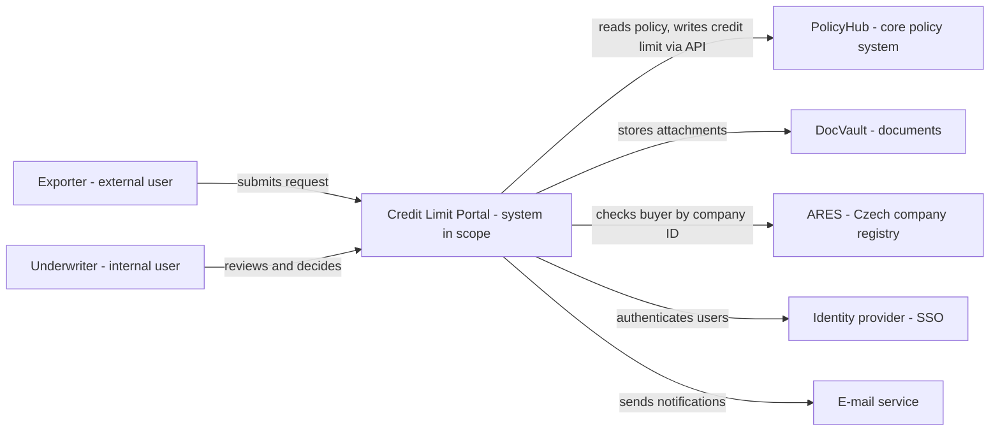
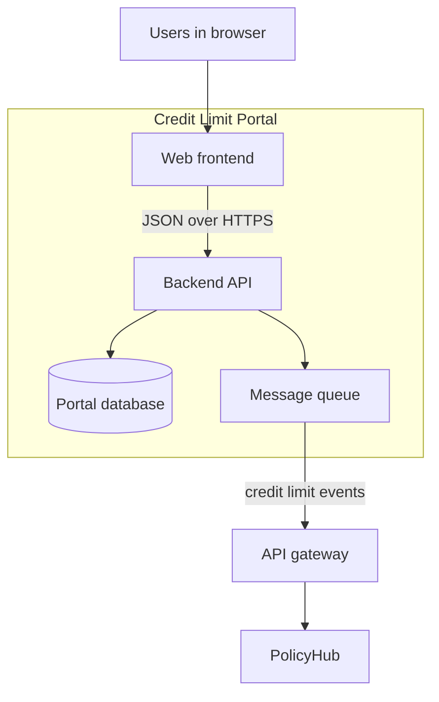

## Why this matters
Inzerát chce, abys navrhovala nové funkce „v souladu s architekturou“. Architekturu kreslit nebudeš, ale musíš rozumět systémům, kterých se tvoje požadavky dotýkají: kde data leží, který systém je vlastní, jak spolu systémy komunikují a jaká bezpečnostní pravidla platí. BA, který umí přečíst architektonický diagram a položit architektovi správné otázky, píše specifikace, podle kterých dodavatel postaví řešení bez drahých překvapení.

## Quick version
**Architecture** (architektura) je struktura IT organizace: jaké systémy existují, za co který odpovídá a jak jsou propojené. Jako BA potřebuješ IT gramotnost, ne inženýrské dovednosti.

**Jak funguje webová aplikace.** Když underwriter otevře PolicyHub v prohlížeči:
- **Browser** (prohlížeč) zobrazuje **frontend**: obrazovky, formuláře, tlačítka. Běží na počítači uživatele.
- Frontend posílá požadavky na **backend**: program na straně serveru, který uplatňuje business pravidla (například „úvěrový limit nad 500 000 EUR potřebuje druhé schválení“).
- Backend čte a zapisuje data v **database** (databázi).
- Systémy spolu mluví přes **API** (application programming interfaces): dohodnuté způsoby, jak jeden program požádá jiný o data nebo akci, obvykle přes HTTP s JSON.

**Kde systémy běží.**
- **On-premises (on-prem):** ve vlastním datovém centru firmy.
- **Cloud:** pronajatý od poskytovatele. Tři úrovně: **IaaS** (pronajímáš si virtuální servery), **PaaS** (pronajímáš si platformu, na které běží tvůj kód), **SaaS** (pronajímáš si hotovou aplikaci, třeba Microsoft 365 nebo CRM).

**Typická krajina systémů v pojišťovně nebo bance:**
- **Core system** (klíčový systém) – hlavní evidenční systém (smlouvy, kontrakty). V ExportShield je to PolicyHub.
- **CRM** – customer relationship management, řízení vztahů se zákazníky: kontakty, schůzky, obchodní příležitosti.
- **DMS** – document management system, správa dokumentů: smlouvy, faktury, dokumenty ke škodám (DocVault).
- **Data warehouse** (datový sklad) – samostatná databáze pro reporting a analýzy, plněná z provozních systémů.
- **Integration layer** (integrační vrstva) – middleware, který propojuje systémy: **ESB** (enterprise service bus) nebo **API gateway**.
- **Identity a SSO** – jedno centrální místo, které ví, kdo jsou uživatelé a co smějí; **single sign-on** znamená jedno přihlášení do mnoha systémů.

**Monolit vs mikroslužby.** **Monolith** (monolit) je jedna velká aplikace nasazovaná jako celek. **Microservices** (mikroslužby) rozdělí aplikaci na malé služby, které se nasazují zvlášť. Ani jedno není „lepší“; obojí má své kompromisy. Pro BA je praktický rozdíl v tom, jak se změny plánují, testují a vydávají.

**Prostředí.** Změny procházejí prostředími **DEV** (vývojáři), **TEST/SIT** (systémové a integrační testování), **UAT** (business akceptace) a **PROD** (skuteční uživatelé a skutečná data). Nikdy netestuj na produkčních datech bez schválení.

**Co pro BA znamená „v souladu s architekturou“:**
1. **Reuse** (znovupoužití): nejdřív využij existující systémy a služby, až pak žádej nové.
2. Respektuj **data ownership** (vlastnictví dat): každý typ dat má jeden evidenční systém (system of record).
3. **Žádné shadow IT** (stínové IT): žádné soukromé excelové databáze ani neschválené nástroje, které se stanou kritickými.
4. **Bezpečnost a compliance** od návrhu: nejmenší oprávnění, auditní logy, GDPR.
5. Mluv s **architektem včas**, ne až po nabídce dodavatele.

**Non-functional requirements** (nefunkční požadavky) popisují, jak dobře systém funguje: bezpečnost, dostupnost, výkon, auditovatelnost. V regulovaných firmách bývají přísnější než funkční.

**Regulace ve financích, zhruba:** **GDPR** chrání osobní údaje. **DORA** (Digital Operational Resilience Act, nařízení EU použitelné od 17. ledna 2025) vyžaduje po finančních subjektech včetně pojišťoven, aby řídily ICT rizika, hlásily závažné ICT incidenty a kontrolovaly rizika od ICT dodavatelů. Pro BA to znamená: každý nový dodavatel nebo cloudová služba projde posouzením rizik a ty to zdokumentuješ.

**Technical debt** (technický dluh) je budoucí cena za zkratky udělané dnes. Rychlé obejití může být správné rozhodnutí, ale má se zapsat a mít naplánovanou opravu.

Na pohovoru můžeš říct: „Architekturu nenavrhuji, ale kontroluji, že moje požadavky využívají existující služby, respektují, který systém data vlastní, a obsahují požadavky na bezpečnost a audit. Architekta zapojím dřív, než specifikace odejde dodavateli.“

## Deep dive

### Jak funguje webová aplikace, krok za krokem [P1]
Vezmi konkrétní akci: underwriter v ExportShield klikne v PolicyHubu u žádosti o úvěrový limit na **Approve**.

1. **Prohlížeč a frontend.** Stránka, kterou underwriter vidí, je frontend. Skládá se z HTML (struktura), CSS (vzhled) a JavaScriptu (chování). Frontend kontroluje jednoduché věci lokálně, například že pole s částkou není prázdné.
2. **Požadavek.** Frontend pošle HTTP požadavek na backend, například `POST /credit-limits/4711/approval` s JSON tělem, které obsahuje schválenou částku a komentář.
3. **Autentizace a autorizace.** Backend ověří, *kdo* volá (autentizace, obvykle tokenem od identity providera), a *zda tato osoba smí schválit tuto částku* (autorizace, podle rolí).
4. **Business logika.** Backend uplatní business pravidla: je částka v pravomoci underwritera? Je země odběratele na seznamu omezení? Je potřeba druhé schválení?
5. **Databáze.** Backend zapíše rozhodnutí do databáze v rámci **transaction** (transakce), což znamená, že se uloží buď všechny změny, nebo žádná.
6. **Integrace.** Backend může volat další systémy: upozornit CRM, uložit rozhodovací dopis do DocVaultu, poslat událost do datového skladu.
7. **Odpověď.** Backend vrátí stav (například `200 OK` nebo `403 Forbidden`) a frontend zobrazí výsledek.

Proč to BA zajímá: každý krok je místo, kde může chybět požadavek. „Schválení se musí zalogovat s uživatelem, časem a starou/novou hodnotou“ patří ke kroku 5. „Underwriteři smějí schválit do 250 000 EUR“ patří ke krokům 3 a 4. „Exportér dostane dopis“ patří ke kroku 6.

```json
{
  "creditLimitId": 4711,
  "decision": "REDUCED",
  "approvedAmount": 150000,
  "currency": "EUR",
  "comment": "Reduced due to buyer's negative equity in 2025 accounts",
  "decidedBy": "u.underwriter01"
}
```

### On-prem, cloud, IaaS, PaaS, SaaS [P1]
Běžné přirovnání je bydlení:

| Model | Kdo co spravuje | Přirovnání k bydlení | Příklad v ExportShield |
|---|---|---|---|
| On-prem | Firma spravuje všechno: hardware, OS, aplikaci | Vlastníš dům | Starší databáze PolicyHubu ve vlastním datovém centru |
| IaaS | Poskytovatel: hardware a virtualizace. Firma: OS, runtime, aplikace | Pronajmeš si prázdný byt | Virtuální servery pro reportingový nástroj |
| PaaS | Poskytovatel: navíc OS a runtime. Firma: aplikace a data | Pronajmeš si zařízený byt | API ClaimDesku běžící na spravované aplikační platformě |
| SaaS | Poskytovatel: všechno. Firma: konfigurace a data | Bydlíš v hotelu | Microsoft 365, cloudové CRM |

Co se pro BA mění, když je řešení SaaS:
- **Konfiguruješ**, nestavíš. Požadavky se musí vejít do toho, co produkt umí, jinak platíš za customizaci.
- Cykly vydávání verzí řídí poskytovatel. Nové funkce mohou přijít, ať je chceš, nebo ne, takže regresní testování se stane pravidelnou úlohou.
- Data jsou uložená mimo firmu. Musíš vědět kde (v EU, nebo ne), kdo k nim má přístup a jak je dostaneš zpět, když smlouva skončí (exit strategie).
- V regulované firmě musí poskytovatele schválit nákup, bezpečnost a compliance dřív, než se kdokoli zaregistruje.

### Typická krajina systémů pojišťovny [P1]
Tady je zjednodušená krajina systémů ExportShield. Stejné stavební bloky potkáš v bankách i jiných pojišťovnách, jen pod jinými názvy.

| Stavební blok | Systém ExportShield | Vlastní jaká data | Typičtí uživatelé |
|---|---|---|---|
| Klíčový systém smluv | PolicyHub (dodavatel NovaSoft) | Smlouvy, úvěrové limity, pojistné | Underwriteři, správa smluv |
| Systém škod | ClaimDesk | Škody, rezervy, výplaty plnění | Likvidátoři škod |
| DMS | DocVault | Dokumenty (smlouvy, faktury, doklady) | Všichni, přes jiné systémy |
| CRM | Obchodní CRM (SaaS) | Kontakty, schůzky, příležitosti | Account manažeři |
| Finance / ERP | Účetní systém | Hlavní kniha, příchozí a odchozí platby | Finance |
| Datový sklad | DWH + reporting | Kopie dat pro reporting | Management, pojistní matematici, risk |
| Integrační vrstva | API gateway + fronta zpráv | Žádná business data; směruje volání | IT |
| Identita / SSO | Firemní identity provider | Uživatelé, skupiny, role | IT, nepřímo všichni uživatelé |
| Externí služby | Registr firem (ARES), ratingová agentura, banka | Externí data | Volají je systémy |

Tři myšlenky k zapamatování:
- **System of record** (evidenční systém). Pro každý typ dat je jeden systém hlavní (master). Když se adresa exportéra změní v CRM, ale evidenčním systémem je PolicyHub, změna se přepíše, nebo hůř, systémy se rozejdou. Tvůj požadavek musí říct, kde se data vytvářejí a mění.
- **Integrační vrstva.** Systémy by neměly být propojené napřímo každý s každým („špagetová integrace“). **ESB** je centrální sběrnice, která zprávy transformuje a směruje; **API gateway** je jediný vstupní bod, který publikuje API se zabezpečením, omezováním počtu volání (throttling) a logováním. Mnoho firem má obojí.
- **Datový sklad je pro business jen ke čtení.** Slouží pro reporty. Obvykle se aktualizuje přes noc nebo několikrát denně, takže není správným zdrojem pro rozhodnutí v reálném čase.

### Monolit vs mikroslužby [P2]
| | Monolit | Mikroslužby |
|---|---|---|
| Struktura | Jedna aplikace, jedno nasazení | Mnoho malých služeb, každá se nasazuje zvlášť |
| Změna | Malá změna znamená vydat celou aplikaci | Jednu službu lze vydat samostatně |
| Testování | Méně integračních bodů, ale větší regrese | Víc integračních bodů k testování |
| Typicky v | Starší klíčové systémy, menší produkty | Novější digitální platformy |

Tohle nerozhoduješ ty. Ale vysvětluje to věty, které uslyšíš: „To nemůžeme vydat do čtvrtletního releasu“ (monolit) nebo „To pole žije v zákaznické službě, kterou vlastní jiný tým“ (mikroslužby). Ptej se, který tým vlastní kterou část, protože to ti řekne, kdo musí s tvou změnou souhlasit.

### Prostředí a vydávání verzí [P1]
| Prostředí | Účel | Data | Kdo ho používá |
|---|---|---|---|
| DEV | Vývojáři vyvíjejí a dělají unit testy | Smyšlená data | Vývojáři dodavatele |
| TEST / SIT | Systémové a integrační testování | Testovací data, někdy anonymizovaná | Testeři |
| UAT | Business akceptace | Realistická, anonymizovaná nebo schválená kopie | Business uživatelé, BA |
| PROD | Skutečná práce | Skutečná data | Všichni uživatelé |

V regulovaných firmách se produkční data s osobními údaji nesmějí kopírovat do testovacích prostředí bez anonymizace nebo schválení. Když plánuješ UAT (modul 13), zeptej se včas, jaká testovací data budou k dispozici. Bez dobrých testovacích dat UAT selže.

**Release** (vydání) je plánovaný balík změn přesunutý do produkce. Mnoho firem má kalendář releasů a **change advisory board (CAB)**, který produkční změny schvaluje. Datum spuštění tvé funkce (go-live) závisí na tomto kalendáři, ne jen na rychlosti dodavatele.

### Co v praxi znamená „v souladu s architekturou“ [P1]
Když specifikuješ novou funkci, projdi tento kontrolní seznam:

1. **Reuse** (znovupoužití). Existuje už služba, která tohle dělá? Příklad: ExportShield už volá ARES v procesu onboardingu. Nová funkce pro úvěrové limity má použít stejnou integraci, ne stavět druhou.
2. **Vlastnictví dat.** Který systém je master pro každý datový prvek? Kde se data vytvářejí a kde se jen zobrazují?
3. **Integrační vzor.** Je volání synchronní (uživatel čeká na odpověď, typické pro volání API), nebo asynchronní (zpráva se odešle a zpracuje později, typické pro frontu nebo dávku)? Ovlivní to uživatelský zážitek i ošetření chyb.
4. **Standardy.** Předepisuje firma nějaký nástroj? Příklad: „Veškerá automatizace workflow běží na schválené low-code platformě“, „Všechny dokumenty se ukládají do DocVaultu“.
5. **Bezpečnost.** Kdo smí data vidět a měnit? Jsou tam osobní údaje? Opouští něco firmu?
6. **Nefunkční požadavky.** Objem, doba odezvy, dostupnost, uchovávání, audit.
7. **Žádné shadow IT.** Shadow IT je jakýkoli systém nebo nástroj používaný pro business bez vědomí nebo schválení IT: soukromé excelové makro, které počítá pojistné, bezplatný online nástroj na převod PDF ke škodám. Přináší rizika: žádná záloha, žádné řízení přístupu, nikdo ho neudržuje, když autor odejde.

:::warning
„Zatím to uděláme v Excelu“ je věta, kterou začíná spousta kritických stínových systémů. Pokud je dočasné řešení správné rozhodnutí, zapiš vlastníka, datum konce a plán náhrady.
:::

### Jak číst architektonický diagram [P1]
Architektonické diagramy nemají jeden standardní vzhled. Čti je v tomto pořadí:
1. **Najdi legendu.** Co znamenají rámečky, barvy a styly čar?
2. **Najdi lidi.** Kdo systém používá?
3. **Najdi systém v rozsahu (in scope).** Obvykle je zvýrazněný nebo uprostřed.
4. **Sleduj šipky.** Každá šipka je závislost nebo tok dat. Přečti popisek: jaká data, jaký protokol (REST, SOAP, soubor, fronta), jak často.
5. **Podívej se na hranice.** Tečkované rámečky často znamenají „uvnitř naší firmy“ vs externí, nebo síťovou zónu.
6. **Ptej se na to, co chybí.** Kde je identita? Kde jsou logy? Co se stane, když externí služba nejede?

### Model C4: kontextový a kontejnerový diagram [P2]
**C4 model**, který vytvořil Simon Brown, popisuje software ve čtyřech úrovních přiblížení: **Context**, **Containers**, **Components** a **Code**. Analytici používají hlavně první dvě.

- **System context diagram** (kontextový diagram): systém v rozsahu jako jeden rámeček, lidé, kteří ho používají, a další systémy, se kterými komunikuje. Hodí se na kick-off projektu.
- **Container diagram** (kontejnerový diagram): přiblíží systém a ukáže jeho nasaditelné části: webovou aplikaci, API, databázi, frontu zpráv. „Container“ tu znamená spustitelnou část, ne konkrétně Docker kontejner.

Kontextový diagram nového „Credit Limit Portal“ v ExportShield, přibližně jako Mermaid flowchart:



A kontejnerový pohled na stejný portál:



Vlastní typ diagramu C4 je v Mermaidu zatím experimentální, proto tyto příklady používají obyčejné flowcharty jako přiblížení: rámečky popiš jejich typem („external user“, „system in scope“, „database“), aby byl význam jasný.

### Nefunkční požadavky v architektuře [P1]
Nefunkční požadavky (NFRs) definují kvalitu. Piš je tak, aby se daly otestovat:

| Oblast | Slabě | Testovatelně |
|---|---|---|
| Výkon | „Systém musí být rychlý“ | „Kontrola v ARES vrátí uživateli výsledek do 3 sekund u 95 % požadavků“ |
| Dostupnost | „Vždy dostupný“ | „Dostupný Po–Pá 7:00–19:00 SEČ s měsíční dostupností 99,5 %; plánovaná údržba mimo tyto hodiny“ |
| Bezpečnost | „Bezpečný“ | „Schvalovat mohou jen uživatelé s rolí UNDERWRITER; schválení nad 250 000 EUR vyžaduje roli SENIOR_UNDERWRITER“ |
| Audit | „Změny se logují“ | „Každá změna úvěrového limitu ukládá ID uživatele, časové razítko, starou hodnotu, novou hodnotu a důvod; logy se uchovávají 10 let a nelze je upravit“ |
| Obnova | „Data se nesmí ztratit“ | „Maximální ztráta dat 15 minut (RPO); služba obnovena do 4 hodin (RTO)“ |

**RPO** (recovery point objective) je, kolik dat si můžeš dovolit ztratit. **RTO** (recovery time objective) je, jak dlouho smí služba stát. Doby uchovávání (jako 10 let výše) stanoví právní oddělení a compliance, ne BA. Zeptej se jich; nevymýšlej je.

### Základy bezpečnosti a compliance v regulovaných firmách [P1]
- **Least privilege** (princip nejmenších oprávnění). Každý uživatel a každý systém dostane jen přístup, který potřebuje. Uživatel reportingu data čte, ale nemění. Integrační účet pro kontrolu v ARES smí volat ARES a nic jiného.
- **Segregation of duties** (oddělení povinností). Kdo škodu zadá, by neměl schvalovat její výplatu.
- **GDPR.** Osobní údaje potřebují právní základ, definovaný účel, minimální rozsah a dobu uchování. V pojištění exportních úvěrů jsou mnoha subjekty údajů firmy, ale kontaktní osoby, živnostníci a podepisující osoby jsou fyzické osoby. V případě pochybností se zeptej pověřence pro ochranu osobních údajů (DPO).
- **DORA.** Nařízení EU o digitální provozní odolnosti (Digital Operational Resilience Act) platí pro finanční subjekty včetně pojišťoven od 17. ledna 2025. Zhruba vyžaduje: rámec řízení ICT rizik, klasifikaci a hlášení závažných ICT incidentů, testování odolnosti a řízení rizik ICT třetích stran včetně registru smluv s poskytovateli ICT služeb. Pro BA se DORA projeví jako kroky navíc, když projekt používá nového dodavatele nebo cloudovou službu, a jako požadavky na logování, monitoring a řešení incidentů.
- **Vendor risk** (riziko dodavatele). Před využitím nového dodavatele ho firma posoudí: bezpečnostní certifikace, umístění dat, subdodavatelé, finanční stabilita, exit plán. Trvá to týdny. Naplánuj to do projektu.
- **Audit trail** (auditní stopa). Regulátoři a interní audit musí umět zrekonstruovat, kdo co kdy udělal.

:::tip
Na pohovorech do bank a pojišťoven ukážeš, že prostředí rozumíš i jako juniorka, když zmíníš nejmenší oprávnění, auditní logy a posouzení rizik dodavatele.
:::

### Technický dluh [P2]
Technický dluh je budoucí práce, která vzniká tím, že teď zvolíš rychlé řešení místo lepšího. Stejně jako finanční dluh nese úrok: každá další změna trvá déle.

Příklady z ExportShield:
- Tým škod každé pondělí exportuje data z ClaimDesku do Excelu a ručně je kopíruje do reportu, protože do datového skladu se data o škodách nikdy nezačala posílat.
- Business pravidlo (maximální úvěrový limit na zemi) je natvrdo zapsané na třech místech, místo aby bylo uložené v jedné konfigurační tabulce.

Co může BA udělat: zapsat známý dluh do backlogu, vysvětlit jeho business cenu („4 hodiny týdně ruční práce, riziko chyb při kopírování“) a zahrnout ho do prioritizace.

### Otázky na architekta [P1]
Než specifikuješ novou funkci, zeptej se:
1. Kterých systémů se to týká a kdo každý z nich vlastní?
2. Který systém je master pro každý datový prvek v mé funkci?
3. Existuje služba nebo integrace, kterou bych měla znovu použít?
4. Synchronní API, nebo asynchronní zpráva? Co se stane, když druhý systém nejede?
5. Opouštějí nějaká data firmu nebo EU? Je potřeba posouzení rizik dodavatele?
6. Jaké jsou bezpečnostní role a autorizační pravidla?
7. Jaké logování a audit jsou potřeba?
8. Jaké jsou očekávané objemy a výkon?
9. Která prostředí jsou k dispozici pro testování a s jakými daty?
10. Platí nějaké architektonické standardy nebo rozhodnutí (někdy zapsaná jako architecture decision records, ADR)?

## Key terms
- **Architecture** (architektura) — struktura IT systémů organizace, jejich odpovědností a propojení.
- **Frontend** — část aplikace, kterou uživatel vidí a se kterou pracuje, obvykle v prohlížeči.
- **Backend** — část na straně serveru, která uplatňuje business pravidla a pracuje s daty.
- **API** (aplikační programové rozhraní) — dohodnuté rozhraní, přes které jeden program žádá jiný o data nebo akce.
- **On-premises** (on-prem, vlastní provoz) — software běžící ve vlastním datovém centru firmy.
- **IaaS / PaaS / SaaS** — cloudové modely, kde poskytovatel spravuje infrastrukturu, platformu, nebo celou aplikaci.
- **Core system** (klíčový systém) — hlavní evidenční systém businessu, například systém správy smluv.
- **System of record** (evidenční systém) — jediný systém, který je pro daný typ dat autoritativním zdrojem (master).
- **Data warehouse** (datový sklad) — databáze, která shromažďuje kopie provozních dat pro reporting a analýzy.
- **ESB / API gateway** — integrační komponenty, které směrují, transformují, zabezpečují a logují komunikaci mezi systémy.
- **SSO** (jednotné přihlášení) — single sign-on: jedno přihlášení dává přístup do mnoha systémů přes centrálního identity providera.
- **Monolith** (monolit) — aplikace postavená a nasazovaná jako jeden celek.
- **Microservices** (mikroslužby) — architektura malých služeb nasazovaných samostatně.
- **Environment** (prostředí) — samostatná instalace systému pro určitý účel (DEV, TEST, UAT, PROD).
- **Shadow IT** (stínové IT) — business používání systémů nebo nástrojů bez vědomí nebo schválení IT.
- **C4 model** — způsob popisu softwaru ve čtyřech úrovních přiblížení: kontext, kontejnery, komponenty, kód.
- **Least privilege** (princip nejmenších oprávnění) — každý uživatel nebo systém dostane jen přístup, který potřebuje.
- **DORA** — nařízení EU o digitální provozní odolnosti finančních subjektů, použitelné od 17. ledna 2025.
- **Technical debt** (technický dluh) — budoucí práce způsobená volbou rychlého řešení místo lepšího.
- **RPO / RTO** — maximální přijatelná ztráta dat a maximální přijatelná doba výpadku po havárii.

## Hands-on
:::exercise id="m12-e1" title="Nakresli kontextový diagram C4 krajiny systémů ExportShield" min="45" tool="Mermaid Live"
**Cíl:** ukázat systémy a uživatele ExportShield na jedné stránce.

1. Vypiš lidi: exportér, underwriter, likvidátor škod, finance, management.
2. Vypiš systémy: PolicyHub, ClaimDesk, DocVault, CRM, finanční systém, datový sklad, identity provider, ARES, e-mail.
3. Otevři [Mermaid Live](https://mermaid.live/) a začni od kontextového diagramu v tomto modulu.
4. Přidej každou osobu a každý systém jako rámeček. Každý rámeček popiš jeho typem (osoba, interní systém, externí systém).
5. Nakresli šipky a každou popiš daty, která tečou („rozhodnutí o úvěrovém limitu“, „dokumenty ke škodě“, „noční nahrání dat“).
6. Vyznač, který systém je master pro: smlouvu, škodu, dokument, kontakt na zákazníka.
7. Vyexportuj diagram jako PNG nebo SVG.

**Hotovo, když:** kolega, který ExportShield nikdy neviděl, z diagramu vysvětlí, kde je uložený dokument ke škodě a jak se rozhodnutí o úvěrovém limitu dostane do datového skladu.
:::

:::exercise id="m12-e2" title="Otázky na architekta" min="30" tool="Confluence or a text editor"
**Cíl:** připravit se na schůzku s architektem o nové funkci: „Exportéři nahrávají dokumenty ke škodám přes webový portál; dokumenty jdou do DocVaultu a škoda se založí v ClaimDesku.“

1. Napiš aspoň 12 otázek seskupených do oblastí: systémy a vlastnictví, data, integrace, bezpečnost, nefunkční požadavky, prostředí.
2. U každé otázky napiš jedním řádkem, proč odpověď ovlivní tvou specifikaci.
3. Označ tři otázky, které bys položila jako první, kdybys měla jen 10 minut.

**Hotovo, když:** každá oblast má aspoň dvě otázky a na žádnou nejde odpovědět „záleží na dodavateli“ bez doplňující otázky.
:::

:::exercise id="m12-e3" title="Najdi architektonická rizika" min="40" tool="Text editor"
**Cíl:** posoudit tento návrh vedoucího oddělení a sepsat rizika.

> „Abychom zrychlili rozhodování o úvěrových limitech, bude underwritingový tým používat bezplatný online nástroj, který čte finanční výkazy odběratelů z nahraných PDF. Člen týmu napsal excelové makro, které výsledek stáhne, spočítá limit a pošle ho e-mailem do schránky podpory PolicyHubu, kde ho NovaSoft ručně zadá. Data odběratelů se navíc kopírují do vlastního seznamu týmu v SharePointu, aby se dala sledovat rozhodnutí.“

1. Vypiš všechna rizika, která najdeš (cíl je aspoň 8).
2. U každého uveď oblast: shadow IT, vlastnictví dat, bezpečnost, GDPR, riziko dodavatele/DORA, audit, technický dluh, provoz.
3. Pro tři největší rizika navrhni alternativu v souladu s architekturou.

**Hotovo, když:** tvůj seznam pokrývá aspoň pět oblastí a každá alternativa jmenuje existující systém nebo schválenou cestu (například schválenou low-code platformu nebo API integraci do PolicyHubu).
:::

## Self-check
:::q
Underwriter změní adresu odběratele v CRM, ale druhý den ráno je tam zase stará adresa. Jaké je nejpravděpodobnější architektonické vysvětlení?
---
CRM pravděpodobně není evidenčním systémem (system of record) pro adresy odběratelů. Jiný systém (například PolicyHub) je master a synchronizuje svá data do CRM, čímž přepisuje lokální změny. Požadavek má říct, kde se adresy vytvářejí a mění a jak tečou do dalších systémů.
:::

:::q
Jaký je pro BA praktický rozdíl mezi nákupem SaaS produktu a tím, když dodavatel postaví aplikaci na míru?
---
U SaaS konfiguruješ existující produkt, takže požadavky se musí vejít do jeho možností, jinak platíš za customizaci. Vydávání verzí řídí poskytovatel, což znamená pravidelné regresní testování. Data jsou uložená u poskytovatele, takže je potřeba prověřit umístění dat, přístup a exit strategii, a v regulované firmě musí poskytovatel projít posouzením rizik dodavatele.
:::

:::q
Proč je datový sklad obvykle špatný zdroj pro rozhodnutí o úvěrovém limitu v reálném čase?
---
Datový sklad drží kopie dat, obvykle nahrávané jednou nebo několikrát denně, takže data mohou být zastaralá. Je navržený pro reporting, ne pro transakční rozhodování. Rozhodnutí má používat provozní evidenční systém přes API.
:::

:::q
Uveď dva příklady shadow IT v pojišťovně a vysvětli riziko.
---
Příklady: excelové makro, které počítá pojistné a žije na notebooku jednoho člověka; bezplatný online převodník PDF používaný na dokumenty ke škodám. Rizika: žádná záloha ani verzování, žádné řízení přístupu, osobní nebo důvěrná data opouštějí firmu a nikdo to neumí udržovat, když autor odejde.
:::

:::q
Přepiš „Systém musí být bezpečný a rychlý“ na dva testovatelné nefunkční požadavky.
---
Například: „Úvěrové limity nad 250 000 EUR mohou schvalovat jen uživatelé s rolí SENIOR_UNDERWRITER.“ a „Kontrola v registru firem vrátí uživateli výsledek do 3 sekund u 95 % požadavků v pracovní době.“ Každý uvádí měřitelnou podmínku, kterou tester umí ověřit.
:::

:::q
Co znamená DORA pro BA na projektu, který chce použít novou cloudovou službu?
---
Pojišťovna jako finanční subjekt musí řídit rizika ICT třetích stran. Nový poskytovatel bude potřebovat posouzení rizik, smlouvu s povinnými ustanoveními a zápis do registru smluv o ICT službách. BA má na to naplánovat čas a zahrnout požadavky na logování, monitoring a řešení incidentů.
:::

:::q
Jaký je rozdíl mezi kontextovým a kontejnerovým diagramem v modelu C4?
---
Kontextový diagram ukazuje systém v rozsahu jako jeden rámeček s jeho uživateli a sousedními systémy. Kontejnerový diagram systém přiblíží a ukáže jeho spustitelné části, například webový frontend, backend API, databázi a frontu zpráv, a jak spolu komunikují.
:::

## Interview corner
:::interview
Co pro tebe znamená navrhnout funkci „v souladu s architekturou“?
*EN: What does it mean for you to design a feature "in line with the architecture"?*
---
- Znovu použít existující systémy, služby a integrace, než požádáš o nové.
- Respektovat evidenční systém (system of record) pro každý datový prvek.
- Dodržet firemní standardy (schválené platformy, DMS pro dokumenty, API gateway pro integrace).
- Od začátku zahrnout bezpečnost, audit a další nefunkční požadavky.
- Zapojit architekta dřív, než specifikace odejde dodavateli.

Typická chyba: odpovědět „řídím se pokyny architekta“ a neukázat, že víš, co sama zkontrolovat.
:::

:::interview
Umíš vysvětlit, co se technicky stane, když uživatel klikne ve webovém formuláři na „Odeslat“?
*EN: Can you explain what happens technically when a user clicks "Submit" in a web form?*
---
- Frontend zvaliduje vstup a pošle na backend HTTP požadavek s JSON payloadem.
- Backend uživatele autentizuje a ověří autorizaci.
- Backend uplatní business pravidla a zapíše do databáze v transakci.
- Backend může volat další systémy přes API nebo posílat zprávy.
- Backend vrátí stav a frontend zobrazí výsledek.

Typická chyba: ztratit se v technických detailech, místo abys každý krok propojila s typem požadavku, který potřebuje.
:::

:::interview
Jak zjistíš, kterých systémů se nový požadavek týká?
*EN: How would you find out which systems are affected by a new requirement?*
---
- Přečíst existující architektonické diagramy a dokumentaci systémů.
- Projít proces a u každého kroku se zeptat, který systém drží data.
- Zeptat se architekta a vlastníků systémů; potvrdit vlastnictví dat.
- Nakreslit jednoduchý kontextový diagram a nechat ho zrevidovat.

Typická chyba: předpokládat, že systém, který uživatelé vidí, je jediný, kterého se to týká.
:::

:::interview
Jaké aspekty bezpečnosti a compliance zvažuješ, když píšeš požadavky v bance nebo pojišťovně?
*EN: What security and compliance aspects do you consider when writing requirements in a bank or insurer?*
---
- Role a nejmenší oprávnění; oddělení povinností u schvalování a plateb.
- Osobní údaje a GDPR: účel, rozsah, doba uchování; zapojit DPO.
- Auditní stopa změn a rozhodnutí.
- Umístění dat a posouzení rizik u nových dodavatelů (DORA pro finanční subjekty).
- Prostředí: žádné produkční osobní údaje v testu bez anonymizace nebo schválení.

Typická chyba: brát bezpečnost jako „problém IT“, ne jako součást požadavků.
:::

:::interview
Business tým chce problém rychle vyřešit neschváleným online nástrojem. Jak zareaguješ?
*EN: A business team wants to solve a problem quickly with an unapproved online tool. How do you respond?*
---
- Uznat business potřebu a její naléhavost.
- Vysvětlit rizika (data opouštějí firmu, žádná podpora, audit).
- Hledat schválenou alternativu: existující systém, schválenou low-code platformu nebo zrychlenou žádost na IT.
- Pokud se přijme dočasné obejití, zdokumentovat vlastníka, datum konce a plán náhrady.

Typická chyba: buď tým zablokovat a nenabídnout cestu, nebo potichu nechat shadow IT růst.
:::
