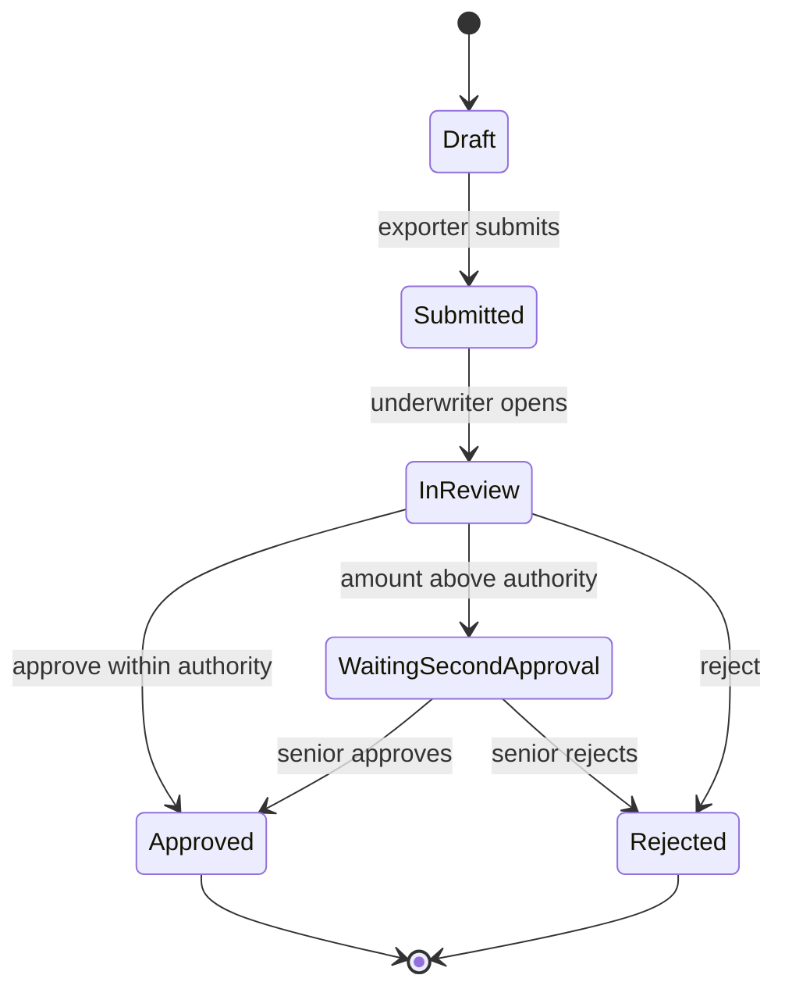

## Why this matters
Inzerát chce, abys podporovala testery, účastnila se testování dodávek a reportovala stav vývoje. BA ví, co business potřebuje, takže je přirozeně tím, kdo ověří, že to dodávka dělá. V pojišťovně, která pracuje s externím dodavatelem, BA často píše testovací scénáře, organizuje akceptační testování uživateli (UAT), hlásí defekty dodavateli a doporučuje, jestli lze release převzít. Část z toho možná už děláš, když testuješ automatizaci před spuštěním.

## Quick version
**Proč BA testuje.** Požadavky mají smysl jen tehdy, když je dodaný systém splňuje. Dodavatel testuje, že kód funguje; business musí ověřit, že řešení řeší jeho problém. BA tyto dvě věci propojuje.

**Úrovně testování (test levels):**
- **Unit testing** (ISTQB: component testing, testování komponent) – vývojáři testují malé kousky kódu.
- **Integration testing** (integrační testování) – části nebo systémy spolu fungují (PolicyHub správně volá ARES).
- **System testing** (systémové testování) – celý systém proti specifikaci, obvykle testeři dodavatele.
- **Acceptance testing (UAT)** (akceptační testování) – business uživatelé potvrdí, že systém podporuje jejich skutečnou práci.

**Typy testování (test types):**
- **Functional** (funkční) – dělá to, co má?
- **Regression** (regresní) – rozbila změna něco, co dřív fungovalo? (Opakovaný test samotné opravy se jmenuje **confirmation testing**, konfirmační testování.)
- **Smoke** – rychlá kontrola, že hlavní funkce po nasazení běží.
- **Non-functional** (nefunkční) – výkon, bezpečnost, použitelnost, dostupnost.

**Static testing** (statické testování) znamená revidovat dokumenty bez spouštění softwaru. Revize požadavků je nejlevnější způsob, jak najít defekty: chybějící pravidlo nalezené ve specifikaci stojí jeden rozhovor; nalezené v produkci stojí opravu, přetestování, release a možná i špatné rozhodnutí.

**Od požadavků k testovacím případům.** Každé akceptační kritérium dá aspoň jeden **test case** (testovací případ). Testovací případ má: ID, název, vstupní podmínky (preconditions), kroky, testovací data, očekávaný výsledek, skutečný výsledek, stav.

**Čtyři techniky, které je dobré znát:**
- **Equivalence partitioning** (rozdělení do tříd ekvivalence) – seskup vstupy, se kterými má systém zacházet stejně, a z každé skupiny otestuj jednu hodnotu.
- **Boundary value analysis** (analýza hraničních hodnot) – testuj na okrajích, kde vznikají chyby jako `>` místo `>=`.
- **Decision tables** (rozhodovací tabulky) – vypiš kombinace podmínek a očekávaný výsledek.
- **State transition testing** (testování přechodů mezi stavy) – testuj povolené i zakázané přechody mezi stavy (Draft → Submitted → In review → Approved).

**UAT** potřebuje plán: rozsah, vstupní kritéria (entry criteria, kdy můžeme začít), výstupní kritéria (exit criteria, kdy jsme hotovi), testovací data, účastníky, harmonogram a **sign-off** (formální převzetí).

**Defekty.** Dobré hlášení defektu umožní vývojáři problém zopakovat, aniž by ti musel volat: název, prostředí, kroky, očekávaný vs. skutečný výsledek, důkaz, závažnost. **Severity** (závažnost) je dopad na systém; **priority** (priorita) je, jak brzy se má opravit. Jsou to různé věci: překlep v názvu firmy na dopise má nízkou závažnost, ale může mít vysokou prioritu.

**Triage** (triáž) je pravidelná schůzka, kde se business, BA a dodavatel u každého nového defektu shodnou: je platný, jak závažný, kdo ho opraví a do kdy, nebo jde ve skutečnosti o change request?

**Reportování stavu.** Užitečná čísla: testovací případy plánované / provedené / prošlé / neprošlé / blokované, otevřené defekty podle závažnosti, vývoj v čase a doporučení go/no-go.

**Převzetí dodávky od dodavatele** znamená zkontrolovat dodávku proti dohodnuté specifikaci a akceptačním kritériím, se všemi kritickými defekty uzavřenými a zbytkem písemně dohodnutým.

**SQL** pomáhá ověřit výsledky v databázi (zapsalo schválení správnou částku?), když máš do testovacího prostředí přístup ke čtení.

**ISTQB CTFL** (Certified Tester Foundation Level) je běžná vstupní certifikace v testování. Pro BA je volitelná, ale dá ti společný slovník s testery.

Na pohovoru: „Testovací scénáře píšu z akceptačních kritérií, na business pravidla používám hraniční hodnoty a rozhodovací tabulky, organizuji UAT s business uživateli, defekty hlásím srozumitelně a doporučení go/no-go dávám na základě dat.“

## Deep dive

### Proč BA testuje [P1]
Testeři kontrolují systém proti specifikaci. Pokud je specifikace špatná nebo neúplná, může být i dokonale otestovaný systém k ničemu. BA přináší to, co testeři mít nemusí:
- znalost business procesu a skutečných případů („exportér někdy žádá o navýšení existujícího limitu, ne jen o nový“),
- znalost toho, proč pravidlo existuje, což pomáhá posoudit, jestli na odchylce záleží,
- kontakt s business uživateli, kteří budou dělat UAT.

Typické úkoly BA v testování: revidovat požadavky z hlediska testovatelnosti, pomáhat testerům pochopit business pravidla, psát nebo revidovat UAT scénáře, připravit s businessem testovací data, vést nebo koordinovat UAT, triážovat defekty, reportovat stav a připravit rozhodnutí o převzetí.

### Úrovně a typy testování [P1]
| Úroveň | Kdo ji obvykle dělá | Co testuje | Příklad v ExportShield |
|---|---|---|---|
| Unit | Vývojáři dodavatele | Jednu funkci | Funkce, která počítá maximální limit podle ratingu země |
| Integration | Testeři dodavatele / IT | Rozhraní mezi částmi nebo systémy | PolicyHub pošle IČO do ARES a uloží vrácený název |
| System | Testeři dodavatele | Celý systém vs. specifikace | Celý tok žádosti o úvěrový limit v testovacím prostředí |
| Acceptance (UAT) | Business uživatelé s BA | Vhodnost pro skutečnou práci | Underwriteři zpracují 20 realistických žádostí z minulého čtvrtletí (anonymizovaných) |

Sylabus ISTQB Foundation (v4.0) používá o něco jemnější názvy: **component testing** místo unit testing a integrační testování dělí na **component integration testing** (integrační testování komponent) a **system integration testing** (systémové integrační testování). Akceptační testování zahrnuje UAT, ale také provozní, smluvní a regulatorní akceptační testování.

Typy procházejí napříč všemi úrovněmi:
- **Funkční** testování kontroluje chování: „žádost nad 500 000 EUR jde k druhému schvalovateli“.
- **Regresní** testování po změně znovu spouští existující testy. Dodavatelé často jednu věc opraví a jinou rozbijí. Liší se od **confirmation testing** (konfirmačního testování, retestu), které ověřuje, že je opravený samotný nahlášený defekt. ISTQB obojí řadí pod testování související se změnami (change-related testing).
- **Smoke** testování je krátká kontrola po každém nasazení: dokážu se přihlásit, otevřít žádost, uložit ji? Když smoke test selže, hlubší testování se zastaví.
- **Nefunkční** testování pokrývá výkon (doby odezvy pod zátěží), bezpečnost (přístupová práva, penetrační testy specialistů), použitelnost a dostupnost.

### Statické testování: revize požadavků [P1]
Statické testování najde defekty bez spouštění softwaru. Pro BA je nejcennější formou revize požadavků a user stories před vývojem.

U každého požadavku kontroluj:
- **Nejednoznačnost:** „velké limity potřebují schválení“ – jak velké?
- **Úplnost:** co se stane, když ARES nejede? když IČO neexistuje?
- **Konzistenci:** jiný požadavek říká, že limit je v CZK, tento v EUR.
- **Testovatelnost:** dokážu napsat očekávaný výsledek? „Uživatelsky přívětivý“ testovatelné není.
- **Hranice:** „nad 500 000“ – je přesně 500 000 nad, nebo ne?

Příklad. Požadavek: *„Žádosti o úvěrový limit nad 500 000 EUR musí schválit senior underwriter.“*
Otázky při revizi: Je to „nad“ (> 500 000), nebo „od“ (>= 500 000)? Porovnává se částka před přepočtem měny, nebo po něm? Co když exportér už má na tohoto odběratele limit 400 000 a žádá o navýšení o 200 000: je částka žádosti 200 000, nebo 600 000? Každá odpověď předejde jednomu defektu.

### Odvození testovacích případů z akceptačních kritérií [P1]
User story s akceptačními kritérii:

```gherkin
Feature: Credit limit request
  Scenario: Request within underwriter authority
    Given an active policy for exporter "TEST Exporter 001"
    And the buyer's company ID exists in the registry
    When the underwriter approves a credit limit of EUR 300,000
    Then the credit limit status is "Approved"
    And the exporter receives a decision e-mail

  Scenario: Request above underwriter authority
    Given an active policy
    When the underwriter approves a credit limit of EUR 600,000
    Then the status is "Waiting for second approval"
    And the request appears in the senior underwriter's queue
```

Z každého scénáře vznikne aspoň jeden testovací případ. Pak doplníš případy, které z kritérií plynou, ale nejsou v nich vypsané: hranici (přesně 500 000), neplatné vstupy, chybějící data, nedostupnou externí službu, uživatele bez správné role.

### Třídy ekvivalence a hraniční hodnoty [P1]
Pravidlo pro formulář úvěrového limitu ExportShield: *„Požadovaná částka musí být mezi 10 000 EUR a 2 000 000 EUR včetně. Částky nad 500 000 EUR vyžadují druhé schválení.“*

**Equivalence partitions** (třídy ekvivalence, skupiny, se kterými má systém zacházet stejně):

| Třída | Rozsah | Očekávané chování |
|---|---|---|
| Neplatná nízká | < 10 000 (včetně 0 a záporných čísel) | Chyba: pod minimem |
| Platná, jedno schválení | 10 000 – 500 000 | Přijato, jedno schválení |
| Platná, druhé schválení | 500 000,01 – 2 000 000 | Přijato, druhé schválení |
| Neplatná vysoká | > 2 000 000 | Chyba: nad maximem |
| Neplatný formát | prázdné, není číslo (text) | Chyba: neplatná částka |

Třídy se nesmějí překrývat: každý možný vstup patří právě do jedné z nich. Rozsahy předpokládají, že částky se zadávají na dvě desetinná místa, takže nejmenší krok je 0,01.

**Hraniční hodnoty** (testuj na každém okraji a hned vedle něj): 9 999,99 / 10 000 / 500 000 / 500 000,01 / 2 000 000 / 2 000 000,01.

Tomu ISTQB říká **2-value boundary value analysis** (dvouhodnotová analýza hraničních hodnot): pro každou hranici samotná hraniční hodnota a její nejbližší soused v sousední třídě. **3-value boundary value analysis** (tříhodnotová) přidává i souseda na druhé straně (pro 10 000: 9 999,99, 10 000 a 10 000,01). Stojí víc testovacích případů, ale zachytí víc chyb, například když vývojář napíše `amount = 10000` místo `amount >= 10000`.

Proč na hranicích záleží: vývojář, který napíše `amount > 10000` místo `amount >= 10000`, vytvoří defekt, který najde jen test s přesně 10 000.

### Rozhodovací tabulky [P1]
Rozhodovací tabulku použij, když výsledek závisí na kombinaci podmínek. Nárok na plnění ze škody v ExportShield (fiktivní pravidla):
- C1: Smlouva byla aktivní k datu faktury.
- C2: K datu odeslání zboží existoval na odběratele úvěrový limit.
- C3: Škoda byla nahlášena ve lhůtě stanovené ve smlouvě.
- C4: Částka faktury je v rámci úvěrového limitu.

| Rule | R1 | R2 | R3 | R4 | R5 |
|---|---|---|---|---|---|
| C1 Policy active | Y | Y | Y | Y | N |
| C2 Limit existed | Y | Y | Y | N | – |
| C3 Notified in time | Y | Y | N | – | – |
| C4 Within limit | Y | N | – | – | – |
| **Outcome** | Eligible, full | Eligible up to limit | Refer to claims manager | Not eligible | Not eligible |

Pomlčka znamená „nezáleží na tom“. Každý sloupec je jeden testovací případ. Pět sloupců dohromady pokrývá všech 16 kombinací čtyř podmínek a žádná kombinace není ve dvou sloupcích. Sestavení tabulky často odhalí chybějící nebo nezamýšlená pravidla: R3 říká, že pozdě nahlášená škoda jde ke claims manažerovi bez ohledu na částku, takže pozdní škoda nad limitem se řeší stejně jako pozdní škoda v limitu. Chce to tak business? Zeptej se před testováním, ne po něm.

### Testování přechodů mezi stavy [P2]
Žádost o úvěrový limit prochází stavy:



Testovací případy: každý platný přechod jednou, plus neplatné (dá se zamítnutá žádost schválit? může Draft přejít rovnou do Approved?). Neplatné přechody jsou častým zdrojem závažných defektů.

### Šablona testovacího případu [P1]
| Pole | Příklad |
|---|---|
| ID | TC-CL-007 |
| Název | Částka přesně na hranici druhého schválení zůstává u jednoho schválení |
| Požadavek / AC | US-CL-12, AC2 |
| Vstupní podmínky | Aktivní smlouva P-2026-0153; přihlášený uživatel s rolí UNDERWRITER |
| Testovací data | IČO odběratele 99000001 (testovací záznam); částka 500 000,00 EUR |
| Kroky | 1. Otevřít novou žádost. 2. Zadat ID odběratele a částku. 3. Odeslat. 4. Schválit. |
| Očekávaný výsledek | Stav „Approved“; druhé schválení není potřeba |
| Skutečný výsledek | (vyplní se při provedení) |
| Stav | Not run / Pass / Fail / Blocked |
| Tester, datum | |

Odkaz na požadavek dává **traceability** (dohledatelnost): umíš ukázat, které požadavky jsou otestované a které ne.

### Plánování UAT [P1]
Plán UAT odpovídá na tyto otázky:

| Položka | Obsah |
|---|---|
| Rozsah | Které procesy a funkce se testují; co je mimo rozsah |
| Vstupní kritéria | Systémový test dokončen; žádné otevřené kritické defekty; UAT prostředí a testovací data připravena; uživatelé zaškoleni |
| Výstupní kritéria | Všechny plánované scénáře provedeny; žádné otevřené kritické ani vysoké defekty; střední/nízké defekty mají dohodnutý plán oprav; sign-off vlastníka businessu |
| Testovací data | Anonymizovaní nebo syntetičtí exportéři, odběratelé, smlouvy; odsouhlaseno s ochranou osobních údajů |
| Účastníci | Jmenovaní business testeři, BA jako koordinátor, kontakt na podporu dodavatele, rozhodující osoba |
| Harmonogram | Termíny, denní časová okna, triážní schůzky, okno pro retest |
| Nástroje | Kde se zapisují scénáře a defekty (Jira, Excel, nástroj pro řízení testů) |
| Sign-off | Kdo podepisuje, na jakém základě, s jakými otevřenými body |

Časté důvody selhání UAT: uživatelé nemají vyhrazený čas, chybí realistická testovací data, prostředí není připravené, scénáře napsal dodavatel místo businessu a nejsou dohodnutá výstupní kritéria.

### Vedení UAT s business uživateli [P1]
1. **Kick-off (30–60 min).** Vysvětli cíl, ukaž systém, vysvětli, jak zapisovat výsledky a defekty.
2. **Scénáře, ne klikání.** Dej uživatelům business scénáře („Zpracuj tuto žádost od polského odběratele s příznakem záporného vlastního kapitálu“) a nech je používat systém tak, jak by ho používali.
3. **Buď u toho.** První den seď s uživateli. Mnoho „defektů“ jsou otázky nebo potřeba zaškolení.
4. **Denní triáž.** Každý den s dodavatelem projdi nové defekty.
5. **Sleduj postup.** Stav aktualizuj každý den.
6. **Retest.** Opravené defekty jdou zpět k tomu, kdo je našel.
7. **Sign-off.** Vlastník businessu podepíše na základě výstupních kritérií a seznamu otevřených bodů.

### Životní cyklus defektu a dobré hlášení defektu [P1]
Nejdřív tři slova, která testeři používají přesně (ISTQB): člověk udělá **error** (chybu, omyl), například špatně pochopí pravidlo; chyba zanechá **defect** (defekt, bug, fault) v pracovním produktu, jako je specifikace nebo kód; když defektní kód běží, může způsobit **failure** (selhání), viditelné špatné chování. V UAT pozoruješ selhání a hlásíš je jako defekty. Statické testování (revize) najde defekty přímo, ještě než cokoli běží.

Typický životní cyklus: **New → Triaged/Open → In progress → Fixed → Ready for retest → Closed**, s vedlejšími výstupy **Rejected** (není defekt), **Duplicate** (duplicita), **Deferred** (opraví se později) a **Reopened** (retest neprošel).

Dobré hlášení defektu:

| Pole | Příklad |
|---|---|
| Název | Schválení přesně 500 000 EUR vyžaduje druhé schválení |
| Prostředí | UAT, build 2.4.1, 28. 10. 2026 |
| Vstupní podmínky | Smlouva P-2026-0153, role uživatele UNDERWRITER |
| Kroky k reprodukci | 1. Vytvořit žádost pro odběratele 99000001. 2. Částka 500000. 3. Odeslat. 4. Schválit. |
| Očekávaný výsledek | Stav „Approved“ (AC2: druhé schválení jen nad 500 000) |
| Skutečný výsledek | Stav „Waiting for second approval“ |
| Důkaz | Screenshot, ID žádosti CL-88412 |
| Závažnost | Střední – špatné směrování, existuje náhradní postup |
| Priorita | Vysoká – týká se mnoha žádostí blízko hranice |
| Požadavek | US-CL-12 AC2 |

Pravidla: jeden defekt na hlášení; fakta, ne názory; kroky, které umí zopakovat někdo jiný; očekávaný výsledek s odkazem na požadavek.

**Závažnost vs. priorita:**

| | Vysoká priorita | Nízká priorita |
|---|---|---|
| **Vysoká závažnost** | Schválené limity se neukládají | Pád ročního reportu, který se spouští v prosinci |
| **Nízká závažnost** | Chybně napsaný název firmy na rozhodovacím dopise | Posunutý popisek na administrační obrazovce |

### Triáž s dodavatelem [P1]
Triážní schůzky u každého nového defektu rozhodnou:
- Je platný? Umí ho dodavatel zopakovat?
- Je to **defect** (systém nesplňuje dohodnutý požadavek), nebo **change request** (požadavek chyběl nebo se změnil)? Na tom záleží kvůli nákladům: defekty se obvykle opravují v rámci smlouvy; change requesty se platí a plánují.
- Závažnost a priorita.
- Kdo ho opraví a v kterém buildu.

Tvoje specifikace a akceptační kritéria jsou v této diskusi důkazem. Vágní požadavky vedou k dlouhým sporům „defekt, nebo změna“.

### Regrese po změnách [P2]
Každá oprava a každý nový release může rozbít existující funkce. Udržuj **regression set** (regresní sadu): výběr nejdůležitějších testovacích případů (hlavní toky, kritická business pravidla, integrace), které po každé změně spustíš znovu. U SaaS produktů s častými releasy je regresní sada trvalým úkolem. Automatizované regresní testy obvykle staví testeři; BA pomáhá vybrat, co musí být pokryto.

### Reportování stavu testování [P1]
Jednostránkový denní nebo týdenní stav:

| Metrika | Hodnota | Proč na tom záleží |
|---|---|---|
| Testovací případy plánované / provedené | 120 / 95 | Postup |
| Prošlé / neprošlé / blokované | 80 / 9 / 6 | Kvalita a překážky |
| Otevřené defekty podle závažnosti | Critical 0, High 2, Medium 7, Low 5 | Riziko releasu |
| Defekty otevřené vs. uzavřené tento týden | 12 / 15 | Trend: stabilizuje se to? |
| Pokryté požadavky | 46 ze 48 | Mezery v pokrytí |
| Rizika a blokery | Chybí testovací data pro škody | Co musí vyřešit management |
| Doporučení | Go s podmínkami / No-go | Rozhodnutí |

Nereportuj jen procenta („79 % prošlo“). Ti, kdo rozhodují, potřebují vědět, *které* funkce selhávají a co to znamená pro business.

### Převzetí dodávky od dodavatele [P1]
Převzetí dodávky je často smluvní krok: může spustit platbu a začátek záruční doby. Než doporučíš převzetí, zkontroluj:
- Všechny dohodnuté požadavky jsou dodané (matice dohledatelnosti, traceability matrix).
- Výstupní kritéria UAT jsou splněná.
- Otevřené defekty jsou sepsané s dohodnutými termíny oprav.
- Dokumentace je dodaná (uživatelská příručka, provozní příručka, release notes).
- Nefunkční požadavky jsou ověřené (výkon, bezpečnostní testy, pokud byly dohodnuté).
- Provoz je připravený: proces podpory, monitoring, přístupová práva.

BA doporučuje; vlastník businessu podepisuje. Případné podmínky zapiš.

### Ověřování výsledků pomocí SQL [P2]
S přístupem ke čtení do testovací databáze zkontroluješ, co obrazovka neukáže. První dotaz běží nad cvičnou datovou sadou v [SQL labu](sql.html). Druhý předpokládá, že nový systém ukládá, kdo limit schválil (`approved_by`, `second_approved_by`) – tyto sloupce patří k návrhu TO-BE a ve cvičné datové sadě nejsou.

```sql
-- Did the decision store the right amount and status?
SELECT id, buyer_id, requested_amount, approved_amount, status, decided_on
FROM credit_limits
WHERE id = 12;

-- In the new system: approved limits above 500,000 without a second approver?
SELECT id, approved_amount, approved_by, second_approved_by
FROM credit_limits
WHERE status = 'APPROVED'
  AND approved_amount > 500000
  AND second_approved_by IS NULL;
```

Druhý dotaz testuje business pravidlo nad všemi daty, ne jen na jednom případu. Neprázdný výsledek je defekt.

### ISTQB CTFL jako volitelná certifikace [P3]
ISTQB (International Software Testing Qualifications Board) nabízí Certified Tester Foundation Level, v současnosti postavenou na sylabu verze 4.0. Pokrývá principy testování, testovací proces, statické testování, testovací techniky a řízení testování. Pro BA není povinná, ale pomůže, když úzce spolupracuješ s testery, a ukáže strukturované znalosti. Certifikace IREB CPRE (modul o požadavcích) je pro kariéru BA obvykle relevantnější; CTFL je užitečná jako druhá.

## Key terms
- **Static testing** (statické testování) — hledání defektů revizí dokumentů nebo kódu bez spouštění softwaru.
- **Unit / integration / system / acceptance testing** (jednotkové / integrační / systémové / akceptační testování) — úrovně testování od jednotlivých částí kódu až po business akceptaci.
- **Regression testing** (regresní testování) — opakované spuštění existujících testů, které ověří, že změna nerozbila funkční části.
- **Smoke test** — krátká kontrola, že hlavní funkce po nasazení fungují.
- **Test case** (testovací případ) — definovaná sada vstupních podmínek, kroků, dat a očekávaného výsledku pro ověření jednoho chování.
- **Equivalence partitioning** (rozdělení do tříd ekvivalence) — rozdělení vstupů do skupin, se kterými systém zachází stejně, a test jedné hodnoty z každé.
- **Boundary value analysis** (analýza hraničních hodnot) — testování hodnot na okrajích platných rozsahů a hned vedle nich.
- **Decision table** (rozhodovací tabulka) — tabulka kombinací podmínek a očekávaných výsledků, používaná k testování business pravidel.
- **State transition testing** (testování přechodů mezi stavy) — testování povolených i zakázaných přechodů mezi stavy.
- **UAT** (akceptační testování uživateli) — user acceptance testing: business uživatelé potvrdí, že řešení podporuje jejich skutečnou práci.
- **Entry / exit criteria** (vstupní / výstupní kritéria) — podmínky, které musí být splněné pro zahájení nebo ukončení testovací fáze.
- **Defect** (defekt) — nedostatek v pracovním produktu (požadavek, návrh, kód), kvůli kterému nesplňuje své požadavky; když se provede, může způsobit selhání (failure), tedy viditelnou odchylku od očekávaného chování.
- **Severity / priority** (závažnost / priorita) — dopad defektu vs. naléhavost jeho opravy.
- **Triage** (triáž) — pravidelná schůzka, na které se nové defekty posoudí, zařadí a přidělí.
- **Traceability** (dohledatelnost) — propojení mezi požadavky, testovacími případy a defekty.
- **Sign-off** (formální převzetí) — formální přijetí výstupu oprávněnou osobou.
- **Change request** (požadavek na změnu) — žádost o změnu dohodnutého rozsahu nebo požadavků, obvykle s vlastním odhadem a schválením.

## Hands-on
:::exercise id="m13-e1" title="10 testovacích případů pro formulář úvěrového limitu" min="60" tool="Excel or Google Sheets"
**Cíl:** napsat testovací případy pro tento formulář a tato pravidla.

Pole formuláře: IČO odběratele (8 číslic), země odběratele (ze seznamu), požadovaná částka (EUR), platební podmínky (dny).
Pravidla: částka 10 000 – 2 000 000 EUR včetně; nad 500 000 EUR je potřeba druhé schválení; platební podmínky 30–180 dní včetně; IČO musí existovat v registru; odběratelé ze zemí s ratingem 7 nejsou povoleni.

1. Vytvoř tabulku se sloupci ze šablony testovacího případu v tomto modulu.
2. Napiš třídy ekvivalence a hraniční hodnoty pro částku a platební podmínky.
3. Napiš 10 testovacích případů: aspoň 4 hraniční, 2 neplatné vstupy, 1 na kontrolu v registru, 1 na pravidlo země, 1 na druhé schválení.
4. Každý testovací případ propoj s pravidlem, které ověřuje.

**Hotovo, když:** každé pravidlo má aspoň jeden testovací případ, každá hranice je otestovaná přímo na okraji a očekávané výsledky jsou konkrétní (přesná hláška nebo stav, ne „funguje“).
:::

:::exercise id="m13-e2" title="Rozhodovací tabulka pro nárok na plnění" min="40" tool="Excel or Google Sheets"
**Cíl:** převést pravidla na rozhodovací tabulku a najít mezery.

Pravidla: na plnění ze škody je nárok, pokud byla smlouva aktivní k datu faktury, k datu odeslání existoval úvěrový limit a škoda byla nahlášena do 60 dnů po splatnosti. Pokud faktura překračuje limit, je nárok do výše limitu. Škody na odběratele propojené s exportérem (stejná skupina) nemají nárok nikdy.

1. Vypiš podmínky (C1–C5).
2. Sestav úplnou tabulku se všemi kombinacemi, pak ji zjednoduš pomocí „nezáleží“ (–).
3. Ke každému sloupci napiš výsledek.
4. Vypiš aspoň dvě otázky, na které pravidla neodpovídají.

**Hotovo, když:** každý sloupec je testovací případ s jasným výsledkem a tvoje otevřené otázky jsou připravené pro claims manažera.
:::

:::exercise id="m13-e3" title="Tři hlášení defektů" min="30" tool="Jira Free or a text editor"
**Cíl:** napsat srozumitelná hlášení defektů z těchto poznámek z UAT:

1. „Když uložím žádost s platebními podmínkami 180, napíše to, že podmínky jsou moc dlouhé. Žádost CL-90011, UAT, včera odpoledne.“
2. „Rozhodovací e-mail exportérovi ukazuje částku jako 500000.0 bez měny.“
3. „Jako likvidátor škod jsem mohla u žádosti o úvěrový limit otevřít tlačítko Approve. Takové žádosti bych neměla vůbec vidět.“

U každého vyplň: název, prostředí, vstupní podmínky, kroky, očekávaný výsledek (s odkazem na pravidlo), skutečný výsledek, důkaz, závažnost, prioritu a jednu větu, která závažnost a prioritu zdůvodní. Použij [Jira Free](https://www.atlassian.com/software/free), pokud sis ji nastavila v některém z dřívějších modulů.

**Hotovo, když:** vývojář by každý defekt zopakoval, aniž by se tě na cokoli ptal, a defekt 3 je zařazený jako bezpečnostní problém.
:::

:::exercise id="m13-e4" title="Plán UAT na jednu stránku" min="45" tool="Confluence or Word"
**Cíl:** naplánovat UAT pro novou funkci žádosti o úvěrový limit v ExportShield.

1. Napiš rozsah a co je mimo rozsah.
2. Napiš 4 vstupní a 4 výstupní kritéria.
3. Popiš testovací data (kolik exportérů, odběratelů, smluv; anonymizovaná, nebo syntetická).
4. Pojmenuj role (ne skutečné lidi): business testeři, koordinátor, kontakt u dodavatele, vlastník sign-offu.
5. Udělej dvoutýdenní harmonogram s triážními schůzkami a oknem pro retest.
6. Definuj, jak se hlásí defekty a co blokuje sign-off.

**Hotovo, když:** plán se vejde na jednu stránku a projektový manažer podle něj umí zarezervovat lidi a prostředí.
:::

## Self-check
:::q
Proč se revizi požadavků říká nejlevnější způsob, jak opravit defekty?
---
Defekt v požadavku nalezený při revizi se opraví změnou věty. Stejný defekt nalezený později vyžaduje změnu kódu, přetestování, nový release a v produkci už mohl způsobit špatná rozhodnutí nebo platby. Čím později se defekt najde, tím víc práce na něm závisí.
:::

:::q
Platný rozsah je 10 000 až 2 000 000 EUR včetně. Které hraniční hodnoty bys testovala a proč?
---
9 999,99, 10 000, 2 000 000 a 2 000 000,01 (plus vnitřní hranici 500 000 a 500 000,01 pro druhé schválení). Vývojáři často dělají chyby o jedničku, například použijí > místo >=, a odhalí je jen hodnoty přesně na okraji a hned vedle něj.
:::

:::q
Jaký je rozdíl mezi závažností a prioritou? Uveď příklad, kde se liší.
---
Závažnost popisuje dopad defektu na systém nebo business; priorita popisuje, jak brzy se má opravit. Chybně napsaný název firmy na každém rozhodovacím dopise má nízkou technickou závažnost, ale vysokou prioritu, protože ho vidí zákazníci.
:::

:::q
Při triáži dodavatel tvrdí, že nahlášený problém je change request, ne defekt. Jak rozhodneš?
---
Podívej se do dohodnuté specifikace a akceptačních kritérií. Pokud systém nedělá, co bylo dohodnuto, je to defekt. Pokud očekávané chování nikdy nebylo specifikované nebo business teď chce něco jiného, je to change request. Jasné požadavky toto rozhodnutí zrychlí.
:::

:::q
Jaká jsou dobrá výstupní kritéria UAT?
---
Všechny plánované scénáře provedené; žádné otevřené kritické ani vysoce závažné defekty; střední a nízké defekty zdokumentované s dohodnutými termíny oprav; klíčová business pravidla ověřená; sign-off vlastníka businessu. Mají být dohodnutá před začátkem UAT.
:::

:::q
Kdy je rozhodovací tabulka užitečnější než třídy ekvivalence?
---
Když výsledek závisí na kombinaci několika podmínek, například nárok na plnění závisí na stavu smlouvy, úvěrovém limitu, lhůtě pro nahlášení a částce. Třídy ekvivalence pracují s jednotlivými vstupy a rozsahy; rozhodovací tabulka ukáže každou kombinaci a odhalí chybějící pravidla.
:::

:::q
Proč má report stavu testování obsahovat víc než procento prošlých testů?
---
Procento skrývá, co selhává. Ti, kdo rozhodují, potřebují vědět, kterých business funkcí se to týká, jak závažné jsou otevřené defekty, jestli se trend zlepšuje a co blokuje postup. Jasné doporučení go/no-go s podmínkami je užitečnější než číslo.
:::

## Interview corner
:::interview
Jaká je role BA v testování?
*EN: What is the role of a BA in testing?*
---
- Dělat požadavky testovatelnými a revidovat je (statické testování).
- Pomáhat testerům pochopit business pravidla; revidovat nebo psát testovací scénáře.
- Připravit a koordinovat UAT s business uživateli a testovacími daty.
- Triážovat defekty s dodavatelem; rozlišit defekt a change request.
- Reportovat stav a dát doporučení go/no-go.

Typická chyba: říct „testování je práce testerů“ nebo popsat jen proklikávání obrazovek.
:::

:::interview
Jak odvodíš testovací případy z user story?
*EN: How do you derive test cases from a user story?*
---
- Každé akceptační kritérium dá aspoň jeden pozitivní test.
- Přidej negativní testy: neplatné vstupy, chybějící data, špatná role.
- Na rozsahy použij hraniční hodnoty a na kombinace pravidel rozhodovací tabulky.
- Každý test propoj s požadavkem kvůli dohledatelnosti.

Typická chyba: testovat jen happy path popsanou ve story.
:::

:::interview
Jak bys zorganizovala UAT pro nový systém dodaný externím dodavatelem?
*EN: How would you organize UAT for a new system delivered by an external vendor?*
---
- Plán UAT: rozsah, vstupní a výstupní kritéria, testovací data, účastníci, harmonogram, sign-off.
- Business scénáře podle skutečných případů, napsané s businessem.
- Kick-off a podpora uživatelů, denní triáž s dodavatelem, retesty.
- Reportování stavu a doporučení podle výstupních kritérií.

Typická chyba: začít UAT bez dohodnutých výstupních kritérií nebo realistických testovacích dat.
:::

:::interview
Co dělá hlášení defektu dobrým?
*EN: What makes a good defect report?*
---
- Jasný název popisující symptom.
- Prostředí, vstupní podmínky, očíslované kroky k reprodukci.
- Očekávaný výsledek s odkazem na požadavek a skutečný výsledek.
- Důkaz (screenshot, ID záznamu), závažnost a priorita.
- Jeden defekt na hlášení, fakta, ne názory.

Typická chyba: „Nefunguje to“ bez kroků a očekávaného výsledku.
:::

:::interview
Dodavatel chce dodávku převzít, ale pořád jsou otevřené defekty. Co uděláš?
*EN: The vendor wants the delivery accepted, but there are still open defects. What do you do?*
---
- Porovnat otevřené defekty s výstupními kritérii a jejich business dopadem.
- Oddělit blokující (kritické/vysoké) od těch, které lze opravit později.
- Navrhnout převzetí s podmínkami: písemný seznam defektů a termínů oprav, nebo no-go, pokud zůstávají kritické defekty.
- Rozhodnutí nechat na vlastníkovi businessu, s tvým doporučením.

Typická chyba: převzít pod časovým tlakem bez zdokumentování otevřených bodů.
:::
