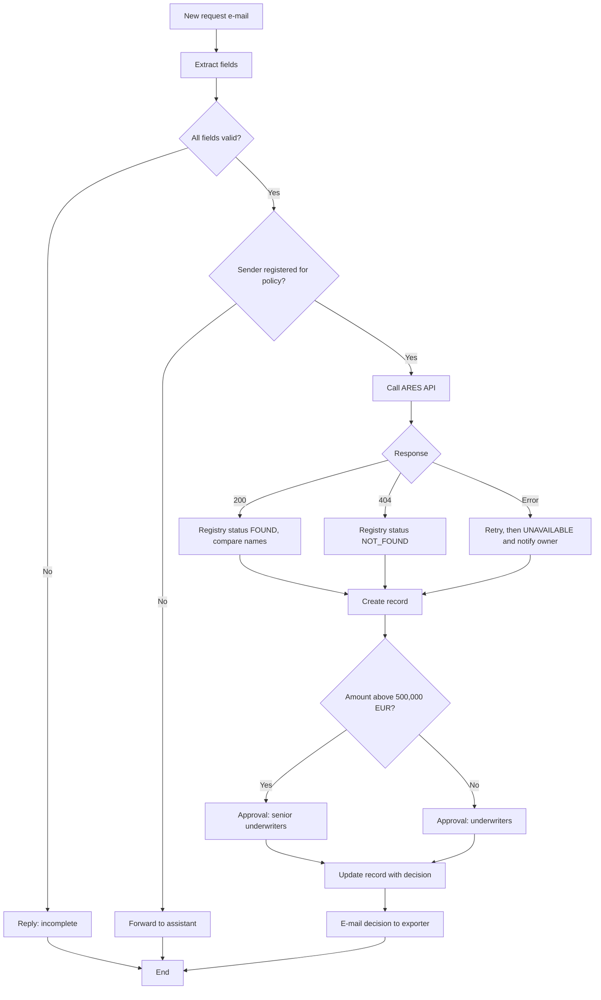

## Why this matters
Inzerát čeká, že budeš stavět automatizace v low-code platformách a převádět požadavky na algoritmy („algoritmizace požadavků“). Low-code umožňuje analytikovi dodat malá zlepšení sám: schvalovací flow, e-mail, ze kterého vznikne záznam, kontrolu v registru. Zároveň prověří, jestli umíš logiku popsat přesně, a to je stejná dovednost, jakou potřebuješ pro dobré specifikace. Pokud už jsi v práci navrhla automatizaci a domluvila ji s IT, tento modul ti dá slovník a strukturu, jak tu zkušenost podat.

## Quick version
**Low-code** platformy umožňují stavět aplikace a automatizace hlavně skládáním vizuálních bloků, s malým množstvím vzorců nebo kódu. **No-code** nástroje míří na nulový kód. Hranice je neostrá; podstatné je, že stavět mohou lidé z businessu a IT na to dohlíží.

**Platformy, které bys měla znát podle jména:**
- **Microsoft Power Platform** – nejběžnější v českých bankách a pojišťovnách, které používají Microsoft 365:
  - **Power Automate** – cloud flows (automatizace mezi cloudovými službami) a desktop flows (RPA, proklikávání desktopových aplikací).
  - **Power Apps** – canvas apps (volný návrh obrazovek) a model-driven apps (generované z datového modelu).
  - **Dataverse** – databáze platformy.
  - **Connectors** (konektory) – hotová propojení se systémy (Outlook, SharePoint, SQL, HTTP).
- **Make**, **Zapier**, **n8n** – automatizační nástroje oblíbené v menších firmách; Make má free plán a n8n si můžeš provozovat sama (self-hosting).
- **OutSystems**, **Mendix** – enterprise low-code platformy pro větší aplikace, blíž klasickému vývoji softwaru.

**RPA vs API.** **RPA** (robotic process automation, robotická automatizace procesů) napodobuje uživatele: kliká, píše a čte obrazovky. **Automatizace přes API** mluví se systémy přímo přes jejich rozhraní. Dávej přednost API: je rychlejší, stabilnější a snáz se zabezpečí a audituje. RPA se rozbije, když se změní obrazovka. RPA použij, jen když API neexistuje, například u staré desktopové aplikace.

**Anatomie flow:**
- **Trigger** (spouštěč) – co flow spustí (přijde e-mail, někdo odešle formulář, každé ráno v 7:00).
- **Actions** (akce) – kroky (načíst data, zavolat API, vytvořit záznam, poslat e-mail).
- **Conditions** (podmínky) – větvení if/else.
- **Loops** (smyčky) – opakování pro každou položku (každou přílohu, každý řádek).
- **Variables and expressions** (proměnné a výrazy) – uložení a výpočet hodnot.
- **Error handling** (ošetření chyb) – co se stane, když krok selže (opakovat, upozornit někoho, čistě skončit).
- **Approvals** (schválení) – čekání, až člověk schválí nebo zamítne.

**Algoritmické myšlení** znamená popsat proces jako přesné kroky dřív, než ho začneš stavět: pseudokódem, rozhodovací tabulkou nebo vývojovým diagramem. Když logiku neumíš napsat na papír, nástroj ti nepomůže.

**Governance** (řízení a pravidla). Ve firmě automatizace běží ve schválených **environments** (prostředích), s **DLP policies** (pravidla data loss prevention, která určují, které konektory se smějí kombinovat), s **Center of Excellence (CoE)**, které nastavuje pravidla, se jmenovitým **ownerem** (vlastníkem) každého flow, s dokumentací a modelem podpory. Záleží i na licencích: některé konektory jsou premium a potřebují placené licence.

**Kdy neautomatizovat:** proces je nestabilní nebo se brzy změní, běží zřídka, vyžaduje složitý úsudek, nebo automatizaci nebude nikdo vlastnit a udržovat.

**Měření přínosu:** ušetřený čas na případ × počet případů, méně chyb, rychlejší odezva, lepší auditní stopa. Porovnej s pracností stavby a údržby.

**Přístup pro procvičování.** Power Automate potřebuje pracovní nebo školní účet Microsoft. Bez něj cvič na **Make** (free plán) nebo **n8n** (open source, poběží i na tvém počítači). Principy jsou stejné.

**Bezpečnostní pravidlo:** v práci používej jen schválené nástroje a postupy domluvené s IT. To je mimochodem i dobrá odpověď na pohovoru.

Na pohovoru: „Začínám procesem a logikou v pseudokódu, ověřím s IT, která platforma a které konektory jsou schválené, dávám přednost API před RPA, do návrhu zabuduju ošetření chyb a vlastníka a automatizaci zdokumentuju tak, aby ji mohl podporovat někdo jiný.“

## Deep dive

### Co low-code je a co není [P1]
Low-code platformy ti dávají stavební bloky: triggery, konektory, podmínky, formuláře, tabulky. Skládáš je vizuálně a kde je třeba, doplníš vzorce. Platforma na pozadí generuje a spouští kód, stará se o hosting a nabízí monitoring.

V čem je low-code dobré: schvalování, notifikace, přesun dat mezi systémy přes konektory, jednoduché formuláře a aplikace, plánované kontroly, směrování dokumentů.

V čem je slabé: složité výpočty s mnoha pravidly, velmi vysoké objemy, zpracování v reálném čase s přísnými výkonnostními cíli a logika, na které závisí mnoho týmů. To patří do pořádné aplikace, kterou postaví IT nebo dodavatel.

**Citizen developer** je běžný název pro uživatele z businessu, který staví automatizace na schválené platformě. **IT** poskytuje platformu, nastavuje pravidla a přebírá řešení, která se stanou kritickými. BA často stojí mezi: navrhne automatizaci, jednoduché postaví sám a složité předá IT s jasnou specifikací.

### Přehled platforem [P1]
| Platforma | Typ | Typické použití | Přístup pro procvičování |
|---|---|---|---|
| Power Automate (cloud flows) | Automatizace workflow | Schvalování, zpracování e-mailů, záznamy v SharePointu/Dataverse | Pracovní nebo školní účet Microsoft |
| Power Automate for desktop | RPA | Automatizace desktopových aplikací bez API | Součást Windows 10/11 pro attended použití (přesná práva závisí na edici) |
| Power Apps | Tvorba aplikací | Formuláře a jednoduché firemní aplikace | Pracovní nebo školní účet; Developer Plan |
| Dataverse | Databáze | Tabulky pro Power Apps a flows | Součást Power Platform |
| Make | Automatizace workflow | Propojování cloudových služeb | Free plán |
| n8n | Automatizace workflow | Totéž, lze provozovat u sebe | Open source, běží lokálně |
| Zapier | Automatizace workflow | Jednoduchá automatizace mezi aplikacemi | Free tier s omezeními |
| OutSystems, Mendix | Enterprise low-code | Větší firemní aplikace | Existují bezplatné edice pro výuku; ověř u výrobců |

**Detaily Power Platform, které stojí za to znát** (licence se často mění; než se na detail spolehneš, ověř si ho na oficiálních stránkách Microsoftu):
- **Power Apps Developer Plan** je zdarma a je určený pro vývoj a testování, ne pro produkční provoz. Vyžaduje pracovní nebo školní e-mailový účet založený na Microsoft Entra ID, takže osobní adresa Gmail nebo Outlook.com nestačí. Zahrnuje právo používat cloud flows napojené na tvoje aplikace; desktopové RPA v něm není. **Změna na konci roku 2026:** od 15. listopadu 2026 registrace už nevytváří developer environment, unmanaged developer environments se od 15. prosince 2026 pozastavují a od 15. ledna 2027 mažou (Microsoft Learn, „Power Apps Developer Plan“). V praxi tedy vývojové prostředí dostaneš jen přes administrátora zaměstnavatele. Na vlastní procvičování použij Make nebo n8n; principy se přenesou.
- **Power Automate for desktop** je ve Windows 10 a 11 k dispozici pro attended automatizaci (flow spouštíš sama). Unattended běhy (bez přítomnosti uživatele) a spouštění desktop flows z cloudu vyžadují placené licence.
- **Standard vs premium konektory.** Licence Microsoft 365 pokrývají standardní konektory (Outlook, SharePoint, Teams). Premium konektory (například HTTP, SQL Server, v mnoha scénářích Dataverse) potřebují premium licenci Power Automate nebo Power Apps. Při návrhu flow si ověř, které konektory používá: může to změnit cenu.

**Make** v době psaní nabízí free plán s měsíčním objemem kreditů (kolem 1 000), omezeným počtem aktivních scénářů a minimálním intervalem plánování (kolem 15 minut). Na učení to stačí. Aktuální limity najdeš na [Make](https://www.make.com/).

**n8n** je vydané pod licencí typu „fair-code“: komunitní edici můžeš zdarma provozovat na vlastním počítači; hostovaná cloudová verze je placená, se zkušební dobou. Viz [n8n](https://n8n.io/).

### RPA vs automatizace přes API [P1]
| | Přes API | RPA |
|---|---|---|
| Jak funguje | Volá rozhraní systému přímo | Napodobuje uživatele na obrazovce |
| Rychlost | Rychlá | Pomalá (čeká na obrazovky) |
| Stabilita | Stabilní, dokud platí kontrakt API | Rozbije se při změně obrazovek, polí nebo rozlišení |
| Bezpečnost | Technický účet s definovanými právy, logovaná volání | Často uživatelský účet a uložené heslo; hůř se kontroluje |
| Audit | Jasný log volání a dat | Záznamy obrazovky a logy, méně přesné |
| Kdy použít | Vždy, když API existuje | API není, stará desktopová aplikace, dočasný most |

Příklad: registr firem ARES má veřejné REST API. Kontrola odběratele podle IČO přes API je jeden HTTP požadavek. Pomocí RPA (otevřít web, napsat IČO, přečíst obrazovku) je to pomalejší a rozbije se to při každém redesignu webu.

:::tip
V regulované firmě je „Existuje API?“ první otázka u každé automatizace. RPA se toleruje jako most, s plánem na jeho nahrazení.
:::

### Anatomie flow [P1]
| Prvek | Význam | Power Automate | Make |
|---|---|---|---|
| Trigger | Událost, která flow spustí | „When a new email arrives“, „Recurrence“ | První modul: Webhook, Watch emails, Schedule |
| Action | Jeden krok | „Create item“, „Send an email“ | Modul |
| Condition | If/else | Condition, Switch | Router s filtry |
| Loop | Opakování pro každou položku | Apply to each, Do until | Iterator, Repeater |
| Variable | Uložená hodnota | Initialize/Set variable | Set variable |
| Expression | Výpočet nebo transformace | Výrazy jako `formatDateTime()` | Funkce jako `formatDate()` |
| Error handling | Reakce na selhání | „Configure run after“, scopes | Error handlers (Resume, Ignore, Rollback, Break) |
| Approval | Čekání na člověka | Konektor Approvals | Obvykle e-mail nebo formulář s odkazem |

**Run-after** v Power Automate: u každé akce lze nastavit, že se spustí, jen pokud předchozí krok *succeeded* (uspěl), *failed* (selhal), *was skipped* (byl přeskočen) nebo *timed out* (vypršel čas). Běžný vzor je **try/catch**: hlavní kroky dáš do jednoho scope („Try“) a druhý scope („Catch“) se spustí, jen když Try selhal, a upozorní vlastníka.

**Expressions** (výrazy) vypadají jako vzorce v Excelu. Příklad v Power Automate:

```text
if(greater(variables('amount'), 500000), 'SECOND_APPROVAL', 'SINGLE_APPROVAL')
```

### Algoritmické myšlení: od procesu k logice [P1]
Než začneš stavět, popiš logiku ve formě, která nemá díry. Tři nástroje:

1. **Pseudocode** (pseudokód) – očíslované kroky v běžném jazyce s IF, ELSE, FOR EACH, STOP.
2. **Decision table** (rozhodovací tabulka) – pro pravidla s několika podmínkami (viz modul 13).
3. **Flowchart** (vývojový diagram) – diagram téže logiky; poslouží i BPMN.

Kontrolní otázky ke každému kroku: Co je vstup? Co přesně se stane? Co je výstup? Co když vstup chybí nebo je špatně? Co když systém neodpoví?

### Řešený příklad: žádost o úvěrový limit e-mailem [P1]
**Situace (AS-IS):** exportéři posílají žádosti o úvěrový limit e-mailem do sdílené schránky. Asistentka každý e-mail otevře, zkontroluje odběratele na webu ARES, zkopíruje data do excelového přehledu, přepošle žádost underwriterovi a později e-mailem pošle rozhodnutí. Asi 40 žádostí týdně, každá 15 minut ruční práce.

**Cíl (TO-BE):** automatizace přečte žádost, zkontroluje odběratele v ARES, vytvoří záznam, požádá underwritera o schválení a pošle exportérovi oznámení. Rozhodnutí underwritera zůstává na člověku.

**Předpoklad:** exportéři používají pevnou šablonu e-mailu, nebo lépe webový formulář. Volný text e-mailu se spolehlivě rozebírá těžko; extrakci pomocí AI probírá modul 15.

**Pseudokód:**

```text
TRIGGER: new e-mail arrives in limits@exportshield.example with subject starting "Credit limit request"

1. Read sender address, subject, body.
2. Extract fields from body: policy number, buyer company ID, buyer name, amount, currency, payment terms.
3. IF any required field is missing OR company ID is not 8 digits
     Reply to sender: "Request incomplete: <missing fields>". Log case as REJECTED_INCOMPLETE. STOP.
4. Look up sender in policy list.
   IF sender is not a registered contact for the policy number
     Forward to underwriting assistant for manual check. Log as MANUAL_CHECK. STOP.
5. Call ARES API GET /ekonomicke-subjekty/{companyId}.
   IF HTTP status = 404 → set registryStatus = "NOT_FOUND"
   ELSE IF HTTP status = 200 → set registryStatus = "FOUND", registryName = obchodniJmeno
   ELSE (timeout or 5xx) → retry 2 times after 5 minutes;
        IF still failing → set registryStatus = "UNAVAILABLE", notify flow owner
6. IF registryStatus = "FOUND" AND registryName differs from buyer name in e-mail
     set nameMismatch = TRUE
7. Create record in Credit Limit Requests table with all fields, registryStatus, nameMismatch,
   status = "WAITING_FOR_DECISION", received timestamp.
8. Determine approver:
   IF amount (in EUR) > 500,000 → approver group = Senior underwriters
   ELSE → approver group = Underwriters
9. Start approval for the approver group with a summary and link to the record.
   Wait for response (max 3 business days; reminder after 2).
10. IF approved → update record status = "APPROVED" (amount approved, approver, time)
    ELSE IF rejected → status = "REJECTED" (reason)
11. Send e-mail to the exporter with the decision, using the approved template.
12. Log end of run. On any unexpected error: notify flow owner with run link, set status = "ERROR".
```

**Vývojový diagram:**



**Návrhová tabulka flow** (to je specifikace, podle které může flow postavit někdo jiný):

| # | Krok | Prvek platformy | Vstup | Výstup / pravidlo | Při chybě |
|---|---|---|---|---|---|
| 1 | Trigger | Outlook „When a new email arrives in a shared mailbox (V2)“, filtr na předmět | E-mail | Odesílatel, předmět, tělo | – |
| 2 | Vytažení polí | Výrazy / textové funkce nad pevnou šablonou | Tělo | Č. smlouvy, IČO, název odběratele, částka, měna, platební podmínky | Označit chybějící pole |
| 3 | Validace | Condition | Vytažená pole | Všechna povinná vyplněna; IČO = 8 číslic | Odpovědět „neúplné“, konec |
| 4 | Kontrola odesílatele | Vyhledání v seznamu kontaktů ke smlouvám | Odesílatel, č. smlouvy | Shoda ano/ne | Přeposlat asistentce |
| 5 | Kontrola v ARES | HTTP GET na ARES API | IČO | Stavový kód, `obchodniJmeno` | 2× opakovat, pak UNAVAILABLE + upozornit vlastníka |
| 6 | Porovnání názvů | Condition | Název z e-mailu vs z registru | Příznak `nameMismatch` | – |
| 7 | Vytvoření záznamu | Create row (seznam SharePoint / Dataverse / tabulka Excel) | Všechna data | ID záznamu, stav WAITING_FOR_DECISION | Upozornit vlastníka, konec |
| 8 | Směrování | Condition na částku | Částka (EUR) | Skupina schvalovatelů | – |
| 9 | Schválení | Approvals: „Start and wait for an approval“ | Shrnutí, odkaz na záznam | Approve / Reject + komentář | Připomínka po 2 dnech; eskalace po 3 |
| 10 | Aktualizace záznamu | Update row | Rozhodnutí | APPROVED / REJECTED se schvalovatelem a časem | Upozornit vlastníka |
| 11 | Oznámení exportérovi | Odeslání e-mailu ze sdílené schránky, šablona | Rozhodnutí | E-mail odeslán | Upozornit vlastníka |
| 12 | Scope pro chyby | Scope s run-after „has failed“ | Jakékoli selhání | Upozornění vlastníkovi s odkazem na běh, stav ERROR | – |

Poznámky pro reálný svět:
- Volání ARES používá konektor HTTP, který je v Power Automate premium. To znamená rozhodnutí o licenci, nebo schválený custom connector.
- ARES vrací oficiální název a adresu; o finančním zdraví firmy neříká nic. Underwriter dál potřebuje finanční data a rating země.
- Převod měny na EUR (krok 8) potřebuje zdroj kurzů, například denní kurzovní lístek ČNB. Rozhodni, kurz kterého dne platí; to je business rule (obchodní pravidlo).

### Governance ve firmách [P1]
| Téma | Co znamená | Na co se zeptat |
|---|---|---|
| Environments | Oddělená prostředí pro vývoj, test a produkční flows | Kde smím stavět a jak se flows dostanou do produkce? |
| DLP policies | Pravidla, která řadí konektory do skupin „business“, „non-business“ a „blocked“; flow nesmí míchat business a non-business konektory | Které konektory jsou v našem prostředí povolené? |
| Center of Excellence (CoE) | Tým, který vlastní pravidla platformy, šablony, školení a monitoring | Kdo schvaluje novou automatizaci? |
| Ownership (vlastnictví) | Každé flow má business vlastníka a technického vlastníka; nikdy ne jen účet jednoho člověka | Kdo to opraví, když to spadne o svátcích? |
| Service accounts | Produkční flows běží pod vyhrazeným účtem, ne osobním | Je k dispozici service account? |
| Dokumentace | Jedna stránka na automatizaci: účel, trigger, systémy, data, ošetření chyb, podpora | Kde je dokumentace uložená? |
| Licence | Standard vs premium konektory, licence na uživatele vs na flow | Kolik tento návrh stojí měsíčně? |
| Data | Osobní nebo důvěrná data, retence, kde jsou data uložena | Opouštějí nějaká data schválené systémy? |

:::warning
Flow postavené pod osobním účtem přestane fungovat, když člověk odejde a jeho účet se zablokuje. Ve firmách je to jedna z nejčastějších příčin rozbitých automatizací.
:::

### Kdy neautomatizovat [P2]
- Proces je nestabilní, nejasný nebo se brzy změní. Nejdřív oprav proces.
- Objem je malý: úkol, který se dělá dvakrát měsíčně po pěti minutách, neospravedlní stavbu ani údržbu.
- Práce vyžaduje úsudek, který nejde vyjádřit pravidly (i když AI může pomoci, viz modul 15).
- Zdrojová data jsou špatná (volný text, naskenované dokumenty bez struktury).
- Nikdo ji nebude vlastnit.
- Stejně se chystá pořádná změna systému; automatizace by byla práce na vyhození.

### Měření přínosu [P2]
Jednoduchý business case pro řešený příklad:

| Položka | Hodnota |
|---|---|
| Žádostí týdně | 40 |
| Ruční čas na žádost dnes | 15 min |
| Ruční čas na žádost po automatizaci | 4 min (výjimky, kontroly) |
| Ušetřený čas za rok | 40 × 11 min × 48 týdnů ≈ 352 hodin |
| Pracnost stavby | např. 5–8 dní včetně testování |
| Provozní náklady | Licence pro premium konektor, údržba ~1 hodina měsíčně |
| Nefinanční přínosy | Rychlejší odpověď exportérům, jednotná kontrola v registru, auditní stopa |

V reálné práci používej vlastní naměřená čísla. Měř před (vzorek případů) i po.

### Citizen developer vs IT [P2]
| Postaví citizen developer | Předá se IT / dodavateli |
|---|---|
| Proces na úrovni týmu, malý objem | Celofiremní nebo směrem ke klientům |
| Standardní konektory | Integrace do klíčových systémů se zápisem |
| Selhání je nepříjemnost | Selhání způsobí finanční, právní nebo klientskou škodu |
| Jednoduchá logika | Složitá pravidla, velký objem, přísný výkon |

Přínos BA tady: jasně navrhnout logiku, s IT zvolit správnou cestu a zdokumentovat ji tak, aby se řešení dalo udržovat.

### Dokumentace automatizace [P1]
Jednostránková karta automatizace:
- **Název a účel** (jedna věta, přínos pro business)
- **Business vlastník** a **technický vlastník** (role)
- **Trigger** a **frekvence / objem**
- Použité **systémy a konektory**, účty, pod kterými běží
- **Data**: co se čte a zapisuje; osobní údaje ano/ne
- **Shrnutí logiky** (odkaz na pseudokód nebo vývojový diagram)
- **Ošetření chyb**: co se stane při selhání, kdo dostane upozornění
- **Podpora**: jak uživatelé hlásí problémy, očekávaná reakce
- **Change log** (historie změn): verze, datum, změna, kdo schválil

## Key terms
- **Low-code** — stavba aplikací a automatizací hlavně konfigurací vizuálních komponent, s minimem kódu.
- **Citizen developer** — uživatel z businessu, který staví řešení na schválené low-code platformě.
- **Power Automate** — automatizační služba Microsoftu s cloud flows a desktop flows.
- **Power Apps** — low-code nástroj Microsoftu pro tvorbu aplikací (canvas a model-driven apps).
- **Dataverse** — datová platforma, kterou používají Power Apps a Power Automate.
- **Connector** (konektor) — hotová komponenta, přes kterou flow nebo aplikace komunikuje s konkrétním systémem nebo službou.
- **RPA** (robotická automatizace procesů) — software, který napodobuje klikání a psaní uživatele v rozhraní.
- **Trigger** (spouštěč) — událost, která spustí flow.
- **Action** (akce) — jeden krok, který flow provede.
- **Run-after** — nastavení v Power Automate, které spustí krok, jen pokud předchozí krok uspěl, selhal, byl přeskočen nebo mu vypršel čas.
- **Pseudocode** (pseudokód) — přesný popis logiky krok za krokem v běžném jazyce.
- **DLP policy** (pravidlo prevence úniku dat) — pravidlo, které určuje, které konektory se smějí používat společně.
- **Environment** (prostředí) — oddělený prostor pro stavbu a běh aplikací a flows (vývoj, test, produkce).
- **Center of Excellence (CoE)** — tým, který ve firmě řídí a podporuje low-code platformu.
- **Premium connector** (prémiový konektor) — konektor, který v Power Platform vyžaduje vyšší, placenou licenci.
- **Service account** (servisní účet) — neosobní účet, pod kterým běží produkční automatizace.

## Hands-on
:::exercise id="m14-e1" title="Pseudokód a vývojový diagram pro hlášení škody" min="45" tool="draw.io or Mermaid Live"
**Cíl:** navrhnout logiku automatizace nejdřív na papíře.

Proces: exportér odešle formulář hlášení nezaplacené pohledávky (číslo smlouvy, IČO odběratele, číslo faktury, částka faktury, datum splatnosti). Automatizace musí ověřit, že škoda byla nahlášena do 60 dní po splatnosti, zkontrolovat odběratele v ARES, vytvořit záznam škody, přidělit ji likvidátorovi (částky nad 100 000 EUR seniornímu likvidátorovi) a potvrdit exportérovi přijetí.

1. Napiš pseudokód s očíslovanými kroky, IF/ELSE a ošetřením chyb u každého externího volání.
2. Nakresli vývojový diagram v [draw.io](https://app.diagrams.net/) nebo [Mermaid Live](https://mermaid.live/).
3. Vyznač, které kroky jsou automatické a kde rozhoduje člověk.
4. Sepiš tři otázky pro manažera likvidace, které tvůj pseudokód odhalil.

**Hotovo, když:** někdo jiný projde tvůj pseudokód s testovacími daty a dojde ke stejnému výsledku jako ty, včetně případu „ARES neodpovídá“.
:::

:::exercise id="m14-e2" title="Postav flow pro kontrolu v ARES" min="120" tool="Make (free) or Power Automate"
**Cíl:** postavit funkční, zjednodušenou verzi řešeného příkladu. Používej jen fiktivní data.

V [Make](https://www.make.com/) (free plán):
1. Vytvoř nový scénář. Jako trigger přidej modul **Webhooks → Custom webhook**. Zkopíruj jeho URL.
2. Pošli na webhook testovací požadavek z [Postmanu](https://www.postman.com/downloads/): metoda POST, JSON tělo `{"policy":"P-2026-0153","companyId":"00006947","buyerName":"Test buyer","amount":120000}`. Make se tak naučí strukturu dat. (00006947 je IČO veřejného úřadu, tady slouží jen jako testovací dotaz.)
3. Přidej modul **HTTP → Make a request**: GET `https://ares.gov.cz/ekonomicke-subjekty-v-be/rest/ekonomicke-subjekty/{ico}`, kde `{ico}` nahradíš hodnotou companyId namapovanou z webhooku. Zapni parsování odpovědi.
4. Přidej **Router** se dvěma větvemi: filtr 1 „status code = 200“, filtr 2 „status code = 404“. Podle potřeby nastav HTTP modul tak, aby při 404 neselhal, nebo přidej error handler.
5. Větev 1: přidej modul **Google Sheets → Add a row** (nebo Excel), který zapíše smlouvu, IČO, název odběratele, název z registru (`obchodniJmeno`), částku, stav „WAITING_FOR_DECISION“ a časové razítko.
6. Větev 2: zapiš řádek se stavem „BUYER_NOT_FOUND“.
7. Na každou větev přidej modul **Email** (nebo Gmail), který pošle shrnutí tobě.
8. Otestuj s 00006947 a s 12345678 (má vrátit 404).

V [Power Automate](https://make.powerautomate.com/) (jen s pracovním nebo školním účtem a se svolením tvého IT): trigger „When an HTTP request is received“ nebo „Manually trigger a flow“ se vstupy; akce **HTTP** (premium) na ARES; **Condition** na stavový kód; **Add a row into a table** (Excel Online) nebo **Create item** (SharePoint); **Send an email (V2)**.

**Hotovo, když:** obě testovací IČO vytvoří správný řádek a e-mail a máš snímky obrazovky scénáře a výsledků do portfolia.
:::

:::exercise id="m14-e3" title="Zdokumentuj automatizaci" min="30" tool="Confluence or Word"
**Cíl:** napsat jednostránkovou kartu automatizace pro flow, které jsi postavila.

1. Vyplň všechny položky z části „Dokumentace automatizace“: účel, vlastníci, trigger, objem, systémy, data, logika, ošetření chyb, podpora, change log.
2. Přidej oddíl „Rizika a limity“: cena premium konektoru, dostupnost ARES, co kontrola *neověřuje*.
3. Přidej oddíl „Jak testovat“: tři testovací vstupy a očekávané výsledky.

**Hotovo, když:** kolega, který flow nikdy neviděl, z karty pozná, co dělat, když v 6 ráno spadne.
:::

## Self-check
:::q
Proč se automatizace přes API obvykle upřednostňuje před RPA?
---
Volání API jsou rychlejší, stabilnější a snáz se zabezpečí a auditují, protože používají definované rozhraní a technický účet s konkrétními právy. RPA napodobuje uživatele na obrazovce a rozbije se, když se rozhraní změní, a často potřebuje uložené přihlašovací údaje uživatele. RPA se používá tam, kde API neexistuje.
:::

:::q
Co je DLP policy v Power Platform a proč je důležitá pro tvůj návrh?
---
Pravidlo data loss prevention rozděluje konektory do skupin a brání flow kombinovat konektory z různých skupin, případně některé úplně blokuje. Pokud návrh používá konektor, který je blokovaný nebo v jiné skupině, flow v daném prostředí nepoběží. Pravidla si ověř dřív, než začneš navrhovat.
:::

:::q
Tvoje flow volá externí API, které občas nefunguje. Co by měl návrh obsahovat?
---
Opakování s prodlevou, jasný stav „služba nedostupná“ místo tichého selhání, upozornění vlastníkovi flow a způsob, jak případ zpracovat později nebo ručně. V Power Automate se to dělá nastavením run-after nebo scopy try/catch; v Make pomocí error handlerů.
:::

:::q
Uveď tři důvody, proč proces neautomatizovat.
---
Proces je nestabilní nebo se brzy změní; objem je příliš malý, aby se vyplatila stavba a údržba; vstupy jsou nestrukturované nebo práce vyžaduje úsudek; automatizaci nebude nikdo vlastnit. Často je lepším krokem nejdřív opravit samotný proces.
:::

:::q
Proč by produkční flow nemělo běžet pod osobním účtem?
---
Když člověk odejde nebo se účet zablokuje, flow se zastaví. Osobní účet má navíc často širší práva, než flow potřebuje, což porušuje princip nejmenších oprávnění (least privilege). Produkční flows mají běžet pod service accountem se jmenovitým business a technickým vlastníkem.
:::

:::q
Na čem může automatizaci procvičovat někdo bez pracovního účtu Microsoft a co se z toho přenese?
---
Na free plánu Make nebo na lokální instalaci n8n. Triggery, akce, podmínky, smyčky, HTTP volání, mapování dat a ošetření chyb fungují na stejných principech, takže dovednosti návrhu se přenesou i do Power Automate.
:::

## Interview corner
:::interview
Řekněte nám o automatizaci, kterou jste navrhla nebo postavila.
*EN: Tell us about an automation you designed or built.*
---
- Situace: ruční proces, objem, pain points (čas, chyby).
- Tvoje role: analýza, návrh logiky, dohoda s IT, stavba, testování.
- Návrhová rozhodnutí: trigger, systémy, API vs RPA, ošetření chyb, schvalování.
- Governance: schválená platforma, vlastník, dokumentace.
- Výsledek: naměřená úspora času, méně chyb, rychlejší odezva.

Typická chyba: popisovat klikání v nástroji bez business problému a naměřeného výsledku.
:::

:::interview
Jak byste rozhodla, jestli proces zautomatizovat v low-code, nebo ho předat IT?
*EN: How would you decide whether a process should be automated with low-code or handed to IT?*
---
- Kritičnost: co se stane, když selže?
- Objem a nároky na výkon.
- Zapojené systémy: standardní konektory vs zápis do klíčových systémů.
- Složitost pravidel a očekávaná četnost změn.
- Dostupné vlastnictví a podpora.

Typická chyba: brát low-code jako odpověď na všechno, nebo s ním vůbec nepočítat.
:::

:::interview
Jaký je rozdíl mezi RPA a integrací přes API a kdy byste použila RPA?
*EN: What is the difference between RPA and API integration, and when would you use RPA?*
---
- RPA napodobuje akce uživatele na obrazovce; integrace přes API volá rozhraní systémů přímo.
- API je rychlejší, stabilnější, bezpečnější a auditovatelné.
- RPA tam, kde API neexistuje (stará desktopová aplikace), jako dočasný most s plánem na nahrazení.

Typická chyba: prezentovat RPA jako moderní výchozí volbu.
:::

:::interview
Jak zajistíte, aby automatizace postavená businessem byla v regulované firmě bezpečná?
*EN: How do you make sure an automation built by the business is safe in a regulated company?*
---
- Jen schválené platformy a prostředí; dodržovat DLP policies.
- Service account, nejmenší oprávnění, jmenovití vlastníci.
- Ošetření chyb a monitoring; dokumentace a model podpory.
- Prověřit osobní údaje a kde jsou data uložena; zapojit IT a bezpečnost brzy.

Typická chyba: „Postavila jsem si to sama v bezplatném nástroji, abych ušetřila čas.“
:::
