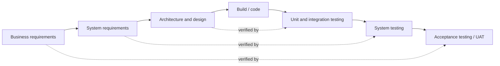
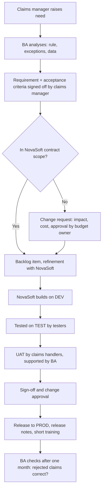

## Why this matters
A business analyst works inside a delivery process: someone decides what to build, someone builds it, someone tests it, someone puts it into production. If you do not know the stages, the roles and the rules of the contract with the vendor, you will not know when your input is needed or why a "small change" suddenly costs money. The target job ad asks for collaboration with vendors, testing of deliveries and status reporting, all of which assume you understand how delivery works.

## Quick version
**SDLC** (software development life cycle) is the general sequence any IT change goes through: idea and analysis → requirements → design → build → test → deployment → operation and maintenance. Every method keeps these activities; they differ in how they are ordered and how often they repeat.

**Waterfall** runs the phases one after another. Requirements are agreed and signed off up front, then design, then build, then test. It suits fixed scope, fixed-price contracts and heavy regulation, but changes late in the project are expensive. The **V-model** is a variant of waterfall that pairs each specification level with a test level: business requirements with acceptance testing, system requirements with system testing, design with integration testing, code with unit testing.

**Agile** delivers in short cycles and adjusts as it learns. **Scrum** (defined in the Scrum Guide 2020) is the most common agile framework:
- **Scrum Team**: one Product Owner, one Scrum Master, and Developers (everyone who builds the increment, including testers and often the BA).
- **Events**: the Sprint (fixed length, one month or less), Sprint Planning, Daily Scrum (15 minutes), Sprint Review, Sprint Retrospective.
- **Artifacts**: Product Backlog (with the Product Goal), Sprint Backlog (with the Sprint Goal), Increment (meets the Definition of Done).

**Kanban** has no sprints. Work flows through columns on a board (for example To do → Analysis → Development → Test → Done), with limits on how much work can be in each column at once.

**Hybrid reality:** banks and insurers rarely run pure Scrum. Typically the budget and contract are planned like waterfall (yearly budget, fixed-price or framework contract with a vendor), while the team builds in sprints. Releases to production may still happen only a few times per year, with formal UAT and change approval.

**Working with vendors.** Many insurers buy systems and development from external companies. Key concepts:
- **RFI / RFP / RFQ**: requests for information, proposal, or quotation sent to potential vendors.
- **Fixed price** contract: agreed scope for agreed money. Any change in scope needs a **change request (CR)**.
- **Time and materials (T&M)**: you pay for hours worked. Flexible, but the client carries the risk of cost growth.
- **SLA** (service level agreement): measurable service promises, for example incident response time.
- **Acceptance / sign-off**: formal confirmation that a delivery meets requirements. After sign-off, defects are usually handled under warranty or support, not as part of the original delivery.

**Environments:** DEV (developers build), TEST (testers test), UAT (business users accept), PROD (real users, real data). Code moves from left to right; each step has checks.

**The BA in each phase:** analysis and requirements (main work), design (review, answer questions), build (clarify), test (provide acceptance criteria, support testers and UAT), deployment (release notes, training), operation (evaluate, collect new needs).

## Deep dive

### The SDLC: what any delivery contains [P1]
Whatever the method, someone has to answer these questions in roughly this order:

1. **Initiation** — Is there a need worth solving? Who sponsors it? (Business case, problem statement.)
2. **Analysis and requirements** — What exactly must the solution do? (Requirements, process models, user stories.)
3. **Design** — How will the solution do it? (Architecture, data model, screens, interfaces.)
4. **Build** — Developers write code or configure a platform.
5. **Test** — Does it work as specified? Does it work for users? (Unit, integration, system, acceptance testing.)
6. **Deployment (release)** — Moving the change to production.
7. **Operation and maintenance** — Running the system, fixing incidents, small improvements.

A useful mental model: the methods (waterfall, Scrum, Kanban) are different *schedules* for the same activities. In waterfall, step 2 happens once for the whole project. In Scrum, steps 2–5 happen every sprint for a small slice.

### Waterfall and the V-model [P1]
**Waterfall** works well when requirements are stable and well understood, when a regulator or contract requires complete documentation up front, or when the work involves hardware or physical installation.

Its weak points:
- Users see the solution late, often only in UAT. Misunderstandings appear months after the requirement was written.
- Change late in the project is expensive, because design and build have already been done.
- Testing gets squeezed when earlier phases run over time.

The **V-model** makes testing explicit. Each level of specification on the left side has a matching level of testing on the right side.

For a BA the message is simple: the requirements you write become the basis of acceptance testing. If a requirement cannot be tested, UAT cannot confirm it.

### Agile and Scrum (Scrum Guide 2020) [P1]
**Agile** is a set of values and principles (the Agile Manifesto, 2001) that prefer working software, collaboration and responding to change over heavy plans and documents. It does not mean "no documentation" or "no plan".

**Scrum** is a lightweight framework. The Scrum Guide 2020 is short and freely available at [scrumguides.org](https://scrumguides.org/scrum-guide.html); read it once in full. The key elements:

**Scrum Team.** Small, typically 10 or fewer people, cross-functional and self-managing. Three accountabilities:

| Accountability | What they are accountable for |
|---|---|
| Product Owner | Maximizing the value of the product; managing the Product Backlog (defining and communicating the Product Goal, creating and ordering backlog items, making them transparent). One person, not a committee. |
| Scrum Master | Effectiveness of the Scrum Team; helping everyone understand Scrum theory and practice; removing impediments. |
| Developers | Creating a usable Increment each Sprint; the Sprint Backlog; quality via the Definition of Done. "Developers" means everyone doing the work, not only programmers. |

Note: the Scrum Guide has no "business analyst" role. In practice the BA is either one of the Developers (doing analysis work), supports the Product Owner, or acts as Product Owner.

**Events.** All events happen inside the Sprint.

| Event | Purpose | Timebox (for a one-month Sprint) |
|---|---|---|
| Sprint | Container for all work; fixed length of one month or less | — |
| Sprint Planning | Decide why the Sprint is valuable (Sprint Goal), what can be done, and how | Max 8 hours, shorter for shorter Sprints |
| Daily Scrum | Developers inspect progress toward the Sprint Goal and adapt the plan | 15 minutes |
| Sprint Review | Inspect the outcome with stakeholders and decide future adaptations | Max 4 hours |
| Sprint Retrospective | Plan ways to improve quality and effectiveness | Max 3 hours |

**Backlog refinement** is not a formal event in the Scrum Guide. It is an ongoing activity of breaking down and clarifying backlog items. For a BA it is often the most important meeting of the week.

**Artifacts and commitments.** Each artifact has a commitment that makes progress measurable:

| Artifact | Commitment |
|---|---|
| Product Backlog — ordered list of everything needed to improve the product | Product Goal |
| Sprint Backlog — Sprint Goal, selected items, and the plan to deliver them | Sprint Goal |
| Increment — a usable step toward the Product Goal | Definition of Done |

The **Definition of Done** is a shared description of the quality an increment must meet, for example "code reviewed, tests passed, deployed to TEST, release notes updated". Something not meeting it is not done and cannot be presented at the Sprint Review as done.

### Kanban [P2]
Kanban comes from manufacturing. In IT it means:
- **Visualize the work** on a board with columns for each stage.
- **Limit work in progress (WIP)**: for example, at most three items in "Analysis". When the column is full, you finish something before starting something new.
- **Manage flow**: measure how long items take from start to finish (cycle time) and remove bottlenecks.

Kanban suits work that arrives continuously and unpredictably: support requests, small changes, a BA team handling requests from many departments. ExportShield's IT support for ClaimDesk could run on Kanban, while the larger claim-automation project runs in Scrum.

### Hybrid reality in banks and insurers [P1]
Pure textbook methods are rare in regulated organizations. Typical patterns:

- **Water-Scrum-Fall.** Initiation and budget approval are waterfall (business case, steering committee). Build is in sprints. Release to production is again waterfall-like: formal UAT, change advisory board, release window.
- **Fixed-price contracts with agile teams.** The vendor works in sprints, but the contract fixes scope and price. Every new backlog item may be a change request.
- **Release trains.** Several teams release together, for example once a month or once a quarter, because systems depend on each other.
- **Regulatory gates.** Security review, data protection assessment, operational risk sign-off. These add steps that agile books do not mention.

As a BA you should ask early: Which gates exist? Who signs what? When are the release windows? A story that is "done" in a sprint can still wait two months for production.

### Working with external vendors [P1]
At ExportShield, PolicyHub is developed by an external vendor, NovaSoft s.r.o. This is common: many insurers own the business process and the data, but not the code.

**Selecting a vendor (rough level).**
- **RFI (request for information)** — "Tell us about your product and capabilities." Used to make a shortlist.
- **RFP (request for proposal)** — "Here are our requirements; propose a solution, approach, team and price." The BA often writes or contributes the requirements section.
- **RFQ (request for quotation)** — "Here is exactly what we want; give us a price." Used when the solution is already clear.

Answers are compared using agreed criteria (functional fit, cost, references, security, support). Procurement and legal run the formal process; the BA brings the requirements and helps score.

**Contract types.**

| | Fixed price | Time and materials (T&M) |
|---|---|---|
| What is agreed | Scope, price, deadline | Rate per day/hour, team, sometimes a cap |
| Who carries the risk of cost growth | Mostly the vendor | Mostly the client |
| Flexibility to change scope | Low; changes need CRs | High |
| What the BA must do well | Precise, complete requirements up front | Clear priorities and backlog; watch the burn rate |
| Typical use | Well-defined deliveries, regulatory changes | Ongoing development, agile teams |

Many real contracts are mixed: a framework agreement with daily rates, and fixed-price work orders for specific deliveries.

**Why change requests matter.** A **change request (CR)** is a formal request to change agreed scope, schedule or cost. Under a fixed-price contract, anything not in the agreed specification is a change. Without a CR process:
- the vendor may build extras for free and then cut corners elsewhere, or
- the vendor may refuse, and the business blames IT, or
- costs grow silently and nobody approved them.

A good CR states: what changes, why, impact on scope, cost, schedule and risk, and who approves. The BA often writes the business part and checks the vendor's impact estimate.

**SLA (service level agreement).** Defines measurable service levels after go-live, for example: priority 1 incidents answered within 1 hour and resolved within 8 hours; system availability 99.5% in business hours. The BA may need to specify SLAs as non-functional requirements and check whether reports from the vendor match them.

**Acceptance and sign-off.** The contract usually defines what acceptance means: which tests, which defect levels are allowed (for example, no open critical or high defects), and who signs. After signing, the delivery is accepted and payment is often triggered. Signing too early means paying for defects; refusing to sign without clear reasons damages the relationship. Clear acceptance criteria written up front avoid both.

### Environments: DEV, TEST, UAT, PROD [P1]
An **environment** is a separate installation of the system with its own database and configuration. Changes move through them in order.

| Environment | Who uses it | Data | Purpose |
|---|---|---|---|
| DEV (development) | Developers | Fake or minimal | Build and first checks |
| TEST (sometimes SIT, system integration test) | Testers | Test data | Functional and integration testing |
| UAT (user acceptance test) | Business users with BA support | Realistic, often anonymized copy | Confirm the solution works for the business |
| PROD (production) | Real users | Real data | Daily work |

Some organizations add PRE-PROD (a copy of production for final checks) or merge TEST and UAT. In banks and insurers, production data in lower environments must be anonymized or masked because of data protection rules. Never copy real client data into a test environment or a public tool to "save time".

### Release and deployment basics [P2]
- **Build** — the packaged version of the software ready to install.
- **Deployment** — installing a build into an environment.
- **Release** — making a set of changes available to users in production. A release can include several deployments.
- **Release notes** — a list of what changed, for users and support.
- **Change approval** — in many regulated organizations, a change advisory board (CAB) or similar approves each production change, checking risk, rollback plan and timing.
- **Rollback** — the plan to return to the previous version if the release fails.
- **Hotfix** — an urgent fix deployed outside the normal release schedule.

The BA usually prepares or reviews release notes, confirms that business-critical scenarios were accepted in UAT, and plans training or communication for users.

### The BA's role in each phase [P1]
| Phase | BA activities | Typical outputs |
|---|---|---|
| Initiation | Clarify the problem, identify stakeholders, rough business case | Problem statement, stakeholder map |
| Analysis and requirements | Elicitation, AS-IS / TO-BE, requirements, prioritization | Requirements, process models, backlog items |
| Design | Review designs against requirements, answer questions, data mapping | Reviewed design, interface specification |
| Build | Clarify details, refine stories, handle CRs | Updated stories, change requests |
| Test | Explain acceptance criteria, review test cases, triage defects, support UAT | Traceability, UAT plan, defect decisions |
| Deployment | Release notes, training, go/no-go input | Release notes, training material |
| Operation | Evaluate benefits, collect new needs, analyze incidents with business impact | Evaluation report, new backlog items |

### Example: one change at ExportShield, end to end [P2]
The claims department wants ClaimDesk to reject claims notified more than the contractual deadline after the invoice due date (assume the policy defines this deadline). Here is how the change travels:

Each arrow is a **handoff**: work passes from one person or team to another. Handoffs are where information gets lost. A good BA makes each handoff explicit: what is passed, in which document, who confirms receipt.

## Key terms
- **SDLC (software development life cycle)** — the sequence of activities from idea to operation of a software change.
- **Waterfall** — a delivery approach where phases follow each other once, each finishing before the next starts.
- **V-model** — a waterfall variant that pairs each specification level with a matching test level.
- **Agile** — an approach that delivers in short iterations and adapts to feedback and change.
- **Scrum** — an agile framework with defined accountabilities, events and artifacts, described in the Scrum Guide 2020.
- **Product Owner** — the Scrum accountability for maximizing product value and managing the Product Backlog.
- **Sprint** — a fixed-length period of one month or less in which a usable increment is created.
- **Definition of Done** — the shared quality standard an increment must meet to count as done.
- **Kanban** — a flow-based method that visualizes work on a board and limits work in progress.
- **RFP (request for proposal)** — a document asking vendors to propose a solution and price for stated requirements.
- **Fixed price** — a contract where scope and price are agreed in advance; changes require change requests.
- **Time and materials (T&M)** — a contract where the client pays for time actually worked.
- **Change request (CR)** — a formal request to change agreed scope, cost or schedule, with impact assessment and approval.
- **SLA (service level agreement)** — measurable service commitments, such as response times and availability.
- **Environment** — a separate installation of a system (DEV, TEST, UAT, PROD) used for a specific purpose.
- **Release** — making a set of changes available to users in production.
- **Sign-off** — formal approval that a deliverable meets the agreed criteria.
- **Handoff** — the point where work passes from one person or team to another.

## Hands-on
:::exercise id="m02-e1" title="Draw the delivery lifecycle of a change at ExportShield" min="45" tool="draw.io"
**Goal:** see every handoff in a realistic delivery with an external vendor.

1. Take the change "ClaimDesk must automatically reject claims notified after the policy deadline" (from the Deep dive example).
2. In [draw.io](https://app.diagrams.net/) create a diagram with horizontal lanes: Claims department, BA, NovaSoft (vendor), Testers, IT operations.
3. Place the steps from idea to production in the lanes. Include: requirement sign-off, CR decision, build, test on TEST, UAT, sign-off, change approval, release, evaluation.
4. Mark every handoff between lanes with a small label saying what is passed (for example "signed requirement", "build 1.4.2", "UAT report").
5. Circle the two handoffs where you think information is most likely to be lost and write one sentence why.

**Done when:** the diagram fits on one page, every lane has at least one step, and every cross-lane arrow is labeled.
:::

:::exercise id="m02-e2" title="Write a change request for the vendor" min="40" tool="Word or Confluence"
**Goal:** practice the most common vendor-facing document a BA writes.

Situation: under a fixed-price contract, NovaSoft is building a credit limit request form in PolicyHub. Halfway through, underwriting asks to add a mandatory field "buyer's annual turnover" with validation (positive number, currency selected from a list).

1. Write a one-page CR with these headings: CR ID and title; Requested by and date; Description of the change; Reason / business value; Affected requirements or stories; Impact (to be filled by vendor: effort, cost, schedule, risk); Options considered (including "do nothing"); Decision and approver.
2. Fill in everything except the vendor's impact estimate. Make the description precise enough that NovaSoft can estimate without a meeting.
3. Add two acceptance criteria for the new field.
4. Ask yourself: is this really a change, or was it implied by the original specification? Write one sentence on how you would check.

**Done when:** the CR fits on one page and a developer could estimate from it without asking you what you meant.
:::

:::exercise id="m02-e3" title="Plan a Scrum sprint in Jira or Trello" min="60" tool="Jira / Trello"
**Goal:** experience Scrum artifacts and events in a tool, not just in theory.

1. Create a free board in [Jira](https://www.atlassian.com/software/free) (Scrum template) or in [Trello](https://trello.com/) (columns: Product Backlog, Sprint Backlog, In progress, Test, Done).
2. Write a Product Goal: "Exporters can submit credit limit requests online without email."
3. Add 8 backlog items (for example: request form, buyer lookup by company ID, upload financial statements, underwriter queue, decision email, status page for exporter, audit log, reporting). Order them by value.
4. Write a Sprint Goal for a two-week Sprint and move 3–4 items into the Sprint Backlog.
5. Write a one-paragraph plan for each event (Sprint Planning, Daily Scrum, Sprint Review, Sprint Retrospective): who attends, what the BA brings, what comes out.
6. Write a Definition of Done with 5–6 points.

**Done when:** the board shows an ordered backlog, a sprint with a goal, and you have the event plans and Definition of Done written down.
:::

## Self-check
:::q
Why does a change late in a waterfall project usually cost more than the same change early on?
---
Because by then the requirement has already been designed, built and possibly tested. A late change means redoing work in several phases and retesting. Early on it is only a change to a document. In fixed-price contracts it also needs a formal change request and new price.
:::

:::q
Your Scrum team has a "BA" on the team chart. Which Scrum accountability does that person most likely belong to, and why does the Scrum Guide not mention BAs?
---
Usually the BA is one of the Developers, because "Developers" means everyone who works on the increment, not only programmers. Sometimes the BA supports or acts as the Product Owner. The Scrum Guide deliberately defines only three accountabilities and leaves specific job titles to the organization.
:::

:::q
What is the difference between the Sprint Goal and the Sprint Backlog?
---
The Sprint Goal is the single objective of the Sprint, the reason it is valuable. The Sprint Backlog is the artifact containing the Sprint Goal, the selected Product Backlog items and the plan to deliver them. The selected items can be adjusted during the Sprint as long as the Sprint Goal stays intact.
:::

:::q
Under a fixed-price contract, underwriting asks NovaSoft directly for "one more small report". What should happen, and what is the risk if it doesn't?
---
The request should go through the change request process: describe it, let NovaSoft estimate impact, and get approval from the budget owner. If it bypasses the process, costs and scope grow without approval, the vendor may cut corners elsewhere, and later nobody can say what was contractually agreed.
:::

:::q
Why should UAT not use a copy of real production data without masking?
---
Production contains personal and confidential client data. Lower environments usually have weaker access controls and more people with access. Data protection rules and internal policies in banks and insurers require anonymization or masking. Realistic but non-identifying test data gives the same testing value without the risk.
:::

:::q
A story is "done" in Sprint 5 but reaches production only three months later. How can that be, and what does it mean for the BA?
---
In hybrid setups, production releases happen in fixed windows after integration testing, UAT and change approval. "Done" in a sprint means it met the Definition of Done, not that users have it. The BA must track the story through to release, keep stakeholders informed about real availability, and check it again after release.
:::

:::q
What is the difference between an SLA and acceptance criteria?
---
Acceptance criteria define when a specific delivered feature is accepted as meeting requirements, typically checked once in testing. An SLA defines ongoing service levels during operation, such as incident response times and availability, measured continuously over time.
:::

## Interview corner
:::interview
What is the difference between waterfall and agile, and which do you prefer?
---
- Waterfall: sequential phases, scope fixed up front, changes expensive late; suits stable requirements and fixed-price contracts.
- Agile: short iterations, frequent feedback, scope adapts; suits uncertainty and changing needs.
- Most banks and insurers use a hybrid; give an example of what that looks like.
- Preference: depends on context; explain what you would adapt as a BA in each.

Typical mistake: saying agile is always better or that agile means no documentation.
:::

:::interview
Describe the Scrum events and what a BA contributes to each.
---
- Sprint Planning: brings refined, ready backlog items, clarifies acceptance criteria.
- Daily Scrum: answers blocking questions quickly, notes new clarifications.
- Sprint Review: helps stakeholders see the increment against the need, captures feedback into the backlog.
- Sprint Retrospective: raises issues such as unclear requirements or late business input.
- Mention backlog refinement as ongoing work where the BA is central, and that it is not a formal event.

Typical mistake: listing the events correctly but saying nothing about the BA's contribution.
:::

:::interview
How would you work with an external vendor on a fixed-price project?
---
- Make requirements and acceptance criteria precise before the contract or work order.
- Agree communication channels and a single point of contact for requirement questions.
- Run a clear change request process; never agree extra scope informally.
- Review vendor designs and test results against requirements; support UAT and sign-off.
- Keep the relationship professional: firm on scope, cooperative on solving problems.

Typical mistake: treating the vendor as an enemy, or the opposite, agreeing to everything in meetings without recording it.
:::

:::interview
What happens between "developer finished" and "users have it in production"?
---
- Deployment to TEST, system and integration testing, defect fixing.
- Deployment to UAT, business acceptance testing, sign-off.
- Change approval (for example a change advisory board), release planning, rollback plan.
- Release to PROD, release notes, user communication and training, monitoring after release.

Typical mistake: forgetting UAT and change approval, which are central in regulated organizations.
:::
