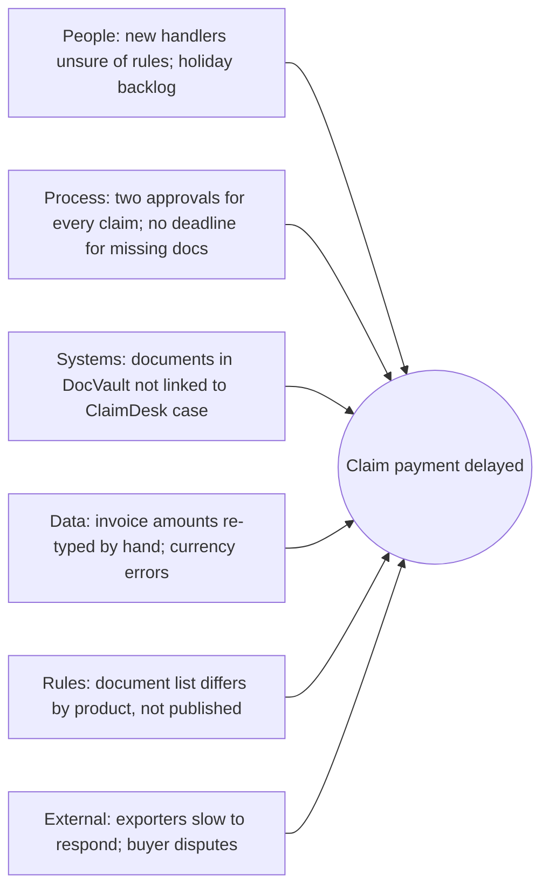

## Why this matters
Most change requests start with a complaint or a proposed solution, not with a clear problem. A business analyst who can find the real cause, measure the current process and show in numbers whether an automation pays off saves the organization from building the wrong thing. The target job ad expects you to automate processes in low-code platforms and bring AI into processes. This module teaches you how to choose *what* is worth automating before you decide *how*.

## Quick version
**Problem, symptom, solution.** A *symptom* is what people notice ("claims take too long"). A *problem* is the underlying condition that causes it ("every third claim waits for missing documents because the notification form does not ask for them"). A *solution* is one way to fix it ("make the documents mandatory in the form"). Requests usually arrive as symptoms or solutions. Your first job is to get to the problem.

**Problem statement.** Write it down in a fixed structure: *The problem of* [what] *affects* [whom], *the impact of which is* [measurable effect]. *A successful solution would* [outcome, not technology].

**Root cause techniques:**
- **5 Whys** — ask "why?" repeatedly (about five times) until you reach a cause you can act on.
- **Fishbone (Ishikawa) diagram** — collect possible causes in categories (people, process, systems, data, rules, external) so you do not fixate on one.
- **Pareto analysis** — count how often each cause occurs; usually a few causes explain most of the cases (the "80/20" pattern).

**Seeing the process:**
- **SIPOC** — a one-page overview: Suppliers, Inputs, Process (5–7 steps), Outputs, Customers.
- **Lean 8 wastes (DOWNTIME)** — Defects, Overproduction, Waiting, Non-utilized talent, Transportation, Inventory, Motion, Extra-processing. A checklist for finding waste.

**Measuring a process.** Without numbers, you cannot prove improvement. Basic measures: **volume** (cases per month), **cycle time** (working time on one case), **lead time** (from request to result, including waiting), **error rate** (share of cases with rework), **FTE effort** (how many full-time people the work consumes).

**What to automate.** Good candidates are rule-based, high volume, stable (rules do not change every month), with digital and structured inputs, and error-prone when done by hand. Do *not* automate a broken process (fix it first), a rare task, a task that needs judgment every time, or a process that is about to change.

**Simple business case.** Compare one-off costs (build, testing, training) and running costs (licenses, support) with benefits (hours saved × cost per hour, fewer errors, faster response). **Payback period** = one-off cost ÷ net annual benefit. Example with fictional numbers: a CZK 900,000 build that saves CZK 534,000 net per year pays back in about 20 months.

**Other quick tools:** **SWOT** (strengths, weaknesses, opportunities, threats) for a strategic view; **gap analysis** (current state vs desired state, and what is missing between them).

**Prioritizing ideas.** Place ideas on an **impact/effort matrix**: high impact and low effort first ("quick wins"), high impact and high effort as planned projects, low impact and low effort when you have spare time, low impact and high effort not at all.

## Deep dive

### Problem vs symptom vs solution [P1]
Consider three statements you might hear at ExportShield Insurance:

1. "Claims take forever." — symptom.
2. "We need an OCR tool for claim documents." — solution.
3. "Claims wait on average 6 working days for missing documents, because the notification form does not tell exporters which documents are required." — problem, with a cause and a measure.

Only the third tells you what to change. The first is too vague to act on. The second may be right, but nobody has shown that reading documents is the bottleneck. If the real delay is waiting for missing documents, OCR will make a fast step slightly faster and leave the slow step untouched.

Practical rule: when you hear a solution, ask "What problem would this solve?" When you hear a symptom, ask "Where exactly, how often, and since when?"

### The problem statement [P1]
A short template that works in workshops and documents:

> **The problem of** claims waiting for missing supporting documents
> **affects** exporters, claims handlers and the claims manager,
> **the impact of which is** an average lead time of 15 working days per claim, of which about 6 are spent waiting for missing documents, and frequent client complaints;
> **a successful solution would** ensure that complete documents are submitted with the first notification in most cases and reduce average lead time to under 8 working days.

(All numbers here are fictional.)

Tips:
- No technology in the problem statement. "A successful solution would introduce RPA" is a solution in disguise.
- Put a number in the impact, even if it is an estimate. Write "estimate" next to it.
- Agree the statement with the sponsor. It becomes the yardstick for everything that follows.

### 5 Whys [P1]
Ask why something happens, then ask why about the answer, and continue. Five is a guideline, not a rule. Stop when you reach a cause that someone can change.

Example: claims at ExportShield are paid late.

1. *Why are claims paid late?* Because approval takes long.
2. *Why does approval take long?* Because handlers cannot calculate the indemnity until all documents are present.
3. *Why are documents missing?* Because exporters send only the invoice with the first notification.
4. *Why do they send only the invoice?* Because the notification form and the policy guide do not list required documents.
5. *Why don't they list them?* Because the list differs by product and nobody owns keeping it current.

Actionable root cause: no owned, product-specific document checklist exists at the point of notification. Possible fixes: a dynamic checklist in the notification form, an automatic reminder for missing documents, an owner for the checklist.

Pitfalls:
- **One chain only.** Real problems have several causes. Use fishbone alongside.
- **Blaming people.** "Because handler X is slow" stops the analysis. Ask why the process allows it.
- **Guessing.** Check each answer with data or with the people who do the work.

### Fishbone (Ishikawa) diagram [P1]
The fishbone puts the effect (the problem) at the "head" and groups possible causes on the "bones". For service and office processes, practical categories are:

- **People** — skills, workload, turnover, training.
- **Process** — steps, handoffs, approvals, missing rules.
- **Systems** — ClaimDesk, PolicyHub, DocVault, email, Excel.
- **Data and documents** — missing, wrong format, duplicated.
- **Policies and rules** — internal rules, contractual terms, regulation.
- **External** — exporters, buyers, banks, foreign courts.

How to run it: in a 60-minute session with handlers and the claims manager, write the problem at the head, brainstorm causes per category on sticky notes, then vote on the 3–5 most likely. Those become hypotheses you verify with data.

### Pareto analysis [P2]
Once you have candidate causes, count them. Pull 100 delayed claims and record the main reason for each delay.

| Delay reason (fictional data) | Count | Cumulative % |
|---|---|---|
| Missing documents | 46 | 46% |
| Waiting for second approval | 21 | 67% |
| Currency or amount correction | 14 | 81% |
| Buyer dispute | 9 | 90% |
| System outage | 5 | 95% |
| Other | 5 | 100% |

The first two reasons explain about two thirds of delays. Focus there first. Pareto does not mean the rare causes do not matter (a buyer dispute may be legally important), only that they are not where most time is lost.

### SIPOC [P2]
SIPOC fits the whole process on one page before you go into detail. It is useful at the start of a project to agree the boundaries (scope).

| Suppliers | Inputs | Process | Outputs | Customers |
|---|---|---|---|---|
| Exporter (insured) | Notification of non-payment, invoice, proof of delivery, correspondence with buyer | 1. Receive notification | Decision (pay / reject / partial) | Exporter |
| Buyer (indirectly) | Payment history | 2. Check policy cover and limit | Indemnity payment | Finance |
| PolicyHub | Policy and credit limit data | 3. Collect and check documents | Recovery file | Recovery team |
| DocVault | Stored documents | 4. Calculate indemnity | Management report | Reinsurers, management |
| | | 5. Approve | | |
| | | 6. Pay and start recovery | | |

Read it right to left too: who is the customer, what do they need, which inputs are required to produce it.

### Lean and the 8 wastes (DOWNTIME) [P2]
**Lean** thinking, which comes from manufacturing, divides activities into those that add value for the customer and those that do not. **Value stream** means all steps, including waiting, from request to delivered result. In office processes, most of the lead time is usually waiting, not working.

The eight wastes, remembered as DOWNTIME, with office examples from ExportShield:

| Waste | Meaning | ExportShield example |
|---|---|---|
| **D**efects | Errors and rework | Wrong currency typed into ClaimDesk, claim recalculated |
| **O**verproduction | Producing more or earlier than needed | Monthly report with 40 tabs that nobody reads |
| **W**aiting | Idle time between steps | Claim waits 6 days for documents; request waits for approver on holiday |
| **N**on-utilized talent | Not using people's skills | Experienced underwriters copying data from emails |
| **T**ransportation | Moving items unnecessarily | Documents forwarded by email between four mailboxes |
| **I**nventory | Work piling up | 120 unprocessed credit limit requests in a shared mailbox |
| **M**otion | Unnecessary movement or clicks | Switching between PolicyHub, DocVault and Excel 15 times per case |
| **E**xtra-processing | Doing more than needed | Two approvals for small claims where one is enough under internal rules |

Walk through a process with this list and you will usually find several wastes. Automation removes some of them (motion, defects from re-typing). Others need a process or rule change (extra-processing, waiting for approvals).

### Measuring a process [P1]
You need a **baseline**: the measured state before the change. Without it you cannot prove the improvement later.

| Measure | Definition | How to get it |
|---|---|---|
| Volume | Number of cases per period | System reports, mailbox counts, SQL query |
| Cycle time (touch time) | Working time actually spent on one case | Time a sample of cases; ask handlers to log for one week |
| Lead time | Elapsed time from request to result, including waiting | Timestamps: received date vs decision date |
| Waiting time | Lead time minus cycle time | Calculated |
| Error / rework rate | Share of cases that need correction | Sample review, defect log, returned cases |
| FTE effort | Volume × cycle time ÷ productive hours of one full-time employee per year | Calculated |
| Cost per case | FTE cost ÷ volume, plus other costs | Calculated with finance |

Terminology warning: some sources and Lean literature use "cycle time" differently (for example, the time between two finished units). In your documents, define what you mean once and stick to it.

Practical tips:
- A sample of 30–50 cases often gives a good enough picture for a first business case.
- Ask for timestamps from the system before asking people to time themselves. People underestimate interruptions.
- Measure variation too. An average of 12 minutes may hide cases of 3 and 60 minutes, which need different solutions.

### Deciding what to automate [P1]
**Automation** here means letting software do steps that people do by hand. Options range from rules inside an existing system, through **low-code** tools (platforms where you build workflows mostly by configuration, for example Power Automate, Make or n8n), to **RPA** (robotic process automation: software that operates the user interface like a person would), to API integrations and AI.

Criteria for a good candidate:

| Criterion | Good sign | Warning sign |
|---|---|---|
| Rule-based | Clear if-then rules, few exceptions | "It depends", expert judgment each time |
| Volume | Hundreds or thousands of cases per year | A few cases per month |
| Stability | Rules and screens rarely change | Process or system will change within a year |
| Digital, structured inputs | Data in forms, systems, structured files | Paper, handwritten notes, free-text emails |
| Error impact | Manual errors are frequent or costly | Errors rare and cheap |
| Time sensitivity | Speed matters to clients | No one waits for the result |

When **not** to automate:
- **The process is broken.** Automating a bad process gives you a fast bad process. Remove waste first.
- **The volume is too low** to repay the build and maintenance.
- **Judgment is the core.** Underwriting a large, unusual credit limit should stay with a person; automation can prepare the data.
- **A bigger change is coming.** If PolicyHub will be replaced next year, a robot built on its screens will die with it.
- **No owner.** Automations need someone who maintains them when rules change. An orphan automation becomes a risk.
- **Not approved.** In a regulated company, automations must use tools and access approved by IT. Building a private script with your own credentials is not acceptable, even if it works.

### A simple business case with a worked example [P1]
A **business case** justifies an investment by comparing costs, benefits and risks. A full business case can be long; a first version fits on one page.

**Scenario (all numbers fictional, for practice only):** credit limit requests arrive at ExportShield by email. An assistant re-types each request into PolicyHub. The proposal: an online form that sends structured data to PolicyHub through an API.

**Step 1: baseline.**
- Volume: 6,000 requests per year.
- Manual intake: 12 minutes per request → 6,000 × 12 = 72,000 minutes = 1,200 hours per year.
- Error rate: 4% of requests have a typing error found later → 240 requests × 30 minutes of rework = 120 hours.
- Total effort today: 1,320 hours per year.
- Fully loaded cost of an hour of staff time (salary, social and health insurance, overhead): CZK 600 (fictional).
- Cost today: 1,320 × 600 = CZK 792,000 per year.

**Step 2: future state.**
- Intake reduced to 2 minutes per request (check and confirm) → 200 hours.
- Errors drop to 1% → 60 requests × 30 minutes = 30 hours.
- Total effort: 230 hours → 230 × 600 = CZK 138,000 per year.
- Gross annual saving: 792,000 − 138,000 = CZK 654,000.

**Step 3: costs.**
- One-off: vendor development and testing CZK 750,000, internal BA and testing time CZK 120,000, training CZK 30,000 → CZK 900,000.
- Running: hosting, support and maintenance CZK 120,000 per year.

**Step 4: results.**
- Net annual benefit: 654,000 − 120,000 = CZK 534,000.
- **Payback period:** 900,000 ÷ 534,000 ≈ 1.7 years ≈ 20 months.
- **Net benefit over 3 years:** 3 × 534,000 − 900,000 = CZK 702,000.
- **Capacity freed:** 1,320 − 230 = 1,090 hours ≈ 0.7 FTE (assuming about 1,600 productive hours per FTE per year).

**Step 5: be honest about what it means.**
- Freed hours are not cash unless the organization uses them (handles more volume without hiring, or moves people to higher-value work). Say which.
- Add benefits you cannot easily price: exporters get faster answers; fewer errors in limits reduce risk; data is structured for reporting.
- List risks: vendor estimate may grow; exporters may keep sending emails; API changes in PolicyHub.
- Show a sensitivity check: if one-off cost is 30% higher (CZK 1,170,000), payback is about 2.2 years. Is that still acceptable?

Decision-makers rarely trust a single number. They trust a calculation they can follow and challenge.

### SWOT and gap analysis [P3]
**SWOT** lists Strengths and Weaknesses (internal) and Opportunities and Threats (external). It helps when the question is strategic, for example "Should ExportShield offer a self-service portal to small exporters?". It is less useful for a single process fix.

**Gap analysis** compares the current state with the desired state and lists what is missing: capabilities, data, skills, systems, rules. Example: desired state "credit limit decisions within 2 working days for small requests"; gaps: no structured intake, no automatic company registry lookup, no rule for auto-approval below a threshold, no agreed authority levels. Each gap can become a requirement or a project.

### Prioritizing improvement ideas [P1]
After a workshop you will have more ideas than budget. An **impact/effort matrix** sorts them quickly.

| | Low effort | High effort |
|---|---|---|
| **High impact** | Quick wins — do now | Major projects — plan and fund |
| **Low impact** | Fill-ins — do when convenient | Avoid — do not start |

How to use it well:
- Define impact before scoring: hours saved, errors avoided, client lead time, risk reduced.
- Score effort with IT or the vendor, not alone.
- Use the matrix to start a discussion, not to end it. A low-impact item may be mandatory because of regulation; mark those separately.

For backlogs, other prioritization techniques such as MoSCoW (Must, Should, Could, Won't) are common. They are covered in the requirements modules.

## Key terms
- **Symptom** — an observable effect of a problem, such as long processing times.
- **Root cause** — the underlying cause which, if removed, prevents the problem from recurring.
- **Problem statement** — a structured description of a problem, who it affects, its impact and what success looks like.
- **5 Whys** — a technique of repeatedly asking "why" to move from a symptom to an actionable root cause.
- **Fishbone (Ishikawa) diagram** — a diagram grouping possible causes of a problem into categories.
- **Pareto analysis** — ranking causes by frequency to find the few that explain most cases.
- **SIPOC** — a high-level process overview: Suppliers, Inputs, Process, Outputs, Customers.
- **Lean** — an improvement approach focused on removing activities that do not add value for the customer.
- **DOWNTIME** — mnemonic for the eight Lean wastes: Defects, Overproduction, Waiting, Non-utilized talent, Transportation, Inventory, Motion, Extra-processing.
- **Baseline** — measured performance of a process before a change, used to prove improvement.
- **Cycle time** — in this course, the working time actually spent on one case.
- **Lead time** — elapsed time from request to result, including waiting.
- **FTE (full-time equivalent)** — the workload of one full-time employee, used to express effort.
- **RPA (robotic process automation)** — software that performs rule-based tasks by operating application user interfaces.
- **Low-code** — platforms that let you build applications or workflows mostly through configuration rather than programming.
- **Business case** — a justification for an investment comparing costs, benefits and risks.
- **Payback period** — the time it takes for cumulative net benefits to equal the initial investment.
- **Gap analysis** — comparing current and desired state to identify what is missing.
- **Impact/effort matrix** — a 2×2 grid for prioritizing ideas by expected benefit and required effort.

## Hands-on
:::exercise id="m03-e1" title="5 Whys and fishbone for the claim delay" min="50" tool="Miro"
**Goal:** practice moving from a symptom to verifiable root causes.

Symptom (fictional): "Claim payments at ExportShield take on average 15 working days; exporters complain."

1. In [Miro](https://miro.com/) (free board) write the symptom on the right.
2. Draw six bones: People, Process, Systems, Data and documents, Policies and rules, External.
3. Add at least three possible causes per bone. Use the SIPOC and DOWNTIME tables in this module for ideas.
4. Pick the cause you think is most important and run a 5 Whys chain from it. Write each answer on a separate note.
5. For your final root cause, write how you would *verify* it (which data, from which system, or whom you would ask).
6. Write a problem statement using the template.

**Done when:** the fishbone has 18+ causes, one 5 Whys chain ends in an actionable cause, and there is a verification method and a problem statement.
:::

:::exercise id="m03-e2" title="Measure and build a business case for credit limit intake automation" min="60" tool="Excel or Google Sheets"
**Goal:** produce a business case a manager can follow and challenge.

Use your own fictional numbers, different from the worked example.

1. Create a sheet with input cells: annual volume, minutes per request today, error rate today, rework minutes per error, cost per hour, minutes per request after automation, error rate after, one-off cost, annual running cost, productive hours per FTE.
2. Calculate with formulas (not typed results): hours today, hours after, annual saving, net annual benefit, payback period in months, 3-year net benefit, FTE freed.
3. Add a sensitivity row: one-off cost +30% and volume −20%. How do payback and 3-year benefit change?
4. Below the numbers, write five sentences: recommendation, main assumption, biggest risk, a benefit you could not price, what you would measure after go-live.
5. Label the sheet clearly "fictional data for practice".

**Done when:** changing any input cell updates all results, and the five sentences fit on the same page.
:::

:::exercise id="m03-e3" title="Prioritize eight improvement ideas" min="30" tool="Miro"
**Goal:** practice transparent prioritization.

Ideas raised in an ExportShield workshop:
1. Online form for credit limit requests with API to PolicyHub.
2. Automatic company lookup in a public business registry by company ID when a request arrives.
3. Remove the second approval for claims below an internal threshold.
4. Email reminder to exporters when claim documents are missing after 5 days.
5. Replace PolicyHub with a new core system.
6. AI summary of buyer correspondence attached to claims (with fictional or approved data only).
7. Weekly Excel report of open requests merged into one dashboard.
8. Rename folders in DocVault to a consistent pattern.

Steps:
1. Write a one-line definition of "impact" and of "effort" for this exercise.
2. Score each idea 1–5 on impact and 1–5 on effort. Write one sentence of reasoning per score.
3. Place the ideas on a 2×2 impact/effort grid in [Miro](https://miro.com/).
4. Mark any idea that would need IT approval, a vendor change request, or a policy change.
5. Choose your top three and justify the order in three sentences.

**Done when:** every idea is placed with reasons, dependencies are marked, and the top three are justified.
:::

## Self-check
:::q
Classify each statement as symptom, problem or solution: (a) "We need a chatbot for exporters." (b) "Exporters call us often." (c) "Exporters cannot see the status of their credit limit request, so they call to ask."
---
(a) is a solution, (b) is a symptom, (c) is a problem with a cause: lack of status visibility. Only (c) points to what should change; a status page or automatic status emails might solve it more cheaply than a chatbot.
:::

:::q
Why should a problem statement not mention a specific technology?
---
Because it would fix the solution before the problem is understood and exclude alternatives. The statement is the yardstick for comparing options; if it already says "RPA", every other option looks wrong by definition. Technology belongs in the options and recommendation.
:::

:::q
A 5 Whys session ends with "because the handler forgot". What went wrong and how do you continue?
---
It stopped at a person instead of a process cause. Continue by asking why the process allowed forgetting: is there no checklist, no reminder, no system validation, too much workload? The goal is a cause you can fix in the process or system, not blame.
:::

:::q
Lead time for a credit limit request is 5 working days, but the actual work on it is 40 minutes. What does that tell you, and would faster data entry help much?
---
Almost all of the lead time is waiting: in queues, for approvals or for missing information. Speeding up data entry would reduce the 40 minutes but barely change the 5 days. Look at the waiting steps first: why requests sit in the queue, approval rules, missing documents.
:::

:::q
Give two reasons not to automate a process even though it is repetitive.
---
Possible reasons: the process itself is inefficient and should be simplified first; the volume is too low to repay build and maintenance; the underlying system will be replaced soon; the rules change frequently; nobody would own and maintain the automation; or the tool is not approved by IT. Any two with a short explanation are fine.
:::

:::q
In a business case, an automation frees 0.7 FTE. Why is that not automatically a cost saving?
---
Freed time saves money only if the organization uses it: by avoiding a new hire, absorbing growth, or moving people to work with higher value. If people stay in the same role with less to do, the cost stays the same. A good business case says explicitly how the freed capacity will be used.
:::

:::q
An idea has low impact and low effort, but is required by a regulator. Where does it go on the impact/effort matrix?
---
It must be done regardless of its position on the matrix. Mark mandatory items separately, because the matrix measures business value, not obligation. In practice regulatory items are often scheduled first or in parallel.
:::

## Interview corner
:::interview
How would you find the root cause of a slow process?
---
- Clarify the symptom with numbers: which cases, how slow, since when.
- Map the process (SIPOC, then AS-IS) and measure lead time vs working time.
- Use fishbone to collect causes broadly, 5 Whys to go deep on the likely ones.
- Verify with data (Pareto of delay reasons) and with the people doing the work.
- Write a problem statement and agree it with the sponsor before proposing solutions.

Typical mistake: jumping straight to a tool or automation without showing where the time is lost.
:::

:::interview
How do you decide whether a process is a good candidate for automation?
---
- Criteria: rule-based, volume, stability, digital structured inputs, error impact.
- First remove waste; do not automate a broken process.
- Rough business case: hours saved × cost vs build and running cost; payback.
- Consider ownership, maintenance, and IT approval of the tool.
- Give a short example, such as intake of credit limit requests.

Typical mistake: saying "anything repetitive should be automated" without mentioning cost, stability or governance.
:::

:::interview
Walk me through a simple business case you could prepare.
---
- Baseline: volume, time per case, error rate, cost per hour.
- Future state: expected time and errors after the change.
- Costs: one-off and running.
- Results: net annual benefit, payback period, multi-year view, freed capacity.
- Non-financial benefits, risks and a sensitivity check; clear recommendation.

Typical mistake: presenting only the benefit and forgetting running costs or the assumptions behind the numbers.
:::

:::interview
You have twenty improvement ideas from a workshop and budget for three. What do you do?
---
- Agree criteria for impact and effort with the sponsor.
- Get effort estimates from IT or the vendor.
- Score and place ideas on an impact/effort matrix; mark mandatory and dependent items.
- Present a recommendation with reasons; let the sponsor decide.
- Keep the rest in a visible backlog rather than discarding them.

Typical mistake: prioritizing by who shouted loudest or by personal preference without visible criteria.
:::
