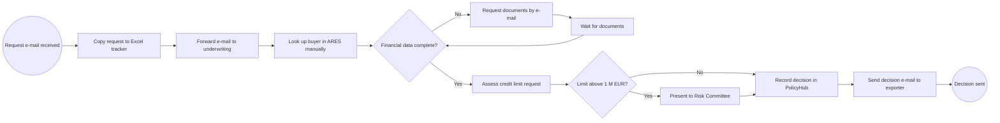
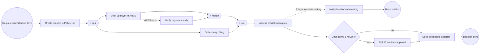

## Why this matters
Most BA work starts with a process: someone submits a request, someone checks it, someone approves it, and somewhere in the middle people retype data from an e-mail into a spreadsheet. BPMN is the standard way to draw that process so that business people, IT and vendors read the same picture. The job ad asks for UML or BPMN directly, and in an interview you can expect to be asked to sketch a process on a whiteboard. A clear AS-IS and TO-BE model is also the best starting point for any automation proposal.

## Quick version
**BPMN 2.0** (Business Process Model and Notation) is a standard published by the OMG (Object Management Group), a body that maintains modeling standards such as BPMN and UML. It defines a small set of shapes with exact meanings, so a diagram drawn by one analyst can be read by anyone who knows the notation.

**The four core building blocks:**
- **Events** (circles) – something that happens. A thin circle is a *start event*, a double-line circle is an *intermediate event*, a thick circle is an *end event*. An icon inside says what kind: envelope = message, clock = timer, lightning = error.
- **Activities** (rounded rectangles) – work that someone or something does. A *task* is one unit of work ("Check buyer in registry"). A *sub-process* (with a small plus sign) hides a more detailed process inside.
- **Gateways** (diamonds) – points where the flow splits or joins. An empty diamond or one with an X is *exclusive* (exactly one path), a plus sign is *parallel* (all paths), a circle is *inclusive* (one or more paths).
- **Flows** – a solid arrow (*sequence flow*) shows the order of steps inside one organization. A dashed arrow with a small open circle at its start and an open arrowhead (*message flow*) shows communication between separate participants.

**Pools and lanes.** A *pool* is one participant, usually one organization (ExportShield, the exporter). *Lanes* inside a pool divide work by role or department (Sales, Underwriting). Sequence flows stay inside a pool. Between pools you only use message flows.

**AS-IS and TO-BE.** You first model how the process works today (AS-IS), including the ugly parts: e-mails, Excel, waiting. Then you mark the pain points and draw the improved process (TO-BE). The difference between the two is the scope of your project.

**Style rules that make a model readable:**
- Name tasks verb + noun: "Approve credit limit", not "Approval" or "Underwriter".
- One start event per process level where possible, every path ends in an end event.
- Label exclusive gateways as a question ("Limit above 1 M EUR?") and the outgoing flows as answers ("Yes", "No").
- Flow left to right. Keep about 7 ± 2 elements per level; put details in sub-processes.
- Every parallel split needs a matching parallel join, otherwise the process behaves differently than you think.

**Levels of detail.** The same process can be drawn at three levels: *descriptive* (high-level, for managers), *analytic* (all paths and exceptions, for BA and testers), and *executable* (technical detail so a process engine such as Camunda can run it). As a BA you mostly work at the analytic level.

**BPMN vs flowchart vs UML.** A flowchart has no standard semantics and no concept of participants. A UML activity diagram is similar to BPMN but comes from software design; BPMN is the more common choice when business stakeholders must read the diagram.

**Tools.** Draw BPMN in [bpmn.io demo](https://demo.bpmn.io/) (free, no registration), [Camunda Modeler](https://camunda.com/download/modeler/) or [draw.io](https://app.diagrams.net/). Mermaid can only approximate BPMN with a flowchart.

**Interview one-liner:** "BPMN is the OMG standard for process diagrams. I use pools and lanes to show who does what, gateways for decisions, events for triggers and timeouts, and I model AS-IS first, then TO-BE with the pain points removed."

## Deep dive

### Why a standard notation at all [P1]
Imagine three people describe the credit limit process at ExportShield. Sales draws boxes and arrows in PowerPoint, Underwriting writes a numbered list in Word, and the vendor NovaSoft sends a sequence diagram. Each picture is correct for its author, and none of them can be compared. A standard notation fixes this. Every shape in BPMN has one defined meaning, so the question "does this arrow mean *then* or *sends an e-mail to*?" never comes up.

BPMN 2.0 was published by the OMG in 2011; the current version is 2.0.2 (2013), also adopted as ISO/IEC 19510. The [specification](https://www.omg.org/spec/BPMN/2.0.2/) is long and technical. You do not need to read it. You need perhaps 20 symbols well, and you need to know where the rest are when someone uses them.

BPMN is useful for a BA in four situations:
1. **Understanding** a process you do not know yet (draw it during interviews and play it back).
2. **Finding problems**: waiting times, handovers, duplicate checks, manual retyping.
3. **Agreeing scope**: the TO-BE model shows exactly which steps change.
4. **Handing over to IT**: a vendor or developer can derive screens, integrations and test cases from it.

### Three levels of modeling [P2]
The same notation is used with different amounts of detail. Practitioners often describe three levels (the names vary by author):

| Level | Audience | What it shows | Typical symbols |
|---|---|---|---|
| Descriptive | Managers, sponsors | Main steps, happy path, roles | Start/end events, tasks, exclusive gateways, lanes |
| Analytic | BA, process owners, testers, vendor | All paths, exceptions, timeouts, messages between parties | Plus intermediate and boundary events, message flows, sub-processes, data objects |
| Executable | Developers, process engine | Technical attributes: forms, service calls, variables, conditions as expressions | Same shapes, plus XML properties invisible on the diagram |

A common beginner mistake is to mix levels in one diagram: a high-level overview where one branch suddenly shows "Click Save button". Decide the level before you draw.

### Pools, lanes and the two kinds of flow [P1]
A **pool** represents a participant in a collaboration. A participant is usually an organization or an independent system: ExportShield, the Exporter, the external registry ARES. A **lane** is a subdivision of a pool, usually a role or department: Sales, Underwriting, Risk Committee. Lanes say *who* does a task. They do not create separate processes.

**Sequence flow** (solid line, filled arrowhead) connects elements inside one pool. It means "when this finishes, that starts". It can cross lanes, because lanes are still the same organization.

**Message flow** (dashed line, small circle at the start, open arrowhead) connects two different pools. It means "this participant sends something to that participant": an e-mail, a letter, an API call, a form submission. It never connects elements in the same pool.

You can draw a pool as a **black box** (collapsed, no content, just a name). Do this for participants whose internal process you do not know or do not care about, for example the Exporter. Message flows then go to the edge of the collapsed pool.

Rule to remember: *sequence flow inside, message flow between.* If you catch yourself drawing a solid arrow from ExportShield to the Exporter, stop. The exporter does not "continue" ExportShield's process; it receives a message and reacts in its own process.

### Events [P1]
An event is something that *happens*, as opposed to something that is *done*. Events are circles. The border tells you the position in the flow:

| Border | Type | Meaning |
|---|---|---|
| Thin single line | Start event | The process begins here |
| Double line | Intermediate event | Something happens during the process (wait for it or send it) |
| Thick single line | End event | This path finishes here |

The icon inside tells you the trigger. Focus on these:

| Icon | Name | Typical use at ExportShield |
|---|---|---|
| (empty) | None | Start or end with no specific trigger, common on high-level diagrams |
| Envelope | Message | "Credit limit request received" (start), "Decision sent to exporter" (end) |
| Clock | Timer | "Every Monday 8:00" (start), "Wait 5 working days" (intermediate) |
| Lightning | Error | "Registry not available" ends a sub-process with an error |
| Triangle | Signal | Broadcast to everyone listening, for example "Country rating downgraded" |
| Upward arrow | Escalation | Raise an issue to a higher role; unlike an error, the work can continue, for example notify the head of underwriting |
| Lined sheet of paper | Conditional | Starts when a condition becomes true ("Exposure above limit") |
| Filled black circle (end only) | Terminate | Stops the whole process immediately, including all parallel branches still running |

A filled (black) icon means **throwing** (the process sends or triggers something). An outlined icon means **catching** (the process waits for something). For example, an intermediate message event with a white envelope means "wait for the documents from the exporter"; with a black envelope it means "send a request for documents".

Difference between message and signal: a message goes to one specific recipient; a signal is broadcast and anyone interested can catch it. Difference between error and escalation: an error interrupts the work because it cannot continue; an escalation informs someone higher and the work may continue.

### Activities and task types [P1]
An **activity** is work performed in the process. The atomic form is a **task**. BPMN defines task types, shown by a small icon in the top-left corner. They matter most when you plan automation, because they say who or what does the work:

| Task type | Icon | Meaning | Example |
|---|---|---|---|
| User task | Person | A human does it in a system with a screen | Underwriter reviews request in PolicyHub |
| Manual task | Hand | A human does it without any system | Sign the paper contract |
| Service task | Gears | A system does it automatically, typically via an API | Look up buyer in ARES |
| Script task | Scroll | A script runs inside the process engine | Calculate exposure total |
| Business rule task | Table | A decision is evaluated, often by a DMN table | Determine approval authority |
| Send task | Black envelope | Sends a message to another participant | Send decision letter |
| Receive task | White envelope | Waits for a message | Receive missing financial statements |
| Abstract task | (none) | Type not specified | Typical on descriptive models |

An API (Application Programming Interface) is a defined way for one system to request data or actions from another system. When you change a user task into a service task in the TO-BE model, you are saying "this step will be automated by an integration". That one icon change is often the core of an automation project.

A **sub-process** groups several activities. Collapsed, it looks like a task with a small plus sign at the bottom; expanded, it shows its internal flow. Use it to keep each diagram level small and readable.

A **call activity** (task with a thick border) calls a separate, reusable process defined elsewhere. Example: "Perform KYC check" is used in both policy onboarding and credit limit requests, so you model it once and call it from both.

Activities can also carry **markers**: a circular arrow for a loop (repeat until a condition), three vertical lines for parallel multi-instance (do it for each item at the same time), three horizontal lines for sequential multi-instance (one item after another). Example: "Check each invoice" as sequential multi-instance in the claims process.

### Gateways [P1]
A gateway controls how the flow splits and merges. It does *not* do any work or make a decision itself. The decision is made in a task before it; the gateway only routes based on the result. This is why a good model has a task such as "Assess buyer risk" followed by a gateway "Risk acceptable?".

| Gateway | Symbol | Split behavior | Join behavior |
|---|---|---|---|
| Exclusive (XOR) | Empty diamond or X | Exactly one outgoing path, based on a condition | Passes each incoming token through, no waiting |
| Parallel (AND) | Plus | All outgoing paths start at the same time | Waits until all incoming paths have arrived |
| Inclusive (OR) | Circle | One or more paths, each with its own condition | Waits for all paths that were actually activated |
| Event-based | Pentagon in double circle | Waits; the first event that occurs decides the path | Not used for joining |

A **token** is a helpful mental model: imagine a coin moving along the arrows. A parallel split creates several coins, a parallel join waits until all of them arrive and merges them into one.

**Event-based gateway example:** after ExportShield asks the exporter for missing documents, two things can happen: the documents arrive (message event) or 10 working days pass (timer event). Whichever happens first wins, and the other is discarded.

**Common gateway mistakes:**
1. **Unmatched parallel join.** You split with a parallel gateway into "Check ARES" and "Check country rating", then merge with an exclusive gateway. The exclusive join lets each token through, so the next task runs *twice*. Fix: close a parallel split with a parallel join.
2. **Exclusive split closed with a parallel join.** Only one path was taken, but the parallel join waits for all paths. The process waits forever (deadlock). Fix: close an exclusive split with an exclusive join.
3. **Unlabeled exclusive gateway.** Nobody knows the condition. Fix: label the gateway as a question and each outgoing flow as an answer.
4. **Overlapping or missing conditions.** "Amount < 1 M" and "Amount > 1 M": what happens at exactly 1 M? Fix: make conditions complete and exclusive, or mark one flow as the *default flow* (a small slash on the arrow).
5. **Gateway doing the work.** A diamond labeled "Underwriter decides". Fix: put the decision in a task, the gateway only routes.

### Data, artifacts and annotations [P2]
**Data objects** (page with folded corner) show information used or produced by tasks: "Credit limit request", "Financial statements", "Decision letter". **Data stores** (cylinder) show where data persists: PolicyHub, DocVault, the shared Excel. They are linked to tasks with dotted *data associations*. Data does not influence the order of steps; it only documents what goes in and out.

**Text annotations** (an open bracket with text) add comments: "Done by e-mail today", "SLA 3 working days". In AS-IS models, annotations are a good place to note pain points without cluttering task names.

**Groups** (dashed rounded rectangle) visually group elements, for example everything in scope for phase 1. They have no effect on the flow.

### Boundary events and timer escalation [P1]
A **boundary event** sits on the edge of an activity. It catches something that happens *while* that activity is running. Two variants:

- **Interrupting** (solid double border): when the event occurs, the activity is cancelled and the flow continues from the boundary event.
- **Non-interrupting** (dashed double border): the activity continues, and an additional path starts in parallel.

Typical use is a **timer escalation**. The underwriter should decide within 3 working days. You put a non-interrupting timer boundary event on "Assess credit limit request". After 3 days, a parallel path starts: "Notify head of underwriting". The underwriter still finishes the task. If instead you want the request to move to another person, use an interrupting timer that leads to "Reassign request".

Other common boundary events: an error event on a service task ("ARES not reachable" leads to "Look up buyer manually"), a message event on a long task ("Exporter withdraws request" cancels the assessment).

### Worked example: ExportShield credit limit request [P1]
**AS-IS, described step by step.** Today the process works like this:
1. The exporter sends an e-mail with a request: buyer name, buyer registration number, country, requested limit in EUR.
2. A sales assistant copies the data into a shared Excel tracker and forwards the e-mail to the underwriting mailbox.
3. An underwriter picks the e-mail, opens the ARES website and searches the buyer by registration number (for Czech buyers) or other registries for foreign buyers, then copies the company details into the tracker.
4. The underwriter checks financial data and the country rating. If financial statements are missing, they write to the exporter and wait. Reminders are sent manually, and sometimes forgotten.
5. The underwriter decides: approve, reduce, or reject. Requests above 1 M EUR go to the Risk Committee, which meets once a week.
6. The underwriter types the decision into PolicyHub and writes the decision e-mail to the exporter.

Pain points you would mark with annotations: duplicate data entry (e-mail → Excel → PolicyHub), manual registry lookup, no deadline tracking, requests lost in the shared mailbox, no audit trail of who decided what and when.

Here is the AS-IS approximated with Mermaid. Mermaid has no pools, lanes or BPMN events, so this is a flowchart, not BPMN. In BPMN you would draw two pools (Exporter as a collapsed black box, ExportShield with lanes Sales, Underwriting, Risk Committee) in [bpmn.io](https://demo.bpmn.io/).

**TO-BE, described step by step.**
1. The exporter submits the request through a web form (message start event "Request submitted"). The form validates the registration number format and the amount.
2. A **service task** "Create request in PolicyHub" stores the data. No Excel, no retyping.
3. A **parallel gateway** splits into two service tasks: "Look up buyer in ARES" (via the [ARES API](https://ares.gov.cz/ekonomicke-subjekty-v-be/rest/ekonomicke-subjekty/{ico}), a public REST API that returns company data for a registration number) and "Get country rating". A **parallel gateway** joins them.
4. An **error boundary event** on the ARES task handles the case when ARES is unavailable or the buyer is not found: the path goes to a user task "Verify buyer manually". An **exclusive gateway** merges this path with the normal ARES path *before* the parallel join, so the join still receives exactly one token from the buyer branch.
5. A **user task** "Assess credit limit request" for the underwriter, with a **non-interrupting timer boundary event** (3 working days) that triggers "Notify head of underwriting".
6. An **exclusive gateway** "Limit above 1 M EUR?" routes large requests to the call activity "Risk Committee approval".
7. A **send task** "Send decision to exporter", then end event "Decision sent". The decision and its timestamp are stored in PolicyHub for audit.

Note how the Mermaid version cannot express the boundary events properly (dotted lines are only a hint). That is exactly why you draw the real model in a BPMN tool: the semantics (interrupting or not, which path the token takes) are part of the notation. Also notice that the TO-BE diagram is not just "the AS-IS with fewer boxes": task types changed from user to service, a timer was added, and an exception path appeared that did not exist on paper before. Each of those changes becomes a requirement in module 06.

### Modeling style rules [P1]
Good BPMN is mostly about discipline. Rules that experienced modelers follow:

1. **Verb + object for tasks.** "Check financial statements", "Send decision letter". Not "Check", not "Financial statements", not "Underwriter".
2. **Events in the past tense or as a state.** "Request received", "Decision sent", "5 days elapsed".
3. **Gateways as questions, flows as answers.** "Documents complete?" with "Yes" / "No".
4. **One start event** per process level, unless there are genuinely different triggers. Every path ends in an end event, and end events are named by outcome: "Request approved", "Request rejected".
5. **Left to right**, happy path in a straight line, exceptions branching above or below.
6. **7 ± 2 elements per level.** More than about a dozen tasks on one page means you need sub-processes.
7. **Same name, same thing.** If "credit limit" means one thing in lane A, it must mean the same in lane B. Keep a glossary.
8. **Do not model the system's internals in a business diagram.** "Save record to table CREDIT_LIMITS" belongs to technical design, not to the analytic process model.
9. **Match gateway types** for split and join, and avoid crossing lines where you can.

### AS-IS vs TO-BE modeling in practice [P1]
**AS-IS** is how the process works today, not how the procedure manual says it should work. You learn it by interviews, by watching people work and by reading tickets or e-mails (see module 05). Draw it fast, show it to the people who do the work, and correct it. Typical comment: "Actually, if the buyer is in Germany we skip that step."

Mark pain points directly on the AS-IS: annotations, a different color, or numbered markers that refer to a list. For each pain point, note the impact if you can measure it ("about 40 requests per month, 15 minutes retyping each").

**TO-BE** is the agreed future process. It should solve the pain points that are in scope, and nothing should appear in it that nobody asked for. Before you draw, agree the constraints: which systems stay, what budget, what the vendor can deliver. A TO-BE that needs a new core system is not useful if the project is a three-month improvement.

A gap list helps: for each change between AS-IS and TO-BE, write one line ("Manual ARES search → automated lookup via API"). The gap list becomes the backbone of your requirements.

### BPMN vs flowchart vs UML activity diagram [P2]
| Aspect | Flowchart | UML activity diagram | BPMN 2.0 |
|---|---|---|---|
| Standard | No single standard (ISO 5807 exists but is rarely followed) | UML 2.5 (OMG) | BPMN 2.0.2 (OMG, ISO/IEC 19510) |
| Main audience | Anyone | Software designers | Business and IT together |
| Participants / organizations | No | Partitions (swimlanes) | Pools and lanes, message flows |
| Events, timers, messages | Not defined | Some (accept event, time event) | Rich event types, boundary events |
| Executable | No | Rarely | Yes, with a process engine |

Use a flowchart for a quick sketch or an algorithm. Use UML activity diagrams when the team already models software in UML (module 08 covers UML). Use BPMN when business and IT must agree on a process, especially when automation is planned.

### DMN decision tables [P3]
**DMN** (Decision Model and Notation) is a companion OMG standard for decisions. A business rule task in BPMN can point to a DMN decision table that holds the logic. This keeps rules out of the diagram: instead of five nested gateways, you have one task and one table.

Example: who may approve a credit limit.

| Requested limit (EUR) | Country risk | Approver |
|---|---|---|
| ≤ 250,000 | Low, Medium | Underwriter |
| ≤ 250,000 | High | Senior underwriter |
| 250,001 – 1,000,000 | any | Senior underwriter |
| > 1,000,000 | any | Risk Committee |

A table has a *hit policy*, for example "Unique" (exactly one row may match) or "First" (the first matching row wins). When rules change, you update the table, not the process. Camunda Modeler can edit DMN tables.

### From model to automation [P2]
An **executable** BPMN model is stored as XML (a text format with tags, see module 11) and loaded into a process engine. A process engine is software that runs the model: it creates a token for each new request, assigns user tasks to people, calls APIs for service tasks and fires timers. **Camunda** is a well-known example; you can draw executable models in [Camunda Modeler](https://camunda.com/download/modeler/). The diagram you drew *is* the program, extended with technical properties.

**Low-code** platforms (tools where you build automation mostly by configuration instead of code) such as [Power Automate](https://make.powerautomate.com/), [Make](https://www.make.com/) or [n8n](https://n8n.io/) do not run BPMN, but their flows map closely to it: a trigger is a start event, an action is a service task, a condition is an exclusive gateway, an approval action is a user task, a "parallel branch" is a parallel gateway, a delay is a timer. A BPMN TO-BE model is therefore a good specification for a low-code flow. When you propose automation at work, use the tools and procedures approved by your IT department; that is also a good point to make in an interview.

## Key terms
- **BPMN 2.0** — OMG standard notation for business process diagrams, also ISO/IEC 19510.
- **Pool** — a participant in a collaboration, usually an organization or independent system.
- **Lane** — a subdivision of a pool showing which role or department performs the work.
- **Sequence flow** — solid arrow showing the order of steps inside one pool.
- **Message flow** — dashed arrow showing communication between two different pools.
- **Start / intermediate / end event** — circle marking how a process begins, something that happens during it, or how a path ends.
- **Timer event** — an event triggered by a date, time or elapsed duration.
- **Boundary event** — an event attached to an activity that catches something while the activity runs, either interrupting or non-interrupting.
- **Task** — an atomic unit of work; its type (user, service, manual, script, business rule, send, receive) says who or what performs it.
- **Sub-process** — an activity that contains its own detailed process, shown collapsed or expanded.
- **Call activity** — an activity that invokes a separate, reusable process.
- **Exclusive gateway** — routes the flow to exactly one outgoing path based on conditions.
- **Parallel gateway** — starts all outgoing paths at once, or waits for all incoming paths to arrive.
- **Inclusive gateway** — activates one or more outgoing paths whose conditions are true.
- **Event-based gateway** — waits for one of several events; the first one that occurs decides the path.
- **Data object / data store** — information used or produced by a task, and the place where data is kept.
- **AS-IS / TO-BE process** — the process as it works today, and the agreed future process.
- **DMN** — OMG standard for modeling decisions, mainly as decision tables.
- **Process engine** — software that executes a BPMN model, for example Camunda.

## Hands-on
:::exercise id="m04-e1" title="Model the AS-IS credit limit request" min="60" tool="bpmn.io"
Goal: turn the step-by-step AS-IS description from the worked example into a real BPMN diagram.

1. Open [demo.bpmn.io](https://demo.bpmn.io/) and create a new diagram.
2. Create a pool "ExportShield Insurance" with three lanes: Sales, Underwriting, Risk Committee. Create a second, collapsed pool "Exporter".
3. Add a message start event "Request e-mail received" in the Sales lane and a message flow from the Exporter pool to it.
4. Model the six AS-IS steps as tasks named verb + noun. Use an exclusive gateway "Financial data complete?" with a loop back after "Request documents by e-mail", and a second gateway "Limit above 1 M EUR?".
5. Add a data store "Excel tracker" and a data store "PolicyHub" with data associations to the tasks that use them.
6. Add at least four text annotations marking pain points.
7. End with a message end event "Decision sent" and a message flow to the Exporter pool.
8. Download the diagram as .bpmn and as .svg (icons in the bottom-left corner of bpmn.io).

Done when: every path ends in an end event, every gateway and outgoing flow is labeled, no sequence flow crosses the pool border, and someone unfamiliar with the process can retell it from your diagram.
:::

:::exercise id="m04-e2" title="Model the TO-BE with ARES lookup and timer escalation" min="60" tool="bpmn.io"
Goal: show the improved process with automation and deadline control.

1. Copy your AS-IS diagram (open the .bpmn file again) and save it under a new name.
2. Replace the e-mail start with a message start event "Request submitted via form".
3. Replace manual data entry with a service task "Create request in PolicyHub". Use the wrench menu on a task to change its type.
4. Add a parallel split with two service tasks "Look up buyer in ARES" and "Get country rating", closed by a parallel join.
5. Attach an error boundary event to "Look up buyer in ARES" leading to a user task "Verify buyer manually". Merge it with the normal ARES path through an exclusive gateway placed before the parallel join (a parallel join with three incoming flows would wait for all three and never continue).
6. Attach a non-interrupting timer boundary event "3 working days elapsed" to "Assess credit limit request", leading to "Notify head of underwriting" and its own end event.
7. Write a gap list (5–8 lines) of what changed between AS-IS and TO-BE.

Done when: you can explain for each change which pain point it solves, and the parallel split and join are of the same type.
:::

:::exercise id="m04-e3" title="Find six errors in a bad model" min="25" tool="paper"
Goal: train your eye for the most common modeling mistakes.

A colleague describes their claims diagram: "It starts with two start events, 'Claim' and 'Start'. The first task is called 'Claims handler'. Then a diamond labeled 'Check' has outgoing arrows without labels. Later I split with a plus gateway into 'Check invoices' and 'Check policy' and merge the two paths with an X gateway before 'Calculate indemnity'. The ClaimDesk system is drawn as a lane, and I draw a solid arrow from our pool to the Exporter pool for 'Send payment notice'. The path after 'Reject claim' just stops without an end event."

1. List at least six errors.
2. For each, write the rule it breaks and the correction.
3. Sketch the corrected version on paper or in bpmn.io.

Done when: you found the start event problem, the task name, the unlabeled gateway, the mismatched parallel join, the solid flow between pools, the missing end event, and you have an opinion on the system modeled as a lane (acceptable in some styles, but a system that acts on its own is often better modeled as a separate pool or as service tasks).
:::

:::exercise id="m04-e4" title="Model your own everyday process" min="40" tool="bpmn.io"
Goal: practice on a process you know well without using any confidential data.

1. Choose an everyday process: ordering and returning goods from an online shop, booking a doctor's appointment, a household monthly bill payment.
2. Identify at least two participants (for example you and the shop) and draw them as pools.
3. Include at least one exclusive gateway, one timer event (for example a return deadline), and one message flow in each direction.
4. Keep it to at most 12 elements per pool. If you need more, create a sub-process.
5. Show it to someone and ask them to explain the process back to you.

Done when: the other person retells the process correctly without your help. Do not model work processes with real client names or internal data.
:::

## Self-check
:::q
What is the difference between a sequence flow and a message flow, and when must you use which?
---
A sequence flow shows the order of activities inside one pool, one participant's process. A message flow shows communication between two different pools. Sequence flows never cross a pool boundary, and message flows never connect elements inside the same pool.
:::

:::q
Why does a parallel split closed by an exclusive join cause a problem?
---
The parallel split creates one token per outgoing path. The exclusive join does not wait; it passes each arriving token through. The task after the join therefore runs once per path, for example twice instead of once. A parallel split must be closed by a parallel join, which waits for all tokens and merges them.
:::

:::q
You want the head of underwriting to be notified if an assessment takes more than 3 days, but the underwriter should still finish it. Which BPMN element do you use?
---
A non-interrupting timer boundary event on the assessment task. When the timer fires, a parallel path starts with the notification, while the task itself continues. An interrupting timer would cancel the task, which is not wanted here.
:::

:::q
What does changing a task from "user task" to "service task" in the TO-BE model communicate?
---
It says that the step will no longer be done by a person but automatically by a system, typically through an API call. This is usually the core of an automation requirement and must be backed by integration requirements: which system, what data, what happens on error.
:::

:::q
Why should a gateway not be labeled "Underwriter decides"?
---
A gateway only routes the flow; it performs no work. The decision is work and belongs in a task such as "Assess credit limit request". The gateway after it asks a question about the result, for example "Request approved?", with the answers on the outgoing flows.
:::

:::q
When would you use a DMN decision table instead of gateways?
---
When the routing depends on several combined conditions, such as amount and country risk, that would require many nested gateways. A business rule task referencing a DMN table keeps the diagram simple and lets the business change rules in the table without redrawing the process.
:::

:::q
What is the risk of drawing the AS-IS process from the procedure manual alone?
---
The manual describes how the process should work, not how it actually works. Workarounds, Excel files, waiting times and skipped steps are often missing, and those are exactly the pain points you need. The AS-IS must be validated with the people who do the work.
:::

## Interview corner
:::interview
What is BPMN and why would you use it instead of a simple flowchart?
---
- OMG standard (BPMN 2.0), shapes with defined meaning, readable by business and IT.
- Has concepts a flowchart lacks: pools/lanes for participants, message flows, events such as timers and errors, boundary events.
- Can be executed by a process engine; maps well to low-code flows.
- Use a flowchart for quick sketches, BPMN when people must agree on a process or automation is planned.

Typical mistake: listing symbols without saying what problem the standard solves.
:::

:::interview
Walk me through how you would model and improve an approval process you do not know yet.
---
- Interview process owner and people doing the work, read existing documents, possibly observe.
- Draw AS-IS quickly, play it back, correct it.
- Mark pain points with impact (time, errors, volume).
- Agree constraints and scope, draw TO-BE, write a gap list.
- Turn gaps into requirements and validate TO-BE with stakeholders and IT.

Typical mistake: jumping straight to a TO-BE without validating the AS-IS with the people who do the work.
:::

:::interview
Explain the difference between exclusive, parallel and inclusive gateways with an example.
---
- Exclusive: exactly one path, for example "Limit above 1 M EUR?" yes or no.
- Parallel: all paths at once, for example ARES lookup and country rating check simultaneously; joined by a parallel gateway that waits for both.
- Inclusive: one or more paths depending on conditions, for example request the invoice copy if it is missing and/or the proof of delivery if it is missing; the inclusive join waits only for the paths that were started.
- Mention that split and join types must match.

Typical mistake: saying parallel means "in any order" without explaining that the join waits for all paths.
:::

:::interview
How do you handle deadlines and exceptions in a BPMN model?
---
- Timer boundary events on activities: interrupting (cancel and reroute) or non-interrupting (escalate while work continues).
- Error boundary events on service tasks for system failures, with a manual fallback path.
- Event-based gateway when waiting for one of several outcomes (documents arrive or deadline passes).
- Model the happy path first, then add exceptions agreed with stakeholders.

Typical mistake: modeling only the happy path and leaving exceptions as "will be handled manually".
:::

:::interview
How does a BPMN model help when working with a vendor or automation team?
---
- Shared picture of scope: which steps change, which systems are involved.
- Task types show what is automated (service tasks) versus human (user tasks).
- Each service task and boundary event points to an integration and its error handling.
- Paths through the model become test scenarios for UAT.
- Can be executed directly in an engine or translated into a low-code flow.

Typical mistake: treating the diagram as a deliverable by itself instead of linking it to requirements and tests.
:::
