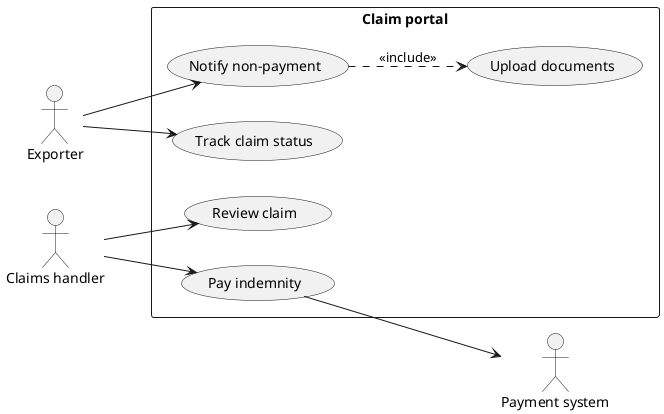
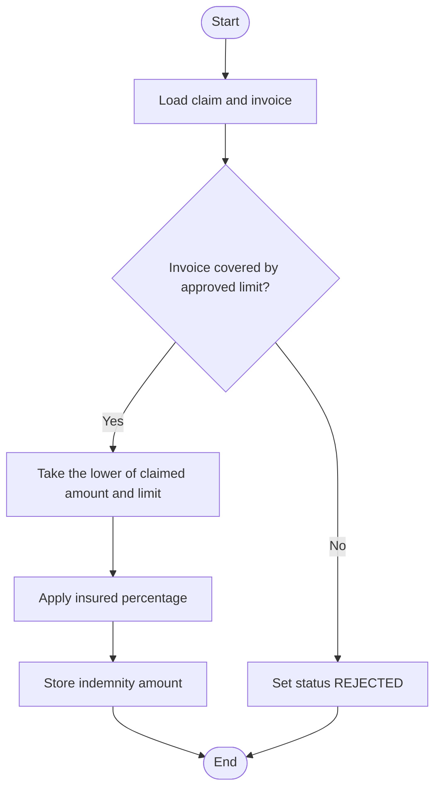
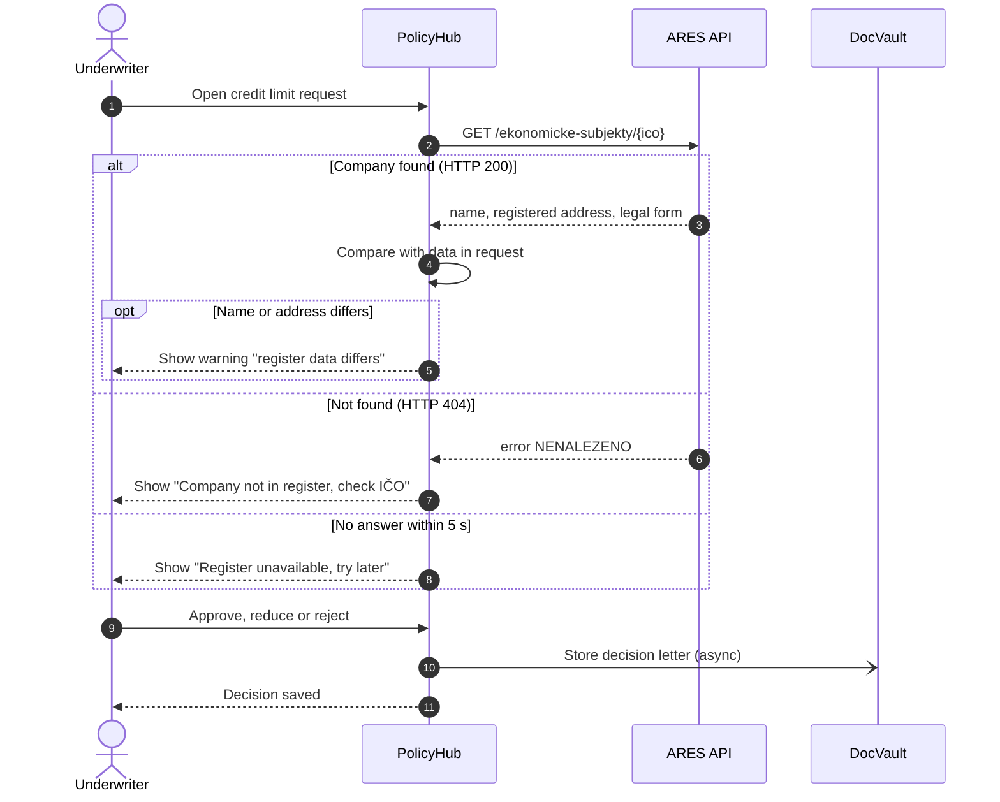
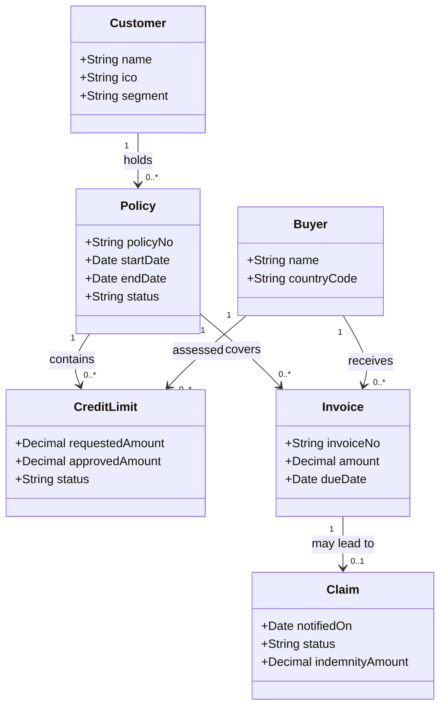
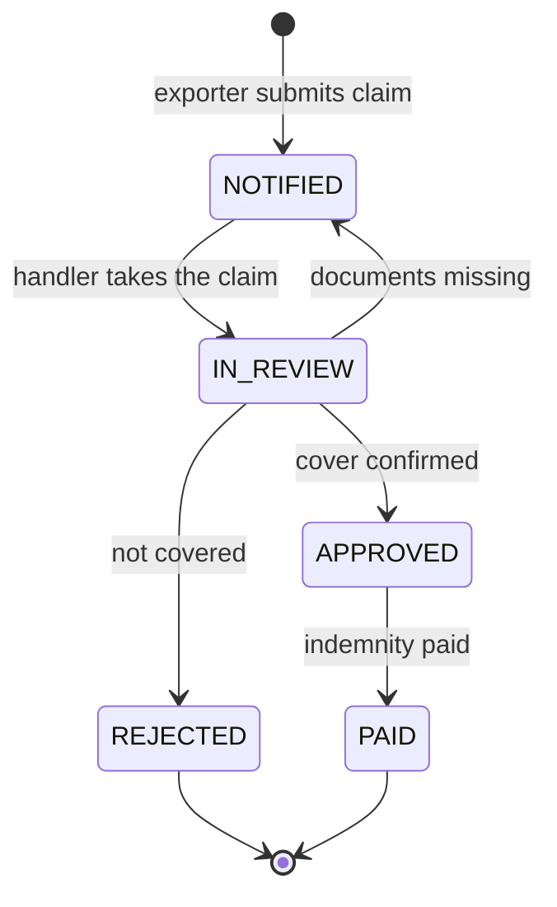

## Why this matters
The job ad asks for UML or BPMN. BPMN shows how work flows through a business. UML (Unified Modeling Language) is better at showing how systems talk to each other, what data a system holds, and which states a record goes through. In a specification for a vendor, one sequence diagram of an API call or one state diagram of a claim often replaces two pages of text and prevents misunderstandings. You do not need all of UML. You need five or six diagram types and the judgment to pick the right one.

## Quick version
**What UML is.** UML is a standard visual language for describing software systems. It is maintained by the OMG (Object Management Group); the current version is **UML 2.5** (2.5.1 is the latest revision). It defines 14 diagram types in two families:

- **Structural diagrams** show what exists: classes, components, servers. They are a snapshot.
- **Behavioral diagrams** show what happens over time: use cases, activities, messages, state changes.

**The five diagrams an analyst actually uses:**

1. **Use case diagram** — who (actors) uses which functions (use cases) of a system. It is a table of contents for the requirements. The real content sits in the **textual use case**: preconditions, main flow, alternative flows, postconditions. A diagram without the text says very little.
2. **Activity diagram** — the steps of a process or algorithm, with decisions and parallel branches. It looks like a flowchart. For business processes with departments and events, BPMN is usually the better choice; activity diagrams are handy for the logic inside one system function.
3. **Sequence diagram** — which participant sends which message to whom, in time order. This is the most useful UML diagram for integrations. Example: the underwriter submits a credit limit request, PolicyHub calls the ARES company register API, ARES returns company data or "not found", PolicyHub shows the result. Fragments `alt` (either/or), `opt` (optional) and `loop` (repeat) show the variants.
4. **Class diagram (domain model)** — the business objects and how they relate: one customer has many policies, one policy covers many invoices. Numbers on the lines (**multiplicity**, e.g. `1` and `0..*`) say how many. Analysts use it as a **domain model**, not as program code.
5. **State machine diagram** — the lifecycle of one object: a claim moves from Notified to In review to Approved or Rejected, then to Paid. It answers "which status changes are allowed?", which is exactly what testers need.

Component and deployment diagrams (which systems and servers exist and how they connect) are useful to read when an architect shows them, but you rarely draw them yourself.

**BPMN or UML?**

| Question you need to answer | Use |
|---|---|
| Who does what, in which order, across departments? | BPMN process diagram |
| Which functions does the system offer to which users? | UML use case diagram + textual use cases |
| How do two systems exchange data, step by step? | UML sequence diagram |
| What business objects exist and how are they related? | UML class diagram (or an ER diagram) |
| Which statuses can a record have and what moves it? | UML state machine diagram |

**Tools.** [draw.io](https://app.diagrams.net/) for drag-and-drop. Text-based tools generate the diagram from a few lines of code: [Mermaid Live](https://mermaid.live/) and [PlantUML](https://www.plantuml.com/plantuml/). Text diagrams can live in Confluence, Git or a Markdown spec and are easy to change.

**Rules of thumb:**

- Draw a diagram for a reader and a question. If nobody needs the answer, skip the diagram.
- Keep it to one page. Split big diagrams.
- Use the business names your stakeholders use ("Claim", not "tbl_clm").
- A diagram complements the text requirement; it does not replace acceptance criteria.

**Interview one-liner:** "I use BPMN for the business process and UML where the system matters: use cases for scope, sequence diagrams for integrations, a class diagram for the domain model and a state diagram for status lifecycles."

## Deep dive

### UML in one page: what it is and what it is not [P1]
UML started in the 1990s as a merger of several object-oriented notations and became an OMG standard. The specification for UML 2.5.1 is long and written for tool vendors; nobody reads it cover to cover. What matters for you:

- UML is a **notation**, not a method. It tells you how to draw, not what to analyze or in which order.
- The 14 diagram types split into **structural** (class, object, component, composite structure, package, deployment, profile) and **behavioral** (use case, activity, state machine, and the interaction diagrams: sequence, communication, timing, interaction overview).
- You can be "correct enough". Teams rarely use every symbol. A consistent, readable diagram with a legend beats a perfectly compliant one that nobody understands.

Two levels of rigor exist in practice. **Sketch**: a diagram on a whiteboard or in a meeting to align people. **Specification**: a diagram attached to a requirement that a vendor builds from. In the second case, precision matters: arrow types, multiplicities and status names must match the text.

### Use case diagram and textual use cases [P1]
A **use case** is a goal an actor achieves with the system, written as verb + object: "Request credit limit", "Notify non-payment". An **actor** is a role outside the system that interacts with it: a person (Exporter, Underwriter) or another system (ARES, the payment system). The **system boundary** is a rectangle with the system name; use cases sit inside, actors outside.

Two relationships cause most confusion:

- **«include»**: the base use case *always* uses the included one. "Submit claim" always includes "Upload documents". Use it to pull out a step shared by several use cases.
- **«extend»**: the extending use case *sometimes* adds behavior at a defined point, under a condition. "Request payment by instalments" extends "Submit claim" only when the exporter agreed a payment plan with the buyer.

Beginners overuse both. If in doubt, leave them out and describe the variation in the textual use case.

A use case diagram for the ExportShield claim portal, written in PlantUML (paste it into [PlantUML](https://www.plantuml.com/plantuml/) to render it):

The diagram shows **scope** at a glance: what the portal does and for whom. It does not say what "Notify non-payment" means. That is the job of the **textual use case**, which is where most of the analysis lives:

| Field | Example: Notify non-payment |
|---|---|
| Actor | Exporter |
| Precondition | Exporter is logged in; the policy is active; the invoice is covered by an approved credit limit |
| Trigger | The buyer has not paid within the waiting period after the due date |
| Main flow | 1. Exporter selects the policy and the invoice. 2. Portal pre-fills invoice data from PolicyHub. 3. Exporter enters the outstanding amount and uploads documents. 4. Portal validates required fields. 5. Exporter submits. 6. Portal creates the claim with status NOTIFIED and shows the claim number. |
| Alternative flow 3a | Invoice not in PolicyHub: exporter enters invoice data manually; claim is flagged for manual check. |
| Exception 4a | Required document missing: portal blocks submission and lists what is missing. |
| Postcondition | Claim exists in ClaimDesk with status NOTIFIED; exporter receives a confirmation e-mail. |
| Business rules | Claimed amount cannot exceed the invoice amount. |

This table is testable: each flow becomes at least one test case. That is why experienced analysts say the text matters more than the picture.

### Activity diagram, and how it differs from BPMN [P2]
An **activity diagram** shows a flow of actions: a filled circle as start, rounded rectangles as actions, diamonds as decisions or merges, a thick bar as **fork/join** (parallel branches), and a filled circle inside a ring as the end of the whole activity (a circle with an X ends only one flow). **Partitions** (swimlanes) can show who performs an action.

It looks similar to BPMN, and you can model simple business processes in either. The differences that matter in practice:

| Aspect | BPMN 2.0 | UML activity diagram |
|---|---|---|
| Built for | Business processes across roles and organizations | Behavior of a system or an algorithm |
| Events (timers, messages, errors) | Rich, standardized event types | Basic support |
| Collaboration between organizations | Pools and message flows | Not really |
| Executable in workflow engines | Yes (e.g. Camunda) | Not in everyday practice |
| Typical reader | Business, process owners | Developers, architects |

Rule: use BPMN for the business process "how does a claim get handled at ExportShield". Use an activity diagram for the logic inside one function, for example "how PolicyHub calculates the indemnity" with its decisions. Mermaid has no native activity diagram, but a flowchart gives a close approximation:

### Sequence diagram for integrations [P1]
A **sequence diagram** shows participants side by side and the messages between them from top to bottom, in time order. It is the most practical UML diagram for an analyst who works with vendors, because integrations are where misunderstandings are most expensive.

Elements:

- **Lifeline**: a participant (a person, a system, a service) with a dashed line going down. Time flows down.
- **Synchronous message** (solid line, filled arrowhead): the sender waits for an answer. A typical REST API call.
- **Asynchronous message** (open arrowhead): the sender continues without waiting. Typical for a message queue or an e-mail notification.
- **Reply** (dashed line): the answer to a synchronous call.
- **Activation bar**: a thin rectangle on a lifeline while the participant is busy.
- **Combined fragments**: a box with an operator in the corner.
  - `alt` — alternatives: one of several branches runs, each with a condition (like if/else).
  - `opt` — an optional part that runs only if the condition holds (if without else).
  - `loop` — repeat while a condition holds or for each item.
  - `par` — parallel parts (less common for analysts).

**Worked example: credit limit request with an ARES check.** An underwriter at ExportShield works in PolicyHub. When a new request arrives for a Czech company, PolicyHub looks up the company in ARES, the Czech public register of economic entities, which combines data from several official registers and offers a free API (covered in the APIs module, 11), by its company ID (IČO). ARES covers Czech entities only; for foreign buyers the same pattern applies with a commercial data provider.

Read it top to bottom. Step 2 is synchronous: PolicyHub waits. The `alt` fragment lists three outcomes; the third (timeout) is the one most specifications forget. The `opt` fragment runs only when data differs. The last call to DocVault is asynchronous: the underwriter does not wait for the document archive.

What this diagram gives the vendor (NovaSoft) that text often does not: the order of calls, who waits for whom, every error branch, and a place to attach rules (timeout 5 seconds, which fields to compare). Each branch is also a test case.

Tips:

- One scenario per diagram, or one diagram with `alt` branches. Do not try to show everything.
- Label messages with business meaning first, technical detail second: "Look up company (GET /ekonomicke-subjekty/{ico})".
- Add a `loop` when you process lists, e.g. "for each invoice in the batch".

### Class diagram as a domain model [P2]
A **class diagram** shows classes (types of things), their **attributes** (data fields), and **associations** (relationships). Developers use it to design code. Analysts use the same notation for a **domain model**: a picture of the business concepts and how they relate, without technical details like methods or database types.

**Multiplicity** at each end of an association says how many objects take part:

| Notation | Meaning |
|---|---|
| `1` | exactly one |
| `0..1` | zero or one (optional) |
| `*` or `0..*` | any number, including zero |
| `1..*` | at least one |

Read an association in both directions: "one Customer holds zero or more Policies; each Policy belongs to exactly one Customer."

Two more relationships appear in class diagrams: **generalization** (a hollow triangle arrow, "is a kind of": a CorporateCustomer is a Customer) and **composition** (a filled diamond, "is part of and cannot exist without": an InvoiceLine cannot exist without its Invoice). Use them sparingly in domain models.

A domain model is a conversation tool. Draw it early in a project, then ask stakeholders: "Can a claim cover two invoices?", "Can a buyer have limits under two policies?" The answers become business rules. The same structure turns into an ER diagram and tables later (see the data module).

### State machine diagram: the claim lifecycle [P2]
A **state machine diagram** shows the states one object can be in and the **transitions** between them. A transition has a trigger (the event), an optional **guard** (a condition in square brackets) and an optional effect. The black dot is the initial state, the filled dot inside a ring the final state. A transition label is written as `trigger [guard] / effect`. In Mermaid, both are written as `[*]`.

Why this matters for an analyst:

- It makes **allowed and forbidden transitions** explicit. Can a REJECTED claim be reopened? Can a claim go from NOTIFIED straight to PAID? If the diagram has no arrow, the answer is no, and the developer must block it.
- Testers derive test cases directly: every arrow is a valid-transition test, every missing arrow a negative test. This is the ISTQB technique "state transition testing".
- It surfaces questions: what happens if the buyer pays after the claim is approved? That might need a new state (e.g. RECOVERED) or a business rule.

Keep state names identical to the values in the system (`IN_REVIEW`, not "Under review" in one place and "Checking" in another).

### Component and deployment diagrams [P3]
A **component diagram** shows the building blocks of a solution and their interfaces: PolicyHub, ClaimDesk, DocVault, an integration layer, ARES as an external service. A **deployment diagram** shows where software runs: servers, cloud services, networks, and which component is installed where.

As an analyst you will mostly read these in architecture documents. Useful questions while reading:

- Which component owns which data (the **system of record**)?
- Which interfaces cross the company network boundary? Those need security review.
- Where would my new feature live, and which interfaces does it touch?

For your own documents a simple box-and-arrow "context diagram" (your system in the middle, users and neighboring systems around it) is usually enough.

### Choosing between BPMN and UML [P1]
They are complementary. A typical specification for a change at ExportShield could contain:

1. A BPMN TO-BE process of credit limit handling (business view).
2. A use case diagram for the new PolicyHub functions, each with a textual use case.
3. A sequence diagram for the ARES integration.
4. A state diagram for the credit limit statuses.
5. A domain model or ER diagram for new data.

Pick by the question. Process across people and time: BPMN. System behavior, data and interfaces: UML. Do not draw the same thing twice in two notations; it doubles the maintenance and the two versions will drift apart.

### Tools: drawing versus diagrams as code [P2]
**[draw.io](https://app.diagrams.net/)** (diagrams.net) is free, runs in the browser, and has UML and BPMN shape libraries. Good for diagrams with a precise layout and for stakeholders who prefer pictures.

**Diagrams as code** means you write a short text and the tool draws the picture:

- **[Mermaid](https://mermaid.live/)** supports flowcharts, sequence, class, state and ER diagrams, among others. It is rendered natively in many wikis and in Markdown on platforms like GitHub and GitLab. This website renders Mermaid blocks too.
- **[PlantUML](https://www.plantuml.com/plantuml/)** covers more of UML, including use case, activity, component and deployment diagrams.

Advantages of text diagrams: version control (you can see what changed), quick edits, consistent layout, easy to keep next to the specification. Disadvantage: less control over layout. AI assistants can draft Mermaid or PlantUML from a description, which is a fast way to get a first version; always check the result against your own understanding, and only use fictional or approved data.

### Reviewing a diagram you receive [P2]
Vendors and architects will send you diagrams too, often as part of a solution design that you are asked to approve. Reviewing them is part of the job and a good way to catch gaps before anything is built. A short checklist:

1. **Purpose**: what question does this diagram answer? If you cannot tell, ask before reviewing details.
2. **Names**: do participants, classes and states use the same names as the requirements and the business? "Credit line" in the diagram and "credit limit" in the user story may be the same thing or two different things; find out.
3. **Completeness against requirements**: for each requirement or acceptance criterion in scope, can you point to where the diagram covers it? For a sequence diagram: is every error case from the specification there?
4. **Multiplicities and transitions**: does the class diagram allow what the business forbids, or forbid what the business needs? Does the state diagram allow a transition that would break a business rule?
5. **Assumptions**: what does the diagram take for granted? A synchronous call to an external register assumes the register is always available. Is that acceptable?
6. **Ownership**: in component and sequence diagrams, which system owns the data and which only keeps a copy?

Write your findings as specific review comments: "Step 4: what happens if ARES returns 404? The specification requires a warning to the underwriter." A comment with a reference to the requirement is far easier to act on than "please add error handling". Keep a list of open points and agree with the vendor which ones block approval.

### Common mistakes [P2]
- Mixing levels: one diagram with business steps and database calls side by side.
- Use case names that are screens or buttons ("Click Save") instead of goals.
- Sequence diagrams with only the happy path.
- Class diagrams full of technical fields (created_by, row_version) that stakeholders do not care about.
- State names that differ between the diagram, the user stories and the system.
- No title, no date, no version. A diagram without context gets misread six months later.

## Key terms
- **UML (Unified Modeling Language)** — an OMG standard notation for modeling software systems; current version UML 2.5.1.
- **Structural diagram** — a UML diagram that shows the static parts of a system, such as classes or components.
- **Behavioral diagram** — a UML diagram that shows how a system behaves over time, such as use case, activity, sequence or state diagrams.
- **Actor** — a role outside the system (person or system) that interacts with it.
- **Use case** — a goal an actor reaches with the system, described by flows of steps.
- **System boundary** — the rectangle in a use case diagram that separates what the system does from its environment.
- **«include»** — a relationship where a use case always uses another use case.
- **«extend»** — a relationship where a use case optionally adds behavior to another under a condition.
- **Lifeline** — a participant in a sequence diagram, drawn as a box with a dashed line down.
- **Synchronous message** — a call where the sender waits for the answer.
- **Asynchronous message** — a message where the sender continues without waiting for an answer.
- **Combined fragment (alt / opt / loop)** — a box in a sequence diagram for alternatives, optional parts and repetition.
- **Domain model** — a class diagram of business concepts and their relationships, without technical detail.
- **Multiplicity** — the numbers on an association that say how many objects take part (e.g. 1, 0..1, 0..*).
- **State machine diagram** — a diagram of the states of one object and the allowed transitions between them.
- **Guard** — a condition on a transition or flow that must be true for it to happen.
- **Diagrams as code** — writing diagrams as text (Mermaid, PlantUML) that a tool renders into a picture.

## Hands-on
:::exercise id="m08-e1" title="Use case diagram for the claim portal" min="45" tool="PlantUML or draw.io"
**Goal:** define the scope of a new ExportShield claim portal and describe one use case in full.

1. List the actors: Exporter, Claims handler, Claims manager (approves claims above a limit), Payment system, DocVault.
2. List 6–8 use cases as verb + object (e.g. "Notify non-payment", "Upload documents", "Approve claim", "Pay indemnity", "Track claim status").
3. Draw the diagram in [draw.io](https://app.diagrams.net/) or start from the PlantUML example in this module and extend it in [PlantUML](https://www.plantuml.com/plantuml/). Add one «include» and at most one «extend». Write a short note why each is needed.
4. Write the textual use case for "Approve claim" with the table from the module: actor, precondition, trigger, main flow, at least two alternative or exception flows, postcondition, business rules.
5. Derive three test case titles from your flows.

**Done when:** the diagram fits one page, every use case name is a goal, and the textual use case has at least two non-happy flows and three test case titles.
:::

:::exercise id="m08-e2" title="Sequence diagram for the ARES lookup in Mermaid Live" min="40" tool="Mermaid Live"
**Goal:** model an integration with all its error branches.

1. Open [Mermaid Live](https://mermaid.live/) and paste the sequence diagram from this module. Check that it renders.
2. Change the scenario: the exporter now enters the buyer's company ID in the **customer portal**, the portal calls PolicyHub, PolicyHub calls ARES. Add the portal as a new participant.
3. Add an `alt` branch for HTTP 400 (invalid ID format). In the APIs module you will see that ARES returns 400 when the ID is not 8 digits.
4. Add a `loop` for a batch case: once a night, PolicyHub re-checks all active buyers with a Czech ID.
5. Add a `Note over PH,ARES: Timeout 5 s, max 1 retry` line (Mermaid syntax: `Note over A,B: text`).
6. Export the diagram as SVG or PNG.

**Done when:** the diagram renders without errors, has at least three outcome branches plus the nightly loop, and someone who did not read the module can explain what happens when ARES is down.
:::

:::exercise id="m08-e3" title="State diagram of the claim lifecycle" min="30" tool="Mermaid Live"
**Goal:** make the allowed status changes of a claim explicit and testable.

1. Start from the `stateDiagram-v2` example in this module.
2. Add these business situations, deciding for each whether you need a new state, a new transition or nothing: the exporter withdraws the claim; the buyer pays after notification; a rejected claim is appealed; partial payment of the indemnity in two instalments.
3. Label every transition with its trigger.
4. Write a list of three transitions that must be **impossible** (negative tests), e.g. "PAID to IN_REVIEW".
5. Compare with the `claims` and `payments` tables in the ExportShield dataset (`data/sql/exportshield.sql`). Do the statuses match? What would the database need for your new states?

**Done when:** the diagram renders, every state is reachable from the start, every state either has an outgoing transition or ends, and you have a list of three forbidden transitions.
:::

:::exercise id="m08-e4" title="Domain class diagram for ExportShield" min="45" tool="Mermaid Live or draw.io"
**Goal:** model the business concepts behind credit insurance and find open questions.

1. Use the classes Customer, Policy, Buyer, Country, CreditLimit, Invoice, Claim, Payment.
2. Give each class 2–4 business attributes (no technical IDs needed).
3. Draw associations with multiplicities on both ends. Read each one aloud in both directions.
4. Write at least three questions you would ask a stakeholder because the multiplicity is unclear (e.g. "Can one claim cover several invoices of the same buyer?").
5. Compare your model with the table structure in `data/sql/exportshield.sql`. Note one place where the database allows something your model forbids.

**Done when:** the diagram renders, every association has multiplicities on both ends, and you have three stakeholder questions and one model-versus-database difference.
:::

## Self-check
:::q
What is the difference between structural and behavioral UML diagrams? Give one example of each.
---
Structural diagrams show what exists in a system at a point in time: classes, components, servers. A class diagram of Customer, Policy and Invoice is structural. Behavioral diagrams show what happens over time: interactions, flows, state changes. A sequence diagram of PolicyHub calling ARES is behavioral.
:::

:::q
Why do experienced analysts say the textual use case matters more than the use case diagram?
---
The diagram only shows names of goals and who uses them, so it is good for scope. The text contains preconditions, the main flow, alternative and exception flows, postconditions and business rules. That is what developers build and testers test. Two people can agree on the same diagram and still mean very different behavior.
:::

:::q
When would you use «include» and when «extend»?
---
«include» means the base use case always performs the included behavior, for example "Submit claim" always includes "Upload documents". «extend» means extra behavior is added only under a condition at a defined point, for example "Request instalment plan" extends "Submit claim" only when instalments were agreed. If you are unsure, describe the variation in the textual use case instead of adding the relationship.
:::

:::q
In a sequence diagram, what is the difference between a synchronous and an asynchronous message, and which one is a typical REST call?
---
With a synchronous message the sender waits for a reply before it continues; it has a filled arrowhead and usually a dashed reply line. With an asynchronous message the sender continues immediately, as with a message queue or e-mail notification; it has an open arrowhead. A typical REST call where the client waits for the HTTP response is synchronous.
:::

:::q
What do the `alt`, `opt` and `loop` fragments express? Give an ExportShield example for each.
---
`alt` shows alternative branches where exactly one runs, like if/else: ARES returns 200, 404 or times out. `opt` shows an optional part that runs only if its condition is true: show a warning only if the register name differs. `loop` repeats a part: for each active Czech buyer, re-check the register every night.
:::

:::q
A class diagram shows `Customer "1" --> "0..*" Policy`. Read it in both directions. What business question could the analyst still ask?
---
One customer holds zero or more policies, and each policy belongs to exactly one customer. Open questions: can a policy be shared by a group of companies (then "exactly one" is wrong)? Does a customer with zero policies exist in the system, for example during onboarding? These answers become business rules or change the model.
:::

:::q
How does a state machine diagram help testers?
---
Every transition in the diagram is a valid status change that needs a positive test. Every pair of states without a transition is a change the system must block, which gives negative tests. The diagram also makes the triggers and guards visible, so testers know which event or condition causes each change. This is the basis of state transition testing.
:::

:::q
You need to document how a claim moves between the exporter, the claims department and finance. Would you use BPMN or a UML activity diagram, and why?
---
BPMN, because this is a business process across several roles with handovers, waiting times and events such as reminders. BPMN has pools, lanes and event types made for this, and business readers know it. A UML activity diagram fits better for the logic inside one system function, such as the indemnity calculation.
:::

## Interview corner
:::interview
Which UML diagrams do you use as a business analyst, and when?
---
- Use case diagram for scope, always backed by textual use cases.
- Sequence diagram for integrations: order of calls, synchronous versus asynchronous, error branches.
- Class diagram as a domain model to agree on business concepts and multiplicities.
- State machine diagram for status lifecycles; testers derive test cases from it.
- Activity diagram for logic inside a function; BPMN for cross-department processes.
- A concrete example from your portfolio (e.g. the ARES lookup).

Typical mistake: listing all 14 diagram types from memory without saying when you would use any of them.
:::

:::interview
How would you describe an integration between two systems to a vendor?
---
- Start with the business purpose and trigger: what event starts the exchange.
- A sequence diagram with participants, call order and every outcome (success, not found, invalid input, timeout).
- A data mapping table: source field, target field, transformation, mandatory or optional.
- Non-functional rules: timeouts, retries, volumes, security, logging.
- Acceptance criteria and test scenarios for each branch.

Typical mistake: describing only the happy path and leaving error handling to the developer's imagination.
:::

:::interview
What is the difference between BPMN and UML?
---
- Both are OMG standards, but for different questions.
- BPMN 2.0: business processes, who does what in which order, events and handovers between roles and organizations; can be executed by workflow engines.
- UML 2.5: software systems, their structure (classes, components) and behavior (use cases, sequences, states).
- In practice they are combined: BPMN for the business process, UML for the system parts.

Typical mistake: saying one is "better" without linking the choice to the question the diagram must answer.
:::

:::interview
Show me how you would model the lifecycle of an insurance claim.
---
- Name the states as they exist in the system (NOTIFIED, IN_REVIEW, APPROVED, REJECTED, PAID).
- Draw a state machine diagram with triggers on each transition and guards where conditions apply.
- Point out the questions it raised: re-opening rejected claims, buyer pays late, partial payments.
- Explain how forbidden transitions become negative tests and validation rules for the developer.

Typical mistake: drawing a flowchart of the claims process instead of the states of one claim object.
:::
