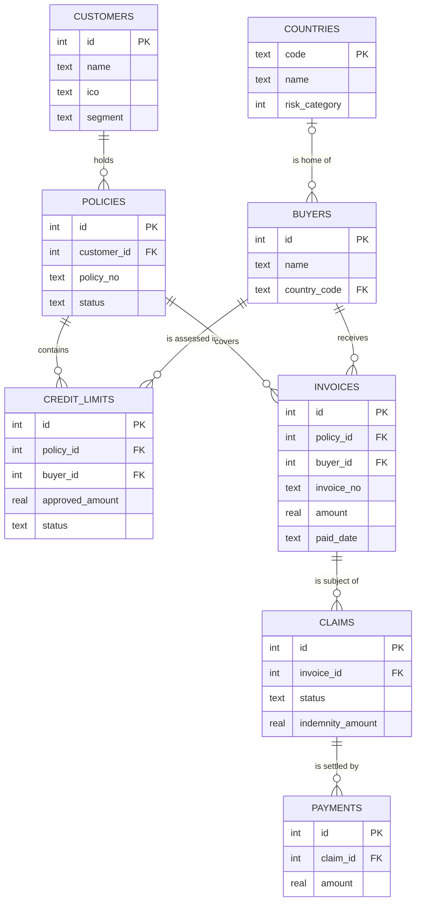

## Why this matters
Almost every requirement touches data: a new field on a form, a report, an interface that sends records to another system, a migration to a new platform. The job ad asks for basic SQL, and SQL only makes sense once you understand tables, keys and relationships. An analyst who can read a data model asks better questions ("what happens to the claims when we merge two duplicate customers?") and writes specifications a vendor can build from. This module is the theory; the SQL module puts it into practice on the same ExportShield dataset.

## Quick version
**A database** is an organized store of data managed by software (a **DBMS**, database management system) that lets many users and applications read and change data safely at the same time. Excel can hold data, but it cannot enforce rules, control who changes what, or handle many users and millions of rows reliably.

**Relational databases** (Oracle, Microsoft SQL Server, PostgreSQL, MySQL, SQLite) store data in **tables**. Each table describes one kind of thing:

- A **row** (record) is one instance: one customer, one invoice.
- A **column** (attribute, field) is one property: name, amount, due date. Each column has a **data type**: text, integer, decimal, date, true/false.
- A **primary key (PK)** uniquely identifies each row, e.g. `customers.id`.
- A **foreign key (FK)** is a column that points to the primary key of another table, e.g. `policies.customer_id` points to `customers.id`. Foreign keys are how tables connect.

**Relationships** between tables:

- **1:1** — one row matches at most one row on the other side (a customer and its KYC record).
- **1:N** — one row matches many (one customer has many policies). The most common case. The FK sits on the "many" side.
- **M:N** — many to many (a policy covers many buyers; a buyer appears under many policies). It needs a **junction table** in between. In the ExportShield data, `credit_limits` plays that role: each row links one policy to one buyer and adds its own data (amounts, status).

**ER diagram** (entity-relationship diagram) is the picture of tables and their relationships. The common style is **crow's foot**: the "foot" with three prongs means "many", a bar means "one", a circle means "zero/optional".

**Normalization** means organizing tables so each fact is stored once. If the buyer's country is typed into every invoice, sooner or later two invoices will disagree. Store it once in `buyers`, refer to it by key.

**Data dictionary**: a table that documents each field: name, meaning, type, allowed values, mandatory or not, source, owner. It is one of the most useful deliverables a BA can produce.

**Data quality** is measured along dimensions:

| Dimension | Question | ExportShield example |
|---|---|---|
| Completeness | Is the value there? | A buyer without a country |
| Validity | Does it follow the format and rules? | A company ID with 7 digits instead of 8 |
| Consistency | Do related values agree? | A credit limit decided before it was requested |
| Accuracy | Does it match reality? | Indemnity higher than the claimed amount |
| Uniqueness | Is each thing recorded once? | The same exporter registered twice |
| Timeliness | Is it up to date when needed? | Paid invoices entered weeks late |

**Master data** is the core shared data that many processes use: customers, buyers, countries, products. Errors in master data spread everywhere.

**Personal data and GDPR**: analysts decide which fields a system collects and who sees them. Collect only what the purpose needs (**data minimization**), define how long it is kept (**retention**), and restrict access by role.

**Interview one-liner:** "I can read a data model: tables, primary and foreign keys, 1:N and M:N relationships. I document fields in a data dictionary, check data quality with SQL, and think about GDPR when a requirement adds personal data."

## Deep dive

### From spreadsheet to database [P1]
Many processes at an insurer start in Excel. A spreadsheet of credit limit requests works until: two people edit it at once, someone types "Germany" and someone else "DE", a row gets deleted by accident, or a manager asks "how many limits did we reject for Turkish buyers last year?"

A database with a DBMS solves these problems:

- **Structure**: every column has a type; a date column only accepts dates.
- **Rules (constraints)**: mandatory fields (`NOT NULL`), unique values, valid references between tables.
- **Concurrency**: many users and systems read and write at the same time without overwriting each other.
- **Transactions**: a group of changes either completes fully or not at all. If paying an indemnity means "insert payment" and "set claim to PAID", both happen or neither does.
- **Security and audit**: who can read or change what, and a log of who did it.
- **Query language**: SQL (Structured Query Language) to ask questions of the data.

Besides relational databases there are **NoSQL** databases (document stores like MongoDB, key-value stores, graph databases). They are used for specific needs such as very flexible structures or huge volumes. Core insurance and banking systems mostly run on relational databases, so that is the focus here.

### Tables, rows, columns and data types [P1]
The ExportShield dataset (`data/sql/exportshield.sql`) has eight tables:

| Table | One row is | Key columns |
|---|---|---|
| `countries` | a country with a risk category 1–7 | `code` (PK) |
| `customers` | an exporter, i.e. a policyholder | `id` (PK), `ico` |
| `buyers` | a foreign buyer of an exporter | `id` (PK), `country_code` (FK) |
| `policies` | an insurance policy | `id` (PK), `customer_id` (FK) |
| `credit_limits` | a limit request for one buyer under one policy | `policy_id` (FK), `buyer_id` (FK) |
| `invoices` | an invoice from the exporter to a buyer | `policy_id` (FK), `buyer_id` (FK) |
| `claims` | a notification of non-payment of one invoice | `invoice_id` (FK) |
| `payments` | an indemnity payment to the exporter | `claim_id` (FK) |

Common **data types** and what to watch for:

| Type | Use for | Watch out |
|---|---|---|
| Integer | counts, IDs | IDs with leading zeros are not numbers. Czech company ID `00006947` stored as a number becomes `6947`. Store it as text. |
| Decimal / numeric | money | Use a fixed decimal type for money, not floating point, in production systems. Always store the currency next to the amount. |
| Text (varchar) | names, codes | Define maximum length and allowed characters (diacritics!). |
| Date / timestamp | dates, events | Agree on time zone and format. ISO format `YYYY-MM-DD` sorts correctly as text. |
| Boolean | yes/no flags | Decide what "unknown" means: NULL, or a default? |

**NULL** means "no value / unknown". It is not zero and not an empty string. An unpaid invoice has `paid_date` NULL. NULL needs special handling in SQL (`IS NULL`), as the SQL module shows.

Note: SQLite, which the site's SQL playground uses, is flexible with types and stores dates as text. Server databases such as Oracle or SQL Server have real date and decimal types and are stricter.

### Primary keys, foreign keys and relationships [P1]
A **primary key** must be unique and never empty. Two kinds:

- **Surrogate key**: a technical number with no business meaning (`customers.id = 7`). Stable, never changes.
- **Natural key**: a business identifier (`policy_no`, a company ID). Meaningful, but it can change or be wrong. Many systems use a surrogate key as PK and enforce the natural key as **unique**.

A **foreign key** links a row to a row in another table. `invoices.buyer_id = 19` means "this invoice was sent to buyer 19". The DBMS can enforce **referential integrity**: you cannot create an invoice for buyer 99 if buyer 99 does not exist, and you cannot delete a buyer who still has invoices.

Relationship types with ExportShield examples:

- **1:N** — `customers` → `policies`. One customer, many policies. The FK `customer_id` is in `policies` (the "many" side).
- **1:1** — not in the dataset; an example would be a `customers_kyc` table with exactly one KYC record per customer.
- **M:N** — policies and buyers. One policy covers many buyers, one buyer can appear under policies of several exporters. A relational database cannot store M:N directly, so you add a **junction table** (also called associative or link table) with two FKs. `credit_limits` is that junction table, and it carries its own attributes: requested and approved amount, status, dates.
- **Optional** relationships — `buyers.country_code` may be NULL (buyer 24 has no country), so a buyer has zero or one country.

### ER diagrams in crow's foot notation [P1]
An **entity** is a thing you store data about (it becomes a table). The **crow's foot** notation marks each end of a relationship line:

| Symbol at line end | Meaning |
|---|---|
| `||` (two bars) | exactly one |
| `o|` (circle and bar) | zero or one |
| `|{` (bar and crow's foot) | one or more |
| `o{` (circle and crow's foot) | zero or more |

The ExportShield data model in Mermaid (`erDiagram`):

Read it like sentences: "Each customer holds zero or more policies; each policy belongs to exactly one customer." Note `INVOICES ||--o{ CLAIMS`: the database technically allows several claims per invoice. The business probably wants at most one open claim per invoice. That gap between the model and the business rule is exactly what an analyst should spot and turn into a requirement (a unique constraint or a validation).

Levels of data models:

- **Conceptual**: business entities and relationships only. For stakeholders.
- **Logical**: all attributes, keys and relationships, independent of a specific database product.
- **Physical**: actual tables, column types, indexes for one DBMS. Owned by developers or DBAs.

A BA typically produces the conceptual model and reviews the logical one.

### Normalization in plain words [P2]
Normalization is a set of rules to avoid storing the same fact in several places. Duplicates hurt because they get out of sync: update one copy and the other is wrong (an **update anomaly**).

Imagine a single "credit limits" spreadsheet:

| request | exporter | exporter city | buyer | buyer country | country risk | amount |
|---|---|---|---|---|---|---|
| 1 | Moravia AgroTech | Olomouc | Dunaj Agro | Slovakia | 2 | 80,000 |
| 2 | Moravia AgroTech | Olmouc | Parana Agro | Brazil | 5 | 500,000 |
| 3 | Hana Food Export | Prostejov | Bosphorus Gida | Turkey | 5 | 500,000 |

Problems: the exporter city is typed twice and already contains a typo. If Turkey's risk category changes, you must find every Turkish row. If you delete request 3, you lose the fact that Hana Food Export is in Prostejov.

The three normal forms in practical terms:

- **1NF (first normal form)**: one value per cell, no repeating groups. Not "buyers: Dunaj Agro, Parana Agro" in one cell, and not columns `buyer1`, `buyer2`, `buyer3`.
- **2NF**: every non-key column depends on the *whole* key. If a table's key is (policy, buyer), the customer name depends only on the policy, so it belongs in another table.
- **3NF**: non-key columns depend on the key and nothing else. Country risk depends on the country, not on the buyer, so it belongs in `countries`, not in `buyers`.

The ExportShield tables are in 3NF: each fact is stored once and referenced by key. A short way to remember it: "the key, the whole key, and nothing but the key."

**Denormalization** is the deliberate opposite, used in reporting and data warehouses: duplicate some data so reports run fast without many joins. That is fine when the copy is refreshed from the normalized source and nobody edits it directly.

### Data dictionary [P1]
A **data dictionary** documents each field so that business, developers and testers mean the same thing. Template:

| Field | Business name | Description | Type / format | Mandatory | Allowed values / rule | Source | Example |
|---|---|---|---|---|---|---|---|
| `claims.id` | Claim ID | Unique identifier of the claim | integer | yes | system-generated, unique | ClaimDesk | 12 |
| `claims.invoice_id` | Invoice | The invoice the claim is about | integer, FK to `invoices.id` | yes | invoice must exist and be unpaid | Portal | 34 |
| `claims.notified_on` | Notification date | Date the exporter notified non-payment | date YYYY-MM-DD | yes | after invoice due date; not in the future | Portal | 2026-02-15 |
| `claims.status` | Claim status | Current lifecycle state | text | yes | NOTIFIED, IN_REVIEW, APPROVED, REJECTED, PAID | ClaimDesk | IN_REVIEW |

Add columns as needed: owner (who decides about the field), sensitivity (personal data, confidential), retention, and the screen or interface where the field appears. Keep the dictionary next to the specification and update it with each change request.

### Data quality dimensions [P1]
Bad data costs money: wrong decisions, failed migrations, rejected interface messages, regulatory findings. Analysts meet data quality in three places: when writing validation rules into requirements, when testing, and when analyzing a problem. The six common dimensions, each with a check you can run in SQL on the ExportShield dataset:

- **Completeness** — mandatory values present. Check: buyers with `country_code IS NULL`.
- **Validity** — values follow format and domain rules. Check: customer IDs where `length(ico) <> 8`; invoices where `due_date < issue_date`; policies where `end_date < start_date`.
- **Consistency** — related values agree across fields and tables. Check: credit limits where `decided_on < requested_on`; limits with status REJECTED but `approved_amount > 0`; claims with status PAID but no payment row; claims on invoices that already have a `paid_date`.
- **Accuracy** — values match reality. Hardest to check from data alone; usually needs a trusted source. Check: indemnity higher than claimed amount (cannot be right), company name compared with the ARES register.
- **Uniqueness** — each real thing exists once. Check: duplicate `invoice_no`; two customers with the same `ico`.
- **Timeliness** — data available and current when needed. Check: how many days between a payment and its entry in the system (needs an "entered on" timestamp, which this dataset lacks; that itself is a finding).

The dataset contains planted problems of the first five kinds (timeliness cannot be checked, as explained above). You will find them in the SQL module. When you find one, a good analyst asks three questions: how many records are affected, what is the business impact, and where does the bad data come from (root cause: missing validation, manual entry, an interface)?

### Master data and reference data [P2]
**Master data** describes the core business objects shared across processes and systems: customers, buyers, policies, products. **Reference data** is small, slowly changing lists used to classify other data: countries, currencies, statuses, risk categories. **Transactional data** records events: invoices, claims, payments.

Why it matters: if the same buyer exists twice with different spellings, its credit limits and claims are split across two records. Exposure reports then understate the risk on that buyer. **Master data management (MDM)** is the discipline of keeping one trusted version ("golden record") of each master object, with clear ownership and rules for creating and merging records. Questions to ask in any project: which system is the **system of record** for this data, who may create or change it, and how do other systems get updates?

### Data migration basics [P3]
When ExportShield replaces an old system, existing data has to move. The BA's part:

1. **Scope**: which entities and how much history (all claims, or only the last 10 years?).
2. **Mapping**: for each target field, the source field and the transformation (code lists, formats, defaults for missing values).
3. **Data profiling**: run queries on the source to find nulls, duplicates and invalid values before migration, not after.
4. **Cleansing decisions**: fix in the source, fix during migration, or migrate as is and flag.
5. **Reconciliation**: after each test migration, compare counts and totals (e.g. number of active policies, sum of open claim amounts) between source and target.
6. **Cut-over**: freeze period, final run, sign-off by data owners.

Most migration problems are data quality problems discovered too late.

### Data in reports and BI [P2]
**Business intelligence (BI)** tools (Power BI, Tableau, Qlik and others) turn data into dashboards. Behind them there is often a **data warehouse**: a separate database that collects data from operational systems through **ETL** (extract, transform, load) jobs, usually overnight, and stores it in a structure optimized for reporting.

What a BA specifies for a report:

- The question it answers and who uses it.
- Each **measure** (number) with an exact definition: "loss ratio = indemnities paid and reserved for claims / earned premium, per quarter, in EUR at the month-end rate". Vague definitions produce two reports with two different numbers.
- **Dimensions** to slice by: country, segment, underwriter, month.
- Filters, refresh frequency, data source and latency (yesterday's data or real time?).
- Access: who may see which rows.

### Personal data and GDPR for analysts [P1]
The **GDPR** (EU General Data Protection Regulation) applies to **personal data**: any information about an identified or identifiable natural person. In credit insurance most parties are companies, but personal data is still everywhere: contact persons, sole traders (whose company ID identifies a person), signatures on documents, user accounts, call notes.

Article 5 of the GDPR lists seven principles: lawfulness, fairness and transparency; purpose limitation; data minimization; accuracy; storage limitation; integrity and confidentiality; accountability. Those that translate most directly into requirements:

- **Purpose limitation**: collect data for a stated purpose and do not reuse it for something unrelated without a legal basis.
- **Data minimization**: collect only fields the purpose needs. Does the claim form really need the contact person's date of birth?
- **Storage limitation (retention)**: define how long data is kept and how it is deleted or anonymized afterwards. Retention periods often come from other laws (accounting, insurance, anti-money-laundering); the legal or compliance team sets them, the BA makes sure the system implements them.
- **Accuracy**: personal data must be correct and kept up to date, so the system needs a way to correct it.
- **Integrity and confidentiality (security)**, in practice:
  - *access control*: who can see what. A claims handler needs claim documents; a marketing user does not.
  - *technical measures*: encryption, logging of access, no production personal data in test environments without anonymization.

As an analyst you do not interpret the law; the data protection officer (DPO) and legal team do. Your job is to notice when a requirement adds or changes personal data, flag it, and write the resulting rules (masking, retention, roles) into the specification. Also: never paste real client or personal data into public AI tools, not even "just as an example".

## Key terms
- **Database / DBMS** — an organized store of data and the software that manages access, rules and concurrency.
- **Relational database** — a database that stores data in tables linked by keys and queried with SQL.
- **Table, row, column** — a set of records of one kind; one record; one attribute with a data type.
- **NULL** — a marker for a missing or unknown value; not zero and not an empty string.
- **Primary key (PK)** — a column or set of columns that uniquely identifies each row.
- **Foreign key (FK)** — a column that refers to the primary key of another table.
- **Referential integrity** — the rule that every foreign key value points to an existing row.
- **Junction table** — a table that resolves a many-to-many relationship using two foreign keys.
- **ER diagram** — a diagram of entities (tables) and their relationships.
- **Crow's foot notation** — ER notation that marks "one", "many" and "optional" at the line ends.
- **Normalization** — structuring tables so each fact is stored once, to avoid update anomalies.
- **Data dictionary** — documentation of each data field: meaning, type, rules, source, owner.
- **Data quality dimensions** — completeness, validity, consistency, accuracy, uniqueness, timeliness.
- **Master data** — core shared business data such as customers, buyers and products.
- **System of record** — the system that holds the authoritative version of a data item.
- **Data migration** — moving data from an old system to a new one, with mapping, cleansing and reconciliation.
- **ETL** — extract, transform, load: moving data from source systems into a target such as a data warehouse.
- **Data minimization** — the GDPR principle of collecting only the personal data needed for a purpose.

## Hands-on
:::exercise id="m09-e1" title="Draw the ER diagram of the ExportShield dataset" min="45" tool="Mermaid Live or draw.io"
**Goal:** read a real database script and turn it into a data model.

1. Open `data/sql/exportshield.sql` in a text editor (or load it in the site's SQL playground `sql.html`). Look only at the `CREATE TABLE` statements.
2. For each table, write down the primary key and every foreign key (`REFERENCES ...`).
3. Draw the ER diagram in crow's foot notation in [draw.io](https://app.diagrams.net/) (shape library "Entity Relation") or in [Mermaid Live](https://mermaid.live/) with `erDiagram`. Do it yourself first, then compare with the diagram in this module.
4. For each relationship, decide the cardinality on both ends and write it as a sentence ("Each invoice is sent to exactly one buyer; a buyer receives zero or more invoices").
5. Mark the junction table and explain which M:N relationship it resolves.
6. Find one place where the schema allows something the business probably does not want, and write it as a business rule.

**Done when:** all eight tables and all foreign keys are in the diagram, each relationship has cardinality on both ends, and you have at least one business rule derived from the model.
:::

:::exercise id="m09-e2" title="Write a data dictionary for the claims table" min="40" tool="Excel or Confluence"
**Goal:** document a table so that a vendor and a tester mean the same thing.

1. Use the template from this module: Field, Business name, Description, Type/format, Mandatory, Allowed values/rule, Source, Example. Add Sensitivity and Owner.
2. Document all seven columns of `claims`.
3. For `status`, list the allowed values and when each applies. For `indemnity_amount`, write when it must be empty, when zero and when positive.
4. Write at least four validation rules across fields, e.g. "`decided_on` must be on or after `notified_on`".
5. Use the SQL playground (`sql.html`) to look at real values: `SELECT * FROM claims;`. Do the data follow your rules? Note every row that breaks one.

**Done when:** all columns are documented, there are at least four cross-field rules, and you list the claim IDs that break them (hint: there are at least two).
:::

:::exercise id="m09-e3" title="Data quality hunt" min="60" tool="SQL playground (sql.html) or SQLite Online"
**Goal:** find planted data quality issues and describe them like an analyst.

1. Load the ExportShield dataset in the site's SQL playground (`sql.html`), or paste `data/sql/exportshield.sql` into [SQLite Online](https://sqliteonline.com/) and run it.
2. For each data quality dimension in this module (completeness, validity, consistency, accuracy, uniqueness), write at least one query that looks for problems. The checks listed in the module are a starting point; the SQL module teaches the syntax.
3. Record each finding in a table: dimension, table and row IDs, description, business impact, likely root cause, proposed fix (data fix and preventive validation).
4. Pick the finding with the biggest business impact and write it as a short defect report.

**Done when:** you have found at least eight different issues across at least four dimensions, each with impact and proposed prevention. The dataset contains eleven planted issues; finding all of them is a strong result.
:::

## Self-check
:::q
What is the difference between a primary key and a foreign key? Use ExportShield tables in your answer.
---
A primary key uniquely identifies each row of its own table, for example `invoices.id`. A foreign key is a column that refers to the primary key of another table, for example `invoices.buyer_id` points to `buyers.id`. Foreign keys create the relationships between tables, and the database can enforce that they point to existing rows.
:::

:::q
Why should a Czech company ID (IČO) like `00006947` be stored as text and not as a number?
---
Numbers lose leading zeros, so `00006947` would become `6947`, which no longer matches the register and breaks lookups. An ID is an identifier, not a quantity; you never add or average it. Storing it as text with a rule "exactly 8 digits" keeps it intact and allows validation.
:::

:::q
Policies and buyers have a many-to-many relationship. How is it stored in the ExportShield database, and why can't it be stored directly?
---
A relational table can only hold one foreign key value per column, so you cannot list many buyers in one policy row without breaking first normal form. The solution is a junction table, here `credit_limits`, with a foreign key to `policies` and one to `buyers`. Each row links one policy with one buyer and carries its own data: amounts, status and dates.
:::

:::q
A spreadsheet stores the buyer's country name and country risk category on every invoice row. What can go wrong, and how does normalization fix it?
---
The same fact is repeated many times, so updates are easily incomplete: change Turkey's risk category and some rows will still show the old value. Typos create variants ("Turkey", "Turkiye"). Normalization stores the country once in `countries`, buyers reference it by code, and invoices reference the buyer. Each fact then lives in exactly one place.
:::

:::q
Give an example of a consistency problem and an accuracy problem. Why is accuracy harder to check?
---
Consistency: a credit limit with `decided_on` earlier than `requested_on`, or a REJECTED limit with an approved amount. These can be found by comparing fields within the data. Accuracy means the data matches reality, for example a correct registered address. You often need an external trusted source (such as the ARES register or a document) to confirm it, so data alone cannot always tell you.
:::

:::q
What is master data, and why does a duplicate buyer record matter for an insurer?
---
Master data is the core shared data about business objects such as customers and buyers, used by many processes and systems. If one buyer exists twice, its credit limits, invoices and claims are split between two records. Reports then understate the total exposure on that buyer, and underwriters may approve limits they would otherwise reduce.
:::

:::q
A new requirement adds the contact person's mobile phone number and date of birth to the claim form. What should you do as the analyst?
---
Recognize that both are personal data and question whether the purpose needs them (data minimization): a phone number may be justified for queries, a date of birth probably is not. Consult the data protection officer or compliance for the legal basis and retention. Then write the rules into the specification: who can see the fields, how long they are kept, masking in test environments.
:::

## Interview corner
:::interview
Explain a relational database to someone who only knows Excel.
---
- Tables are like sheets, but each table describes one kind of thing and each column has a fixed type.
- Rows are linked by keys instead of copying data: an invoice stores the buyer's ID, not the buyer's name and country.
- The database enforces rules (mandatory fields, valid references), supports many users at once and keeps an audit trail.
- You ask questions with SQL instead of filters and pivot tables.
- A short example from the insurance domain.

Typical mistake: answering with database product names instead of explaining the idea.
:::

:::interview
How do you approach data quality in a project?
---
- Name the dimensions: completeness, validity, consistency, accuracy, uniqueness, timeliness.
- Profile the data early with SQL queries: counts, nulls, duplicates, out-of-range values.
- Quantify the impact and find the root cause, not only the bad rows.
- Write preventive validation rules into requirements and test them.
- Agree on ownership: who fixes data and who decides on edge cases.

Typical mistake: treating data quality as a one-off cleanup instead of fixing the cause.
:::

:::interview
What is a data dictionary and why would you write one?
---
- A table documenting each field: business name, meaning, type, format, mandatory flag, allowed values, source, owner, sensitivity.
- It creates one shared meaning for business, vendor and testers.
- It is the base for validation rules, interface mappings, migration mappings and test data.
- Keep it versioned next to the specification and update it with change requests.

Typical mistake: copying column names from the database without writing what they mean in business terms.
:::

:::interview
What should a business analyst know about GDPR?
---
- What personal data is, and that it appears even in B2B systems (contact persons, sole traders, user accounts).
- Principles that become requirements: purpose limitation, data minimization, accuracy, storage limitation (retention), integrity and confidentiality (access control, security).
- The BA flags and documents; legal or the DPO interprets the law and sets retention periods.
- Practical rules: no production personal data in test without anonymization, no real data in public AI tools.

Typical mistake: saying "legal handles GDPR" and ignoring that the system design decides what data is collected and who sees it.
:::
