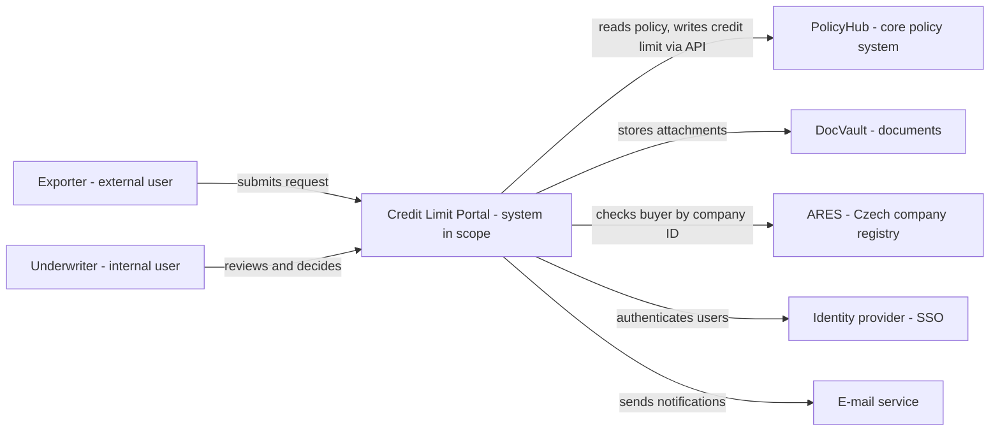
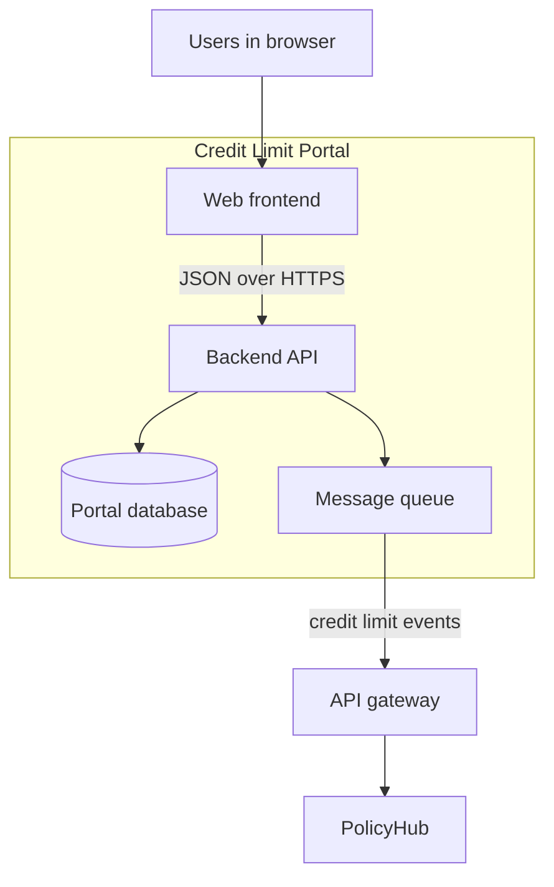

## Why this matters
The job ad asks you to design new features "in line with the architecture". You will not draw the architecture yourself, but you must understand the systems your requirements touch: where data lives, which system owns it, how systems talk to each other and what security rules apply. A BA who can read an architecture diagram and ask the architect the right questions writes specifications that vendors can build without expensive surprises.

## Quick version
**Architecture** is the structure of an organization's IT: which systems exist, what each one is responsible for, and how they connect. As a BA you need IT literacy, not engineering skills.

**How a web application works.** When an underwriter opens PolicyHub in a browser:
- The **browser** shows the **frontend**: screens, forms, buttons. It runs on the user's computer.
- The frontend sends requests to the **backend**: the server-side program that applies business rules (for example "a credit limit above EUR 500,000 needs a second approval").
- The backend reads and writes data in a **database**.
- Systems talk to each other through **APIs** (application programming interfaces): agreed ways for one program to ask another for data or an action, usually over HTTP with JSON.

**Where systems run.**
- **On-premises (on-prem):** in the company's own data center.
- **Cloud:** rented from a provider. Three levels: **IaaS** (you rent virtual servers), **PaaS** (you rent a platform to run your code), **SaaS** (you rent a finished application, such as Microsoft 365 or a CRM).

**A typical insurer or bank landscape:**
- **Core system** – the main system of record (policies, contracts). At ExportShield this is PolicyHub.
- **CRM** – customer relationship management: contacts, meetings, sales pipeline.
- **DMS** – document management system: contracts, invoices, claim documents (DocVault).
- **Data warehouse** – a separate database for reporting and analytics, filled from the operational systems.
- **Integration layer** – middleware that connects systems: an **ESB** (enterprise service bus) or an **API gateway**.
- **Identity and SSO** – one central place that knows who the users are and what they may do; **single sign-on** means one login for many systems.

**Monolith vs microservices.** A **monolith** is one large application deployed as a whole. **Microservices** split the application into small services that are deployed separately. Neither is "better"; each has trade-offs. For a BA the practical difference is how changes are planned, tested and released.

**Environments.** Changes move through **DEV** (developers), **TEST/SIT** (system and integration testing), **UAT** (business acceptance) and **PROD** (real users and real data). Never test on production data without approval.

**What "in line with architecture" means for a BA:**
1. **Reuse** existing systems and services before asking for new ones.
2. Respect **data ownership**: each type of data has one system of record.
3. **No shadow IT**: no private Excel databases or unapproved tools that become critical.
4. **Security and compliance** by design: least privilege, audit logs, GDPR.
5. Talk to the **architect early**, not after the vendor has quoted.

**Non-functional requirements** describe how well the system works: security, availability, performance, auditability. In regulated companies they are often stricter than the functional ones.

**Regulation in finance, at a rough level:** **GDPR** protects personal data. **DORA** (Digital Operational Resilience Act, an EU regulation applicable since 17 January 2025) requires financial entities, including insurers, to manage ICT risk, report major ICT incidents and control risks from ICT vendors. For a BA this means: every new vendor or cloud service goes through a risk assessment, and you document it.

**Technical debt** is the future cost of shortcuts taken today. A quick workaround may be the right decision, but it should be written down and planned for repair.

In an interview, you can say: "I don't design the architecture, but I check that my requirements reuse existing services, respect which system owns the data, and include security and audit requirements. I involve the architect before the specification goes to the vendor."

## Deep dive

### How a web application works, step by step [P1]
Take a concrete action: an underwriter at ExportShield clicks **Approve** on a credit limit request in PolicyHub.

1. **Browser and frontend.** The page the underwriter sees is the frontend. It is made of HTML (structure), CSS (look) and JavaScript (behavior). The frontend checks simple things locally, for example that the amount field is not empty.
2. **Request.** The frontend sends an HTTP request to the backend, for example `POST /credit-limits/4711/approval` with a JSON body containing the approved amount and a comment.
3. **Authentication and authorization.** The backend checks *who* is calling (authentication, usually via a token from the identity provider) and *whether this person may approve this amount* (authorization, based on roles).
4. **Business logic.** The backend applies the business rules: is the amount within the underwriter's authority? Is the buyer's country on a restricted list? Is a second approval needed?
5. **Database.** The backend writes the decision to the database inside a **transaction**, which means either all changes are saved or none.
6. **Integration.** The backend may call other systems: notify the CRM, store a decision letter in DocVault, send an event to the data warehouse.
7. **Response.** The backend returns a status (for example `200 OK` or `403 Forbidden`) and the frontend shows the result.

Why a BA cares: each step is a place where a requirement can be missing. "The approval must be logged with user, time and old/new value" belongs to step 5. "Underwriters may approve up to EUR 250,000" belongs to steps 3 and 4. "The exporter receives a letter" belongs to step 6.

```json
{
  "creditLimitId": 4711,
  "decision": "REDUCED",
  "approvedAmount": 150000,
  "currency": "EUR",
  "comment": "Reduced due to buyer's negative equity in 2025 accounts",
  "decidedBy": "u.underwriter01"
}
```

### On-prem, cloud, IaaS, PaaS, SaaS [P1]
A common comparison is housing:

| Model | Who manages what | Housing analogy | ExportShield example |
|---|---|---|---|
| On-prem | Company manages everything: hardware, OS, application | You own the house | Legacy PolicyHub database in own data center |
| IaaS | Provider: hardware and virtualization. Company: OS, runtime, app | You rent an empty flat | Virtual servers for the reporting tool |
| PaaS | Provider: also OS and runtime. Company: app and data | You rent a furnished flat | ClaimDesk API running on a managed app platform |
| SaaS | Provider: everything. Company: configuration and data | You stay in a hotel | Microsoft 365, cloud CRM |

What changes for a BA when a solution is SaaS:
- You **configure**, you don't build. Requirements must fit what the product can do, or you pay for customization.
- Release cycles are controlled by the provider. New features may arrive whether you want them or not, so regression testing becomes a regular task.
- Data is stored outside the company. You need to know where (EU or not), who can access it and how you get it back if the contract ends (exit strategy).
- In a regulated company, procurement, security and compliance must approve the provider before anyone signs up.

### A typical insurer landscape [P1]
Here is a simplified ExportShield landscape. You will meet the same building blocks in banks and other insurers, under different names.

| Building block | ExportShield system | Owns which data | Typical users |
|---|---|---|---|
| Core policy system | PolicyHub (vendor NovaSoft) | Policies, credit limits, premiums | Underwriters, policy admin |
| Claims system | ClaimDesk | Claims, reserves, indemnity payments | Claims handlers |
| DMS | DocVault | Documents (contracts, invoices, proofs) | Everyone, via other systems |
| CRM | Sales CRM (SaaS) | Contacts, meetings, opportunities | Account managers |
| Finance / ERP | Accounting system | Ledger, incoming and outgoing payments | Finance |
| Data warehouse | DWH + reporting | Copies of data for reporting | Management, actuaries, risk |
| Integration layer | API gateway + message queue | No business data; routes calls | IT |
| Identity / SSO | Company identity provider | Users, groups, roles | IT, all users indirectly |
| External services | Company registry (ARES), rating agency, bank | External data | Called by systems |

Three ideas to remember:
- **System of record.** For each data type, one system is the master. If an exporter's address is changed in the CRM but PolicyHub is the system of record, the change will be overwritten or, worse, the two systems will disagree. Your requirement must say where data is created and changed.
- **Integration layer.** Systems should not be wired directly to each other in every combination ("spaghetti integration"). An **ESB** is a central bus that transforms and routes messages; an **API gateway** is a single entry point that publishes APIs with security, throttling and logging. Many companies have both.
- **Data warehouse is read-only for business.** It is for reports. It is usually updated overnight or several times a day, so it is not the right source for a real-time decision.

### Monolith vs microservices [P2]
| | Monolith | Microservices |
|---|---|---|
| Structure | One application, one deployment | Many small services, each deployed separately |
| Change | A small change means releasing the whole application | One service can be released on its own |
| Testing | Fewer integration points, but larger regression | More integration points to test |
| Typical in | Older core systems, smaller products | Newer digital platforms |

You don't decide this. But it explains things you will hear: "We can't release that until the quarterly release" (monolith) or "That field lives in the customer service, which is owned by another team" (microservices). Ask which team owns which part, because that tells you who must agree to your change.

### Environments and releases [P1]
| Environment | Purpose | Data | Who uses it |
|---|---|---|---|
| DEV | Developers build and unit-test | Fake data | Vendor developers |
| TEST / SIT | System and integration testing | Test data, sometimes anonymized | Testers |
| UAT | Business acceptance | Realistic, anonymized or approved copy | Business users, BA |
| PROD | Real work | Real data | All users |

In regulated companies, production data with personal information may not be copied to test environments without anonymization or approval. When you plan UAT (module 13), ask early what test data will exist. Without good test data, UAT fails.

A **release** is a planned package of changes moved to production. Many companies have release calendars and a **change advisory board (CAB)** that approves production changes. Your feature's go-live date depends on this calendar, not only on the vendor's speed.

### What "in line with architecture" means in practice [P1]
When you specify a new feature, run through this checklist:

1. **Reuse.** Is there an existing service that already does this? Example: ExportShield already calls ARES in the onboarding process. A new credit limit feature should use the same integration, not build a second one.
2. **Data ownership.** Which system is the master for each data element? Where is data created, where is it only displayed?
3. **Integration pattern.** Is the call synchronous (the user waits for an answer, typical for an API call) or asynchronous (a message is sent and processed later, typical for a queue or batch)? This affects user experience and error handling.
4. **Standards.** Does the company prescribe a tool? Example: "All workflow automation runs on the approved low-code platform", "All documents are stored in DocVault".
5. **Security.** Who may see and change the data? Is there personal data? Does anything leave the company?
6. **Non-functional requirements.** Volume, response time, availability, retention, audit.
7. **No shadow IT.** Shadow IT is any system or tool used for business without IT's knowledge or approval: a private Excel macro that calculates premiums, a free online tool to convert claim PDFs. It creates risks: no backup, no access control, no one to maintain it when the author leaves.

:::warning
"We'll just do it in Excel for now" is how many critical shadow systems start. If a temporary solution is the right decision, write down the owner, the end date and the replacement plan.
:::

### Reading an architecture diagram [P1]
Architecture diagrams have no single standard look. Read them in this order:
1. **Find the legend.** What do boxes, colors and line styles mean?
2. **Find the people.** Who uses the system?
3. **Find the system in scope.** Usually highlighted or in the center.
4. **Follow the arrows.** Each arrow is a dependency or data flow. Read the label: what data, which protocol (REST, SOAP, file, queue), how often.
5. **Look at the boundaries.** Dotted boxes often mean "inside our company" vs external, or a network zone.
6. **Ask about what is missing.** Where is identity? Where are logs? What happens when an external service is down?

### The C4 model: context and container diagrams [P2]
The **C4 model**, created by Simon Brown, describes software at four zoom levels: **Context**, **Containers**, **Components** and **Code**. Analysts mostly use the first two.

- **System context diagram:** the system in scope as one box, the people who use it and the other systems it talks to. Good for a project kick-off.
- **Container diagram:** zooms into the system and shows its deployable parts: web app, API, database, message queue. Here "container" means a runnable part, not specifically a Docker container.

A context diagram for a new "Credit Limit Portal" at ExportShield, approximated as a Mermaid flowchart:



And a container view of the same portal:



Mermaid's own C4 diagram type is still experimental, so these examples use ordinary flowcharts as an approximation: label the boxes with their type ("external user", "system in scope", "database") to keep the meaning clear.

### Non-functional requirements in architecture [P1]
Non-functional requirements (NFRs) define quality. Write them so they can be tested:

| Area | Weak | Testable |
|---|---|---|
| Performance | "The system must be fast" | "The ARES check returns a result to the user within 3 seconds for 95% of requests" |
| Availability | "Always available" | "Available Mon–Fri 7:00–19:00 CET with 99.5% monthly availability; planned maintenance outside these hours" |
| Security | "Secure" | "Only users with role UNDERWRITER can approve; approval above EUR 250,000 requires role SENIOR_UNDERWRITER" |
| Audit | "Changes are logged" | "Every change of a credit limit stores user ID, timestamp, old value, new value and reason; logs are kept 10 years and cannot be edited" |
| Recovery | "Data must not be lost" | "Maximum data loss 15 minutes (RPO); service restored within 4 hours (RTO)" |

**RPO** (recovery point objective) is how much data you can afford to lose. **RTO** (recovery time objective) is how long the service may be down. Retention periods (like the 10 years above) are set by legal and compliance, not by the BA. Ask them; don't invent them.

### Security and compliance basics in regulated companies [P1]
- **Least privilege.** Every user and every system gets only the access it needs. A reporting user reads data but does not change it. An integration account for the ARES check can call ARES and nothing else.
- **Segregation of duties.** The person who enters a claim should not be the one who approves its payment.
- **GDPR.** Personal data needs a legal basis, a defined purpose, minimal scope and a retention period. In export credit insurance, many data subjects are companies, but contact persons, sole traders and signatories are natural persons. Ask the data protection officer when in doubt.
- **DORA.** The EU Digital Operational Resilience Act applies to financial entities, including insurers, since 17 January 2025. At a rough level it requires: an ICT risk management framework, classification and reporting of major ICT incidents, resilience testing, and management of ICT third-party risk, including a register of contracts with ICT providers. For a BA, DORA shows up as extra steps when a project uses a new vendor or cloud service, and as requirements for logging, monitoring and incident handling.
- **Vendor risk.** Before using a new supplier, the company assesses it: security certifications, data location, subcontractors, financial stability, exit plan. This takes weeks. Plan it into the project.
- **Audit trail.** Regulators and internal audit must be able to reconstruct who did what and when.

:::tip
In interviews for banks and insurers, mentioning least privilege, audit logs and vendor risk assessment shows that you understand the environment, even as a junior.
:::

### Technical debt [P2]
Technical debt is the future work created by choosing a quick solution now instead of a better one. Like financial debt, it charges interest: each later change takes longer.

ExportShield examples:
- The claims team exports data from ClaimDesk to Excel every Monday and copies it into a report by hand, because the data warehouse never received the claims feed.
- A business rule (maximum credit limit per country) is hard-coded in three places instead of being stored in one configuration table.

What a BA can do: record known debt in the backlog, explain its business cost ("4 hours per week of manual work, risk of copy errors"), and include it in prioritization.

### Questions to ask the architect [P1]
Before you specify a new feature, ask:
1. Which systems are affected, and who owns each of them?
2. Which system is the master for each data element in my feature?
3. Is there an existing service or integration I should reuse?
4. Synchronous API or asynchronous message? What happens when the other system is down?
5. Does any data leave the company or the EU? Does it need a vendor risk assessment?
6. What are the security roles and authorization rules?
7. What logging and audit are required?
8. What are the volume and performance expectations?
9. Which environments are available for testing, with which data?
10. Are there architecture standards or decisions (sometimes recorded as architecture decision records, ADRs) that apply?

## Key terms
- **Architecture** — the structure of an organization's IT systems, their responsibilities and their connections.
- **Frontend** — the part of an application the user sees and interacts with, usually in a browser.
- **Backend** — the server-side part that applies business rules and works with data.
- **API** — an agreed interface through which one program requests data or actions from another.
- **On-premises** — software running in the company's own data center.
- **IaaS / PaaS / SaaS** — cloud models where the provider manages infrastructure, a platform, or the whole application.
- **Core system** — the main system of record for the business, such as the policy administration system.
- **System of record** — the one system that is the authoritative master for a given type of data.
- **Data warehouse** — a database that collects copies of operational data for reporting and analytics.
- **ESB / API gateway** — integration components that route, transform, secure and log communication between systems.
- **SSO** — single sign-on: one login gives access to many systems through a central identity provider.
- **Monolith** — an application built and deployed as one unit.
- **Microservices** — an architecture of small, separately deployable services.
- **Environment** — a separate installation of a system for a purpose (DEV, TEST, UAT, PROD).
- **Shadow IT** — business use of systems or tools without IT's knowledge or approval.
- **C4 model** — a way to describe software at four zoom levels: context, containers, components, code.
- **Least privilege** — giving each user or system only the access it needs.
- **DORA** — EU regulation on digital operational resilience of financial entities, applicable since 17 January 2025.
- **Technical debt** — future work caused by choosing a quick solution instead of a better one.
- **RPO / RTO** — maximum acceptable data loss and maximum acceptable downtime after an outage.

## Hands-on
:::exercise id="m12-e1" title="Draw a C4 context diagram of the ExportShield landscape" min="45" tool="Mermaid Live"
**Goal:** show the ExportShield systems and users on one page.

1. List the people: exporter, underwriter, claims handler, finance, management.
2. List the systems: PolicyHub, ClaimDesk, DocVault, CRM, finance system, data warehouse, identity provider, ARES, e-mail.
3. Open [Mermaid Live](https://mermaid.live/) and start from the context diagram in this module.
4. Add every person and system as a box. Label each box with its type (person, internal system, external system).
5. Draw arrows and label each with the data that flows ("credit limit decision", "claim documents", "nightly data load").
6. Mark which system is the master for: policy, claim, document, customer contact.
7. Export the diagram as PNG or SVG.

**Done when:** a colleague who has never seen ExportShield can explain from the diagram where a claim document is stored and how a credit limit decision reaches the data warehouse.
:::

:::exercise id="m12-e2" title="Questions for the architect" min="30" tool="Confluence or a text editor"
**Goal:** prepare for a meeting with the architect about a new feature: "Exporters upload claim documents through a web portal; documents go to DocVault and the claim is created in ClaimDesk."

1. Write at least 12 questions, grouped under: systems and ownership, data, integration, security, non-functional, environments.
2. For each question, write in one line why the answer affects your specification.
3. Mark the three questions you would ask first if you had only 10 minutes.

**Done when:** every group has at least two questions and none of them could be answered with "it depends on the vendor" without a follow-up.
:::

:::exercise id="m12-e3" title="Find the architecture risks" min="40" tool="Text editor"
**Goal:** review this proposal from a department head and list the risks.

> "To speed up credit limit decisions, the underwriting team will use a free online tool that reads buyer financial statements from uploaded PDFs. A team member has written an Excel macro that pulls the result, calculates the limit and e-mails it to PolicyHub's support mailbox, where NovaSoft enters it manually. Buyer data is also copied into the team's own SharePoint list to track decisions."

1. List every risk you find (aim for at least 8).
2. For each, name the area: shadow IT, data ownership, security, GDPR, vendor risk/DORA, audit, technical debt, operations.
3. For the three biggest risks, propose an architecture-compliant alternative.

**Done when:** your list covers at least five of the areas and each alternative names an existing system or an approved route (for example the approved low-code platform or an API integration to PolicyHub).
:::

## Self-check
:::q
An underwriter changes a buyer's address in the CRM, but next morning the old address is back. What is the most likely architecture explanation?
---
The CRM is probably not the system of record for buyer addresses. Another system (for example PolicyHub) is the master and synchronizes its data to the CRM, overwriting local changes. The requirement should state where addresses are created and changed and how they flow to other systems.
:::

:::q
What is the practical difference for a BA between buying a SaaS product and having a vendor build a custom application?
---
With SaaS you configure an existing product, so requirements must fit its capabilities or you pay for customization. Releases are controlled by the provider, which means regular regression testing. Data is stored at the provider, so data location, access and exit strategy must be checked, and in a regulated company the provider must pass a vendor risk assessment.
:::

:::q
Why is a data warehouse usually the wrong source for a real-time credit limit decision?
---
A data warehouse holds copies of data, usually loaded once or a few times a day, so the data may be outdated. It is designed for reporting, not for transactional decisions. The decision should use the operational system of record through an API.
:::

:::q
Give two examples of shadow IT at an insurer and explain the risk.
---
Examples: an Excel macro that calculates premiums and lives on one person's laptop; a free online PDF converter used for claim documents. Risks include no backup or versioning, no access control, personal or confidential data leaving the company, and no one able to maintain it when the author leaves.
:::

:::q
Rewrite "The system must be secure and fast" as two testable non-functional requirements.
---
For example: "Only users with role SENIOR_UNDERWRITER can approve credit limits above EUR 250,000." and "The buyer registry check returns a result to the user within 3 seconds for 95% of requests during business hours." Each states a measurable condition that a tester can verify.
:::

:::q
What does DORA mean for a BA on a project that wants to use a new cloud service?
---
The insurer, as a financial entity, must manage ICT third-party risk. The new provider will need a risk assessment, a contract with required clauses and an entry in the register of ICT contracts. The BA should plan time for this and include requirements for logging, monitoring and incident handling.
:::

:::q
What is the difference between a context diagram and a container diagram in the C4 model?
---
The context diagram shows the system in scope as a single box with its users and neighboring systems. The container diagram zooms into the system and shows its runnable parts, such as the web frontend, backend API, database and message queue, and how they communicate.
:::

## Interview corner
:::interview
What does it mean for you to design a feature "in line with the architecture"?
---
- Reuse existing systems, services and integrations before requesting new ones.
- Respect the system of record for each data element.
- Follow company standards (approved platforms, DMS for documents, API gateway for integration).
- Include security, audit and other non-functional requirements from the start.
- Involve the architect before the specification goes to the vendor.

Typical mistake: answering "I follow the architect's instructions" without showing you know what to check yourself.
:::

:::interview
Can you explain what happens technically when a user clicks "Submit" in a web form?
---
- Frontend validates input and sends an HTTP request with a JSON payload to the backend.
- Backend authenticates the user and checks authorization.
- Backend applies business rules and writes to the database in a transaction.
- Backend may call other systems through APIs or send messages.
- Backend returns a status and the frontend shows the result.

Typical mistake: getting lost in technical details instead of linking each step to the kind of requirement it needs.
:::

:::interview
How would you find out which systems are affected by a new requirement?
---
- Read existing architecture diagrams and system documentation.
- Walk through the process and ask, for each step, which system holds the data.
- Ask the architect and system owners; confirm data ownership.
- Draw a simple context diagram and have it reviewed.

Typical mistake: assuming the system the users see is the only one involved.
:::

:::interview
What security and compliance aspects do you consider when writing requirements in a bank or insurer?
---
- Roles and least privilege; segregation of duties for approvals and payments.
- Personal data and GDPR: purpose, scope, retention; involve the DPO.
- Audit trail of changes and decisions.
- Data location and vendor risk assessment for new suppliers (DORA for financial entities).
- Environments: no production personal data in test without anonymization or approval.

Typical mistake: treating security as "IT's problem" instead of part of the requirements.
:::

:::interview
A business team wants to solve a problem quickly with an unapproved online tool. How do you respond?
---
- Acknowledge the business need and its urgency.
- Explain the risks (data leaving the company, no support, audit).
- Look for an approved alternative: existing system, approved low-code platform, or a fast-track request to IT.
- If a temporary workaround is accepted, document owner, end date and replacement plan.

Typical mistake: either blocking the team without offering a path, or quietly letting shadow IT grow.
:::
