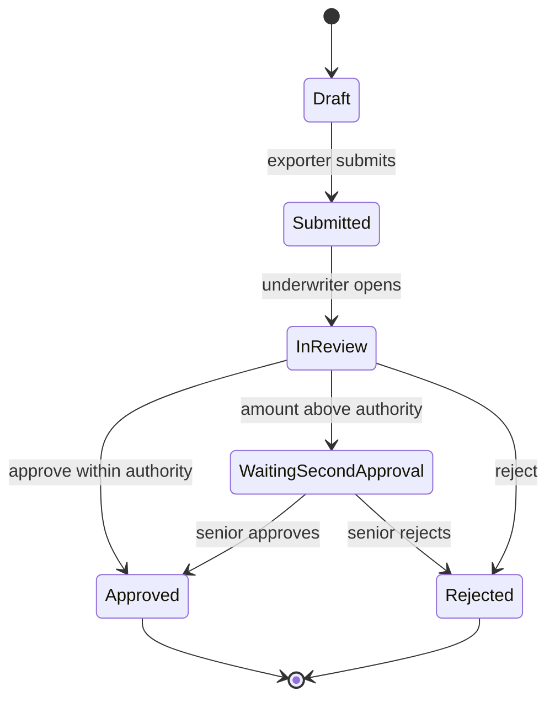

## Why this matters
The job ad asks you to support testers, take part in testing deliveries and report on development status. The BA knows what the business needs, so the BA is the natural person to check that the delivery does it. At an insurer working with an external vendor, the BA often writes test scenarios, organizes user acceptance testing (UAT), reports defects to the vendor and recommends whether a release can be accepted. You may already do part of this when you test an automation before it goes live.

## Quick version
**Why a BA tests.** Requirements are only useful if the delivered system meets them. The vendor tests that the code works; the business must check that the solution solves its problem. The BA links the two.

**Testing levels:**
- **Unit testing** (ISTQB: component testing) – developers test small pieces of code.
- **Integration testing** – parts or systems work together (PolicyHub calls ARES correctly).
- **System testing** – the whole system against the specification, usually by the vendor's testers.
- **Acceptance testing (UAT)** – business users confirm the system supports their real work.

**Testing types:**
- **Functional** – does it do what it should?
- **Regression** – did the change break something that used to work? (Retesting the fix itself is called **confirmation testing**.)
- **Smoke** – a quick check that the main functions run after a deployment.
- **Non-functional** – performance, security, usability, availability.

**Static testing** means reviewing documents without running software. Reviewing requirements is the cheapest way to find defects: a missing rule found in the specification costs a conversation; found in production, it costs a fix, a retest, a release and maybe a wrong decision.

**From requirements to test cases.** Each acceptance criterion gives at least one test case. A test case has: ID, title, preconditions, steps, test data, expected result, actual result, status.

**Four techniques to know:**
- **Equivalence partitioning** – group inputs that the system should treat the same way and test one value from each group.
- **Boundary value analysis** – test at the edges, where mistakes like `>` instead of `>=` happen.
- **Decision tables** – list combinations of conditions and the expected outcome.
- **State transition testing** – test allowed and forbidden moves between statuses (Draft → Submitted → In review → Approved).

**UAT** needs a plan: scope, entry criteria (when we can start), exit criteria (when we are done), test data, participants, schedule and **sign-off** (formal acceptance).

**Defects.** A good defect report lets the developer reproduce the problem without calling you: title, environment, steps, expected vs actual result, evidence, severity. **Severity** is the impact on the system; **priority** is how soon it should be fixed. They are different: a typo in the company name on a letter has low severity but may have high priority.

**Triage** is a regular meeting where the business, BA and vendor agree on each new defect: is it valid, how severe, who fixes it, by when, or is it actually a change request.

**Reporting status.** Useful numbers: test cases planned / executed / passed / failed / blocked, open defects by severity, trend over time and the go/no-go recommendation.

**Accepting a vendor delivery** means checking the delivery against the agreed specification and acceptance criteria, with all critical defects closed and the rest agreed in writing.

**SQL** helps verify results in the database (did the approval write the correct amount?) when you have read access to the test environment.

**ISTQB CTFL** (Certified Tester Foundation Level) is the common entry-level testing certification. It is optional for a BA, but it gives you a shared vocabulary with testers.

In an interview: "I write test scenarios from acceptance criteria, use boundary values and decision tables for business rules, organize UAT with business users, report defects clearly and give a go/no-go recommendation based on data."

## Deep dive

### Why the BA tests [P1]
Testers check the system against the specification. If the specification is wrong or incomplete, a perfectly tested system can still be useless. The BA brings what testers may not have:
- knowledge of the business process and real cases ("an exporter sometimes asks to increase an existing limit, not only for a new one"),
- knowledge of why a rule exists, which helps judge whether a deviation matters,
- contact with business users who will run UAT.

Typical BA tasks in testing: review requirements for testability, help testers understand business rules, write or review UAT scenarios, prepare test data with the business, run or coordinate UAT, triage defects, report status and prepare the acceptance decision.

### Testing levels and types [P1]
| Level | Who usually does it | Tests what | ExportShield example |
|---|---|---|---|
| Unit | Vendor developers | One function | The function that calculates the maximum limit by country rating |
| Integration | Vendor testers / IT | Interfaces between parts or systems | PolicyHub sends the company ID to ARES and stores the returned name |
| System | Vendor testers | Whole system vs specification | Full credit limit request flow in the test environment |
| Acceptance (UAT) | Business users with BA | Fit for real work | Underwriters process 20 realistic requests from last quarter (anonymized) |

The ISTQB Foundation syllabus (v4.0) uses slightly finer names: **component testing** instead of unit testing, and it splits integration testing into **component integration testing** and **system integration testing**. Acceptance testing includes UAT but also operational, contractual and regulatory acceptance testing.

Types cross all levels:
- **Functional** testing checks behavior: "a request above EUR 500,000 goes to a second approver".
- **Regression** testing reruns existing tests after a change. Vendors often fix one thing and break another. It is different from **confirmation testing** (retest), which checks that the reported defect itself is fixed. ISTQB groups both as change-related testing.
- **Smoke** testing is a short check after each deployment: can I log in, open a request, save it? If smoke fails, deeper testing stops.
- **Non-functional** testing covers performance (response times under load), security (access rights, penetration tests by specialists), usability and availability.

### Static testing: reviewing requirements [P1]
Static testing finds defects without running the software. For a BA, the most valuable form is reviewing requirements and user stories before development.

Check each requirement for:
- **Ambiguity:** "large limits need approval" – how large?
- **Completeness:** what happens if ARES is unavailable? if the company ID does not exist?
- **Consistency:** another requirement says the limit is in CZK, this one in EUR.
- **Testability:** can I write an expected result? "User-friendly" is not testable.
- **Boundaries:** "above 500,000" – is exactly 500,000 above or not?

Example. Requirement: *"Credit limit requests over EUR 500,000 must be approved by a senior underwriter."*
Review questions: Is it "over" (> 500,000) or "from" (>= 500,000)? Is the amount compared before or after currency conversion? What if the exporter already has a limit of 400,000 on this buyer and asks for an increase of 200,000: is the request amount 200,000 or 600,000? Each answer prevents a defect.

### Deriving test cases from acceptance criteria [P1]
A user story with acceptance criteria:

```gherkin
Feature: Credit limit request
  Scenario: Request within underwriter authority
    Given an active policy for exporter "TEST Exporter 001"
    And the buyer's company ID exists in the registry
    When the underwriter approves a credit limit of EUR 300,000
    Then the credit limit status is "Approved"
    And the exporter receives a decision e-mail

  Scenario: Request above underwriter authority
    Given an active policy
    When the underwriter approves a credit limit of EUR 600,000
    Then the status is "Waiting for second approval"
    And the request appears in the senior underwriter's queue
```

Each scenario becomes at least one test case. Then you add cases the criteria imply but don't spell out: the boundary (exactly 500,000), invalid inputs, missing data, unavailable external service, a user without the right role.

### Equivalence partitioning and boundary values [P1]
Rule for the ExportShield credit limit form: *"Requested amount must be between EUR 10,000 and EUR 2,000,000 inclusive. Amounts above EUR 500,000 require second approval."*

**Equivalence partitions** (groups the system should handle the same way):

| Partition | Range | Expected behavior |
|---|---|---|
| Invalid low | < 10,000 (including 0 and negative numbers) | Error: below minimum |
| Valid, single approval | 10,000 – 500,000 | Accepted, one approval |
| Valid, second approval | 500,000.01 – 2,000,000 | Accepted, second approval |
| Invalid high | > 2,000,000 | Error: above maximum |
| Invalid format | empty, not a number (text) | Error: invalid amount |

Partitions must not overlap: every possible input belongs to exactly one of them. The ranges assume amounts are entered with two decimal places, so the smallest step is 0.01.

**Boundary values** (test on and next to each edge): 9,999.99 / 10,000 / 500,000 / 500,000.01 / 2,000,000 / 2,000,000.01.

This is what ISTQB calls **2-value boundary value analysis**: for each boundary, the boundary value itself and its nearest neighbor in the adjacent partition. **3-value boundary value analysis** also adds the neighbor on the other side (for 10,000: 9,999.99, 10,000 and 10,000.01). It costs more test cases but catches more mistakes, for example a developer writing `amount = 10000` instead of `amount >= 10000`.

Why boundaries matter: a developer writing `amount > 10000` instead of `amount >= 10000` creates a defect that only a test with exactly 10,000 finds.

### Decision tables [P1]
Use a decision table when the outcome depends on a combination of conditions. ExportShield claim eligibility (fictional rules):
- C1: Policy was active on the invoice date.
- C2: A credit limit on the buyer existed on the shipment date.
- C3: The claim was notified within the deadline set in the policy.
- C4: The invoice amount is within the credit limit.

| Rule | R1 | R2 | R3 | R4 | R5 |
|---|---|---|---|---|---|
| C1 Policy active | Y | Y | Y | Y | N |
| C2 Limit existed | Y | Y | Y | N | – |
| C3 Notified in time | Y | Y | N | – | – |
| C4 Within limit | Y | N | – | – | – |
| **Outcome** | Eligible, full | Eligible up to limit | Refer to claims manager | Not eligible | Not eligible |

A dash means "doesn't matter". Each column is one test case. Together the five columns cover all 16 combinations of the four conditions, with no combination in two columns. Building the table often uncovers missing or unintended rules: R3 says a late claim goes to the claims manager whatever the amount, so a late claim above the limit is handled like a late claim within it. Is that what the business wants? Ask before testing, not after.

### State transition testing [P2]
A credit limit request moves through statuses:



Test cases: each valid transition once, plus invalid ones (can a Rejected request be approved? can a Draft go directly to Approved?). Invalid transitions are a frequent source of serious defects.

### A test case template [P1]
| Field | Example |
|---|---|
| ID | TC-CL-007 |
| Title | Amount exactly at second-approval boundary stays single approval |
| Requirement / AC | US-CL-12, AC2 |
| Preconditions | Active policy P-2026-0153; user with role UNDERWRITER logged in |
| Test data | Buyer company ID 99000001 (test record); amount EUR 500,000.00 |
| Steps | 1. Open new request. 2. Enter buyer ID and amount. 3. Submit. 4. Approve. |
| Expected result | Status "Approved"; no second approval required |
| Actual result | (filled during execution) |
| Status | Not run / Pass / Fail / Blocked |
| Tester, date | |

The link to the requirement gives **traceability**: you can show which requirements are tested and which are not.

### Planning UAT [P1]
A UAT plan answers these questions:

| Item | Content |
|---|---|
| Scope | Which processes and features are tested; what is out of scope |
| Entry criteria | System test finished; no open critical defects; UAT environment and test data ready; users trained |
| Exit criteria | All planned scenarios executed; no open critical or high defects; medium/low defects have an agreed fix plan; sign-off by business owner |
| Test data | Anonymized or synthetic exporters, buyers, policies; agreed with data protection |
| Participants | Named business testers, BA as coordinator, vendor support contact, decision maker |
| Schedule | Dates, daily time slots, triage meetings, retest window |
| Tools | Where scenarios and defects are recorded (Jira, Excel, test management tool) |
| Sign-off | Who signs, on what basis, with which open items |

Common UAT failures: users without time allocated, no realistic test data, environment not ready, scenarios written by the vendor instead of the business, and no agreed exit criteria.

### Running UAT with business users [P1]
1. **Kick-off (30–60 min).** Explain the goal, show the system, explain how to record results and defects.
2. **Scenarios, not clicks.** Give users business scenarios ("Process this request from a Polish buyer with a negative equity flag") and let them use the system as they would.
3. **Be present.** Sit with users on the first day. Many "defects" are questions or training needs.
4. **Daily triage.** Review new defects every day with the vendor.
5. **Track progress.** Update the status every day.
6. **Retest.** Fixed defects go back to the person who found them.
7. **Sign-off.** The business owner signs based on the exit criteria and the list of open items.

### Defect lifecycle and a good defect report [P1]
First, three words testers use precisely (ISTQB): a person makes an **error** (mistake), for example misreads a rule; the error leaves a **defect** (bug, fault) in a work product such as the specification or the code; when the defective code runs, it can cause a **failure**, the visible wrong behavior. In UAT you observe failures and report them as defects. Static testing (reviews) finds defects directly, before anything runs.

A typical lifecycle: **New → Triaged/Open → In progress → Fixed → Ready for retest → Closed**, with side exits **Rejected** (not a defect), **Duplicate**, **Deferred** (fix later) and **Reopened** (retest failed).

A good defect report:

| Field | Example |
|---|---|
| Title | Approval of exactly EUR 500,000 requires second approval |
| Environment | UAT, build 2.4.1, 28 Oct 2026 |
| Preconditions | Policy P-2026-0153, user role UNDERWRITER |
| Steps to reproduce | 1. Create request for buyer 99000001. 2. Amount 500000. 3. Submit. 4. Approve. |
| Expected result | Status "Approved" (AC2: second approval only above 500,000) |
| Actual result | Status "Waiting for second approval" |
| Evidence | Screenshot, request ID CL-88412 |
| Severity | Medium – wrong routing, workaround exists |
| Priority | High – affects many requests near the boundary |
| Requirement | US-CL-12 AC2 |

Rules: one defect per report; facts, not opinions; steps that someone else can repeat; expected result with a reference to the requirement.

**Severity vs priority:**

| | High priority | Low priority |
|---|---|---|
| **High severity** | Approved limits are not saved | A crash in a yearly report run in December |
| **Low severity** | Company name misspelled on the decision letter | Misaligned label on an admin screen |

### Triage with the vendor [P1]
Triage meetings decide for each new defect:
- Is it valid? Can the vendor reproduce it?
- Is it a **defect** (the system does not meet the agreed requirement) or a **change request** (the requirement was missing or has changed)? This matters for cost: defects are usually fixed under the contract; change requests are paid and planned.
- Severity and priority.
- Who fixes it and in which build.

Your specification and acceptance criteria are the evidence in this discussion. Vague requirements lead to long arguments about "defect or change".

### Regression after changes [P2]
Every fix and every new release can break existing functions. Keep a **regression set**: a selection of the most important test cases (main flows, critical business rules, integrations) that you rerun after every change. For SaaS products with frequent releases, a regression set is a standing task. Automated regression tests are usually built by testers; the BA helps choose what must be covered.

### Test status reporting [P1]
A one-page daily or weekly status:

| Metric | Value | Why it matters |
|---|---|---|
| Test cases planned / executed | 120 / 95 | Progress |
| Passed / failed / blocked | 80 / 9 / 6 | Quality and obstacles |
| Open defects by severity | Critical 0, High 2, Medium 7, Low 5 | Release risk |
| Defects opened vs closed this week | 12 / 15 | Trend: is it stabilizing? |
| Requirements covered | 46 of 48 | Gaps in coverage |
| Risks and blockers | Test data for claims missing | What management must solve |
| Recommendation | Go with conditions / No-go | The decision |

Avoid reporting only percentages ("79% passed"). Decision makers need to know *which* functions fail and what that means for the business.

### Accepting a vendor delivery [P1]
Accepting a delivery is often a contractual step: it can trigger payment and the start of a warranty period. Before recommending acceptance, check:
- All agreed requirements are delivered (traceability matrix).
- UAT exit criteria are met.
- Open defects are listed with agreed fix dates.
- Documentation is delivered (user guide, operations manual, release notes).
- Non-functional requirements are verified (performance, security tests if agreed).
- Operations are ready: support process, monitoring, access rights.

The BA recommends; the business owner signs. Write down any conditions.

### Using SQL to verify results [P2]
With read access to the test database, you can check what the screen cannot show. The first query runs on the practice dataset in the [SQL lab](sql.html). The second one assumes the new system stores who approved a limit (`approved_by`, `second_approved_by`) – those columns belong to the TO-BE design and are not in the practice dataset.

```sql
-- Did the decision store the right amount and status?
SELECT id, buyer_id, requested_amount, approved_amount, status, decided_on
FROM credit_limits
WHERE id = 12;

-- In the new system: approved limits above 500,000 without a second approver?
SELECT id, approved_amount, approved_by, second_approved_by
FROM credit_limits
WHERE status = 'APPROVED'
  AND approved_amount > 500000
  AND second_approved_by IS NULL;
```

The second query tests a business rule across all data, not just one case. A non-empty result is a defect.

### ISTQB CTFL as an optional certification [P3]
ISTQB (International Software Testing Qualifications Board) offers the Certified Tester Foundation Level, currently based on syllabus version 4.0. It covers testing principles, the test process, static testing, test techniques and test management. For a BA it is not required, but it helps when you work closely with testers and shows structured knowledge. The IREB CPRE certification (module on requirements) is usually more relevant for a BA career; CTFL is a useful second one.

## Key terms
- **Static testing** — finding defects by reviewing documents or code without running the software.
- **Unit / integration / system / acceptance testing** — testing levels from single code units up to business acceptance.
- **Regression testing** — rerunning existing tests to check that a change did not break working functions.
- **Smoke test** — a short check that the main functions work after a deployment.
- **Test case** — a defined set of preconditions, steps, data and expected result to check one behavior.
- **Equivalence partitioning** — dividing inputs into groups handled the same way and testing one value from each.
- **Boundary value analysis** — testing values on and next to the edges of valid ranges.
- **Decision table** — a table of condition combinations and expected outcomes, used to test business rules.
- **State transition testing** — testing allowed and forbidden moves between statuses.
- **UAT** — user acceptance testing: business users confirm the solution supports their real work.
- **Entry / exit criteria** — conditions that must be met to start or finish a test phase.
- **Defect** — an imperfection in a work product (requirement, design, code) that means it does not meet its requirements; when it is executed it can cause a failure, a visible deviation from the expected behavior.
- **Severity / priority** — impact of a defect vs urgency of fixing it.
- **Triage** — a regular meeting to assess, classify and assign new defects.
- **Traceability** — the link between requirements, test cases and defects.
- **Sign-off** — formal acceptance of a deliverable by an authorized person.
- **Change request** — a request to change agreed scope or requirements, usually with its own estimate and approval.

## Hands-on
:::exercise id="m13-e1" title="10 test cases for the credit limit form" min="60" tool="Excel or Google Sheets"
**Goal:** write test cases for this form and these rules.

Form fields: buyer company ID (8 digits), buyer country (from list), requested amount (EUR), payment terms (days).
Rules: amount EUR 10,000 – 2,000,000 inclusive; above EUR 500,000 needs second approval; payment terms 30–180 days inclusive; company ID must exist in the registry; buyers in countries with rating 7 are not allowed.

1. Create a sheet with the columns from the test case template in this module.
2. Write equivalence partitions and boundary values for amount and payment terms.
3. Write 10 test cases: at least 4 boundary cases, 2 invalid inputs, 1 for the registry check, 1 for the country rule, 1 for the second approval.
4. Link each test case to the rule it checks.

**Done when:** every rule has at least one test case, each boundary is tested on the edge, and the expected results are specific (exact message or status, not "works").
:::

:::exercise id="m13-e2" title="Decision table for claim eligibility" min="40" tool="Excel or Google Sheets"
**Goal:** turn rules into a decision table and find gaps.

Rules: a claim is eligible if the policy was active on the invoice date, a credit limit existed on the shipment date and the claim was notified within 60 days after the due date. If the invoice exceeds the limit, the claim is eligible up to the limit. Claims for buyers related to the exporter (same group) are never eligible.

1. List the conditions (C1–C5).
2. Build the full table with all combinations, then simplify with "doesn't matter" (–).
3. Write the outcome for each column.
4. List at least two questions the rules don't answer.

**Done when:** each column is a test case with a clear outcome and your open questions are ready for the claims manager.
:::

:::exercise id="m13-e3" title="Three defect reports" min="30" tool="Jira Free or a text editor"
**Goal:** write clear defect reports from these UAT notes:

1. "When I save a request with payment terms 180, it says terms are too long. Request CL-90011, UAT, yesterday afternoon."
2. "The decision e-mail to the exporter shows the amount as 500000.0 without currency."
3. "As a claims handler I could open the Approve button on a credit limit request. I should not even see those requests."

For each, fill in: title, environment, preconditions, steps, expected (with rule reference), actual, evidence, severity, priority, and one sentence justifying severity and priority. Use [Jira Free](https://www.atlassian.com/software/free) if you have set it up in an earlier module.

**Done when:** a developer could reproduce each defect without asking you anything, and defect 3 is classified as a security issue.
:::

:::exercise id="m13-e4" title="UAT plan one-pager" min="45" tool="Confluence or Word"
**Goal:** plan UAT for the new credit limit request feature at ExportShield.

1. Write scope and out of scope.
2. Write 4 entry and 4 exit criteria.
3. Describe test data (how many exporters, buyers, policies; anonymized or synthetic).
4. Name roles (not real people): business testers, coordinator, vendor contact, sign-off owner.
5. Make a two-week schedule with triage meetings and a retest window.
6. Define how defects are reported and what blocks sign-off.

**Done when:** the plan fits on one page and a project manager could use it to book people and environments.
:::

## Self-check
:::q
Why is reviewing requirements called the cheapest way to fix defects?
---
A defect in a requirement found during review is fixed by changing a sentence. The same defect found later requires changing code, retesting, a new release, and in production it may already have caused wrong decisions or payments. The later a defect is found, the more work depends on it.
:::

:::q
The valid range is EUR 10,000 to 2,000,000 inclusive. Which boundary values would you test and why?
---
9,999.99, 10,000, 2,000,000 and 2,000,000.01 (plus the internal boundary of 500,000 and 500,000.01 for second approval). Developers often make off-by-one mistakes such as using > instead of >=, and only values exactly on and next to the edge reveal them.
:::

:::q
What is the difference between severity and priority? Give an example where they differ.
---
Severity describes the impact of the defect on the system or business; priority describes how soon it should be fixed. A misspelled company name on every decision letter has low technical severity but high priority, because it is visible to customers.
:::

:::q
During triage, the vendor says a reported problem is a change request, not a defect. How do you decide?
---
Check the agreed specification and acceptance criteria. If the system does not do what was agreed, it is a defect. If the expected behavior was never specified or the business now wants something different, it is a change request. Clear requirements make this decision quick.
:::

:::q
What are good exit criteria for UAT?
---
All planned scenarios executed; no open critical or high-severity defects; medium and low defects documented with agreed fix dates; key business rules verified; sign-off from the business owner. They should be agreed before UAT starts.
:::

:::q
When is a decision table more useful than equivalence partitioning?
---
When the outcome depends on a combination of several conditions, such as claim eligibility depending on policy status, credit limit, notification deadline and amount. Equivalence partitioning handles single inputs and ranges; a decision table shows every combination and reveals missing rules.
:::

:::q
Why should a test status report include more than the percentage of passed tests?
---
A percentage hides what fails. Decision makers need to know which business functions are affected, how severe the open defects are, whether the trend is improving and what blocks progress. A clear go/no-go recommendation with conditions is more useful than a number.
:::

## Interview corner
:::interview
What is the role of a BA in testing?
---
- Make requirements testable and review them (static testing).
- Help testers understand business rules; review or write test scenarios.
- Prepare and coordinate UAT with business users and test data.
- Triage defects with the vendor; distinguish defect vs change request.
- Report status and give a go/no-go recommendation.

Typical mistake: saying "testing is the testers' job" or describing only clicking through screens.
:::

:::interview
How do you derive test cases from a user story?
---
- Each acceptance criterion gives at least one positive test.
- Add negative tests: invalid inputs, missing data, wrong role.
- Use boundary values for ranges and decision tables for rule combinations.
- Link each test to the requirement for traceability.

Typical mistake: only testing the happy path described in the story.
:::

:::interview
How would you organize UAT for a new system delivered by an external vendor?
---
- UAT plan: scope, entry and exit criteria, test data, participants, schedule, sign-off.
- Business scenarios based on real cases, written with the business.
- Kick-off and support for users, daily triage with the vendor, retests.
- Status reporting and a recommendation based on exit criteria.

Typical mistake: starting UAT without agreed exit criteria or realistic test data.
:::

:::interview
What makes a good defect report?
---
- Clear title describing the symptom.
- Environment, preconditions, numbered steps to reproduce.
- Expected result with a reference to the requirement, and actual result.
- Evidence (screenshot, record ID), severity and priority.
- One defect per report, facts not opinions.

Typical mistake: "It doesn't work" with no steps or expected result.
:::

:::interview
The vendor wants the delivery accepted, but there are still open defects. What do you do?
---
- Check the open defects against the exit criteria and their business impact.
- Separate blockers (critical/high) from items that can be fixed later.
- Propose acceptance with conditions: a written list of defects and fix dates, or no-go if critical defects remain.
- Let the business owner decide, with your recommendation.

Typical mistake: accepting under time pressure without documenting the open items.
:::
