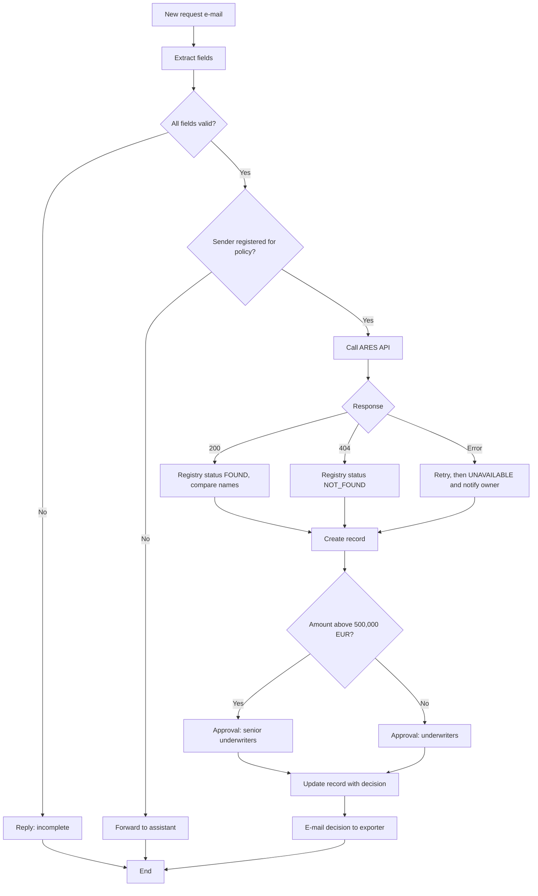

## Why this matters
The job ad expects you to build automations in low-code platforms and to turn requirements into algorithms ("algoritmizace požadavků"). Low-code lets a BA deliver small improvements directly: an approval flow, an e-mail that becomes a record, a registry check. It also tests whether you can describe logic precisely, which is the same skill you need for good specifications. If you have already proposed an automation at work and agreed it with IT, this module gives you the vocabulary and structure to present that experience.

## Quick version
**Low-code** platforms let you build applications and automations mostly by configuring visual blocks, with small amounts of formulas or code. **No-code** tools aim for zero code. The difference is fuzzy; the important point is that business-side people can build, and IT governs.

**Platforms you should know by name:**
- **Microsoft Power Platform** – the most common in Czech banks and insurers that use Microsoft 365:
  - **Power Automate** – cloud flows (automations between cloud services) and desktop flows (RPA, clicking through desktop applications).
  - **Power Apps** – canvas apps (free design of screens) and model-driven apps (generated from a data model).
  - **Dataverse** – the platform's database.
  - **Connectors** – ready-made links to systems (Outlook, SharePoint, SQL, HTTP).
- **Make**, **Zapier**, **n8n** – automation tools popular in smaller companies; Make has a free plan and n8n can be self-hosted.
- **OutSystems**, **Mendix** – enterprise low-code platforms for building larger applications, closer to software development.

**RPA vs API.** **RPA** (robotic process automation) imitates a user: it clicks, types and reads screens. **API-based automation** talks to systems directly through their interfaces. Prefer APIs: they are faster, more stable and easier to secure and audit. RPA breaks when a screen changes. Use RPA only when there is no API, for example an old desktop application.

**Anatomy of a flow:**
- **Trigger** – what starts it (an e-mail arrives, a form is submitted, every morning at 7:00).
- **Actions** – steps (read data, call an API, create a record, send an e-mail).
- **Conditions** – if/else branches.
- **Loops** – repeat for each item (each attachment, each row).
- **Variables and expressions** – store and calculate values.
- **Error handling** – what happens when a step fails (retry, notify someone, stop cleanly).
- **Approvals** – wait for a person to approve or reject.

**Algorithmic thinking** means describing a process as precise steps before building it: pseudocode, a decision table or a flowchart. If you cannot write the logic on paper, the tool won't help.

**Governance.** In a company, automation runs in approved **environments**, with **DLP policies** (data loss prevention rules that say which connectors may be combined), a **Center of Excellence (CoE)** that sets rules, a named **owner** for each flow, documentation and a support model. Licensing matters: some connectors are premium and need paid licenses.

**When not to automate:** the process is unstable or about to change, it runs rarely, it needs complex judgment, or nobody will own and maintain the automation.

**Measure benefit:** time saved per case × number of cases, fewer errors, faster response, better audit trail. Compare with build and maintenance effort.

**Access for practice.** Power Automate needs a Microsoft work or school account. Without one, practice on **Make** (free plan) or **n8n** (open source, can run on your own computer). The concepts are the same.

**Safety rule:** at work, use only approved tools and the procedures agreed with IT. That is also a good interview answer.

In an interview: "I start with the process and the logic in pseudocode, check with IT which platform and connectors are approved, prefer API over RPA, build error handling and an owner into the design, and document the automation so someone else can support it."

## Deep dive

### What low-code is and isn't [P1]
Low-code platforms give you building blocks: triggers, connectors, conditions, forms, tables. You arrange them visually and add formulas where needed. Behind the scenes the platform generates and runs the code, handles hosting and offers monitoring.

What low-code does well: approvals, notifications, moving data between systems with connectors, simple forms and apps, scheduled checks, document routing.

What it does poorly: complex calculations with many rules, very high volumes, real-time processing with strict performance targets, and logic that many teams depend on. These belong in a proper application built by IT or a vendor.

**Citizen developer** is the common name for a business user who builds automations on an approved platform. **IT** provides the platform, sets the rules and takes over solutions that become critical. A BA often sits between: designs the automation, builds simple ones, and hands complex ones to IT with a clear specification.

### Platforms at a glance [P1]
| Platform | Type | Typical use | Access for practice |
|---|---|---|---|
| Power Automate (cloud flows) | Workflow automation | Approvals, e-mail processing, SharePoint/Dataverse records | Work or school Microsoft account |
| Power Automate for desktop | RPA | Automating desktop apps without API | Included in Windows 10/11 for attended use (exact rights depend on edition) |
| Power Apps | App builder | Forms and simple business apps | Work or school account; Developer Plan |
| Dataverse | Database | Tables for Power Apps and flows | Part of Power Platform |
| Make | Workflow automation | Connecting cloud services | Free plan |
| n8n | Workflow automation | Same, self-hostable | Open source, run locally |
| Zapier | Workflow automation | Simple app-to-app automation | Free tier with limits |
| OutSystems, Mendix | Enterprise low-code | Larger business applications | Free editions for learning exist; check vendors |

**Power Platform details worth knowing** (licensing changes often; check the official Microsoft pages before you rely on details):
- The **Power Apps Developer Plan** is free and meant for building and testing, not production use. It requires a work or school e-mail account backed by Microsoft Entra ID, so a personal Gmail or Outlook.com address is not enough. It includes the right to use cloud flows connected to your apps; desktop RPA is not included. **Change in late 2026:** from 15 November 2026 signing up no longer creates a developer environment, and unmanaged developer environments are suspended from 15 December 2026 and deleted from 15 January 2027 (Microsoft Learn, "Power Apps Developer Plan"). In practice you get a development environment only through your employer's admin. For practice on your own, use Make or n8n; the concepts carry over.
- **Power Automate for desktop** is available in Windows 10 and 11 for attended automation (you start the flow yourself). Unattended runs and triggering desktop flows from the cloud need paid licenses.
- **Standard vs premium connectors.** Microsoft 365 licenses cover standard connectors (Outlook, SharePoint, Teams). Premium connectors (for example HTTP, SQL Server, Dataverse in many scenarios) need a Power Automate or Power Apps premium license. When you design a flow, check which connectors it uses: it can change the cost.

**Make** at the time of writing offers a free plan with a monthly allowance of credits (around 1,000), a limited number of active scenarios and a minimum schedule interval (around 15 minutes). That is enough for learning. Check [Make](https://www.make.com/) for current limits.

**n8n** is published under a "fair-code" license: you can run the community edition on your own computer for free; the hosted cloud version is paid with a trial. See [n8n](https://n8n.io/).

### RPA vs API-based automation [P1]
| | API-based | RPA |
|---|---|---|
| How it works | Calls the system's interface directly | Imitates a user on the screen |
| Speed | Fast | Slow (waits for screens) |
| Stability | Stable while the API contract holds | Breaks when screens, fields or resolution change |
| Security | Technical account with defined rights, logged calls | Often a user account and stored password; harder to control |
| Audit | Clear log of calls and data | Screen recordings and logs, less precise |
| When to use | Whenever an API exists | No API, old desktop app, temporary bridge |

Example: the ARES company registry has a public REST API. Checking a buyer by company ID through the API takes one HTTP request. Doing it with RPA (open the website, type the ID, read the screen) is slower and breaks with every website redesign.

:::tip
In a regulated company, "Is there an API?" is the first question for any automation. RPA is accepted as a bridge, with a plan to replace it.
:::

### Anatomy of a flow [P1]
| Element | Meaning | Power Automate | Make |
|---|---|---|---|
| Trigger | Event that starts the flow | "When a new email arrives", "Recurrence" | First module: Webhook, Watch emails, Schedule |
| Action | One step | "Create item", "Send an email" | Module |
| Condition | If/else | Condition, Switch | Router with filters |
| Loop | Repeat for each item | Apply to each, Do until | Iterator, Repeater |
| Variable | Stored value | Initialize/Set variable | Set variable |
| Expression | Calculation or transformation | Expressions such as `formatDateTime()` | Functions such as `formatDate()` |
| Error handling | Reaction to failure | "Configure run after", scopes | Error handlers (Resume, Ignore, Rollback, Break) |
| Approval | Wait for a person | Approvals connector | Usually e-mail or form with a link |

**Run-after** in Power Automate: each action can be set to run only if the previous one *succeeded*, *failed*, *was skipped* or *timed out*. A common pattern is the **try/catch** pattern: put main steps in one scope ("Try"), and a second scope ("Catch") that runs only if Try failed and notifies the owner.

**Expressions** look like formulas in Excel. Example in Power Automate:

```text
if(greater(variables('amount'), 500000), 'SECOND_APPROVAL', 'SINGLE_APPROVAL')
```

### Algorithmic thinking: from process to logic [P1]
Before building, describe the logic in a form that has no gaps. Three tools:

1. **Pseudocode** – numbered steps in plain language with IF, ELSE, FOR EACH, STOP.
2. **Decision table** – for rules with several conditions (see module 13).
3. **Flowchart** – a diagram of the same logic; BPMN is fine too.

Checklist for each step: What is the input? What exactly happens? What is the output? What if the input is missing or wrong? What if the system does not answer?

### Worked example: credit limit request by e-mail [P1]
**Situation (AS-IS):** exporters e-mail credit limit requests to a shared mailbox. An assistant opens each e-mail, checks the buyer on the ARES website, copies data to an Excel tracker, forwards it to an underwriter and later e-mails the decision. About 40 requests per week, 15 minutes of manual work each.

**Goal (TO-BE):** the automation reads the request, checks the buyer in ARES, creates a record, asks an underwriter for approval and notifies the exporter. The underwriter's decision stays human.

**Assumption:** exporters use a fixed e-mail template or, better, a web form. Free-text e-mails are hard to parse reliably; AI extraction is discussed in module 15.

**Pseudocode:**

```text
TRIGGER: new e-mail arrives in limits@exportshield.example with subject starting "Credit limit request"

1. Read sender address, subject, body.
2. Extract fields from body: policy number, buyer company ID, buyer name, amount, currency, payment terms.
3. IF any required field is missing OR company ID is not 8 digits
     Reply to sender: "Request incomplete: <missing fields>". Log case as REJECTED_INCOMPLETE. STOP.
4. Look up sender in policy list.
   IF sender is not a registered contact for the policy number
     Forward to underwriting assistant for manual check. Log as MANUAL_CHECK. STOP.
5. Call ARES API GET /ekonomicke-subjekty/{companyId}.
   IF HTTP status = 404 → set registryStatus = "NOT_FOUND"
   ELSE IF HTTP status = 200 → set registryStatus = "FOUND", registryName = obchodniJmeno
   ELSE (timeout or 5xx) → retry 2 times after 5 minutes;
        IF still failing → set registryStatus = "UNAVAILABLE", notify flow owner
6. IF registryStatus = "FOUND" AND registryName differs from buyer name in e-mail
     set nameMismatch = TRUE
7. Create record in Credit Limit Requests table with all fields, registryStatus, nameMismatch,
   status = "WAITING_FOR_DECISION", received timestamp.
8. Determine approver:
   IF amount (in EUR) > 500,000 → approver group = Senior underwriters
   ELSE → approver group = Underwriters
9. Start approval for the approver group with a summary and link to the record.
   Wait for response (max 3 business days; reminder after 2).
10. IF approved → update record status = "APPROVED" (amount approved, approver, time)
    ELSE IF rejected → status = "REJECTED" (reason)
11. Send e-mail to the exporter with the decision, using the approved template.
12. Log end of run. On any unexpected error: notify flow owner with run link, set status = "ERROR".
```

**Flowchart:**



**Flow design table** (this is the specification someone else can build from):

| # | Step | Platform element | Input | Output / rule | On error |
|---|---|---|---|---|---|
| 1 | Trigger | Outlook "When a new email arrives in a shared mailbox (V2)", subject filter | E-mail | Sender, subject, body | – |
| 2 | Extract fields | Expressions / text functions on a fixed template | Body | Policy no., company ID, buyer name, amount, currency, terms | Mark missing fields |
| 3 | Validate | Condition | Extracted fields | All required present; ID = 8 digits | Reply "incomplete", stop |
| 4 | Check sender | Lookup in policy contact list | Sender, policy no. | Match yes/no | Forward to assistant |
| 5 | ARES check | HTTP GET to ARES API | Company ID | Status code, `obchodniJmeno` | Retry 2×, then UNAVAILABLE + notify owner |
| 6 | Compare names | Condition | Name from e-mail vs registry | `nameMismatch` flag | – |
| 7 | Create record | Create row (SharePoint list / Dataverse / Excel table) | All data | Record ID, status WAITING_FOR_DECISION | Notify owner, stop |
| 8 | Route | Condition on amount | Amount (EUR) | Approver group | – |
| 9 | Approval | Approvals: "Start and wait for an approval" | Summary, record link | Approve / Reject + comment | Reminder after 2 days; escalate after 3 |
| 10 | Update record | Update row | Decision | APPROVED / REJECTED with approver, time | Notify owner |
| 11 | Notify exporter | Send e-mail from shared mailbox, template | Decision | E-mail sent | Notify owner |
| 12 | Error scope | Scope with run-after "has failed" | Any failure | Owner alert with run link, status ERROR | – |

Notes for the real world:
- The ARES call uses the HTTP connector, which is premium in Power Automate. That needs a license decision or an approved custom connector.
- ARES gives the official name and address; it does not give financial health. The underwriter still needs financial data and country rating.
- Currency conversion to EUR (step 8) needs a rate source, such as the ČNB daily rates file. Decide which date's rate applies; that is a business rule.

### Governance in companies [P1]
| Topic | What it means | Question to ask |
|---|---|---|
| Environments | Separate spaces for development, test and production flows | Where may I build, and how do flows move to production? |
| DLP policies | Rules that group connectors into "business", "non-business" and "blocked"; a flow cannot mix business and non-business connectors | Which connectors are allowed in our environment? |
| Center of Excellence (CoE) | Team that owns platform rules, templates, training and monitoring | Who approves a new automation? |
| Ownership | Each flow has a business owner and a technical owner; never only one person's account | Who fixes it when it fails on a holiday? |
| Service accounts | Production flows run under a dedicated account, not a personal one | Is a service account available? |
| Documentation | One-pager per automation: purpose, trigger, systems, data, error handling, support | Where is the documentation stored? |
| Licensing | Standard vs premium connectors, per-user vs per-flow licenses | What does this design cost per month? |
| Data | Personal or confidential data, retention, where data is stored | Does any data leave approved systems? |

:::warning
A flow built under a personal account stops working when that person leaves and their account is disabled. In a company, this is one of the most common causes of broken automations.
:::

### When not to automate [P2]
- The process is unstable, unclear or about to change. Fix the process first.
- Volume is low: a task done twice a month for five minutes doesn't justify build and maintenance.
- The work needs judgment that can't be expressed as rules (although AI may assist, see module 15).
- The source data is poor (free text, scanned documents without structure).
- No one will own it.
- A proper system change is planned anyway; automation would be throw-away work.

### Measuring benefit [P2]
A simple business case for the worked example:

| Item | Value |
|---|---|
| Requests per week | 40 |
| Manual time per request today | 15 min |
| Manual time per request after automation | 4 min (exceptions, checks) |
| Time saved per year | 40 × 11 min × 48 weeks ≈ 352 hours |
| Build effort | e.g. 5–8 days including testing |
| Running cost | Licenses for premium connector, maintenance ~1 hour per month |
| Non-financial | Faster response to exporters, consistent registry check, audit trail |

Use your own measured numbers in real work. Measure before (sample of cases) and after.

### Citizen developer vs IT [P2]
| Built by citizen developer | Handed to IT / vendor |
|---|---|
| Team-level process, small volume | Company-wide or customer-facing |
| Standard connectors | Integrations into core systems with write access |
| Failure is an inconvenience | Failure causes financial, legal or customer damage |
| Simple logic | Complex rules, high volume, strict performance |

The BA's value here: design the logic clearly, choose the right path with IT and document it so the solution is maintainable.

### Documenting an automation [P1]
A one-page automation card:
- **Name and purpose** (one sentence, business benefit)
- **Business owner** and **technical owner** (roles)
- **Trigger** and **frequency / volume**
- **Systems and connectors** used, accounts it runs under
- **Data**: what is read and written; personal data yes/no
- **Logic summary** (link to pseudocode or flowchart)
- **Error handling**: what happens on failure, who is notified
- **Support**: how users report problems, expected response
- **Change log**: version, date, change, who approved

## Key terms
- **Low-code** — building applications and automations mainly by configuring visual components, with minimal code.
- **Citizen developer** — a business user who builds solutions on an approved low-code platform.
- **Power Automate** — Microsoft's automation service with cloud flows and desktop flows.
- **Power Apps** — Microsoft's low-code app builder (canvas and model-driven apps).
- **Dataverse** — the data platform used by Power Apps and Power Automate.
- **Connector** — a ready-made component that lets a flow or app talk to a specific system or service.
- **RPA** — robotic process automation: software that imitates a user's clicks and typing in an interface.
- **Trigger** — the event that starts a flow.
- **Action** — one step executed by a flow.
- **Run-after** — Power Automate setting that runs a step only after the previous step succeeded, failed, was skipped or timed out.
- **Pseudocode** — a precise step-by-step description of logic in plain language.
- **DLP policy** — data loss prevention rule defining which connectors may be used together.
- **Environment** — a separate space for building and running apps and flows (development, test, production).
- **Center of Excellence (CoE)** — a team that governs and supports a low-code platform in a company.
- **Premium connector** — a connector that requires a higher, paid license in Power Platform.
- **Service account** — a non-personal account under which production automations run.

## Hands-on
:::exercise id="m14-e1" title="Pseudocode and flowchart for a claim notification" min="45" tool="draw.io or Mermaid Live"
**Goal:** design an automation logic on paper first.

Process: an exporter submits a claim notification form (policy number, buyer company ID, invoice number, invoice amount, due date). The automation must check that the claim is reported within 60 days after the due date, check the buyer in ARES, create a claim record, assign it to a claims handler (amounts over EUR 100,000 to a senior handler) and confirm receipt to the exporter.

1. Write pseudocode with numbered steps, IF/ELSE and error handling for each external call.
2. Draw the flowchart in [draw.io](https://app.diagrams.net/) or [Mermaid Live](https://mermaid.live/).
3. Mark which steps are automatic and where a person decides.
4. List three questions for the claims manager that your pseudocode revealed.

**Done when:** someone else can follow your pseudocode with test data and reach the same result as you, including the case "ARES does not respond".
:::

:::exercise id="m14-e2" title="Build the ARES check flow" min="120" tool="Make (free) or Power Automate"
**Goal:** build a working version of the worked example, simplified. Use only fictional data.

In [Make](https://www.make.com/) (free plan):
1. Create a new scenario. Add a **Webhooks → Custom webhook** module as the trigger. Copy its URL.
2. Send a test request to the webhook from [Postman](https://www.postman.com/downloads/): method POST, JSON body `{"policy":"P-2026-0153","companyId":"00006947","buyerName":"Test buyer","amount":120000}`. Make learns the data structure. (00006947 is a public body's company ID, used here only as a test lookup.)
3. Add an **HTTP → Make a request** module: GET `https://ares.gov.cz/ekonomicke-subjekty-v-be/rest/ekonomicke-subjekty/{ico}`, replacing `{ico}` with the companyId mapped from the webhook. Turn on parsing of the response.
4. Add a **Router** with two routes: filter 1 "status code = 200", filter 2 "status code = 404". Set the HTTP module to not fail on 404 if needed, or add an error handler.
5. Route 1: add a **Google Sheets → Add a row** (or Excel) module that writes policy, company ID, buyer name, registry name (`obchodniJmeno`), amount, status "WAITING_FOR_DECISION" and a timestamp.
6. Route 2: write a row with status "BUYER_NOT_FOUND".
7. Add an **Email** module (or Gmail) on each route that sends a summary to yourself.
8. Test with 00006947 and with 12345678 (should return 404).

In [Power Automate](https://make.powerautomate.com/) (only with a work or school account and with your IT's permission): trigger "When an HTTP request is received" or "Manually trigger a flow" with inputs; action **HTTP** (premium) to ARES; **Condition** on status code; **Add a row into a table** (Excel Online) or **Create item** (SharePoint); **Send an email (V2)**.

**Done when:** both test IDs produce the correct row and e-mail, and you have screenshots of the scenario and the results for your portfolio.
:::

:::exercise id="m14-e3" title="Document the automation" min="30" tool="Confluence or Word"
**Goal:** write the one-page automation card for the flow you built.

1. Fill in all items from "Documenting an automation": purpose, owners, trigger, volume, systems, data, logic, error handling, support, change log.
2. Add a section "Risks and limits": premium connector cost, ARES availability, what the check does *not* verify.
3. Add a section "How to test": three test inputs and expected results.

**Done when:** a colleague who has never seen the flow could tell from the card what to do when it fails at 6 a.m.
:::

## Self-check
:::q
Why is API-based automation usually preferred over RPA?
---
API calls are faster, more stable and easier to secure and audit, because they use a defined interface and a technical account with specific rights. RPA imitates a user on the screen and breaks when the interface changes, and it often needs stored user credentials. RPA is used when no API exists.
:::

:::q
What is a DLP policy in Power Platform and why does it matter to your design?
---
A data loss prevention policy groups connectors and prevents a flow from combining connectors from different groups, or blocks some entirely. If your design uses a connector that is blocked or in another group, the flow will not run in that environment. Check the policies before you design.
:::

:::q
Your flow calls an external API that is sometimes down. What should your design include?
---
Retries with a delay, a clear status for "service unavailable" instead of a silent failure, a notification to the flow owner, and a way to process the case later or manually. In Power Automate this is done with run-after settings or try/catch scopes; in Make with error handlers.
:::

:::q
Give three reasons not to automate a process.
---
The process is unstable or about to change; the volume is too low to justify building and maintaining it; the inputs are unstructured or the work requires judgment; nobody will own the automation. Fixing the process first is often the better step.
:::

:::q
Why should a production flow not run under a personal account?
---
If the person leaves or the account is disabled, the flow stops. A personal account also often has broader rights than the flow needs, which breaks least privilege. Production flows should run under a service account with a named business and technical owner.
:::

:::q
What can a learner without a Microsoft work account use to practice automation, and what carries over?
---
Make's free plan or a local installation of n8n. Triggers, actions, conditions, loops, HTTP calls, data mapping and error handling work on the same principles, so the design skills carry over to Power Automate.
:::

## Interview corner
:::interview
Tell us about an automation you designed or built.
---
- Situation: the manual process, volume, pain points (time, errors).
- Your role: analysis, logic design, agreement with IT, build, testing.
- Design choices: trigger, systems, API vs RPA, error handling, approvals.
- Governance: approved platform, owner, documentation.
- Result: measured time saved, fewer errors, faster response.

Typical mistake: describing tool clicks without the business problem and measured result.
:::

:::interview
How would you decide whether a process should be automated with low-code or handed to IT?
---
- Criticality: what happens if it fails?
- Volume and performance needs.
- Systems involved: standard connectors vs write access to core systems.
- Complexity of rules and expected change frequency.
- Ownership and support available.

Typical mistake: treating low-code as the answer to every problem, or never considering it.
:::

:::interview
What is the difference between RPA and API integration, and when would you use RPA?
---
- RPA imitates user actions on the screen; API integration calls system interfaces directly.
- API is faster, more stable, more secure and auditable.
- RPA when no API exists (old desktop app), as a temporary bridge, with a plan to replace it.

Typical mistake: presenting RPA as the modern default.
:::

:::interview
How do you make sure an automation built by the business is safe in a regulated company?
---
- Use only approved platforms and environments; follow DLP policies.
- Service account, least privilege, named owners.
- Error handling and monitoring; documentation and support model.
- Check personal data and where data is stored; involve IT and security early.

Typical mistake: "I built it myself in a free tool to save time."
:::
